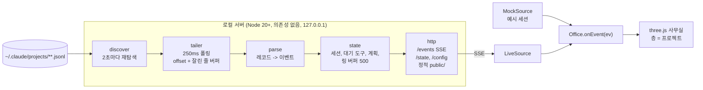

# Office Sim 구현 계획

AI 코딩 에이전트의 세션 기록을 0.25초 간격으로 tail 해서, 3D 사무실의 직원들이 도구 사용에 맞춰 방을 오가게 만든다. 지금은 Claude Code, Grok(P5c), Codex(P5d), Antigravity CLI 와 예전 IDE(P5e)의 세션 기록(jsonl)을 읽는다. Antigravity 데스크톱 앱은 범위 밖이다(결정 D6).

- 프로토타입(데모 데이터): https://claude.ai/artifact/WEDBFM36VSMpZWMZ4UWPGA
- 작성일: 2026-10-19

## 1. 조사 결과

### 1.1 스킬 검색 (`npx skills find`)

"Claude 세션을 3D 사무실로 시각화"를 직접 다루는 스킬은 없다. three.js 일반 스킬만 쓸 만하다.

| 스킬 | 설치 수 | 판단 |
|---|---|---|
| `cloudai-x/threejs-skills@threejs-animation` | 18.5K | 추천. 캐릭터 애니메이션 |
| `cloudai-x/threejs-skills@threejs-fundamentals` | 15.5K | 추천. 씬, 카메라, 조명 |
| `cloudai-x/threejs-skills@threejs-interaction` | 12.7K | 선택. 클릭 피킹, 컨트롤 |
| `freshtechbro/claudedesignskills@react-three-fiber` | 3.5K | 보류. R3F는 빌드 단계가 필요 |
| `heygen-com/hyperframes@hyperframes-animation` | 943.7K | 제외. 영상 제작용으로 무관 |

`cloudai-x/threejs-skills` 저장소는 GitHub 스타 3.6K, 2026-10-19 갱신으로 활발하다. 설치는 사용자 확인 후 진행한다.

```bash
npx skills add cloudai-x/threejs-skills@threejs-fundamentals -g -y
```

### 1.2 세션 기록 구조 (최근 40개 세션 표본)

- 메인 세션: `~/.claude/projects/<인코딩된 cwd>/<sessionId>.jsonl`
- 서브에이전트: `~/.claude/projects/<인코딩된 cwd>/<sessionId>/subagents/agent-<id>.jsonl` 와 `.meta.json`(`agentType`, `description`, `toolUseId`)
- 레코드 `type`: `user`, `assistant`, `system`(`stop_hook_summary`, `api_error`, `compact_boundary`), `custom-title`, `agent-name`, `last-prompt`, `attachment`, `queue-operation`, `file-history-*`
- `assistant.message.content`: `thinking`, `text`, `tool_use`
- `user.message.content`: `tool_result`(`is_error`), 거절 시 본문이 "The user doesn't want to proceed..." 로 시작
- `thinking` 블록의 약 80%(9,492 / 11,943)는 본문이 비어 있고 서명만 있다. 생각 말풍선에 폴백이 필요하다.
- 프로젝트 디렉터리가 53개라 전부 tail 하지 않고, 최근에 수정된 파일만 따라간다.

## 2. 아키텍처



중요한 결정: 아티팩트는 claude.ai(https)에서 열리므로 `http://localhost` SSE에 접속할 수 없고 로컬 파일도 읽을 수 없다. 그래서 아티팩트는 데모 데이터로 화면을 다듬는 용도로 쓰고, 실제 라이브는 로컬 서버가 같은 HTML/JS를 그대로 서빙한다. `main.js` 가 `localhost` 여부로 데모와 라이브를 자동으로 고른다(`#demo` 로 강제 가능).

## 3. 이벤트 스키마 (서버 -> 브라우저)

> 3~6절은 P0 시점의 초안이다. 구현된 동작의 기준은 `docs/CONTRACT.md` 이다(이벤트 필드, 파싱 규칙, 개인정보 규칙, 서버 동작).

모든 이벤트는 `{ type, sessionId, ts, ... }` 형태다. 브라우저는 `Office.onEvent(ev)` 한 곳에서만 받는다.

| type | 필드 | 만드는 레코드 |
|---|---|---|
| `session` | project, title, branch, isSubagent, parentSessionId, agentType | 새 파일 발견, `custom-title`, `agent-name`, 서브에이전트 `.meta.json` |
| `tool_start` | toolUseId, tool, summary, question?, options? | `assistant` 의 `tool_use` |
| `tool_end` | toolUseId, ok, error?, errorKind(`failed` / `denied`) | `user` 의 `tool_result` |
| `thinking` | text(없으면 null), durationMs | `thinking` 블록 + `thinkingDurationMs` |
| `say` | text(앞 100자) | `text` 블록 |
| `plan` | items[{content, status}] | `update_plan`, `TodoWrite`, `TaskCreate/Update`, `ExitPlanMode` (서버가 누적 상태를 유지해 전체 목록을 보냄) |
| `turn_end` | - | `system.stop_hook_summary`, `stop_reason: end_turn` |
| `session_end` | - | 서브에이전트 종료, 장시간 무활동 |
| `system` | kind(`api_error` / `compact`), text | `system.api_error`, `compact_boundary` |

## 4. 방 매핑 (`js/rooms.js` 의 `ROOM_RULES` 한 곳만 수정)

| 방 | 도구 |
|---|---|
| 자료실 | Read, Glob, Grep, Skill, `codegraph_*`, serena 조회, morph 검색 |
| 개발실 | Edit, Write, NotebookEdit, morph `edit_file`, serena 수정 |
| 서버실 | Bash, Monitor, 터미널, GitHub, Cloud Run, Firebase MCP |
| 정보검색실 | WebSearch, WebFetch, 그 밖의 모든 MCP |
| 회의실 | 계획 도구 -> 화이트보드 |
| 내 자리 | AskUserQuestion, ExitPlanMode(계획 승인) |
| 제자리 | Agent, Workflow, SendMessage, advisor |
| 무시 | `mcp__ccd_*` 같은 앱 내부 배관 도구, ToolSearch |

## 5. 캐릭터 동작 규칙 (프로토타입에 구현됨)

- 이벤트는 바로 실행하지 않고 할 일 대기열에 넣는다. 방까지 걸어간 뒤 최소 시간만큼 머문다.
- 밀리면 따라잡는다: 걷는 속도가 빨라지고, 같은 방 도구는 "외 N건"으로 합치고, 생각 말풍선은 건너뛴다.
- 생각: 요약이 있으면 첫 문장을 손글씨 구름 말풍선으로, 없으면 "생각 중…" 을 `durationMs` 만큼 보여 준다.
- 실패: 식은땀 + 빨간 말풍선 + 몸 떨림. 사용자 거절은 땀 없이 회색 점선 말풍선으로 구분한다.
- 계획: 항목 내용이 바뀌면 화이트보드로 걸어가 적고, 상태만 바뀌면 그 자리에서 보드만 갱신한다.
- 질문: 내 자리로 와서 손을 들고 기다린다. `tool_result` 가 오면 "답변 받음" 후 돌아간다.
- 서브에이전트: 부모 옆에 작은 직원(모자)으로 나타나고, 끝나면 엘리베이터로 퇴장한다.
- 7초간 할 일이 없거나 턴이 끝나면 라운지로 간다.
- 층: 프로젝트마다 한 층. 위층은 숨겨 돌하우스처럼 보고, "전체"는 층을 벌려서 건물 단면으로 본다. 다른 층에 활동이나 오류가 생기면 엘리베이터 버튼이 깜빡인다.
- 테마: 밝은 테마는 낮 사무실, 어두운 테마는 밤 사무실(방마다 조명, 모니터와 LED가 더 밝게).

## 6. 로컬 서버 설계

```
office-sim/
  package.json          type: module, bin: office-sim
  bin/office-sim.mjs    CLI 인자 처리 후 시작
  src/discover.mjs       프로젝트 디렉터리와 subagents/ 탐색
  src/tailer.mjs         파일별 offset, 잘린 줄 버퍼, 잘림(truncate) 감지
  src/parse.mjs          레코드 -> 이벤트, 도구별 요약
  src/state.mjs          세션, 대기 도구, 계획 누적, 링 버퍼
  src/server.mjs         /, /events, /state, /config
  public/                지금의 office.html + js/ 그대로
  test/*.test.mjs        node:test + 합성 jsonl 픽스처
```

- CLI: `--port 4317 --interval 250 --active 30 --claude-root ~/.claude/projects`(`--root` 는 같은 옵션의 별칭). `--active` 는 최근 N분 안에 수정된 파일만 따라가는 창이다.
- tail: 간격마다 `fs.stat` -> 커지면 `[offset, size)` 만 읽고, 마지막 줄이 잘렸으면 다음 회차로 넘긴다. 작아지면 처음부터 다시 읽는다.
- 처음 발견한 파일은 끝부분 256KB만 읽어서 제목, 계획, 아직 안 끝난 도구를 상태에 채운다(애니메이션 없이 스냅샷으로).
- SSE: 이벤트마다 `id:` 를 붙이고 최근 500개를 보관한다. 재접속 시 `Last-Event-ID` 로 이어 보내고, 너무 오래됐으면 스냅샷을 보낸다. 15초마다 하트비트 주석.
- `POST /config {intervalMs}`: 50~5000ms. 화면의 tail 입력칸이 이 값을 바꾼다.
- 프로젝트 키: 레코드의 `cwd` -> git 루트 이름. `.worktrees/` 나 `.claude/worktrees/` 아래 경로는 원래 저장소 층으로 묶고 배지로 표시한다.
- 개인정보: 127.0.0.1 에만 바인딩한다. 파일 내용과 명령 원문은 보내지 않고 요약만 보낸다(파일은 이름, 명령은 설명 문구나 프로그램 이름, URL은 호스트, 생각은 첫 문장 100자). 모든 자유 텍스트에서 경로, URL, 이메일을 걸러 낸다.

## 7. 단계별 계획과 검증

| 단계 | 내용 | 검증 |
|---|---|---|
| P0 (완료) | 스킬 검색, jsonl 분석, 이벤트 스키마, 데모 프로토타입 아티팩트 | 로컬 브라우저에서 콘솔 오류 없음, 아티팩트 게시 |
| P1 (완료) | discover, tailer, records, session, plan, summarize | `node --test` 374개 통과. 잘린 줄, 파일 교체, 재개 시 중복 기록, 포크 기록, 병렬 도구 짝짓기, 계획 복원, 질문, 서브에이전트 |
| P2 (완료) | SSE, /state, /config, 라이브 모드 연결, 보안 헤더, `--auth` | 이 세션을 실제로 띄워 앱 브라우저에서 확인(밝은/어두운 테마, 데모 모드) |
| P3 (완료, 소리 제외) | 재생 모드(`--replay 파일 --speed 4 --loop`), 권한 승인 대기 표시(재생 모드만, 라이브는 신호 없음), 층이 많을 때 성능. 소리는 하지 않았다 | `node --test` 394개 통과. 합성 세션으로 재생 모드를 앱 브라우저에서 확인(재생 칩, 반복, 서브에이전트, 승인 대기 말풍선, 콘솔 오류 없음). `#bench` 층 10개·직원 60명 측정 |
| P4 (완료, 2026-10-20, 새 세션 확인 남음) | 스킬/플러그인 포장: `/office` 로 서버 시작과 브라우저 열기. `skills/office/SKILL.md`(start, stop, status, demo, auth), `npm run skill:install`/`skill:uninstall`(`scripts/install-skill.mjs`, `~/.claude/skills/office` 심볼릭 링크), CLI `--open`(`src/open-url.mjs`) | 새 세션에서 `/office` 실행. 스킬의 명령은 `test/skill-commands.test.mjs` 가 적힌 그대로 실행해 확인(리뷰 수정 뒤 `node --test` 1027개 통과). 실제 `~/.claude` 에 설치하고 새 세션에서 `/office` 를 쳐 보는 확인은 사용자가 할 일 |
| P5a (완료) | 멀티 에이전트 공통 분리: `store.mjs` 의 Claude 서브에이전트 연결을 `src/store-claude.mjs` 로 빼기, agent id 를 ref -> entry -> session 이벤트로 흐르게 하기, `Store.endCharacter` 와 `{ hint: 'end', charId }` 항목, 어댑터 등록표(`src/adapters/`)와 `RunnerGroup`, CLI `--agents`/`--codex-root`/`--grok-root`/`--antigravity-root`. 등록된 어댑터는 `claude-code` 하나 | 기존 `npm test` 전부 그대로 통과(테스트 수정 0개가 목표, import 경로만 예외). 새 테스트: agent id 흐름, 등록표, 루트가 없는 어댑터는 조용히 꺼짐. 실제 서버를 띄워 화면이 이전과 같은지 앱 브라우저로 확인 |
| P5b (완료, 2026-10-20) | `SessionCore`(`src/core/session-core.mjs`)와 `src/core/tool-summary.mjs`. 아직 어떤 어댑터도 쓰지 않는다. 시험용 `core-fixture` 어댑터로 도는 공통 적합성 하네스(`test/fixtures/conformance.mjs`, `docs/ADAPTERS.md` 10절)를 함께 만들었다. 기준은 `docs/CONTRACT.md` 4.0.2절 | 정규화 항목만으로 만든 합성 입력에서 스키마, dedupe, 도구 짝, 턴, 계획, 개인정보 테스트 통과 |
| P5c (완료, 2026-10-20) | Grok 어댑터: 탐색(모든 cwd 그룹, `subagents/` 연결), 정규화, `summary.json` 메타, `SidecarWatcher`. 코드는 `src/adapters/grok/` 와 `src/core/sidecar.mjs`, 기준은 `docs/CONTRACT.md` 4.6절 | 공통 적합성 테스트 + Grok 전용 테스트. 합성 픽스처를 시간차로 덧붙여 라이브 화면 확인(Claude 와 Grok 직원이 같은 층에). 실제 Grok 세션 하나로 덧붙이는 단위 확인(실행 중인 세션이 있어야 해서 남아 있음) |
| P5d (완료, 2026-10-20) | Codex 어댑터(데스크톱 앱, CLI, IDE 확장 모두 `codex`): 허용 목록 탐색(날짜 폴더, 첫 줄 사실, 이어쓰기 조각), guardian 스레드 숨김, code-mode `exec` 방문, 서브에이전트 문맥 건너뛰기, `session_index.jsonl` 제목, D1 워크트리 층. 코드는 `src/adapters/codex/`, 기준은 `docs/CONTRACT.md` 4.7절 | P5c 와 같음. 0.142 이전과 이후(code-mode) 픽스처 둘 다. 실제 Codex 세션 하나로 덧붙이는 단위 확인(실행 중인 세션이 있어야 해서 남아 있음) |
| P5e (완료, 2026-10-20) | Antigravity 어댑터(CLI `agy` 와 예전 IDE, 데스크톱 앱은 범위 밖, D6): `antigravity-cli/`, `antigravity-ide/` 두 폴더만 보는 허용 목록 탐색과 `transcript_full.jsonl` / `transcript.jsonl` 고르기, 바이트 위치로 줄 구분과 위치 짝짓기(`abandoned` 닫기), `USER_REQUEST` 꺼내기, 조용한 시간의 턴 끝, 요약 proto 해석(`proto.mjs`, 필드 번호는 추정), `annotations` 제목, `task.md` 계획판. 코드는 `src/adapters/antigravity/`, 기준은 `docs/CONTRACT.md` 4.8절 | P5c 와 같음. 옛 도구 이름과 새 도구 이름 픽스처 둘 다, `transcript.jsonl` 의 문자열 인자 픽스처 |
| P5f (완료, 2026-10-20, P5e 와 함께) | 문서: `docs/CONTRACT.md` 어댑터별 절(4.1~4.5, 4.6, 4.7, 4.8), `README.md` 지원 표와 옵션, 이 문서의 진행 기록 | 문서와 `--help` 출력이 맞음(USAGE 가 `antigravity` 를 구현된 어댑터로, `--antigravity-root` 를 CLI 와 예전 IDE 의 루트로 적음) |
| P5g (완료, 2026-10-21) | Grok 라이브 승인 대기(결정 D7): 새 이벤트 `tool_wait { toolUseId, waiting }`, 세션 폴더의 `events.jsonl` 을 rescan 마다 바이트 위치로 이어 읽는 `GrokMeta`(`events.mjs`, `approval.mjs`, `meta.mjs`), 순번 + 시각 확인 짝짓기, 화면의 내 자리 방문(`public/js/approval.js`). 기준은 `docs/CONTRACT.md` 2절, 4.0.2, 4.6절 Approval wait, 7.1절 | 공통 적합성 테스트(라이브 대기와 붙을 때 열린 대기) + P5g 전용 테스트. 실제 기록 재집계(읽기 전용, 개수만)에서 틀린 짝 0. Claude, Codex, Antigravity 의 선 위 출력이 master 와 같음(ts 제외) |

P5 의 단계와 끝 조건은 `docs/ADAPTERS.md` 9절이 기준이다(선택 단계 P5g: Grok 라이브 승인 대기). 모든 단계는 Store, SSE, 화면을 그대로 같이 쓰고, 어댑터마다 합성 픽스처로 같은 이벤트 스키마(`docs/CONTRACT.md` 2절), 맞는 `agent` id, 개인정보 규칙(5절) 노출 0건을 확인한다.

P5 어댑터가 각각 갖춰야 할 것:

- 기록 위치 탐색: 그 도구가 세션 기록을 어디에 어떤 파일로 남기는지 찾고, 새 파일과 늘어난 줄을 따라간다(Claude Code 의 `~/.claude/projects` 탐색과 tail 에 해당).
- 레코드 -> 이벤트 매핑: 그 도구의 레코드를 `docs/CONTRACT.md` 2절의 이벤트(`session`, `tool_start`, `tool_end`, `thinking`, `say`, `plan`, `turn_end` 등)로 바꾼다. 새 이벤트 형식을 만들지 않는다.
- 에이전트 id: 모든 `session` 이벤트에 `agent` 를 붙인다(`codex`, `grok`, `antigravity`). 지금 Claude Code 어댑터는 `claude-code` 를 보낸다.
- 개인정보: 모든 자유 텍스트를 공용 `cleanText`(`src/summarize.mjs`)로 거르고, 5절의 "보내지 않는 것" 규칙을 그대로 따른다.

Codex, Grok, Antigravity 의 기록 위치와 형식은 Claude Code 형식 조사(`docs/research/jsonl-format.json`)처럼 구조만 조사했다(`docs/research/codex-format.json`, `grok-format.json`, `antigravity-format.json`). 그 결과로 만든 설계가 `docs/ADAPTERS.md` 이고, 2026-10-20 에 결정 D1~D12 를 모두 추천안대로 승인했다.

## 8. 진행 기록 (2026-10-19)

- 형식 조사: 에이전트 5명이 로컬 기록 5,016개를 구조만 조사했다(`docs/research/jsonl-format.json`). 이 결과로 계약 문서 `docs/CONTRACT.md`를 만들었다.
- 구현: 모듈 담당 5명과 통합 담당 1명이 서버를 만들었다.
- 적대적 리뷰: 리뷰어 4명이 정확성, 견고성, 보안·개인정보, 브라우저 연동 관점에서 40건을 찾았고, 검증자가 반박을 시도해 34건이 확인됐다(`docs/review/2026-10-19-confirmed.json`). 34건 모두 회귀 테스트와 함께 고치고 재검증했다.
- 개인정보: 실제 기록 5,103개(이벤트 63.9만 건)를 재생해 셌을 때 노출 0건이다(층 구분 키는 설계상 경로 포함).
- 확인된 설계 결정:
  - 생각 요약이 비어 있으면 "생각 중…"을 보여 준다.
  - 워크트리 세션은 원래 저장소 층으로 묶는다.
  - 폴더를 옮긴(relocated) 세션은 옮긴 폴더의 층으로 간다.
  - 이 환경은 Grep/Glob 대신 Bash로 검색하므로, 서버가 명령어 종류로 방 힌트를 준다(`grep`/`cat` -> 자료실).

## 8.1 P3 진행 기록 (2026-10-20)

- 재생 모드: `node bin/office-sim.mjs --replay <세션>.jsonl --speed 4 [--loop]`. 메인과 서브에이전트 파일의 줄을 기록 시각 순서로 합쳐, 공백을 배속으로 나눠(한 공백은 최대 5초) 라이브와 같은 Store/SSE 로 흘려보낸다. 서브에이전트는 자기 파일의 첫 줄 시각에 출근한다. `--loop` 는 마지막 장면을 3초 보여 준 뒤 모두 퇴근시키고 2초 뒤 처음부터 다시 한다. 화면 위쪽 칩에 `재생 · 4× · 37%`(반복이면 `N회째`), 끝나면 `재생 끝`이 보인다. 앱 브라우저 확인용 합성 세션: `test/fixtures/replay/`, launch 설정 `office-sim-replay`(포트 4318). 실제 세션 1건(2.5 MB, 워크플로 에이전트 94명)으로 구조만 확인: 200배속으로 끝까지 재생, 이벤트 16,644건(도구 시작 6,051 = 끝 6,051), 서브에이전트 94명 모두 출근과 퇴근, 적용 오류 0, 깨진 줄 0.
- 권한 승인 대기: 라이브 모드에는 확실한 신호가 없어 표시하지 않는다. 승인 창이 열려 있는 동안 기록에 아무것도 쓰이지 않고, `permissionDecision` 은 결과 줄에만 붙는다(결과 225,155개 중 32,065개). `user_permanent`(316)는 저장된 허용 규칙이라 기다림이 없고(Read p50 0.3초), 실제 클릭인 `user_temporary`(94)는 대부분 이미 '내 자리'로 가는 질문 도구다(89). 자동 승인 도구도 오래 걸려(Bash p99 68.6초) 시간 기준은 추측이 된다. 근거: `docs/CONTRACT.md` 7절, `docs/research/permission-decision.json`. 재생 모드는 결과 줄을 미리 읽을 수 있어 사람이 답한 호출에만 `awaitsApproval` 을 붙이고, 직원이 '내 자리'에서 `승인 대기` 말풍선(허용/거절)을 띄운다.
- 성능: `#bench`(층 10개, 직원 60명 중 서브에이전트 20명) 합성 부하, 1024x768, dpr 1. 프레임당 CPU 시간 p50(괄호는 1픽셀 readPixels 로 GPU 완료까지 기다린 값):

  | 보기 | 전 | 후 | 그리기 호출 |
  |---|---|---|---|
  | 1층에 초점(위 9개 층 숨김) | 1.0 ms (2.3) | 0.6 ms (1.9) | 286 |
  | 10층에 초점(아래 9개 층 보임) | 2.1 ms (4.0) | 1.3 ms (3.2) | 약 930 |
  | 전체 보기 | 3.9 ms (6.3) | 3.7 ms (6.1) | 2,860 |

  줄인 것: CSS 라벨은 초점 층만 계산(라벨 0.40 → 0.05 ms), 초점이 아닌 층은 그림자를 드리우지 않음, 숨은 층은 행렬 갱신, 몸짓, LED/지구본/문 애니메이션을 건너뜀(일의 진행은 계속). JS 힙은 18~30 MB(GC 시점에 따라 흔들림), 지오메트리 110, 텍스처 14, DOM 노드 1,326. 앱 브라우저 창이 가려져 있어 rAF 프레임 간격(fps)은 잴 수 없었다. 전체 보기는 모든 층이 보이는 화면이라 그대로 두었고, 2,860번의 그리기 호출(상자마다 메시 하나)이 남은 비용이다.

## 8.2 P5 진행 기록 (2026-10-20)

- 조사: Codex, Grok, Antigravity 의 기록 위치와 형식을 이 Mac 에서 읽기 전용으로 구조와 개수만 셌다(`docs/research/codex-format.json`, `grok-format.json`, `antigravity-format.json`). 세 도구 모두 덧붙여 쓰는 JSONL 기록이 있어 지금의 `Tailer` 로 따라 읽을 수 있다. Antigravity 데스크톱 앱만 대화 파일이 암호화된 것으로 보여 범위에서 뺐다.
- 설계 승인: `docs/ADAPTERS.md` 의 결정 D1~D12 를 모두 추천안대로 승인했다. 승인된 결정은 `docs/CONTRACT.md` 4.0.1절에 한 줄씩 옮겼다. 구현 순서는 P5a 공통 분리, P5b `SessionCore`, P5c Grok, P5d Codex, P5e Antigravity CLI, P5f 문서다.
- P5a 완료(브랜치 `feat/p5a-adapter-core`, PR #5 로 master 에 병합): `store.mjs` 의 Claude 서브에이전트 연결을 `src/store-claude.mjs` 로 빼고, agent id 를 `FileRef.agent` -> `entry.agent` -> `session.agent` 로 흐르게 하고, 공통 종료 규칙 `Store.endCharacter` 와 내부 항목 `{ hint: 'end', charId }`(Runner 가 걸러 내서 브라우저로는 가지 않는다)를 넣고, 어댑터 등록표(`src/adapters/index.mjs`, `claude-code.mjs`)와 어댑터마다 Runner 하나를 두는 `RunnerGroup` 을 넣는다. CLI 는 `--agents`(모르는 id 는 종료 코드 2)와 예약 옵션 `--codex-root`, `--grok-root`, `--antigravity-root` 를 받고, 시작할 때 `office-sim: agents <켜진 id>` 를 출력한다. `/healthz` 에 `agents` 가 더해진다. 등록된 어댑터는 `claude-code` 하나라 Claude 동작은 바뀌지 않는다. 재생 모드는 Claude 만(D12).
- 범위 조정: 메타 파일을 바뀔 때만 다시 읽는 `SidecarWatcher` 는 P5a 에서 P5c 로 옮겼다. 처음 쓰는 곳이 Grok 의 `summary.json` 이다.
- P5b 완료(2026-10-20, 브랜치 `feat/p5b-session-core`): 새 어댑터 셋이 같이 쓸 공통 코어를 만들었다. `src/core/tool-summary.mjs` 는 어댑터가 미리 줄여 둔 도구 설명자(원래 도구 입력이 아니다)를 받아 `tool`, `summary`, `room` 힌트를 만든다(파일은 basename, 셸은 프로그램 이름, URL 은 host, MCP 는 `mcp__<server>__<tool>` 이고 uuid 모양 서버 이름은 ZERO_UUID 규칙으로 가림, patch 는 헤더의 파일 이름만). `src/core/session-core.mjs` 의 `SessionCore` 는 정규화 항목(`meta`, `prompt`, `tool_start`, `tool_end`, `thinking`, `say`, `plan`, `turn_start`, `turn_end`, `system`, `sub_end`)을 Claude 규칙과 같은 뜻으로 이벤트로 바꾼다(dedupe 키, id 로 도구 짝짓기, 턴이 바뀌면 열린 도구는 `abandoned`, `say` 의 `final` 로 `end_turn` 추정, `sub_end` 는 공통 종료 힌트). 리뷰에서 찾은 10건(시작하지 않은 턴의 `turn_end`, 여러 줄 `system` 문구, `plan` 출처, 실패한 계획 호출, 리플레이 시각, 끝난 서브 되살리기, 백그라운드 상태, 보이지 않는 글자 뒤의 주입 프롬프트, 셸 옵션 값, 빈 `argv[0]`)을 실패하는 테스트부터 써서 고쳤다(`test/core-session-fixes.test.mjs`, CONTRACT 4.0.2 의 Review fixes). 테스트는 규칙마다 단위 테스트, 그리고 실제 서버를 띄워 SSE 와 `/state` 를 검사하는 공통 적합성 하네스(`test/fixtures/conformance.mjs`)를 시험용 `core-fixture` 어댑터로 돌린다. 아직 어떤 어댑터도 쓰지 않고 등록된 어댑터는 `claude-code` 하나라 Claude 동작은 바뀌지 않는다. 기준: `docs/CONTRACT.md` 4.0.2절.

- P5c 완료(2026-10-20, 브랜치 `feat/p5c-grok-adapter`): Grok 어댑터를 붙였다(agent id `grok`, 기본 루트 `~/.grok`, `--grok-root`). 탐색은 허용 목록 방식이라 `sessions/<cwd 그룹>/<세션>/updates.jsonl` 만 기록으로 받고, 모든 cwd 그룹을 훑는다. `prompt_history.jsonl`, `chat_history.jsonl`, `events.jsonl`(라이브 승인 대기는 나중 단계 P5g, 결정 D7), 계획 파일, 인증과 설정 파일은 열지 않는다. 직원 id 는 `grok-<세션 폴더 uuid>` 이고(D2), 서브에이전트는 부모 세션 폴더의 `subagents/<자식 id>/` 디렉터리 이름으로만 연결한다(자식 파일에는 부모가 없다). 제목, 작업 폴더, branch 는 `summary.json` 에서 새로 만든 `SidecarWatcher`(`src/core/sidecar.mjs`)가 읽는다: rescan 마다 stat 해서 mtime/크기/inode 가 바뀔 때만 1 MB 안에서 다시 읽는다. 기록은 `SessionCore` 의 정규화 항목으로 바꾼다(`src/adapters/grok/records.mjs`, `session.mjs` 의 `GrokSession`): 턴은 `promptId` 로 나눔(대개 `user_prompt_submit` 훅이 메시지보다 먼저 새 id 로 턴을 열고, 메시지가 먼저면 메시지가 연 턴이 뒤따르는 id 를 받음), chunk 하나가 항목 하나(이어 붙이지 않음), 턴 끝은 `turn_completed` 로만(20초 무활동 추정 없음), 숨은 주입 메시지는 프롬프트로 내지 않음, 셸 종료 코드가 0 이 아니면 `completed` 여도 실패, `rawOutput` 없는 `failed` 의 고정 문구는 거절(오류 문구도 고정 문구만), 취소된 턴의 열린 도구는 중단, `plan` 레코드는 전체 목록(`todo_write` 는 숨김), MCP 는 `use_tool` 의 `tool_name` 으로 `mcp__<server>__<tool>`. 같은 작업 폴더면 Claude 와 같은 층이고, Grok 전용 워크트리(`~/.grok/worktrees/<repo>/<name>`)는 이름이 같은 층이 있으면 그 층, 없으면 자기 층(워크트리 배지)이다(D1). 설계와 달라진 점(`exit_plan_mode` 의 계획은 보통 답을 받은 뒤에 보임, 턴 시작 방식, `subagent_spawned` 는 연결이 아니라 spawn 호출 닫기에만 씀, `enter_plan_mode`/`search_tool` 숨김, 서브 `agentType` 은 자식의 `summary.json`, 새 폴더의 1초 연결 유예, Grok 전용 워크트리 층은 Store 의 층 규칙)과 5.2절 미확인 항목의 상태는 `docs/ADAPTERS.md` 9절과 5.2절 끝에 적었다. Claude 동작을 바꾸지 않는 것이 끝 조건이다(합성 Claude SSE 흐름을 master 와 비교, ts 제외). 기존 테스트는 Grok 을 '아직 구현되지 않은 id' 의 예로 쓰던 곳과, bin 을 띄우는 테스트가 실제 `~/.grok` 에 닿지 않게 `HOME` 을 임시 폴더로 바꾼 곳만 고쳤다(bin 이 기본 루트 `~/.grok` 를 채우고, `start()` 는 받은 루트만 쓴다). 실제 `~/.grok` 기록은 개수만 세는 읽기 전용 확인에만 쓴다. 그 확인의 결과(이벤트 수, 짝 안 맞는 도구 수, 적용 오류 수, 개인정보 노출 수)와 테스트 수는 통합 단계에서 여기에 적는다. 실행 중인 Grok 세션으로 덧붙이는 단위를 보는 확인은 실행 중인 세션이 있어야 한다.

- P5c 리뷰 수정(2026-10-20): 리뷰에서 확인된 10건을 실패하는 테스트부터 써서 고쳤다. (1) 말(`say`)이 20초 무활동 추정을 켜서 일하는 턴이 일찍 끝나고 두 번 끝나던 것: Grok 의 `say` 는 `final` 을 켜지 않고 턴은 `turn_completed` 로만 끝난다. (2, 7) 이어진 생각/말 조각을 구분 없이 붙여 글이 섞이고 경로가 지우기를 빠져나가던 것: 레코드 하나가 항목 하나다. (3) CONTRACT 4.6 의 턴 규칙 줄을 코드대로 고쳤다(훅 먼저와 메시지 먼저, 일이 없는 턴, `promptIndex` 없는 입력, 앞 턴 id 다시 받기). (4) 부모가 늦게 불러 메인으로 붙은 자식의 과제가 프롬프트와 제목으로 나가던 것: `summary.json` 의 `session_kind` 가 `subagent` 이면 `SessionCore` 가 그 세션의 사람 입력을 쓰지 않고 이미 잡힌 제목 대안도 지운다. (5) 심볼릭 링크인 `subagents/` 를 따라가던 것: lstat 으로 진짜 디렉터리일 때만 연다. (6) `summary.json` 을 lstat 뒤에 경로로 다시 열던 것: `O_NOFOLLOW` 로 열고 inode/장치가 같을 때만 읽는다. (8) 탐색 상한이 이름 순으로 잘라 가장 새 세션을 버리던 것: 상한을 10배로 올리고(그룹 10,000, 세션 폴더 50,000, 부모당 자식 5,000), 넘으면 `SCAN_CAPPED` 로 그 rescan 을 건너뛴다(로그 한 번, 붙은 세션은 그대로). (9) 시작할 때 이미 있던 Grok 전용 워크트리 세션이 Claude 층보다 먼저 붙어 제 층을 갖던 것: 첫 rescan 에서 층 규칙이 있는 Runner 는 다른 Runner 의 첫 붙이기가 끝난 뒤에(최대 10초) 탐색한다(설계 확인 필요: 안 (c) 를 골랐고, Store 플래그로 알림을 미루는 안 (a) 도 계약에 맞는다). (10) `package.json` 설명에 Grok 을 넣었다. 검증: `node --test test/` 692개 모두 통과(실패 0), 모든 src/bin/public/scripts 파일 `node --check` 통과, 500줄 넘는 파일 없음, `src/` 에 `console.*` 없음, 합성 Claude SSE 흐름(스냅숏, 라이브, `/state`)이 master 와 같다(ts 제외, Grok 루트를 같이 켜도 같다). 이번 수정에서 master 에 있던 테스트 파일은 고치지 않았다.

- P5d 완료(2026-10-20, 브랜치 `feat/p5d-codex-adapter`, P5c 의 PR #8 위에 쌓음, PR #9 로 master 에 병합): Codex 어댑터를 붙였다(agent id `codex`, 기본 루트 `~/.codex`, `--codex-root`). 데스크톱 앱, CLI, IDE 확장이 같은 폴더에 같은 형식으로 쓰므로 모두 `codex` 하나다. 탐색은 허용 목록 방식이라 `sessions/<YYYY>/<MM>/<DD>/rollout-<시각>-<uuid>.jsonl` 과 되돌리기 뒤의 이어쓰기 조각 `..._<uuid2>.jsonl` 만 기록으로 받는다. rescan 마다 활동 창이 닿는 날짜 폴더와 최근 이틀만 보고(창 안의 옛 폴더 파일은 매번 다시 lstat), 모든 날짜 폴더는 첫 탐색과 30초마다 이름만 훑는다(이어 받아 옛 날짜 폴더에 다시 풀린 기록도 그때 찾는다). `.jsonl.zst`(7일 뒤 압축), `archived_sessions/`, `history.jsonl`(원문 프롬프트), 인증과 설정 파일, SQLite, 로그, `worktrees/` 안은 열지 않고, 심볼릭 링크인 폴더(`sessions/`, 연, 월, 일)는 전체 탐색에서도 매번 보는 최근 폴더에서도 따라가지 않는다. 파일마다 첫 줄(`session_meta`)만 256 KB 안에서 한 번 읽어 스레드 id, 종류, 바로 위 부모, guardian 표시, `/review` 표시, cwd, branch, `cli_version`, `subagent_history_start_ordinal`, 서브의 역할(`agent_role`, `agentType`)을 캐시하고, 계정 id 와 그 밖의 신원 필드는 이벤트에 넣지 않는다. 직원 id 는 `codex-<스레드 uuid>` 이고(D2), 서브에이전트는 자식 첫 줄의 `parent_thread_id` 로 연결하며 최상위 메인은 부모 사슬을 거슬러 올라가 찾는다(창 밖의 부모는 파일 이름의 uuid 로만 찾고 그 첫 줄만 읽는다). 자동 승인 검토(guardian) 스레드는 숨기고(D10a, 조사 때 전체 파일의 41%), `/review` 스레드는 보통 서브에이전트로 보인다(D10d). 이어쓰기 조각은 같은 직원이라 가장 새 조각으로 옮겨 다시 읽는다. 제목은 `session_index.jsonl` 의 `thread_name` 이고, 이 색인은 모든 스레드가 같이 쓰는 덧붙이기 파일이라 `SidecarWatcher` 가 아니라 덧붙은 부분만 한 번에 1 MB 까지 읽는 `CodexTitles` 로 읽는다(Runner 의 메타 파일 감시자 자리 `deps.sidecarWatcher` 에 들어간다). 없으면 메인은 첫 사람 입력 40자, 서브는 `agent_nickname` 이나 `agent_path` 의 끝 조각이다. 기록은 `SessionCore` 의 정규화 항목으로 바꾼다: `ordinal` 이 dedupe 키, `call_id` 로 도구 짝짓기, `task_started`/`task_complete`(오류면 `api_error`)/`turn_aborted`(`interrupt`, 열린 도구는 중단)로 턴, 사람 프롬프트는 `UserMessage` 항목만(`role: user` 메시지는 주입 문맥, 데스크톱과 IDE 의 문맥 묶음이 앞에 붙으면 마지막 `## My request:` 뒤의 글만), 생각과 말은 두 출처 중 `cli_version` 으로 고른 한쪽만(0.142.5 부터 `item_completed`, 그 전은 `response_item`), 서브 파일은 `subagent_history_start_ordinal` 앞의 물려받은 문맥을 건너뜀(남는 것이 없으면 0.154 전 파일은 첫 줄 뒤를 모두 읽고, 0.154 부터는 자기 기록을 기다림), 부모의 `SubAgentActivity` 완료/중단이 자식의 끝(붙일 때는 자식마다 그 파일의 마지막 종류로 정하므로, 끝난 뒤 다시 일을 받은 자식은 끝내지 않음), `ordinal` dedupe 는 아주 긴 기록에서도 한 줄에 O(1), `compacted` 는 압축 표시. 도구 끝은 출력의 종료 코드와 첫 줄의 고정 문구로만 정한다(0 이 아닌 종료 코드 실패, `Process running with session ID` 는 ok + 백그라운드, `aborted by user` 중단, `rejected by user`/`sandbox denied`/`approval required by policy` 거절, `Script failed`/`command timed out` 실패. 오류 줄도 고정 문구나 종료 코드뿐). `write_stdin`, `wait`, `search_tool_bm25`, `list_mcp_resources`, `list_mcp_resource_templates`, `get_goal` 은 배관이라 숨기고, `clock.sleep` 은 라운지 힌트를 받는다. 0.146 까지의 `update_plan` 은 계획판(`update_plan`), 계획 모드의 `Plan` 항목은 `exit_plan` 계획, `request_user_input` 은 질문이다. 0.142.5 부터의 code-mode `exec` 는 바깥 도구 하나(요약과 방은 스크립트에서 처음 부르는 `tools.<이름>` 의 이름만 보고 정함. 문자열, 템플릿 글, 정규식, 주석 안은 이름으로 읽지 않음)와, 그 호출이 열려 있는 동안 끝난 안쪽 항목(명령 실행, 파일 수정, MCP, 웹 검색, 이미지 보기)마다 짧은 방문으로 보인다. 스크립트 안의 `tools.update_plan` 은 보이지 않는다(D10c). 같은 작업 폴더면 Claude, Grok 과 같은 층이고, Codex 전용 워크트리(`~/.codex/worktrees/<id>/<name>`)는 이름이 같은 층이 있으면 그 층, 없으면 자기 층(워크트리 배지)이다(D1, Grok 과 같은 층 규칙 장치). 같은 rescan 에서는 워크트리 메인이 보통 메인 뒤에 붙으므로 uuid 순서와 상관없이 그 층을 찾는다. 설계와 달라진 점과 더 정한 점(제목 색인을 `SidecarWatcher` 대신 덧붙인 부분만 읽기, 조각은 mtime 과 첫 줄 ordinal 로 고르기, 생각과 말의 출처를 버전으로 고르기, 물려받은 문맥의 임시 적용과 대체 규칙, 열린 `exec` 밖의 안쪽 항목은 무시, 바깥 `exec` 요약에서 배관 이름 건너뛰기, `clock.sleep` 의 라운지 힌트는 세션이 직접 붙임, 붙일 때 자식의 끝은 마지막 `SubAgentActivity` 로 정하기, 대체 규칙은 0.154 전 파일만, 데스크톱과 IDE 문맥 묶음 벗기기)과 5.1절 미확인 항목의 상태는 `docs/ADAPTERS.md` 9절과 5.1절 끝에 적었다. Claude 와 Grok 동작을 바꾸지 않는 것이 끝 조건이다. 기존 테스트는 Codex 를 '아직 구현되지 않은 id' 의 예로 쓰던 곳처럼 Codex 가 구현되어 바뀔 수밖에 없는 곳만 고친다(고친 곳은 통합 단계가 여기에 하나씩 적는다). 실제 `~/.codex` 기록은 개수만 세는 읽기 전용 확인에만 쓴다. 그 확인의 결과(이벤트 수, 짝 안 맞는 도구 수, 적용 오류 수, 개인정보 노출 수)와 테스트 수는 통합 단계에서 여기에 적는다. 실행 중인 Codex 세션으로 덧붙이는 단위를 보는 확인은 실행 중인 세션이 있어야 한다.

- P5e 완료(2026-10-20, 브랜치 `feat/p5e-antigravity-cli`, master `d9d4c8e` 에서 시작): Antigravity 어댑터를 붙였다(agent id `antigravity`, 기본 루트 `~/.gemini`, `--antigravity-root`). 범위는 결정 D6 대로 CLI(`agy`)와 예전 IDE 의 대화 기록뿐이고, 데스크톱 앱(`~/.gemini/antigravity/`)은 대화 파일이 암호화된 것으로 보여 범위 밖이라 그 폴더는 목록도 보지 않는다. `~/.gemini` 는 Gemini CLI 와 같이 쓰는 폴더라 탐색은 `antigravity-cli/` 와 `antigravity-ide/` 두 폴더에만 들어가고, 그 안에서도 `brain/<대화 uuid>/.system_generated/logs/` 의 `transcript_full.jsonl`(값이 잘리지 않음)을 쓰되 없거나 줄 수가 더 적으면 `transcript.jsonl` 을 쓴다(두 파일이 차례로 덧붙어 잠깐 어긋나므로, `transcript_full.jsonl` 을 고른 대화는 `transcript.jsonl` 이 16줄을 넘게 앞설 때만 바꾼다). 고른 파일이 대화 중에 바뀌면 Codex 이어쓰기 조각과 같은 장치로 직원을 새 파일로 옮겨 처음부터 다시 읽는다. 인증과 설정 파일, `history.jsonl`/`history`(원문 입력), SQLite 대화 저장소, `.pb`, 백그라운드 알림(`messages/`), 도구 출력 파일은 열지 않는다. 모든 대화가 메인이고(서브에이전트 연결이 기록에 없다), 직원 id 는 `antigravity-<대화 uuid>` 다(D2). 기록은 한 줄이 한 단계라 `SessionCore` 의 정규화 항목으로 바꾼다: 줄은 바이트 위치로 구분하고(`step_index` 는 겹치고 거꾸로도 가서 쓰지 않음), 도구 호출 id 가 없어 `PLANNER_RESPONSE` 의 호출 N개를 뒤따르는 결과 줄 N개와 차례로 짝짓는다(id `<대화>:<위치>:<i>`). 결과가 오기 전에 다음 계획 줄, 입력, 오류 단계가 오면 남은 호출은 `abandoned` 로 닫고(체크포인트는 닫지 않는다: 그 뒤에도 결과 줄이 온다), `SYSTEM_MESSAGE` 와 `CONVERSATION_HISTORY` 는 짝짓기에 끼지 않는다. 결과의 `status: ERROR`, `error`, 0 이 아닌 `exit_code` 는 실패, `RUNNING` 은 ok + 백그라운드다. 사람 프롬프트는 `USER_INPUT` 안의 맨 바깥 `<USER_REQUEST>` 블록 안쪽 글뿐이고(환경 정보 `ADDITIONAL_METADATA` 등은 그 안에 적힌 `<USER_REQUEST>` 까지 통째로 버림), 턴 끝 기록이 없어 도구 없이 글만 있는 계획 줄 뒤 20초 동안 조용하면 `end_turn`, 그 전에 다음 입력이 오면 `next_turn` 이다. `CHECKPOINT` 는 압축, `ERROR_MESSAGE` 는 `api_error`(턴은 계속). 도구 이름표는 옛 이름(`view_file`, `write_to_file`)과 1.4.x 의 새 이름(`read_file`, `write_file`, `edit_file`)을 함께 받고, `toolAction`/`toolSummary` 같은 모델이 쓴 설명 인자는 읽지 않는다. `schedule` 은 라운지, `list_permissions` 는 숨기되 짝짓기 자리는 차지한다. 제목, 작업 폴더, branch 는 요약 protobuf(`jetbox_summaries_proto.pb`, 예전 IDE 는 `agyhub_summaries_proto.pb`)를 새 파일 `src/adapters/antigravity/proto.mjs` 의 작은 해석기(한계가 있고 예외를 던지지 않음)로 읽고(필드 번호는 조사에서 교차 확인으로 추정한 것), 제목은 `annotations/<uuid>.pbtxt` 가 먼저다. 작업 폴더를 모르면 첫 `run_command` 의 `Cwd` 를 쓴다. `brain/<uuid>/task.md` 체크리스트(`[ ]`, `[/]`, `[x]`)는 `tasks` 계획판이 된다(조사 때 CLI 대화에는 `task.md` 가 없어 예전 IDE 대화에서만 보인다). 메타 파일 셋은 `src/adapters/antigravity/meta.mjs` 의 `AntigravityMeta` 가 읽는다: 요약 파일은 대화 모두가 같이 쓰므로 파일마다 한 번, annotations 와 `task.md` 는 대화마다, 모두 `SidecarWatcher` 위에서 바뀔 때만 다시 읽고 바뀐 값만 넘긴다(Codex 제목 읽기와 같은 `deps.sidecarWatcher` 자리). 요약의 상태가 idle 로 오면 도구 없는 마지막 답 뒤의 열린 턴을 20초를 기다리지 않고 바로 끝낸다(idle 이 그 답보다 먼저 읽히면 기억해 두었다가 답에서 끝낸다). 같은 작업 폴더면 Claude, Grok, Codex 와 같은 층이다(D1, Antigravity 전용 워크트리 규칙은 없다). 설계와 달라진 점과 더 정한 점(데스크톱 루트는 아예 훑지 않음, `history.jsonl` 과 `messages/` 를 쓰지 않음, 요약 proto 의 상태는 세션 끝이 아니라 턴 끝에만 씀, 짝짓기에 끼지 않는 단계, 잘린 `tool_calls` 의 처리, 줄 위치는 다시 직렬화한 길이로 센 의사 위치, "생각 중" 채우기는 하지 않음)과 5.3절 미확인 항목의 상태는 `docs/ADAPTERS.md` 9절과 5.3절 끝에 적었다. 이제 등록표의 네 id 가 모두 구현되어 `--agents` 의 "아직 구현되지 않음" 줄은 나오지 않는다. Claude, Codex, Grok 동작을 바꾸지 않는 것이 끝 조건이다. 기존 테스트는 Antigravity 를 '아직 구현되지 않은 id' 의 예로 쓰던 곳처럼 Antigravity 가 구현되어 바뀔 수밖에 없는 곳만 고친다(고친 곳은 통합 단계가 여기에 하나씩 적는다). 실제 `~/.gemini` 기록은 개수만 세는 읽기 전용 확인에만 쓴다. 그 확인의 결과(이벤트 수, 짝 안 맞는 도구 수, 적용 오류 수, 개인정보 노출 수)와 테스트 수는 통합 단계에서 여기에 적는다.
- P5e 리뷰 수정(2026-10-20): 리뷰에서 확인된 7건을 실패하는 테스트부터 써서 고쳤다. (1) `CHECKPOINT` 가 기다리는 호출을 `abandoned` 로 닫아, 압축 표시 뒤에 온 진짜 결과 줄(종료 코드 1 등)이 짝 없는 줄이 되던 것: `CHECKPOINT` 는 `system compact` 만 내고 닫지 않는다(`PLANNER_RESPONSE`, `USER_INPUT`, `ERROR_MESSAGE` 는 그대로 닫는다). (2) 1.4.x `edit_file`(실제 데이터에서 71번)이 코드에는 있는데 CONTRACT 4.8 의 도구 표와 ADAPTERS 6.2 에 없던 것: 문서만 고쳤다(`Path` 만 읽고 `Target`, `Replacement` 는 읽지 않음). (3) 맨 바깥 `<USER_REQUEST>` 가 비어 있을 때 `ADDITIONAL_METADATA` 같은 다른 블록 안에 적힌 `<USER_REQUEST>` 를 프롬프트와 제목으로 내던 것(예전 IDE 의 실제 모양): 여는 태그를 앞에서부터 보며 다른 블록은 자기 닫는 태그까지 통째로 건너뛰므로 맨 바깥 블록만 읽는다. (4) 링크인 `<app>/annotations/` 폴더를 따라가 루트 밖이나 데스크톱 루트의 파일을 열던 것: `AntigravityMeta` 가 확인할 때마다 앱 폴더, `annotations/`, `brain/`, `brain/<uuid>/` 를 lstat 하고 링크인 폴더는 없는 것으로 친다. (5) 탐색의 lstat 과 붙이기 사이에 기록 파일이 링크로 바뀌면 Tailer 가 따라가던 것: Tailer 에 `noFollow` 선택을 더하고(기본은 꺼짐이라 Claude, Codex, Grok 은 그대로) Antigravity 설명자의 `deps().Tailer` 만 켠다. 붙일 때 `O_NOFOLLOW` 로 열고 탐색 ref 의 `ino` 인 일반 파일일 때만 읽는다. (6) `transcript_full.jsonl` 과 `transcript.jsonl` 사이를 옮길 때 도구 id 의 위치 조각이 달라져 열린 도구와 질문이 열린 페이지에 두 번 보이고 옛 것은 닫히지 않던 것: Store 가 옮겨 간 직원의 페이지에 열려 있던 도구 id 를 기억했다가(1000 명까지), 다시 알린 뒤 새 스냅숏에 없는 것을 `abandoned` 로 닫는다(id 가 그대로이고 아직 열린 도구에는 보낼 것이 없다. 옮기는 사이에 끝난 도구는 다른 어댑터도 페이지에 열린 채 남지 않고 `abandoned` 로 닫힌다. 같은 경로에 다시 붙는 경우는 범위 밖이다). (7) 요약 상태 idle 이 닫는 답보다 먼저 읽히면 턴이 20초 대안을 기다리던 것: 그 idle 을 기억해 두었다가 답이 오면 바로 `end_turn` 이고, `USER_INPUT`, 호출이 있는 계획 줄, `running` 이 오면 잊는다. 새 테스트 파일은 `test/antigravity-fixes.test.mjs`(1, 3, 7), `antigravity-symlinks`(4, 5), `antigravity-switch`(6), `antigravity-docs`(2, 그리고 1, 3 의 문서)다. 검증: `node --test test/` 982개 모두 통과(실패 0), src/bin/public/scripts 의 64개 파일 `node --check` 통과, 500줄 넘는 코드 파일 없음(`src/store.mjs` 489줄), `src/` 에 `console.*` 없음, Claude/Codex/Grok 의 SSE(스냅숏, 라이브, `/state`, ts 제외)가 master `d9d4c8e` 와 같다(Antigravity 루트를 같은 층에 같이 켜도 같다). 이번 수정에서 master 에 있던 테스트 파일은 고치지 않았다. 이 브랜치에서 새로 만든 테스트 중 고친 곳: `test/antigravity-records.test.mjs` 의 닫는 줄 집합(넷에서 셋), `test/antigravity-session.test.mjs` 의 `CHECKPOINT` 줄 테스트(이제 체크포인트 뒤의 결과가 짝이 된다)와 상태 idle 테스트(호출이 도는 중의 idle 이 기억되므로 그 뒤에 `running` 한 줄을 넣어 원래 확인을 그대로 둠), `test/fixtures/antigravity.mjs` 의 주석 두 곳.
- P5 전체 상태(2026-10-20): 필수 단계 P5a~P5f 가 모두 끝났다. 네 어댑터(Claude Code, Grok, Codex, Antigravity)가 같은 Store, SSE, 화면을 쓰고, `docs/CONTRACT.md` 에 어댑터마다 절(4.1~4.5, 4.6, 4.7, 4.8)이 있다. 남은 것: 선택 단계 P5g(Grok 라이브 승인 대기, 결정 D7, 2026-10-21 에 끝남, 아래 P5g 기록), 실행 중인 Grok, Codex 세션으로 덧붙이는 단위 확인, Codex 스크립트 안의 `tools.update_plan` 을 계획판에 보일지(D10c), 이 단계의 통합 결과(실제 기록 개수 확인, 테스트 수, 고친 기존 테스트 목록) 기록.
- P5e 뒤 후속(2026-10-20, P5e 브랜치 위에서): (1) 공용 `askFields` 가 첫 질문이 정리 뒤 빈 문자열이면 `question` 을 `" (+N)"` 만 남기던 것을 고쳤다. 정리 뒤 글이 있는 첫 질문이 대표가 되고(선택지도 그 질문의 것), ` (+N)` 은 대표가 있을 때만 붙으며, 글 있는 질문이 없으면 `question` 은 `null` 이다(CONTRACT R33, 4.0.2). Claude, Grok, Codex, Antigravity 네 경로의 회귀 테스트가 `test/ask-fields.test.mjs` 에 있다. (2) Antigravity 에서 닫는 답 없이 멈춘 턴(중단, 오류 뒤 포기)은 받은 요약 상태 idle 이 60초(`IDLE_STATUS_QUIET_MS`) 동안 그대로이고 새 줄이 없으면, 결과를 기다리던 호출을 `abandoned` 로 닫고 `end_turn` 으로 끝낸다(CONTRACT 4.8, `test/antigravity-idle-status.test.mjs`). 실제 기록을 읽기 전용으로 개수만 세어 보니 36개 중 6개가 열린 채 남았고 4개가 닫힌다(남은 2개: 요약 상태 running 1, 요약 항목 없음 1). (3) 데모(`public/js/sources.js`)의 omni-app 층에 Codex, Grok, Antigravity 직원을 더해 네 에이전트가 함께 일한다(각 어댑터의 실제 도구 이름과 서버가 보내는 방 힌트). 아티팩트를 다시 게시했다. 검증: `node --test test/` 997개 통과.
- P5g 완료(2026-10-21, 브랜치 `feat/p5g-grok-approval`, master `f418c9c` 에서 시작): Grok 라이브 승인 대기(결정 D7)를 붙였다. 설계의 네 가지 선택(선 위의 모양, 보이는 때, 허용 뒤의 움직임, 표시)은 모두 추천안으로 승인됐다(`docs/ADAPTERS.md` 11절 D7 결과). (1) 선 위: 새 이벤트 `tool_wait { toolUseId, waiting }`. `true` 의 `ts` 는 권한 창이 열린 시각, `false` 는 허용일 때만 보내고 거절은 기존 `tool_end` `denied` 가 닫는다. 스냅숏과 `/state` 에서는 그 `tool_start` 바로 뒤에 같은 사본이 온다. `awaitsApproval` 은 재생 전용 그대로이고 Store, HTTP, ring 은 바뀌지 않았다(`docs/CONTRACT.md` 2절). (2) 서버: `SessionCore` 의 새 항목 `{ k: 'tool_wait', id, waiting }`(빗장, 성장 아님, 턴 일 아님, 끝난 서브를 깨우지 않음, `session-items.mjs` 의 `waitFields`), `src/adapters/grok/events.mjs`(`EventsTail`: 세션 폴더의 `events.jsonl` 을 lstat, `O_NOFOLLOW`, inode 확인 뒤 바이트 위치로 이어 읽고, `JSON.parse` 전에 따옴표 붙은 타입 이름으로 거르며, 네 필드만 읽는 순수 reducer), `approval.mjs`(`ApprovalPairing`: 순번 + 이름 + 50 ms 확인, 하나뿐인 후보로 다시 맞추기, 호출보다 먼저 읽힌 요청 들고 있기, 1초 규칙), `meta.mjs`(`GrokMeta`: `SidecarWatcher` 를 이어받아 `deps.sidecarWatcher` 자리에서 붙은 뒤와 rescan 마다 읽음), `session.mjs`(호출 세기, `setInfo({ approval })`), `index.mjs`(`deps()` 가 Runner 마다 새 `GrokMeta`). Runner, Store, HTTP, Tailer, `core/sidecar.mjs`, 재생, Claude/Codex/Antigravity 어댑터는 그대로다. (3) 화면: 새 순수 모듈 `public/js/approval.js` 와 `office.js` 의 `tool_wait` 처리. 재생과 같은 내 자리 방문(`승인 대기 · <도구> <요약>`, `허용`/`거절` 칩), 허용되면 줄에 선 질문은 그 자리에서 도구 일로 바뀌고 이미 간 질문은 `승인됨` 뒤 도구 방으로 돌아간다. 라이브 질문은 생각, 말, 형제 도구로 닫히지 않고, 재연결 스냅숏과 맞춘다. (4) 데모와 도구: `public/js/sources.js` 의 grok-demo-rules 에 허용 대기 하나와 내 자리 거절 하나, `scripts/fake-grok-append.mjs` 가 `events.jsonl` 도 쓴다(`--wait-ms`, `--deny`). 데모 아티팩트는 다시 게시하지 않았다(사용자가 확인한 뒤에만 다시 게시한다).
- P5g 설계와 달라진 점(코드를 읽어 확인): `debugState()` 는 대기를 `open` 항목의 필드가 아니라 따로 `waiting` id 목록으로 낸다(기존 테스트 4곳이 `open` 항목을 그대로 비교한다). 실제 서버로 도는 core 끝-끝 확인은 `test/core-tool-wait.test.mjs` 에 있다(`adapter-conformance` 는 자체 시험만). 모르는 `decision` 은 허용처럼 지운다. 상한을 넘는 줄과 해석할 수 없는 줄은 바로 앞 기록을 지워 다음 요청을 짝짓지 않는다(안전한 쪽). 짝 없는 요청은 사라짐으로도 알리지 않는다. 닫힘은 앞서 열린 채로 알린 요청만 한 번 알린다. 요청 시각이 없거나 읽은 시각보다 5초 넘게 앞서면 처음 열린 채로 본 읽기 시각을 쓴다. 순번 확인에도 "마지막 짝보다 뒤" 조건을 더했다(한 호출을 두 번 짝짓지 않게). `events.jsonl` 이 바뀌면 순번, 정한 요청, 보인 대기를 지우되 센 호출은 둔다(그래서 바뀌기 전에 보인 대기는 `false` 없이 `tool_end` 가 닫는다). 들고 있는 요청은 64개까지. 호출 레코드 자체가 새 턴을 여는 드문 경우 그 호출을 기다리던 요청은 버린다(안전한 쪽). `TOOL_NAME_RE` 는 `records.mjs` 에서 내보내지 않고 `toolNameOf` 를 거쳐 같은 규칙을 쓴다(동작 같음, 테스트로 고정). 화면은 서버와 별도로 id 마다 빗장을 하나 더 두고, 도구 문구 표를 `session_end` 와 스냅숏에서도 정리한다. `tool_wait` `true` 는 활동 기록에 `승인 대기 · ...` 한 줄을 쓴다. 데모의 grok-demo-rules 에 계획 단계 하나가 더 있고, fake-grok-append 는 `turn_started`/`turn_ended` 도 쓰고 web_fetch 정책 거절에도 요청/거절 쌍을 쓴다. 통합 단계의 코드 수정은 없었다(문서와 문서 고정 테스트만).
- P5g 에서 고친 기존 테스트(모두 설계가 정한 곳): `test/grok-discover.test.mjs` 허용 목록 테스트에서 메인과 자식의 `events.jsonl` 두 경로를 미끼 목록에서 빼 읽는 파일 목록에 넣었다(`deepEqual` 의 기대값이 바뀜). 대신 그 파일은 `lstat` 과 `open` 만 되고 그 폴더는 목록으로 읽히지 않는다는 검사를 더했다. `test/adapter-grok-conformance.test.mjs`: `ALL_TYPES`(mustSee)에 `tool_wait`, `BAIT` 에 `BAIT_EV_`, 끝 상태 표에 라이브 대기 도구를 더하고, 읽지 않는 필드의 미끼와 라이브 대기 단계, 붙을 때 열린 대기(손주) 검사를 더했다(`BAIT_EVENTS` 줄과 마지막 `/state` 의 도구 목록은 그대로). `test/sidecar.test.mjs`: `SidecarWatcher` 고정은 그대로 두고 `GrokMeta` 검사를 더했다. `test/adapter-conformance.test.mjs`: `tool_wait` 자체 시험 셋을 더했다(기존 줄은 그대로). `test/fixtures/conformance.mjs`(공용 하네스): `FIELDS.tool_wait`, 스트림 규칙(열린 ask 아닌 `tool_start` 에만, 두 번째 `true` 없음, `true` 뒤에만 `false`)과 `/state` 대기 규칙을 더했다. `test/grok-docs.test.mjs`: P5g 문서 줄 고정 다섯을 더했다.
- P5g 검증: `npm test` 1,121개 통과(실패 0). `node --check` 70개 파일 통과, 500줄 넘는 코드 파일 0, `src/` 의 `console.*` 0, 의존성 0. 선 위 동일성: master 의 분리된 작업 트리와 이 작업 트리의 서버에 같은 합성 픽스처(Claude 재생 픽스처와 라이브 메인, Codex 적합성 루트와 라이브 단계, Antigravity 적합성 루트와 라이브 단계, `events.jsonl` 없는 Grok)를 돌려 첫 스냅숏, 라이브 프레임, `/state` 를 `ts` 를 빼고 비교했더니 네 경우 모두 같았다. fake-grok-append 를 실제 서버에 붙여 허용(`true`, `false`, `tool_end` ok), 거절(`true`, `tool_end` denied, `false` 없음), 대기 없음(`tool_wait` 0)을 확인했고, 앱 브라우저에서 내 자리의 `승인 대기` 말풍선과 칩, 대기 중 새로 고침 뒤 스냅숏으로 되살아나는 라이브 질문을 확인했다(콘솔 오류 0). 실제 기록 재집계(읽기 전용, 개수만, 실제 모듈, 12번): 틀린 짝 0, 1초 넘게 기다린 순서 확인 2,238건 중 99.7% 맞음, 누출 0(자세한 수는 `docs/ADAPTERS.md` 5.2절 끝). 이 단계에서 `docs/research/grok-format.json` 의 "첫 갱신이 사람의 답보다 먼저 써진다" 문장도 쓰는 시각 측정으로 고쳤다.
- P5g 리뷰 수정(2026-10-21): 리뷰에서 확인된 15건을 고쳤다. 건마다 먼저 지금 코드에서 실패하는 테스트를 쓰고 실패를 확인한 뒤 원인을 고치고 통과를 확인했다. (1) `events.jsonl` 이 바뀌어(새 inode, 줄어듦) reset 이 오면 보인 대기를 `waiting: false` 없이 지워, 허용 뒤에도 `/state` 와 페이지에 대기가 `tool_end` 까지 남던 것(아직 열린 요청도 마지막 짝 u 를 넘지 못해 다시 짝지어지지 않았다): reset 은 순번, 정한 요청, 마지막 짝 u 를 지우되 보인 호출은 `unseen` 으로 기억한다. 아직 열린 요청이 같은 호출과 다시 짝지어지면 보인 채로 두고(코어 빗장이 두 번째 `true` 를 막고, 뒤의 허용은 `false` 가 된다), 아니면 다음 따라잡은 읽기에서 `false` 로 닫는다. 그래서 reset 뒤에 이름이나 시각이 맞지 않아 다시 짝지어지지 못한 요청은 권한 창이 아직 열려 있어도 대기가 지워지고, 코어 빗장 때문에 다시 보이지 않는다(안전한 쪽: `tool_end` 까지 남는 대기 대신 놓침). (2, 4) 같은 inode 로 세션 폴더가 옮겨질 때 Runner 가 events 꼬리를 잊어, 그 사이에 쓰인 허용을 새 꼬리가 알리지 않던 것(이미 허용이 든 사본으로 교체된 파일도 같다): `GrokMeta` 가 꼬리마다 첫 따라잡은 읽기를 사실이 없어도 알리고(결과에 `caughtUp` 를 더함), `ApprovalPairing` 이 따라잡은 읽기에 없는 보인 요청을 모르는 결정처럼 `false` 로 닫고 들고 있던 요청과 아직 보일 때가 아닌 요청은 버린다(settle). 끊기지 않은 꼬리에서는 닫힘이 먼저 오므로 이 규칙은 일하지 않는다. Runner 는 그대로다(리뷰가 권한 `rename` 훅은 Runner 를 바꿔야 하고 옮김만 고친다). (3) `tool_call` 줄 하나를 세지 못하면(8 MB 넘는 줄, 깨진 줄, 256자 넘는 id) 순번이 앞서 그 뒤 요청이 모두 들고만 있다가 버려지던 것: 다음 읽기에도 열린 채 호출이 오지 않은 들고 있는 요청은 센 호출 중 하나뿐인 후보로 다시 맞춘다(없으면 정하지도 놓침으로 세지도 않고 계속 든다). 리뷰가 함께 권한 "들기 전에 바로 다시 맞추기"는 하지 않았다: 호출 줄이 그 읽기 바로 뒤에 오는 흔한 경우에 같은 이름의 형제 호출과 잘못 짝지을 수 있어서다(잘못 짝짓느니 놓친다). 들고 있다 닫힌 요청은 이미 `stats.dropped` 에 보이므로 새 카운터는 두지 않았고, settle 횟수는 `stats.settled` 로 본다. (5) 같은 경로에 다시 붙을 때 두 번째 `true` 가 CONTRACT 2절의 "id 마다 한 번" 과 어긋나던 것: 문서를 코드에 맞췄다(알릴 때마다 한 번, 다시 알리면 열린 `tool_start` 와 그 `tool_wait` 사본을 되풀이한다). 공용 하네스는 `tool_start` 가 다시 오면 그 id 의 빗장을 푼다. 다시 붙는 사이에 허용되면 열린 페이지에 내 자리 질문이 `tool_end` 까지 남는 나머지 반은 Store 가 다시 알릴 때 `false` 를 만들어야 해서(설계가 그대로 두기로 한 파일) 고치지 않고 CONTRACT 7.1 에 같은 경로 다시 붙기의 한계로 적었다(`/state` 와 새 페이지는 맞다). (6) 합쳐진 intent 에 실패한 형제의 error 가 남아 있으면 그 안 도구의 대기가 버려지던 것: `waitStart` 의 `orig.error` 조건을 뺐다(실패한 도구는 그 전에 pending 에서 빠지므로 이 조건은 합쳐진 경우만 막았다). (7) 페이지의 id 마다 빗장이 서버 재시작 뒤 새 코어의 정당한 `true` 를 막던 것(첫 스냅숏에 아직 대기가 없어 허용으로 맞춘 뒤): 페이지 빗장을 없앴다. 서버가 코어마다 id 당 한 번만 보내고, 질문이 이미 있으면 다시 온 `true` 는 무시된다. (8) 허용 뒤 내 자리 시간이 CONTRACT 7.1 과 다르던 것(오래 기다린 뒤 허용이면 다음 프레임에 떠나고, 걸어가는 사이 허용이면 도착해서 열린 질문과 칩을 1.2초 보이며 HUD 가 승인 1 로 셈): `Agent.showAllowed`(approval.js `waitEnd` 가 부른다)가 허용 때부터 `승인됨` 을 보이고 모드를 'ask' 에서 빼고 1.2초 머문 뒤 돌아가게 하고, `onArrive` 는 이미 답을 받은 라이브 질문이면 열린 질문 대신 결과만 보인다(재생 질문은 그대로). (9) lstat 과 open 사이에 FIFO 를 바꿔 넣으면 open 이 영원히 막혀 Grok rescan 과 `Runner.close()` 가 멈추던 것: `grok/events.mjs`, `core/sidecar.mjs`(같은 `GrokMeta.check` 경로의 `summary.json`), Codex `titles.mjs`, `line0.mjs`, Antigravity `discover.mjs` 의 open 에 `O_NONBLOCK` 을 더했다(일반 파일 읽기에는 영향 없고, FIFO 는 바로 열려 있던 일반 파일 검사에서 걸린다). 모든 어댑터가 쓰는 `tailer.mjs` 의 같은 모양은 리뷰가 짚지 않아 그대로 두었다(9절의 남은 일). (10) 은 (1) 과 같은 수정이다. (11) fake-grok-append 의 실제 루트 막기가 문자열만 비교해 링크, 링크 아래 경로, 대소문자를 바꾼 경로(APFS)로 실제 `~/.grok` 에 쓸 수 있던 것: 양쪽을 가장 가까운 있는 폴더의 `realpathSync.native` 로 바꾸고 darwin/win32 에서는 대소문자를 접어 비교한다(정확한 경로 비교도 그대로 둠). (12) "Store-ended guard" 테스트가 Store 의 5초 유예 안에서 읽혀 Runner 가드를 빼도 통과하던 것(제품 코드 문제는 아님): 끝난 뒤 `doneAt` 을 6초 앞으로 옮겨 Runner 가드만 남게 했고, 가드를 잠깐 빼서 이 테스트가 실패함을 확인했다. (13) 공용 하네스가 모든 에이전트의 `tool_wait` 를 받던 것: Grok 이 아닌 에이전트의 `tool_wait` 는 문제로 낸다(위 P5g 의 고친 테스트 목록에 `test/fixtures/conformance.mjs` 를 더했다). (14) `grok-format.json` 의 "요청만 있고 결정이 없으면 사람을 기다린다" 문장을 중립 문구(권한 창이 열려 있다, 답하는 쪽은 사람일 수도 Grok 의 자동 검토일 수도 있다)로 고쳤다. (15) CONTRACT 7.1 의 긴 대기 구간 4-30 s 를 측정값 5-30 s(ADAPTERS 5.2 와 같음)로 고쳤다. 더한 것: fake-grok-append `--cancel`(그 회차의 권한 창에 답하지 않고 `--wait-ms` 뒤 `updates.jsonl` 에 `turn_completed { stop_reason: 'cancelled' }`, `events.jsonl` 에 `turn_ended { outcome: 'cancelled', cancellation_category: 'mid_turn_abort' }` 를 쓴다. `permission_resolved` 와 그 호출의 `tool_completed` 는 없고, `--deny` 와 함께 쓸 수 없으며, `--help` 에 옵션 설명을 더했다). 스크래치 루트와 포트 0 서버에서 그 도구가 `tool_start`, `tool_wait true`, `tool_end interrupted` 순이고 `false` 가 없음을 확인했다. 새 테스트: `test/grok-approval.test.mjs` 4개(1/10, 2/4 의 세션 쪽, 3), `test/grok-meta.test.mjs` 2개(2/4 의 `GrokMeta` 단위, 실제 서버의 같은 inode 옮김), `test/fifo-swap.test.mjs` 3개(9), `test/fake-grok-append.test.mjs` 2개(11, `--cancel`), `test/page-approval.test.mjs` 1개(6), `test/page-approval-office.test.mjs` 4개(6, 7, 8 두 경우), `test/adapter-conformance.test.mjs` 1개(5, 13), `test/grok-docs.test.mjs` 1개(14, 15, 2절 줄). 페이지 테스트가 500줄을 넘지 않게 `test/page-approval.test.mjs` 의 Office 부분을 내용 그대로 `test/page-approval-office.test.mjs` 로 옮겼다. 고친 기존 단정(모두 이 브랜치에서 새로 만든 테스트): `test/grok-meta.test.mjs` 첫 테스트의 결과 모양(`caughtUp: true` 를 더함, `forget()` 뒤의 확인이 사실 없는 `approval` 을 갖고 그다음 확인은 null), "Store-ended guard" 테스트(`doneAt` 옮김을 더함), `test/page-approval.test.mjs` 의 "waitStart does nothing ..." 테스트(일어날 수 없는 실패한 단일 도구 경우를 빼고 이름을 고침, "a true after the allow (the latch)" 를 "다시 묻는다" 로 뒤집음), 첫 `waitStart` 테스트의 `e.waited` 확인을 뺌, 문구 표 모양 `{ text, waited: false }` -> `{ text }`(`text map helpers` 와 Office 의 session_end 테스트). master 에 있던 테스트 파일의 기존 단정은 고치지 않았다(`adapter-conformance`, `grok-docs` 는 테스트만 더했고, `test/fixtures/conformance.mjs` 는 13, 5 의 규칙을 바꿨다). 위 P5g 기록 중 "`events.jsonl` 이 바뀌면 ... `false` 없이 `tool_end` 가 닫는다" 와 "화면은 서버와 별도로 id 마다 빗장을 하나 더 두고" 는 이 수정으로 바뀌었다. 문서: CONTRACT 2절 `tool_wait` 줄, 4.6 Approval wait(파일, Pairing, Settle, Timing, Tests), 7.1(5-30 s, 페이지 동작, 같은 경로 다시 붙기), ADAPTERS 5.2 와 P5g 줄, `grok-format.json`. Claude, Codex, Antigravity 쪽에서 바뀐 것은 open 플래그(`O_NONBLOCK`) 뿐이라 선 위의 바이트는 같다(`npm test` 의 Claude SSE 바이트 비교 포함). 검증: `npm test` 1,139개 통과(실패 0, 1,121개에 18개 더함), src/bin/public/js/scripts 의 70개 파일 `node --check` 통과, 500줄 넘는 코드 파일 0(`public/js/agent.js` 496줄), `src/` 의 `console.*` 0, `// TODO:` 0, 의존성 0.
- P5g 리뷰 수정 뒤 확인(2026-10-21): 실제 기록 재집계(읽기 전용, 개수만, 실제 모듈)를 고친 코드로 다시 돌렸더니 짝짓기 수는 그대로였지만(틀린 짝 0, 보인 대기 2,888, settle 0) "`tool_wait` 를 뺀 흐름이 `events.jsonl` 없는 같은 세션의 흐름과 같다" 확인이 107개 중 54개에서 깨졌다. 리뷰 수정 (2, 4) 로 `GrokMeta` 가 꼬리의 첫 따라잡은 읽기를 사실 없이도 알리게 되면서 `GrokSession.setInfo` 가 빈 info 로 `core.setInfo({})` 를 불러 세션 확인이 돌았기 때문이다: 아직 아무 기록도 붙지 않은 세션은 `session` 이벤트를 더 이른 시각에 냈고(47개, `ts` 만 다름), 보일 것이 없는 세션은 원래 내지 않는 `session` 이벤트를 냈다(7개). 실제 서버에서는 `summary.json` 이 붙을 때 이미 `setInfo` 를 부르므로 드러날 일이 적지만, `approval` 말고 넘길 것이 없으면 코어의 `setInfo` 를 부르지 않게 고쳤다(`src/adapters/grok/session.mjs`). 테스트: `test/grok-approval.test.mjs` 에 1개(고치기 전 코드에서 실패 확인). 다시 센 결과 그 확인은 0, 틀린 짝 0, 누출 0. `npm test` 1,140개 통과. master `f418c9c` 의 분리된 작업 트리와 다시 비교해 Claude, Codex, Antigravity, `events.jsonl` 없는 Grok 의 첫 스냅숏, 라이브 프레임, `/state`(ts 제외)가 모두 같았다(`O_NONBLOCK` 뒤에도 같음). 앱 브라우저에서 스크래치 루트에 fake-grok-append 를 붙여(`--rescan 500`) 다섯 경우를 봤다: 내 자리에서 기다리다 허용(`승인 대기` 말풍선과 `허용`/`거절` 칩, 층 목록의 `승인 1`, 허용 뒤 `승인됨` 그리고 서버실로 돌아가 일함), 걸어가는 사이 허용(도착하면 칩 없이 `승인됨`, 그다음 서버실), 대기 중 새로 고침(스냅숏에서 라이브 질문이 되살아나고, 줄에 선 채 허용되자 그 자리에서 서버실 일로 바뀜), 거절(`--deny`: `승인 대기` 뒤 `거절됨`, 턴은 이어져 보고까지), 취소(`--cancel`: `승인 대기` 뒤 `거절됨`(중단), 턴 종료). 세 세션의 대기를 한 층에서 동시에 열어도 각자 맞게 닫혔다. 콘솔 오류 0.
- P5g 후속(2026-10-21, 브랜치 `fix/tailer-nonblock`): P5g 리뷰 (9) 에서 남겨 둔 공용 `src/tailer.mjs` 의 두 open(`readAll`, `poll`)에도 `O_NONBLOCK` 을 더했다(모든 어댑터, `noFollow` 와 상관없이). 전에는 붙일 때 경로에 FIFO 가 있거나 `poll` 의 `stat` 과 `open` 사이에 FIFO 가 들어오면 쓰는 쪽이 없는 `open(2)` 가 막혀 그 읽기가 끝나지 않았다. 이제 FIFO 는 바로 열리고 아무것도 읽지 않는다(붙일 때는 크기 0, `noFollow` 면 일반 파일이 아니라 `gone`, `poll` 에서는 다른 inode 라 `reset`). 일반 파일 읽기는 그대로다. 테스트: `test/fifo-swap.test.mjs` 에 1개(두 모드에서 붙일 때와 `poll` 경쟁, 고치기 전 코드에서 막힘을 확인, 네 번 되풀이해 통과). 검증: `npm test` 1,141개 통과, master `c1eb2b0` 의 분리된 작업 트리와 비교해 Claude, Codex, Antigravity, Grok 의 첫 스냅숏, 라이브 프레임, `/state`(ts 제외)가 모두 같았다. 기준: `docs/CONTRACT.md` 3.6절.

## 8.3 P4 진행 기록 (2026-10-20)

- P4 완료(2026-10-20, 브랜치 `feat/p4-office-skill`, master `7f9fa81` 에서 시작, 네 어댑터 병합 뒤): `/office` Claude Code 스킬을 붙였다. `skills/office/SKILL.md` 는 (a) 스킬 기준 폴더의 realpath 에서 두 단계 위를 저장소 루트로 잡고 `bin/office-sim.mjs` 가 있는지 보며(설치된 스킬은 저장소로 가는 심볼릭 링크), (b) 인자 없음과 `start`, `stop`, `status`, `demo`, `auth` 를 받고, (c) `GET http://127.0.0.1:4317/healthz` 를 1초 제한으로 물어 office-sim(200 JSON), `--auth` 로 뜬 office-sim(401 고정 문구), 빈 포트, 다른 프로그램을 가른다. (d) 시작은 office-sim 이 떠 있으면 그대로 쓰고, 다른 프로그램이 4317 을 쓰면 `--port 0`, 아니면 4317 로 `node <루트>/bin/office-sim.mjs` 를 백그라운드(`run_in_background`)로 띄운다. 출력은 `mktemp` 로 만든 0600 파일로 받고(`--auth` 토큰 주소를 다른 사용자가 못 읽게), 한 명령 안에서 10초까지 `office-sim: agents` 줄을 기다린 뒤 healthz 를 확인한다. (e) 앱 안의 브라우저(`mcp__Claude_Browser__preview_start`)가 있으면 거기서, 없으면 OS 의 여는 명령을 스킬이 직접 실행해(3초 한도, 결과 한 줄) 열고, `demo` 는 `<주소>#demo` 를 연다(리뷰 수정 뒤로 스킬은 `--open` 을 쓰지 않는다). (f) 멈춤은 argv 가 정확히 `node <루트>/bin/office-sim.mjs ...` 인 프로세스에만 SIGTERM 을 보낸다(셸 래퍼, 다른 저장소, `npm start` 로 띄운 서버는 건드리지 않음). (g) 세션 기록은 읽지 않고 healthz 와 서버의 `office-sim:` 줄만 읽으며, 주소에는 경로를 넣지 않는다. CLI `--open` 은 듣기 시작한 뒤 출력한 주소(`--auth` 면 토큰 주소)를 darwin `open`, win32 `cmd /c start ""`, 그 밖 `xdg-open` 으로 연다. 주소는 늘 argv 한 칸이고, 루프백 `http://` 주소의 좁은 글자 집합만 열며, detached 로 띄우고 기다리지 않는다. 실패는 주소 없는 로그 한 줄이고 서버는 계속 돈다. 플래그가 없으면 동작이 그대로다. `scripts/install-skill.mjs` 는 `~/.claude/skills/office` 를 `skills/office` 로 가리키는 링크를 만들고(Windows 는 junction), 맞는 링크가 있으면 그대로 두며, 남의 폴더, 파일, 다른 곳을 가리키는 링크는 `--force` 없이는 건드리지 않는다. `--force` 는 지우지 않고 `office.bak-<시각>` 으로 옮긴다. `--uninstall` 은 우리 링크만 지우고, `--dry-run` 은 계획만 출력한다. `~/.claude` 안의 다른 것은 건드리지 않는다. 문서: README `/office 스킬` 절과 `--open` 옵션, CONTRACT 1절 파일 목록과 6절 `--open`, 스킬이 기대는 서버 사실. 새 테스트: `test/skill-file.test.mjs`(머리말, 단계와 인자, 사용자 경로와 이모티콘 없음, 코드와 이름 맞춤), `test/skill-commands.test.mjs`(스킬의 bash 명령 여섯 개를 적힌 그대로 실행: 루트 찾기, healthz 분류 넷, 0600 출력 파일과 시작과 기다림, 10초 한도, 가짜 저장소에서 멈춤), `test/install-skill.test.mjs`(설치, 다시 설치, 남의 것 거절, `--force` 백업, 우리 것만 지우기, dry-run, 임시 HOME 만), `test/open-url.test.mjs`(플랫폼별 명령, argv 한 칸, 오류 로그 한 줄, `--open` 인자, `PATH` 의 가짜 여는 명령으로 bin 확인). 검증: `node --test test/` 1012개 모두 통과(실패 0, P5e 의 982개에 30개 더함), 기존 테스트 파일은 고치지 않았다, 새 파일은 모두 500줄 아래, `src/` 에 `console.*` 없음, 의존성 없음. 남은 것: 실제 `~/.claude` 에 `npm run skill:install` 로 설치하고 새 Claude Code 세션에서 `/office`, `/office status`, `/office stop` 을 쳐 보는 확인(테스트는 실제 `~/.claude` 를 건드리지 않으므로 사용자가 한다).
- P4 리뷰 수정(2026-10-20): 리뷰에서 확인된 9건을 고쳤다. 고칠 때마다 회귀 테스트를 더했고, 고치기 전 코드에서는 그 테스트가 실패하는 것을 하나씩 되돌려 확인했다. (1, 7) 앱 안의 브라우저가 없을 때 스킬이 `--open` 을 붙이고 열기 단계를 건너뛰어, 여는 명령이 실패해도(SSH, 헤드리스 Linux, `xdg-open` 없는 WSL) 열렸다고 말하던 것: 스킬은 이제 `--open` 을 쓰지 않는다. 여는 명령(macOS `open`, Linux `xdg-open`, Windows `cmd /c start ""`)을 detached 로 띄우고 3초까지 기다려 `opened`, `open failed ...`, `opener still running`(브라우저를 새로 띄우고 기다리는 `xdg-open`) 중 한 줄을 받는다. 그냥 앞에서 실행하면 generic 모드의 `xdg-open` 이 브라우저가 끝날 때까지 Bash 호출을 붙잡으므로 이렇게 했다. 열지 못하면 직접 열 주소를 알려 준다. CLI `--open` 은 그대로 따로 쓸 수 있다. (2) 4317 의 서버를 다시 쓸 때 `npm start` 나 다른 체크아웃으로 띄운 서버에도 "`/office stop` 이 멈춘다" 고 말하던 것: 멈춤 명령에 포트 인자(` 4317`)를 주면 아무것도 죽이지 않고 `ours pid <n>` 이나 `not ours` 만 출력하고(`--port` 가 없으면 4317 로 친다), 5단계의 멈추는 방법이 그 결과를 따른다(아니면 띄운 곳에서 Ctrl-C). (3) healthz 확인이 아무 줄도 못 내고 끝날 수 있던 것: 1.5초의 ref 된 대체 타이머가 늘 한 줄(`down Timeout`)을 보장하고, 출력이 없으면 다른 프로그램으로 친다. 이 컴퓨터(Node 20.20)에서는 받자마자 닫는 리스너가 `down ECONNRESET` / `down UND_ERR_SOCKET` 을 내서 그대로 재현되지는 않았고, 테스트는 끝나지 않는 `fetch` 를 미리 넣어 그 경우를 만든다. (4) 서버가 바로 끝나면(EADDRINUSE 등) 기다림이 10초를 다 쓰던 것: 완성된 줄만 읽고, URL 줄이 아닌 `office-sim:` 줄(성공이면 agents 줄, 실패면 오류 줄)이 오면 바로 끝난다. EADDRINUSE 면 한 번 더 확인해 1단계처럼 다시 쓰거나 `--port 0` 으로 띄운다. (5) `install-skill --force` 가 저장소 자체(저장소를 `~/.claude/skills/office` 에 받은 경우)를 옆으로 옮기고 자기 자신을 가리키는 링크를 남기던 것: 대상이 실제 폴더이고 realpath 가 스킬 원본과 같으면 이미 설치된 것으로 보고(0), 원본을 품은 상위 폴더면 `--force` 여도 옮기지 않고 거절하며 거절 문구에 `--force` 를 권하지 않는다(1). `--uninstall` 도 둘 다 그대로 둔다. (6) 멈춤 명령이 신호를 못 보낸 첫 pid(EPERM, ESRCH)에서 멈춰 뒤의 서버를 안 멈추던 것: pid 마다 따로 시도하고 `stopped pid ...` 와 `could not stop pid <n> (<code>)` 를 나눠 알린다. Windows 줄도 pid 마다 `-ErrorAction Stop` 으로 나눈다. (7) 은 (1) 과 같은 수정이다. (8) Windows 멈춤이 bin 경로를 부분 문자열(`-like`)로 맞춰 `node --inspect <bin>` 이나 `<bin>.bak` 도 강제 종료할 수 있던 것: `[regex]::Escape` 와 `-match` 로 POSIX 와 같은 규칙(node(.exe) 다음 토큰이 정확히 `<root>\bin\office-sim.mjs`, 구분자는 `\` 와 `/` 둘 다)을 쓴다. `[`, `]` 가 와일드카드로 읽히던 문제도 사라졌다. (9) `--auth --open` 의 노출을 문서가 줄여 말하던 것: CONTRACT 6절과 README 에 Linux 에서 새로 뜬 브라우저가 끝날 때까지 토큰 주소가 프로세스 인자에 남는다고 적고, 스킬은 Linux 의 `auth` 에서 여는 명령을 실행하지 않고 주소만 준다. 테스트: `test/skill-commands.test.mjs` 에 6개(bash 명령이 일곱 개가 되어 개수 확인을 6에서 7로 고침), `test/skill-file.test.mjs` 에 7개, `test/install-skill.test.mjs` 에 2개. 검증: `node --test test/` 1027개 모두 통과(실패 0), master 에 있던 테스트 파일은 고치지 않았다, src/bin/scripts 의 71개 파일 `node --check` 통과, 500줄 넘는 코드 파일 없음, `src/` 에 `console.*` 없음, 의존성 없음.

## 8.4 기록 관찰 진행 기록 (2026-10-21)

- 기록 관찰 완료(2026-10-21, 브랜치 `feat/observe-live`, master `794f18c` 에서 시작): 사용자가 평소처럼 Grok Build 와 Codex 를 쓰는 동안 기록 파일이 어떤 단위로 덧붙는지를, 사무실 화면에서 켜고 끄며 개수와 모양만 세는 기능을 붙였다(기준은 `docs/CONTRACT.md` 6.2절, 개인정보는 5절 끝). 모델을 따로 부르지 않으므로 구독 사용량이 더 들지 않는다. 만든 것: `src/observe/` 네 파일(`records.mjs` 범주 값 추출과 줄 나누기, `observer.mjs` 읽기 전용 파일 감시, `summary.mjs` 집계와 체크리스트, `control.mjs` 시작과 끝, 100 ms poll 과 2초 rescan, 결과 파일, 상태), 서버의 `GET`/`POST /observe` 와 SSE 제어 메시지 `observe`(`start()` 의 `observeDir` 이 있을 때만), 페이지의 `기록 관찰` 버튼과 패널(`public/js/observe-panel.js`, `office.html`), 실행 파일의 결과 폴더 `<저장소>/.observe/`(`.gitignore`). 보는 파일은 Grok 의 `updates.jsonl`, `events.jsonl`, `active_sessions.json` 과 Codex 의 오늘·어제(그리고 시작할 때 10분 안에 바뀐 파일이 있던) 날짜 폴더 `rollout-*.jsonl`, `session_index.jsonl` 뿐이고, 링크는 따라가지 않으며 `O_NOFOLLOW | O_NONBLOCK` 과 inode 확인으로 연다. 남기는 것은 숫자, `f#`/`s#` 번호, 정해진 필드의 범주 값(정규식과 id 모양 검사를 통과한 것, 아니면 `?`), 오류 코드, 결과 파일 이름뿐이다.
- 승인된 네 가지 선택(2026-10-21): (1) 시작과 끝은 화면의 버튼과 패널로 하고, 서버는 `/config` 와 같은 방어(Host, Sec-Fetch-Site, Origin, JSON 형식, 4096 바이트, `--auth` 쿠키)의 `/observe` 를 연다. (2) 체크리스트(`grok-updates` 20번, `grok-wait` 1초 넘게 기다린 권한 창 1번, `grok-active` 행 있는 `active_sessions.json` 1번, `codex-rollout` 20번)로 진행을 보이고, 다 모이면 버튼이 "충분히 모였어요" 로 바뀌며, 끝내기는 사용자가 패널의 버튼으로 한다. 사용자 요청("관찰 끝" 이라고 말하는 것보다 office-sim 의 UI/UX 로 처리)대로 채팅 명령은 없고, 다 모이기 전에도 "지금 끝내기" 로 모인 만큼 저장하고 끝낼 수 있다. (3) 결과는 `<저장소>/.observe/observe-<YYYYMMDD-HHMMSS>.jsonl` 에 쌓고 화면은 개수 요약만 보이며, Claude 는 사용자가 "관찰 결과 반영해 줘" 라고 할 때 가장 새 파일을 읽어 문서에 반영한다(패널의 마지막 줄이 이것을 알려 준다). (4) 관찰 상태는 패널에만 보이고 Runner, Store, 캐릭터는 그대로다.
- 명세와 달라진 점(코드를 읽어 확인): Grok `method` 는 실제 두 값 모두 `/` 가 있어 정규식으로는 늘 `?` 가 되므로, 알려진 두 값(`session/update`, `_x.ai/session/update`, `records.mjs` 의 상수)만 그대로 남기고 그 밖은 `?` 다. 정규식을 통과해도 uuid 모양이나 16자 넘는 16진 문자열은 `?` 다(세션 id 가 범주 값 자리에 와도 남지 않게). Grok `events.jsonl` 의 덧붙음 기록에 `perm`(권한 요청과 결정의 줄 순서와 시각 차이)을 더했다(종류별 개수만으로는 한 덧붙음 안의 순서를 잃어 FIFO 짝짓기를 못 한다). 오류 코드별 개수를 위해 `error` 기록을 더했다(코드가 바뀔 때만, ENOENT 와 ENOTDIR 은 오류가 아님). 시작보다 10분 넘게 전에 바뀐 파일은 잠들어 있다가 바뀌면 그때 크기부터 본다. 시작할 때 줄 중간에서 끝나 있던 파일의 그 줄은 끝날 때 줄 수에만 세고 해석하지 않는다. 빈 줄과 객체가 아닌 JSON 은 `bad` 다. `active_sessions.json` 은 시작할 때와 rescan 때만 보고, 최상위가 객체이면 그 키(세션 id 일 수 있음)는 남기지 않는다. 상태의 `last` 에 `elapsedMs`, `ready` 를 더했다. 같은 초에 두 번 시작하면 파일 이름에 `-2`..`-99` 가 붙는다. 결과 파일 쓰기 실패는 그 기록만 버린다(상태와 요약은 메모리 집계라 맞다). `start()` 는 첫 rescan 을 기다리지 않는다(느린 폴더가 `POST /observe` 를 붙잡지 않게, 답의 합계는 0). 지연은 덧붙음마다의 최솟값 분포와 최댓값 분포 둘로 요약한다. 서버: 기능이 꺼져 있을 때 `POST /observe` 는 다른 모르는 POST 경로처럼 405 다(GET 은 404). `/observe` 의 답은 `/config` 처럼 `{ type: 'observe', ...상태 }` 다. 시작 실패는 500 `{ error, code }`(코드만, 문구와 폴더 경로는 없음), 볼 루트가 없을 때의 시작은 200 no-op 이다. 늦게 켜진 grok / codex 루트를 열린 페이지에 알리려고 RunnerGroup 의 `late` 에 `onEnabled(id)` 를 더했다. 시험 훅 `observeTiming` 을 더했다. 페이지: 버튼은 `available: false` 인 상태에도 보인다(패널이 이유를 설명하고 시작은 막는다, 명세의 서버 절대로). 관찰 중이 아닐 때 체크리스트는 목표만 보인다. `ready` 는 관찰 중일 때만 따른다. 시작과 끝이 같은 버튼이라 요청이 끝난 뒤 800 ms 는 클릭을 받지 않는다(더블클릭으로 끝내자마자 다시 시작하지 않게). 패널의 열림은 저장하지 않는다. 통합 단계: 재생 모드에서는 실행 파일이 `observeDir` 을 넘기지 않는다(재생은 Claude Code 만이라 볼 것이 없고, 버튼이 "기록 폴더를 찾지 못함" 만 보이는 것을 막는다). 시작 실패 500 은 패널이 오류 코드와 함께 "결과 파일을 만들지 못했어요" 로 보인다.
- 테스트: 새 파일 7개, 66개. `test/observe-core.test.mjs` 16(통째 줄, 한 번에 여러 줄, 덧붙음 사이에서 잘린 줄, 빈 poll, 시작 때 크기부터, 새 파일은 0 부터, inode 바뀜과 잘림의 reset, 링크와 FIFO 는 열지 않고 막히지 않음, 미끼 파일은 열리지 않음 등), `test/observe-control.test.mjs` 8, `test/observe-privacy.test.mjs` 2(모든 자유 글 자리의 BAIT 가 결과 파일과 모든 상태에 없음), `test/observe-summary.test.mjs` 6(1000 ms 경계, off 항목, 세션별 FIFO), `test/observe-server.test.mjs` 8(기능이 꺼지면 `/observe` 도 `observe` 프레임도 없음, 방어, `--auth`, close 때 요약, 0600/0700), `test/page-observe.test.mjs` 22(화면 모델, LiveSource 갈래, 가짜 DOM 의 패널, `office.html` 의 자리), `test/observe-integration.test.mjs` 4(실제 서버의 상태를 페이지 도우미가 그대로 받음, 500 의 오류 코드 문장, 재생 모드의 실행 파일은 `/observe` 404). 고친 기존 테스트는 없다.
- 검증: `npm test` 1,207개 통과(실패 0). `node --check` 75개 파일(`src/`, `bin/`, `public/js/`, `scripts/`) 통과, 500줄 넘는 코드 파일 0(가장 큰 것: `observer.mjs` 475, `test/page-observe.test.mjs` 490, `office.html` 428), `src/` 의 `console.*` 0, TODO 0, 의존성 0. 선 위 동일성(기능이 꺼진 `start()`): master 의 분리된 작업 트리와 이 작업 트리에 같은 합성 픽스처(Claude, Codex, Antigravity, Grok)를 돌려 첫 스냅숏, 라이브 프레임, `/state` 를 비교했더니 넷 모두 같았다. 가짜 루트 끝-끝(실제 실행 파일, `--agents grok,codex`, 임시 Grok·Codex 루트, `POST /observe` 시작 뒤 `fake-grok-append --wait-ms 2500 --step-ms 400 --loop` 와 `fake-codex-append --step-ms 400 --loop`, 지어낸 `active_sessions.json` 한 행): 약 12초 만에 `ready`, 체크리스트 20/20, 1/1, 1/1, 25/20. 결과 파일(0600, 폴더 0700) 76줄: `start` 1, `file` 7(모두 `new`), `active` 1, `append` 66(grok-updates 20, grok-events 20, codex-rollout 25, codex-index 1), `summary` 1. 가짜 스크립트는 줄을 통째로 쓰므로 `partialTail`, `midLineStart`, `bad` 는 모두 0 이다(실제 도구의 단위는 실제 관찰로 본다). 결과 파일, 모든 상태, 서버 로그에 임시 루트 경로, 작업 폴더, 세션 uuid, 기록 파일 이름, 지어낸 프롬프트·명령·도구 이름이 0건이고, 파일 안의 모든 문자열은 스키마 이름이거나 범주 값이었다. 앱 브라우저로 실제 페이지를 열어 버튼 -> 관찰 시작 -> "충분히 모였어요" -> 관찰 끝내기 -> 저장한 파일 이름과 요약 줄까지 확인했다(브라우저의 같은 출처 POST 가 방어를 통과함). 확인에 쓴 결과 파일과 `.observe/` 폴더, 임시 루트는 지웠다.
- 기록 관찰 리뷰 수정(2026-10-21): 리뷰에서 확인된 12건 가운데 11건을 고치고(5 는 리뷰 뒤에 Codex 어댑터의 전체 훑기 규칙에 맞춰 고쳤다), 1건(6)은 상태 필드 부분만 미뤘다. 건마다 테스트를 먼저 써서 고치기 전 코드에서 실패하는 것을 확인했다. (1) 시작 훑기 뒤에 세션, 그룹, 날짜 폴더가 루트 밖으로 가는 링크로 바뀌면 poll 의 lstat 과 rescan 의 못 찾은 파일 확인이 그 링크를 따라가 바깥 파일을 0 부터 읽던 것: O_NOFOLLOW 와 inode 확인은 마지막 이름만 지키므로, 파일마다 루트와 파일 사이의 폴더 목록을 두고 poll 로 읽기 전과 rescan 이 못 찾은 파일을 남기기 전에 진짜 폴더인지 lstat 으로 본다(한 번의 poll / rescan 에서 폴더마다 한 번). 링크로 바뀌었거나 없으면 reset 없이 `gone`. (2) `stop()` / `close()` 가 멈춘 마운트의 fs 호출에 걸린 단계를 끝없이 기다려 요약이 써지지 않고 그 뒤의 `POST /observe` 가 모두 멈추던 것: 1500 ms(`STOP_WAIT_MS`)까지만 기다리고 메모리 집계로 요약을 쓴 뒤 닫는다. 늦게 깨어난 단계의 기록은 버리고, 끝내는 중인 단계는 스스로 쓰지 않는다. (3) Grok updates 의 `lagMs` 가 에이전트 시계(`agentTimestampMs`)를 먼저 써서 권한 창 뒤 지연이 수십 초로 보이던 것: 맨 위 `timestamp`(쓴 시각, 초; ms 도 받는 어댑터의 규칙)를 먼저, 없을 때만 `agentTimestampMs`. 초 단위라 0..999 ms 길게 읽힌다고 CONTRACT 에 적었다(새 필드는 더하지 않았다). (4) 시작한 뒤 시작 훑기가 닿기 전에 생긴 파일을 있던 파일로 쳐서 첫 줄을 놓치던 것: 시작 훑기에서는 생성 시각이 시작보다 뒤의 밀리초인 파일을 `new`(0 부터)로 본다. 생성 시각이 없으면 예전처럼 있던 파일이다(mtime 으로 가르면 시작 직전에 덧붙은 오래된 파일을 0 부터 다시 읽는다). (5) 어제보다 오래된 날짜 폴더에서 이어 쓰는 Codex 스레드(`.zst` 에서 되살아난 `.jsonl` 포함)를 보지 않는 것: 리뷰 뒤에 Codex 어댑터가 이미 같은 경우를 30초마다의 전체 훑기(`FULL_WALK_MS`)로 찾는다는 것을 확인하고, 관찰도 같은 규칙을 따르게 했다(새 설계 결정이 아니라 어댑터 규칙에 맞춤). 새 `src/observe/codex-walk.mjs` 가 시작 훑기, 오늘/어제/hot 날만 보는 rescan, 30초마다의 전체 훑기를 맡는다. 전체 훑기에서 시작 뒤에 바뀐 rollout 이 보인 날은 hot 에 더하고, 그 파일은 그때 크기부터 본다(`late`: 시작 뒤에 생긴 파일이라도 0 부터 읽지 않아, 다시 풀린 오래된 기록 전체가 한 번의 덧붙이기로 세지지 않는다. 깨어난 잠든 파일과 같은 규칙). 날짜 폴더의 mtime 으로 가르는 안은 기존 파일에 덧붙이면 폴더 mtime 이 바뀌지 않아 쓰지 않았다. 테스트: `test/observe-fixes.test.mjs` 에 2개(전체 훑기를 끄면 둘 다, `late` 규칙을 빼면 두 번째가 실패하는 것을 확인). `observer.mjs` 는 이 이동으로 446줄. (6) 결과 파일 쓰기 실패를 삼켜 그 기록이 사라지고 반쯤 쓴 줄에 다음 기록이 붙어 함께 깨지던 것: `appendFile` 대신 `fh.write` 로 쓴 바이트를 세고, 실패하면 다음 tick(또는 stop)에 쓰지 못한 첫 바이트부터 이어 쓴다(잘리거나 붙거나 두 번 쓰이는 기록이 없다). 실패 뒤에 기다리는 기록은 20,000개까지(`MAX_PENDING`, 넘으면 오래된 것부터 버림). 패널이 "저장한 파일이 불완전하다" 고 알리는 부분은 상태에 새 필드(`writeErrors`)가 필요해 하지 않았다. (7) `npm start` 의 Ctrl-C 가 신호 두 번(터미널과 npm, 1~2 ms 사이)으로 와서 두 번째가 `exit 130` 으로 요약을 쓰기 전에 끝내던 것: 실행 파일이 첫 신호에서 500 ms 안에 온 같은 신호를 무시하고, 그 뒤의 두 번째 Ctrl-C 는 바로 끝낸다(3초 강제 종료는 그대로). (8) 720px 이하에서 패널이 자기 줄 밖으로 넘쳐 아래의 방 안내, 활동 기록, 직원 상세가 끝내기 버튼을 덮던 것: 좁은 화면의 `#observe` 에 `align-self: stretch`(안에서 스크롤). (9) 서버가 갑자기 꺼져도 패널이 관찰 중 시계와 끝내기 버튼을 그대로 보이던 것: `Hud.setSource` 가 연결 상태를 패널에 넘기고, 끊긴 동안(`retry`) 시계를 세우고 버튼을 막고 "서버와 연결이 끊겼어요" 를 보인다. 다시 붙은 서버에 관찰도 지난 결과도 없으면 "앞의 관찰은 서버가 꺼지면서 끝났어요. 결과 파일에 요약이 없을 수 있어요." 를 보인다. (10) 요청 중에 버튼을 `disabled` 로 바꿔 키보드 초점이 body 로 가던 것: 요청 중과 끊긴 동안은 `aria-disabled` 로만 막고(누름은 `act()` 와 `send()` 가 거른다), `disabled` 는 기능을 쓸 수 없을 때만. (11) 다 모였을 때 상단 버튼 툴팁이 "눌러서 관찰을 끝낼 수 있어요" 였지만 그 버튼은 패널만 여닫던 것: "패널의 '관찰 끝내기' 를 눌러 끝내세요." 와 "눌러서 패널을 열고 닫아요." 로 바꿨다. (12) 패널이 닫혀 있으면 다 모였다는 소식이 화면 읽기 프로그램에 가지 않고 버튼 이름이 시계 글로 바뀌던 것: 버튼에 `aria-label`(`기록 관찰`, `기록 관찰, 관찰 중`, `기록 관찰, 충분히 모였어요`), 패널 밖의 숨은 `aria-live` 줄 `#observe-announce` 에 패널이 닫혀 있을 때 시작, 다 모임, 끝을 쓴다. 그 밖: `observer.mjs` 가 500줄을 넘지 않게 Codex 날짜 폴더 이름 도우미를 `src/observe/days.mjs` 로 옮겼다(`observer.mjs` 가 `nearDays` 를 다시 내보낸다). `test/page-observe.test.mjs`(490줄)의 가짜 DOM `ObservePanel` 테스트는 내용 그대로 `test/page-observe-panel.test.mjs` 로 옮기고, 함께 쓰는 합성 상태는 `test/fixtures/observe-status.mjs` 로 뺐다.
- 리뷰 수정 테스트: 새 `test/observe-fixes.test.mjs` 5개(1: Grok 세션과 그룹 폴더, Codex 날짜 폴더를 링크로 바꿈; 4: 생성 시각, 생성 시각이 없을 때; 3: 지연), `test/observe-control.test.mjs` 에 2개(2: lstat 에서 멈춘 단계; 6: 반쯤 쓰고 실패하는 쓰기), `test/observe-integration.test.mjs` 에 1개(7: 실행 파일을 임시 폴더에 복사하고 `sessions` 의 readdir 을 늦추는 preload 를 끼워 SIGINT 를 2 ms 사이로 두 번 보내면 종료 코드 0, 마지막 기록은 `summary`; 고치기 전에는 130), `test/page-observe.test.mjs` 에 4개(11, 12 의 이름과 툴팁; 9 의 모델; 9 의 hud 연결; 8, 12 의 `office.html`), `test/page-observe-panel.test.mjs` 에 3개(10, 9, 12). 고친 기존 assertion 은 하나(idle 버튼 deepEqual 에 `label`). 검증: `npm test` 1,223개 통과(실패 0; 1,207 + 새 테스트 15 + 테스트 파일로 세는 fixture 1), `node --check` 76개 파일 통과, 500줄 넘는 코드 파일 0(`observer.mjs` 499, `observe-panel.js` 445, `office.html` 433), `src/` 의 `console.*` 0, TODO 0, 의존성 0. 기능이 꺼진 `start()` 의 선 위 동일성: master 의 분리된 작업 트리와 claude, codex, antigravity, grok 넷 모두 첫 스냅숏, 라이브 프레임, `/state` 가 같았다. 앱 브라우저(임시 루트, 고정 포트 서버)로 720x800 에서 패널 넷을 모두 열고, 375x700 에서 직원 상세를 열고 끝내기 버튼 가운데의 `elementFromPoint` 가 그 버튼인 것, 시작 요청 뒤에도 초점이 버튼에 남는 것, SIGKILL 뒤 끊김 문구와 막힌 버튼, 다시 띄운 뒤 끊긴 관찰 문구를 확인했고, 그 서버의 임시 폴더는 지웠다. 문서: CONTRACT 1절(`days.mjs`), 6절(실행 파일의 신호), 6.2절(링크, 생성 시각, 멈춤 대기, 쓰기 이어 쓰기, Grok 지연 순서, 페이지), README `기록 관찰` 절.

## 9. 남은 결정과 할 일

1. 결정(2026-10-21): 층 구분 키(`project`)는 지금처럼 작업 폴더 전체 경로로 둔다. 선 위에서 전체 경로를 담는 필드는 이것 하나이고(다른 글의 경로는 모두 basename 으로 줄인다), 화면은 이 값을 층 지도의 키로만 쓰며 경로가 보이는 곳은 층 목록 버튼의 툴팁 하나다(`public/js/hud.js`). 검토한 안은 셋이었다. (1) 서버 실행마다 새로 만드는 비밀값으로 HMAC 해시: 경로는 가려지지만 선 위의 형식이 바뀌고, 서버를 다시 띄우면 키가 바뀌어 열린 페이지가 새로 고쳐야 하며(페이지는 층을 지우지 않는다), basename 이 같은 두 저장소를 툴팁으로 구분할 수 없게 된다. (2) 비밀값 없는 고정 해시: basename 이 이미 층 이름으로 보이고 상위 폴더는 짐작하기 쉬워 후보 경로를 해시해 보면 맞춰지므로 가리는 효과가 약하다. (3) 그대로 두기: 채택. 경로가 드러나는 범위는 `--auth` 없이 띄웠을 때 같은 컴퓨터의 다른 OS 사용자와 로컬 프로세스가 `/state`, `/events` 를 읽는 경우와, 그 출력을 그대로 공유하는 경우뿐이다(같은 사용자의 프로세스는 기록 파일을 직접 읽을 수 있다). 여러 사람이 쓰는 컴퓨터에서는 `--auth` 를 쓰고, `/state` 나 SSE 출력을 공유할 때는 작업 폴더 경로가 들어 있음을 기억한다(`docs/CONTRACT.md` 0절, 4.4절, 5절)
2. P3 에서 하지 않은 것: 소리. Claude 라이브 모드의 권한 승인 대기는 기록에 신호가 생기기 전까지 보류(예: 사용자가 PermissionRequest/Notification 훅으로 옆 파일에 남기는 방식). Grok 은 P5g 에서 라이브로 보인다(`events.jsonl` 에 권한 창 기록이 있다, `docs/CONTRACT.md` 7.1절)
3. 전체 보기에서 층이 많을 때: 가구 상자를 층마다 합치거나 인스턴싱하면 그리기 호출을 크게 줄일 수 있다(P3 범위 밖)
4. 완료(P4, 2026-10-20): `/office` 스킬로 포장(`skills/office/SKILL.md`, `npm run skill:install`, `--open`). 남은 것은 실제 설치 뒤 새 세션에서 `/office` 를 쳐 보는 확인
5. P5: Codex, Grok, Antigravity 어댑터. 조사와 설계는 끝났고(`docs/ADAPTERS.md`, 승인됨), P5a(공통 분리), P5b(`SessionCore`, `tool-summary`), P5c(Grok 어댑터, `SidecarWatcher`), P5d(Codex 어댑터), P5e(Antigravity CLI 어댑터), P5f(문서)와 선택 단계 P5g(Grok 라이브 승인 대기, 2026-10-21)가 끝났다. 남은 것은 아래 확인들이다. P5e 에서 남은 것: 실제 `~/.gemini` 기록으로 개수만 세는 확인(통합 단계), 예전 IDE 의 요약 파일 위치와 두 기록 파일이 잠깐 엇갈리는지(`docs/ADAPTERS.md` 5.3절 끝). P5c 에서 남은 것: 실행 중인 Grok 세션으로 덧붙이는 단위 확인(기록 관찰로). P5g 에서 남은 것: 실행 중인 Grok 세션에서 권한 창이 열린 동안 `events.jsonl` 이 어떤 단위로 언제 써지는지(기록 관찰로, 데모 아티팩트는 2026-10-21 에 Grok 승인 대기 장면을 넣어 버전 5 로 다시 게시했다, 데모 대기 시간은 PR #15). P5d 에서 남은 것: 실행 중인 Codex 세션으로 덧붙이는 단위 확인(기록 관찰로), 스크립트 안의 `tools.update_plan` 을 계획판에 보일지(D10c, 첫 판에서는 보이지 않음). 실행 중인 세션으로 보는 이 확인들(Grok 과 Codex 의 덧붙이는 단위, 권한 창이 열린 동안의 `events.jsonl`, `active_sessions.json` 행 모양)은 이제 사무실 화면의 `기록 관찰`(2026-10-21, 8.4절, `docs/CONTRACT.md` 6.2절)로 한다: 패널에서 관찰을 시작하고 평소처럼 Grok, Codex 를 쓰다가 체크리스트가 차면("충분히 모였어요") 패널의 `관찰 끝내기` 를 누르고, "관찰 결과 반영해 줘" 라고 하면 Claude 가 `.observe/` 의 가장 새 파일을 읽어 `docs/ADAPTERS.md` 5.1, 5.2절과 CONTRACT 에 반영한다
6. 완료(P5b 리뷰 후속, 2026-10-20): Claude Bash/Monitor 의 `programOf` 가 값을 받는 전역 옵션 뒤의 값을 하위 명령으로 보여 주던 문제(`gcloud --project p run` -> `gcloud p`, `kubectl -n ns get` -> `kubectl ns`)를 고쳤다. CLI 별 값 옵션 표 대신 공통 코어의 규칙(값 없는 옵션 뒤의 하위 명령은 버린다)을 `programOf` 로 옮겨 Claude 경로와 `tool-summary` 가 같은 함수를 쓴다. 표는 빠진 옵션이 곧 노출이라 택하지 않았다. 대가로 `git -C /abs/repo log` 같은 경우도 `git` 만 보인다(실제 기록에서 하위 명령이 보이던 2,742건 중 37건이 바뀜). 기준: `docs/CONTRACT.md` 3.1, 테스트: `test/privacy-shell-options.test.mjs`
