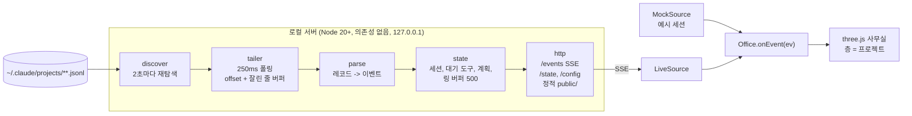

# Office Sim 구현 계획

AI 코딩 에이전트의 세션 기록을 0.25초 간격으로 tail 해서, 3D 사무실의 직원들이 도구 사용에 맞춰 방을 오가게 만든다. 지금은 Claude Code 세션 기록(jsonl)을 읽고, Codex, Grok, Antigravity 는 P5 에서 어댑터로 붙인다.

- 프로토타입(데모 데이터): https://claude.ai/artifact/WEDBFM36VSMpZWMZ4UWPGA
- 작성일: 2026-10-19

## 1. 조사 결과

### 1.1 스킬 검색 (`npx skills find`)

"Claude 세션을 3D 사무실로 시각화"를 직접 다루는 스킬은 없다. three.js 일반 스킬만 쓸 만하다.

| 스킬 | 설치 수 | 판단 |
|---|---|---|
| `cloudai-x/threejs-skills@threejs-animation` | 18.5K | 추천. 캐릭터 애니메이션 |
| `cloudai-x/threejs-skills@threejs-fundamentals` | 15.5K | 추천. 씬, 카메라, 조명 |
| `cloudai-x/threejs-skills@threejs-interaction` | 12.7K | 선택. 클릭 피킹, 컨트롤 |
| `freshtechbro/claudedesignskills@react-three-fiber` | 3.5K | 보류. R3F는 빌드 단계가 필요 |
| `heygen-com/hyperframes@hyperframes-animation` | 943.7K | 제외. 영상 제작용으로 무관 |

`cloudai-x/threejs-skills` 저장소는 GitHub 스타 3.6K, 2026-10-19 갱신으로 활발하다. 설치는 사용자 확인 후 진행한다.

```bash
npx skills add cloudai-x/threejs-skills@threejs-fundamentals -g -y
```

### 1.2 세션 기록 구조 (최근 40개 세션 표본)

- 메인 세션: `~/.claude/projects/<인코딩된 cwd>/<sessionId>.jsonl`
- 서브에이전트: `~/.claude/projects/<인코딩된 cwd>/<sessionId>/subagents/agent-<id>.jsonl` 와 `.meta.json`(`agentType`, `description`, `toolUseId`)
- 레코드 `type`: `user`, `assistant`, `system`(`stop_hook_summary`, `api_error`, `compact_boundary`), `custom-title`, `agent-name`, `last-prompt`, `attachment`, `queue-operation`, `file-history-*`
- `assistant.message.content`: `thinking`, `text`, `tool_use`
- `user.message.content`: `tool_result`(`is_error`), 거절 시 본문이 "The user doesn't want to proceed..." 로 시작
- `thinking` 블록의 약 80%(9,492 / 11,943)는 본문이 비어 있고 서명만 있다. 생각 말풍선에 폴백이 필요하다.
- 프로젝트 디렉터리가 53개라 전부 tail 하지 않고, 최근에 수정된 파일만 따라간다.

## 2. 아키텍처



중요한 결정: 아티팩트는 claude.ai(https)에서 열리므로 `http://localhost` SSE에 접속할 수 없고 로컬 파일도 읽을 수 없다. 그래서 아티팩트는 데모 데이터로 화면을 다듬는 용도로 쓰고, 실제 라이브는 로컬 서버가 같은 HTML/JS를 그대로 서빙한다. `main.js` 가 `localhost` 여부로 데모와 라이브를 자동으로 고른다(`#demo` 로 강제 가능).

## 3. 이벤트 스키마 (서버 -> 브라우저)

> 3~6절은 P0 시점의 초안이다. 구현된 동작의 기준은 `docs/CONTRACT.md` 이다(이벤트 필드, 파싱 규칙, 개인정보 규칙, 서버 동작).

모든 이벤트는 `{ type, sessionId, ts, ... }` 형태다. 브라우저는 `Office.onEvent(ev)` 한 곳에서만 받는다.

| type | 필드 | 만드는 레코드 |
|---|---|---|
| `session` | project, title, branch, isSubagent, parentSessionId, agentType | 새 파일 발견, `custom-title`, `agent-name`, 서브에이전트 `.meta.json` |
| `tool_start` | toolUseId, tool, summary, question?, options? | `assistant` 의 `tool_use` |
| `tool_end` | toolUseId, ok, error?, errorKind(`failed` / `denied`) | `user` 의 `tool_result` |
| `thinking` | text(없으면 null), durationMs | `thinking` 블록 + `thinkingDurationMs` |
| `say` | text(앞 100자) | `text` 블록 |
| `plan` | items[{content, status}] | `update_plan`, `TodoWrite`, `TaskCreate/Update`, `ExitPlanMode` (서버가 누적 상태를 유지해 전체 목록을 보냄) |
| `turn_end` | - | `system.stop_hook_summary`, `stop_reason: end_turn` |
| `session_end` | - | 서브에이전트 종료, 장시간 무활동 |
| `system` | kind(`api_error` / `compact`), text | `system.api_error`, `compact_boundary` |

## 4. 방 매핑 (`js/rooms.js` 의 `ROOM_RULES` 한 곳만 수정)

| 방 | 도구 |
|---|---|
| 자료실 | Read, Glob, Grep, Skill, `codegraph_*`, serena 조회, morph 검색 |
| 개발실 | Edit, Write, NotebookEdit, morph `edit_file`, serena 수정 |
| 서버실 | Bash, Monitor, 터미널, GitHub, Cloud Run, Firebase MCP |
| 정보검색실 | WebSearch, WebFetch, 그 밖의 모든 MCP |
| 회의실 | 계획 도구 -> 화이트보드 |
| 내 자리 | AskUserQuestion, ExitPlanMode(계획 승인) |
| 제자리 | Agent, Workflow, SendMessage, advisor |
| 무시 | `mcp__ccd_*` 같은 앱 내부 배관 도구, ToolSearch |

## 5. 캐릭터 동작 규칙 (프로토타입에 구현됨)

- 이벤트는 바로 실행하지 않고 할 일 대기열에 넣는다. 방까지 걸어간 뒤 최소 시간만큼 머문다.
- 밀리면 따라잡는다: 걷는 속도가 빨라지고, 같은 방 도구는 "외 N건"으로 합치고, 생각 말풍선은 건너뛴다.
- 생각: 요약이 있으면 첫 문장을 손글씨 구름 말풍선으로, 없으면 "생각 중…" 을 `durationMs` 만큼 보여 준다.
- 실패: 식은땀 + 빨간 말풍선 + 몸 떨림. 사용자 거절은 땀 없이 회색 점선 말풍선으로 구분한다.
- 계획: 항목 내용이 바뀌면 화이트보드로 걸어가 적고, 상태만 바뀌면 그 자리에서 보드만 갱신한다.
- 질문: 내 자리로 와서 손을 들고 기다린다. `tool_result` 가 오면 "답변 받음" 후 돌아간다.
- 서브에이전트: 부모 옆에 작은 직원(모자)으로 나타나고, 끝나면 엘리베이터로 퇴장한다.
- 7초간 할 일이 없거나 턴이 끝나면 라운지로 간다.
- 층: 프로젝트마다 한 층. 위층은 숨겨 돌하우스처럼 보고, "전체"는 층을 벌려서 건물 단면으로 본다. 다른 층에 활동이나 오류가 생기면 엘리베이터 버튼이 깜빡인다.
- 테마: 밝은 테마는 낮 사무실, 어두운 테마는 밤 사무실(방마다 조명, 모니터와 LED가 더 밝게).

## 6. 로컬 서버 설계

```
office-sim/
  package.json          type: module, bin: office-sim
  bin/office-sim.mjs    CLI 인자 처리 후 시작
  src/discover.mjs       프로젝트 디렉터리와 subagents/ 탐색
  src/tailer.mjs         파일별 offset, 잘린 줄 버퍼, 잘림(truncate) 감지
  src/parse.mjs          레코드 -> 이벤트, 도구별 요약
  src/state.mjs          세션, 대기 도구, 계획 누적, 링 버퍼
  src/server.mjs         /, /events, /state, /config
  public/                지금의 office.html + js/ 그대로
  test/*.test.mjs        node:test + 합성 jsonl 픽스처
```

- CLI: `--port 4317 --interval 250 --active 30 --claude-root ~/.claude/projects`(`--root` 는 같은 옵션의 별칭). `--active` 는 최근 N분 안에 수정된 파일만 따라가는 창이다.
- tail: 간격마다 `fs.stat` -> 커지면 `[offset, size)` 만 읽고, 마지막 줄이 잘렸으면 다음 회차로 넘긴다. 작아지면 처음부터 다시 읽는다.
- 처음 발견한 파일은 끝부분 256KB만 읽어서 제목, 계획, 아직 안 끝난 도구를 상태에 채운다(애니메이션 없이 스냅샷으로).
- SSE: 이벤트마다 `id:` 를 붙이고 최근 500개를 보관한다. 재접속 시 `Last-Event-ID` 로 이어 보내고, 너무 오래됐으면 스냅샷을 보낸다. 15초마다 하트비트 주석.
- `POST /config {intervalMs}`: 50~5000ms. 화면의 tail 입력칸이 이 값을 바꾼다.
- 프로젝트 키: 레코드의 `cwd` -> git 루트 이름. `.worktrees/` 나 `.claude/worktrees/` 아래 경로는 원래 저장소 층으로 묶고 배지로 표시한다.
- 개인정보: 127.0.0.1 에만 바인딩한다. 파일 내용과 명령 원문은 보내지 않고 요약만 보낸다(파일은 이름, 명령은 설명 문구나 프로그램 이름, URL은 호스트, 생각은 첫 문장 100자). 모든 자유 텍스트에서 경로, URL, 이메일을 걸러 낸다.

## 7. 단계별 계획과 검증

| 단계 | 내용 | 검증 |
|---|---|---|
| P0 (완료) | 스킬 검색, jsonl 분석, 이벤트 스키마, 데모 프로토타입 아티팩트 | 로컬 브라우저에서 콘솔 오류 없음, 아티팩트 게시 |
| P1 (완료) | discover, tailer, records, session, plan, summarize | `node --test` 374개 통과. 잘린 줄, 파일 교체, 재개 시 중복 기록, 포크 기록, 병렬 도구 짝짓기, 계획 복원, 질문, 서브에이전트 |
| P2 (완료) | SSE, /state, /config, 라이브 모드 연결, 보안 헤더, `--auth` | 이 세션을 실제로 띄워 앱 브라우저에서 확인(밝은/어두운 테마, 데모 모드) |
| P3 (완료, 소리 제외) | 재생 모드(`--replay 파일 --speed 4 --loop`), 권한 승인 대기 표시(재생 모드만, 라이브는 신호 없음), 층이 많을 때 성능. 소리는 하지 않았다 | `node --test` 394개 통과. 합성 세션으로 재생 모드를 앱 브라우저에서 확인(재생 칩, 반복, 서브에이전트, 승인 대기 말풍선, 콘솔 오류 없음). `#bench` 층 10개·직원 60명 측정 |
| P4 | 스킬/플러그인 포장: `/office` 로 서버 시작과 브라우저 열기 | 새 세션에서 `/office` 실행 |
| P5a (진행 중) | 멀티 에이전트 공통 분리: `store.mjs` 의 Claude 서브에이전트 연결을 `src/store-claude.mjs` 로 빼기, agent id 를 ref -> entry -> session 이벤트로 흐르게 하기, `Store.endCharacter` 와 `{ hint: 'end', charId }` 항목, 어댑터 등록표(`src/adapters/`)와 `RunnerGroup`, CLI `--agents`/`--codex-root`/`--grok-root`/`--antigravity-root`. 등록된 어댑터는 `claude-code` 하나 | 기존 `npm test` 전부 그대로 통과(테스트 수정 0개가 목표, import 경로만 예외). 새 테스트: agent id 흐름, 등록표, 루트가 없는 어댑터는 조용히 꺼짐. 실제 서버를 띄워 화면이 이전과 같은지 앱 브라우저로 확인 |
| P5b | `SessionCore`(`src/core/session-core.mjs`)와 `src/core/tool-summary.mjs`. 아직 어떤 어댑터도 쓰지 않는다 | 정규화 항목만으로 만든 합성 입력에서 스키마, dedupe, 도구 짝, 턴, 계획, 개인정보 테스트 통과 |
| P5c | Grok 어댑터: 탐색(모든 cwd 그룹, `subagents/` 연결), 정규화, `summary.json` 메타, `SidecarWatcher` | 공통 적합성 테스트 + Grok 전용 테스트. 합성 픽스처를 시간차로 덧붙여 라이브 화면 확인(Claude 와 Grok 직원이 같은 층에). 실제 Grok 세션 하나로 덧붙이는 단위 확인 |
| P5d | Codex 어댑터: guardian 스레드 숨김, code-mode `exec`, 서브에이전트 문맥 건너뛰기, `session_index.jsonl` 제목 | P5c 와 같음. 0.142 이전과 이후(code-mode) 픽스처 둘 다 |
| P5e | Antigravity CLI 어댑터: 위치 짝짓기, `USER_REQUEST` 꺼내기, 요약 proto 해석(데스크톱 앱은 범위 밖) | P5c 와 같음. 옛 도구 이름과 새 도구 이름 픽스처 둘 다 |
| P5f | 문서: `docs/CONTRACT.md` 어댑터별 절, `README.md` 지원 표와 옵션, 이 문서의 진행 기록 | 문서와 `--help` 출력이 맞음 |

P5 의 단계와 끝 조건은 `docs/ADAPTERS.md` 9절이 기준이다(선택 단계 P5g: Grok 라이브 승인 대기). 모든 단계는 Store, SSE, 화면을 그대로 같이 쓰고, 어댑터마다 합성 픽스처로 같은 이벤트 스키마(`docs/CONTRACT.md` 2절), 맞는 `agent` id, 개인정보 규칙(5절) 노출 0건을 확인한다.

P5 어댑터가 각각 갖춰야 할 것:

- 기록 위치 탐색: 그 도구가 세션 기록을 어디에 어떤 파일로 남기는지 찾고, 새 파일과 늘어난 줄을 따라간다(Claude Code 의 `~/.claude/projects` 탐색과 tail 에 해당).
- 레코드 -> 이벤트 매핑: 그 도구의 레코드를 `docs/CONTRACT.md` 2절의 이벤트(`session`, `tool_start`, `tool_end`, `thinking`, `say`, `plan`, `turn_end` 등)로 바꾼다. 새 이벤트 형식을 만들지 않는다.
- 에이전트 id: 모든 `session` 이벤트에 `agent` 를 붙인다(`codex`, `grok`, `antigravity`). 지금 Claude Code 어댑터는 `claude-code` 를 보낸다.
- 개인정보: 모든 자유 텍스트를 공용 `cleanText`(`src/summarize.mjs`)로 거르고, 5절의 "보내지 않는 것" 규칙을 그대로 따른다.

Codex, Grok, Antigravity 의 기록 위치와 형식은 Claude Code 형식 조사(`docs/research/jsonl-format.json`)처럼 구조만 조사했다(`docs/research/codex-format.json`, `grok-format.json`, `antigravity-format.json`). 그 결과로 만든 설계가 `docs/ADAPTERS.md` 이고, 2026-10-20 에 결정 D1~D12 를 모두 추천안대로 승인했다.

## 8. 진행 기록 (2026-10-19)

- 형식 조사: 에이전트 5명이 로컬 기록 5,016개를 구조만 조사했다(`docs/research/jsonl-format.json`). 이 결과로 계약 문서 `docs/CONTRACT.md`를 만들었다.
- 구현: 모듈 담당 5명과 통합 담당 1명이 서버를 만들었다.
- 적대적 리뷰: 리뷰어 4명이 정확성, 견고성, 보안·개인정보, 브라우저 연동 관점에서 40건을 찾았고, 검증자가 반박을 시도해 34건이 확인됐다(`docs/review/2026-10-19-confirmed.json`). 34건 모두 회귀 테스트와 함께 고치고 재검증했다.
- 개인정보: 실제 기록 5,103개(이벤트 63.9만 건)를 재생해 셌을 때 노출 0건이다(층 구분 키는 설계상 경로 포함).
- 확인된 설계 결정:
  - 생각 요약이 비어 있으면 "생각 중…"을 보여 준다.
  - 워크트리 세션은 원래 저장소 층으로 묶는다.
  - 폴더를 옮긴(relocated) 세션은 옮긴 폴더의 층으로 간다.
  - 이 환경은 Grep/Glob 대신 Bash로 검색하므로, 서버가 명령어 종류로 방 힌트를 준다(`grep`/`cat` -> 자료실).

## 8.1 P3 진행 기록 (2026-10-20)

- 재생 모드: `node bin/office-sim.mjs --replay <세션>.jsonl --speed 4 [--loop]`. 메인과 서브에이전트 파일의 줄을 기록 시각 순서로 합쳐, 공백을 배속으로 나눠(한 공백은 최대 5초) 라이브와 같은 Store/SSE 로 흘려보낸다. 서브에이전트는 자기 파일의 첫 줄 시각에 출근한다. `--loop` 는 마지막 장면을 3초 보여 준 뒤 모두 퇴근시키고 2초 뒤 처음부터 다시 한다. 화면 위쪽 칩에 `재생 · 4× · 37%`(반복이면 `N회째`), 끝나면 `재생 끝`이 보인다. 앱 브라우저 확인용 합성 세션: `test/fixtures/replay/`, launch 설정 `office-sim-replay`(포트 4318). 실제 세션 1건(2.5 MB, 워크플로 에이전트 94명)으로 구조만 확인: 200배속으로 끝까지 재생, 이벤트 16,644건(도구 시작 6,051 = 끝 6,051), 서브에이전트 94명 모두 출근과 퇴근, 적용 오류 0, 깨진 줄 0.
- 권한 승인 대기: 라이브 모드에는 확실한 신호가 없어 표시하지 않는다. 승인 창이 열려 있는 동안 기록에 아무것도 쓰이지 않고, `permissionDecision` 은 결과 줄에만 붙는다(결과 225,155개 중 32,065개). `user_permanent`(316)는 저장된 허용 규칙이라 기다림이 없고(Read p50 0.3초), 실제 클릭인 `user_temporary`(94)는 대부분 이미 '내 자리'로 가는 질문 도구다(89). 자동 승인 도구도 오래 걸려(Bash p99 68.6초) 시간 기준은 추측이 된다. 근거: `docs/CONTRACT.md` 7절, `docs/research/permission-decision.json`. 재생 모드는 결과 줄을 미리 읽을 수 있어 사람이 답한 호출에만 `awaitsApproval` 을 붙이고, 직원이 '내 자리'에서 `승인 대기` 말풍선(허용/거절)을 띄운다.
- 성능: `#bench`(층 10개, 직원 60명 중 서브에이전트 20명) 합성 부하, 1024x768, dpr 1. 프레임당 CPU 시간 p50(괄호는 1픽셀 readPixels 로 GPU 완료까지 기다린 값):

  | 보기 | 전 | 후 | 그리기 호출 |
  |---|---|---|---|
  | 1층에 초점(위 9개 층 숨김) | 1.0 ms (2.3) | 0.6 ms (1.9) | 286 |
  | 10층에 초점(아래 9개 층 보임) | 2.1 ms (4.0) | 1.3 ms (3.2) | 약 930 |
  | 전체 보기 | 3.9 ms (6.3) | 3.7 ms (6.1) | 2,860 |

  줄인 것: CSS 라벨은 초점 층만 계산(라벨 0.40 → 0.05 ms), 초점이 아닌 층은 그림자를 드리우지 않음, 숨은 층은 행렬 갱신, 몸짓, LED/지구본/문 애니메이션을 건너뜀(일의 진행은 계속). JS 힙은 18~30 MB(GC 시점에 따라 흔들림), 지오메트리 110, 텍스처 14, DOM 노드 1,326. 앱 브라우저 창이 가려져 있어 rAF 프레임 간격(fps)은 잴 수 없었다. 전체 보기는 모든 층이 보이는 화면이라 그대로 두었고, 2,860번의 그리기 호출(상자마다 메시 하나)이 남은 비용이다.

## 8.2 P5 진행 기록 (2026-10-20)

- 조사: Codex, Grok, Antigravity 의 기록 위치와 형식을 이 Mac 에서 읽기 전용으로 구조와 개수만 셌다(`docs/research/codex-format.json`, `grok-format.json`, `antigravity-format.json`). 세 도구 모두 덧붙여 쓰는 JSONL 기록이 있어 지금의 `Tailer` 로 따라 읽을 수 있다. Antigravity 데스크톱 앱만 대화 파일이 암호화된 것으로 보여 범위에서 뺐다.
- 설계 승인: `docs/ADAPTERS.md` 의 결정 D1~D12 를 모두 추천안대로 승인했다. 승인된 결정은 `docs/CONTRACT.md` 4.0.1절에 한 줄씩 옮겼다. 구현 순서는 P5a 공통 분리, P5b `SessionCore`, P5c Grok, P5d Codex, P5e Antigravity CLI, P5f 문서다.
- P5a 진행 중(브랜치 `feat/p5a-adapter-core`): `store.mjs` 의 Claude 서브에이전트 연결을 `src/store-claude.mjs` 로 빼고, agent id 를 `FileRef.agent` -> `entry.agent` -> `session.agent` 로 흐르게 하고, 공통 종료 규칙 `Store.endCharacter` 와 내부 항목 `{ hint: 'end', charId }`(Runner 가 걸러 내서 브라우저로는 가지 않는다)를 넣고, 어댑터 등록표(`src/adapters/index.mjs`, `claude-code.mjs`)와 어댑터마다 Runner 하나를 두는 `RunnerGroup` 을 넣는다. CLI 는 `--agents`(모르는 id 는 종료 코드 2)와 예약 옵션 `--codex-root`, `--grok-root`, `--antigravity-root` 를 받고, 시작할 때 `office-sim: agents <켜진 id>` 를 출력한다. `/healthz` 에 `agents` 가 더해진다. 등록된 어댑터는 `claude-code` 하나라 Claude 동작은 바뀌지 않는다. 재생 모드는 Claude 만(D12).
- 범위 조정: 메타 파일을 바뀔 때만 다시 읽는 `SidecarWatcher` 는 P5a 에서 P5c 로 옮겼다. 처음 쓰는 곳이 Grok 의 `summary.json` 이다.

## 9. 남은 결정과 할 일

1. 층 구분 키(`project`)에 작업 폴더 전체 경로가 들어간다. 로컬 브라우저에만 가지만, 해시로 바꿀지 결정 필요
2. P3 에서 하지 않은 것: 소리. 라이브 모드의 권한 승인 대기는 기록에 신호가 생기기 전까지 보류(예: 사용자가 PermissionRequest/Notification 훅으로 옆 파일에 남기는 방식)
3. 전체 보기에서 층이 많을 때: 가구 상자를 층마다 합치거나 인스턴싱하면 그리기 호출을 크게 줄일 수 있다(P3 범위 밖)
4. P4: `/office` 스킬로 포장
5. P5: Codex, Grok, Antigravity 어댑터. 조사와 설계는 끝났고(`docs/ADAPTERS.md`, 승인됨), P5a 를 진행 중이다. 다음은 P5b(`SessionCore`), 그 뒤 Grok, Codex, Antigravity CLI 순서
