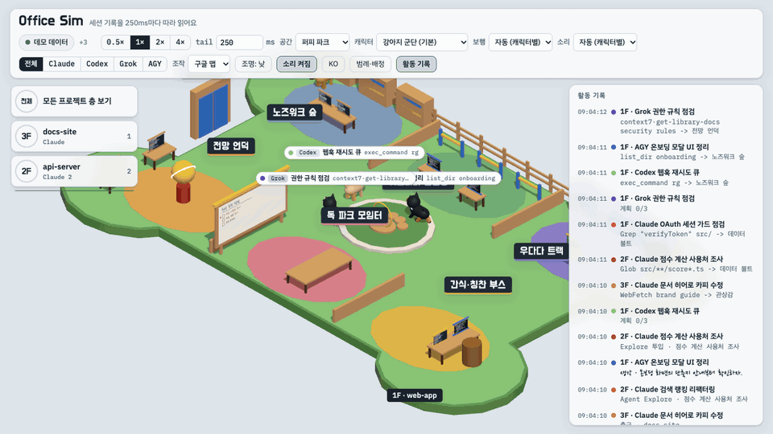
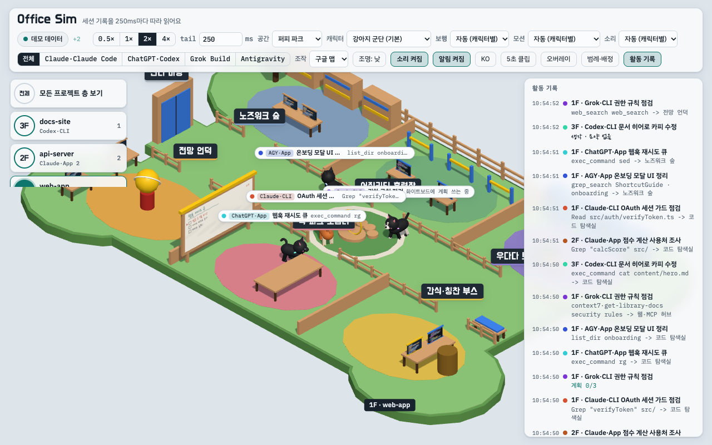
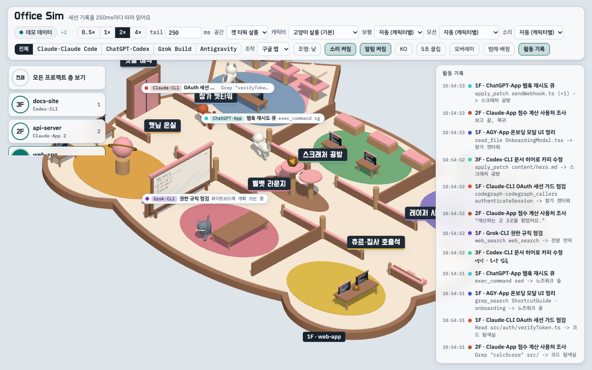
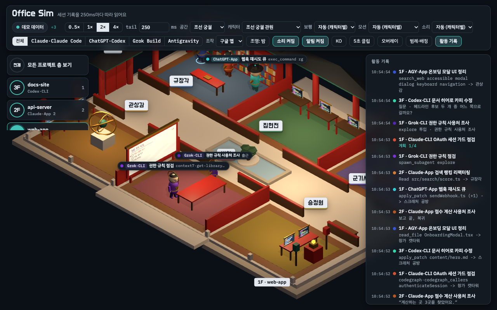
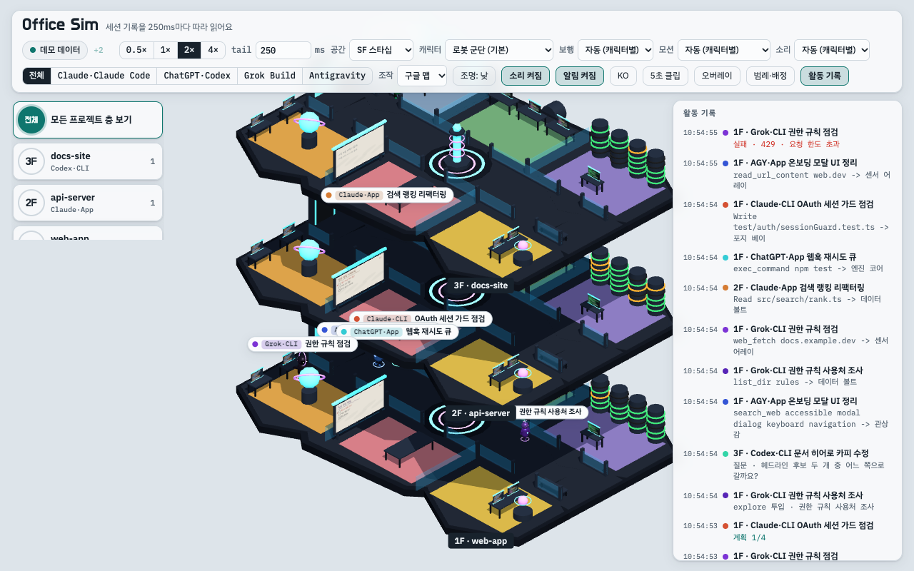
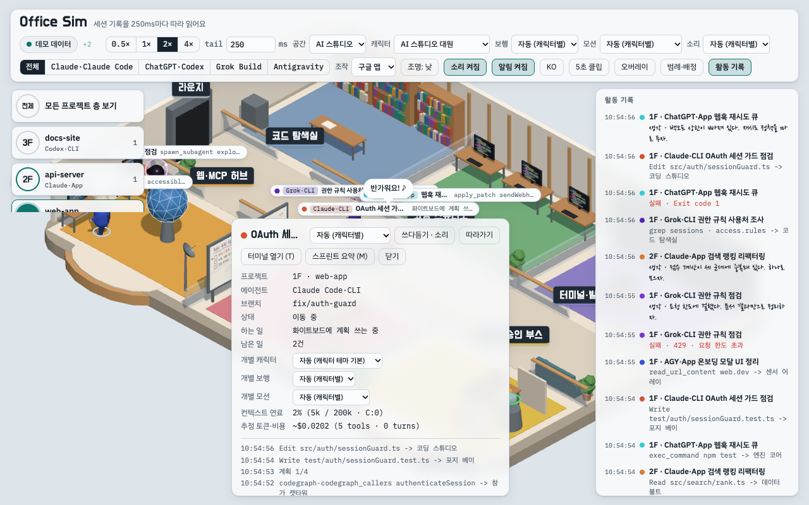
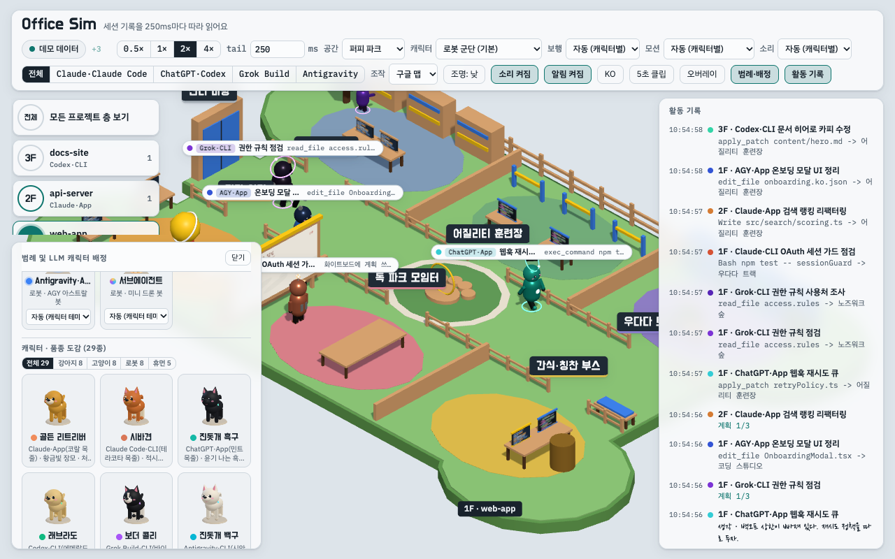

<div align="center">
<h1>Office Sim (한국어 문서)</h1>
<p><strong>Claude Code, OpenAI Codex, xAI Grok, Google Antigravity 세션을 실시간으로 시각화하는 무의존성 3D 멀티 에이전트 오피스</strong></p>

[](https://github.com/WahyzMaster/office-sim/actions/workflows/test.yml)
[](https://www.npmjs.com/package/office-sim)
[](https://wahyzmaster.github.io/office-sim/?lang=ko#demo)
[](https://nodejs.org/)
[](#빠른-시작)
[](LICENSE)
[](https://www.buymeacoffee.com/wahyzdad)

[English README](README.md) | **한국어** | [실시간 3D 웹 데모 열기](https://wahyzmaster.github.io/office-sim/?lang=ko#demo) | [고화질 데모 영상 (MP4)](docs/assets/ko/demo-hero.mp4)

<a href="https://wahyzmaster.github.io/office-sim/?lang=ko#demo">
  
</a>

*위 프리뷰를 클릭하면 설치 없이 브라우저에서 [실시간 인터랙티브 3D 데모](https://wahyzmaster.github.io/office-sim/?lang=ko#demo)를 바로 체험할 수 있으며, [720p H.264 데모 영상 (`docs/assets/ko/demo-hero.mp4`)](docs/assets/ko/demo-hero.mp4)도 직접 확인할 수 있습니다.*

</div>

---

**Office Sim**은 AI 코딩 에이전트의 세션 기록을 0.25초마다 따라 읽고(Claude Code HTTP 훅 연결 시 10ms 미만 실시간 수신), 에이전트 캐릭터들이 3D 공간을 오가며 협업하는 모습을 실시간으로 보여 주는 로컬 서버입니다. **Claude Code**(`~/.claude/projects/**/*.jsonl` 및 Claude 데스크톱 앱), **Grok (xAI Grok Build)**(`~/.grok/sessions/<작업 폴더>/<세션>/updates.jsonl` 및 Grok 데스크톱 봇), **OpenAI Codex**(`~/.codex/sessions/<YYYY>/<MM>/<DD>/rollout-*.jsonl` 및 ChatGPT 데스크톱 앱), **Google Antigravity**(`~/.gemini/{antigravity,antigravity-cli,antigravity-ide}/brain/<대화>/.system_generated/logs/transcript_full.jsonl`) 세션을 외부 패키지 의존성 없이 로컬에서 즉시 시각화합니다.

## 빠른 시작

**Node.js 22 이상**이 필요하며, 설치할 외부 런타임 패키지가 전혀 없습니다(Zero dependencies).

```bash
# 바로 실행 (기본 포트 4317)
npx office-sim --open

# macOS / Windows 네이티브 시스템 알림(질문·승인 대기, 완료, 오류)과 함께 실행
npx office-sim --open --notify

# 또는 저장소를 클론해서 실행
git clone https://github.com/WahyzMaster/office-sim.git
cd office-sim
npm start
```

- **실시간 로컬 세션 감시**: 브라우저에서 `http://127.0.0.1:4317`을 열면 현재 실행 중인 로컬 에이전트 세션이 실시간으로 표시됩니다.
- **무설치 데모 모드**: `http://127.0.0.1:4317/?lang=ko#demo` 또는 [GitHub Pages 라이브 데모](https://wahyzmaster.github.io/office-sim/?lang=ko#demo)를 열면 로컬 세션 없이도 네 종류 에이전트가 여러 층에서 협업하는 데모 시나리오를 체험할 수 있습니다.

## 테마 및 화면 갤러리

| 퍼피 파크 (`dogs`) | 캣 타워 살롱 (`cats`) |
| :---: | :---: |
|  |  |
| **뼈다귀 모양 잔디 마당, 발바닥 분수대, 어질리티 링과 8종 3D 강아지 품종** (골든·래브라도 리트리버, 진돗개 백구·흑구·반달곰, 보더 콜리, 웰시 코기, 시바견) | **고양이 귀 썬룸, 3단 캣타워, 벨벳 라운지와 8종 3D 고양이 품종** (사바나·아세라, 메인쿤, 친칠라 페르시안, 벵갈, 브리티시·러시안 블루, 샤미즈, 랙돌, 스코티시 폴드) |
| **조선 궁궐 (`palace` - 밤 조명 모드)** | **다층 프로젝트 오버뷰 (`starship` & `hanok`)** |
|  |  |
| **장대석 흰 돌 기단, 경회루 연못 회랑과 은은한 청사초롱 야간 조명** (`밤` 조명 모드) | **프로젝트별 다층 구조** (2층 SF 스타십 팔각 선체·워프 코어, 1층 전통 한옥 ㄱ·ㄷ자 마당, **8종 로봇 군단**) |
| **AI 스튜디오 (`studio`)** | **29종 3D 캐릭터 도감 및 에이전트 상세 창** |
|  |  |
| **실시간 도구 말풍선, 3D 컨텍스트 연료 링, 화이트보드 체크리스트, 에이전트 상세 창**(`터미널 열기 (T)` & `스프린트 요약 (M)`)이 갖춰진 모던 AI 스튜디오 | **전체 29종 3D 캐릭터 모형**(`전체 29 | 강아지 8 | 고양이 8 | 로봇 8 | 휴먼 5`)과 **8종 LLM 캐릭터 배정 카드** |

## 핵심 기능 및 8축 독립 커스터마이징

상단 컨트롤 바에서 **공간·캐릭터·LLM별 캐릭터 배정·모션·보행·소리·조명·카메라 조작**을 서로 독립적으로 조합할 수 있으며, 모든 설정은 브라우저(`localStorage`)에 자동 저장됩니다.

- **멀티 에이전트 CLI & 데스크톱 클라우드 챗 통합 감시**:
  - 로컬 터미널·IDE의 **Claude Code**, **OpenAI Codex**, **Grok**, **Google Antigravity** 세션뿐만 아니라 **Claude 데스크톱 앱**(`claude-code:app`), **ChatGPT 데스크톱 앱 / 도트**(`codex:app`), **Grok 데스크톱 봇**(`grok:app`)도 자동 감지하여 3D 로봇 캐릭터로 표시합니다.
  - **Claude Code 실시간 HTTP 훅**(`POST /api/hooks/claude`)을 통해 10ms 미만의 즉각적인 도구·질문 이벤트를 수신합니다.
- **macOS & Windows 네이티브 시스템 알림 (`--notify` / 단축키 `N`)**:
  - `--notify [ask,error,done,tool_error]` 플래그 또는 상단 바 **알림 꺼짐 / 알림 켜짐**(`#notify-toggle`, 단축키 `N`) 버튼으로 에이전트 질문·승인 대기(`ask`), 작업 완료(`done`), 세션 오류(`error`) 발생 시 OS 네이티브 알림을 받을 수 있습니다.
  - 외부 패키지 없이 macOS Notification Center(`/usr/bin/osascript`)와 Windows 10/11 WinRT `ToastNotificationManager`(구형 환경 `NotifyIcon` 폴백)를 구동하며, 5가지 소음 방지 규칙(3.5초 질문 대기 확인, 4.0초 턴 완료 안정화, 에이전트별 4.0초 쿨다운, 서브에이전트 중간 완료 억제, 리플레이 모드 차단)과 브라우저 Web `Notification` 폴백을 내장하고 있습니다.
- **3D 캐릭터 클릭 시 네이티브 터미널·IDE 탭 즉시 전환 (단축키 `T`)**:
  - 3D 캐릭터를 클릭하거나 상세 창의 **터미널 열기 (T)** 버튼을 누르면 **macOS**(`iTerm2`, `Terminal.app`, `Cursor`, `VS Code`, `Antigravity`, `Ghostty`, `WezTerm`, `Warp`)와 **Windows**(`Windows Terminal`, `VS Code`, `Cursor`, `PowerShell`)에서 해당 에이전트가 실행 중인 터미널 탭·IDE 창으로 즉시 포커스를 이동합니다.
- **3D 컨텍스트 연료 링 & 실시간 토큰·비용(USD) 추정기**:
  - 각 캐릭터 발밑의 **3D 컨텍스트 연료 링**이 컨텍스트 사용률에 따라 초록(`<60%`) -> 호박색(`60~85%`) -> 적색 점멸(`>85%`)로 변하며, 컨텍스트 압축(Compaction) 발생 시 입자 버스트 이펙트를 터뜨립니다.
  - 에이전트 상세 창에서 실시간 컨텍스트 연료 비율과 입·출력·캐시 토큰 수, 추정 비용(USD)을 바로 확인할 수 있습니다.
- **미확인 `완료(Done)` 배지 & 원클릭 스프린트 요약 마크다운 복사 (단축키 `M`)**:
  - 에이전트가 턴을 마치면 머리 위 이름표에 호박색 **`완료(Done)` 배지**가 켜지며, `M` 키 또는 **스프린트 요약 (M)** 버튼을 눌러 수정한 파일·실행 명령·검증 내역을 정리한 마크다운 요약 카드를 열고 원클릭으로 복사할 수 있습니다.
- **공간 (`7`가지 3D 건축 테마)**: `AI 스튜디오`, `테크 오피스`, `조선 궁궐`, `전통 한옥`, `SF 스타십`, `퍼피 파크`, `캣 타워 살롱` 중 원하는 3D 건물 구조와 방 가구를 즉시 전환합니다.
- **캐릭터 (`9`가지 프리셋 + `29`종 개별 모형)**: 건물 공간과 캐릭터 외형을 분리하여 `AI 스튜디오 대원`, `테크 오피스 사원`, `조선 궁궐 관원`, `전통 한옥 선비`, `SF 스타십 크루`, `강아지 군단`, `고양이 살롱`, `로봇 군단`, `동물·캐릭터 혼합` 또는 29종 개별 모형 중 자유롭게 조합할 수 있습니다.
- **LLM별 캐릭터 개별 매핑 (`29`종 3D 모형 · `8`개 슬롯)**: **Claude/Claude Code·App**, **Claude Code·CLI**, **ChatGPT/Codex·App**, **Codex·CLI**, **Grok Build·CLI**, **Antigravity·CLI**, **Antigravity·App**, **서브에이전트** 8개 슬롯 각각에 29종(강아지 8종 + 고양이 8종 + 3D 로봇 8종: 클로드 듀엣 봇·클로드 코드 봇·챗GPT 도트 봇·코덱스 드로이드·그록 봇·AGY 프로브 봇·AGY 아스트랄 봇·미니 드론 봇 + 치비 휴먼 5종) 중 원하는 캐릭터를 개별 배정할 수 있습니다.
- **모션 (`자동` + `6`가지 곡예 모션)**: 상단 모션 선택기, 에이전트 상세 창, 또는 3D 캐릭터 클릭으로 `점프`, `구르기`, `캣 플립`, `회전 스핀`, `프로펠러 비행`, `차원 도약` 모션을 즉시 실행할 수 있습니다.
- **보행 (`자동` / `앉기` / `서기` / `2족 보행` / `4족 보행`)**: 책상 앞 자동 착석, 서기·앉기 고정, 또는 2족·4족 보행 자세를 선택할 수 있습니다.
- **소리 (`끄기` / `자동` / `동물` / `사람` / `로봇`)**: Web Audio 합성 사운드로 사람 음성 차임벨, 강아지 짖는 소리, 고양이 울음소리, 드로이드 전자음(`BotVoice`)을 재생합니다.
- **조명 (`낮` / `밤` / `자동`)**: 밝은 주간 조명, 아늑한 야간 무드 조명, 또는 현재 시각 연동 자동 모드를 지원합니다.
- **3D 가구 충돌 회피 및 비겹침 좌석 배정**: 각 방의 책상·서버 랙·원탁·캣타워·연못마다 2D 충돌 박스가 등록되어 있어, 캐릭터가 이동할 때 가구와 겹치지 않고 자연스럽게 우회하며 빈 좌석에 나누어 앉습니다.
- **스크롤 가능한 29종 3D 캐릭터 도감 범례**: 좌측 하단 **범례 및 LLM 캐릭터 배정** 패널에서 카테고리 탭(`전체 29 | 강아지 8 | 고양이 8 | 로봇 8 | 휴먼 5`)으로 회전하는 29종 전체 3D 모형과 8개 LLM 슬롯 배정 카드, 방·상태 색깔 신호를 스크롤하며 한눈에 확인할 수 있습니다.
- **스트리머·OBS 투명 오버레이 모드 & 5초 클립 캡처**:
  - `?overlay=1`(또는 `#overlay`, 단축키 `O`)로 열면 상·하단 UI 패널을 숨기고 3D 캔버스 배경을 투명하게(또는 `?chroma=green` / `?chroma=blue` 크로마키 배경으로) 전환해 OBS 브라우저 소스나 코딩 방송 오버레이로 바로 쓸 수 있습니다.
  - 상단 바의 **5초 클립**(`#capture-clip`) 버튼을 누르면 5초 분량의 WebM 영상을 즉시 녹화·저장하며, `Shift+클릭`하면 고해상도 PNG 스크린샷을 저장합니다.

## 7가지 공간 테마와 방 구성

| 역할 (`key`) | AI 스튜디오 (`studio`, 기본) | 테크 오피스 (`office`) | 조선 궁궐 (`palace`) | 전통 한옥 (`hanok`) | SF 스타십 (`starship`) | 퍼피 파크 (`dogs`) | 캣 타워 살롱 (`cats`) | 주요 도구·역할 |
|---|---|---|---|---|---|---|---|---|
| `archive` | **코드 탐색실** | 라이브러리 | **규장각** | **장판각** | 데이터 볼트 | **노즈워크 숲** | **창가 캣타워** | `Read`, `Grep`, `Glob`, `codegraph` |
| `dev` | **코딩 스튜디오** | 개발존 | **집현전** | **글방** | 포지 베이 | **어질리티 훈련장** | **스크래처 공방** | `Edit`, `Write`, `NotebookEdit`, `apply_patch` |
| `server` | **터미널·빌드실** | 서버룸 | **군기시** | **대장간** | 엔진 코어 | **우다다 트랙** | **레이저 사냥터** | `Bash`, `git`, `gh`, 테스트·빌드 |
| `research` | **웹·MCP 허브** | 리서치랩 | **관상감** | **누각** | 센서 어레이 | **전망 언덕** | **캣닢 온실** | `WebSearch`, `WebFetch`, 외부 MCP |
| `meeting` | **기획·작전실** | 보드룸 | **빈청** | **대청마루** | 택티컬 브리지 | **독 파크 모임터** | **벨벳 라운지** | 계획 수립 · 할 일 화이트보드 기록 |
| `desk` | **리뷰·승인 부스** | 핫라인 부스 | **승정원** | **사랑채** | 홀로그램 통신실 | **간식·칭찬 부스** | **츄르·집사 호출석** | 사용자 질문(`AskUserQuestion`) · 권한/계획 승인 |
| `lounge` | **라운지** | 라운지 | **후원** | **안마당** | 크루 라운지 | **잔디 마당** | **햇살 해먹** | 대기 · 출퇴근 엘리베이터 |

- 프로젝트(작업 폴더)마다 한 층을 씁니다. 같은 저장소의 워크트리 세션은 같은 층에 모이고, 작업 폴더가 정해지지 않은 세션은 `전역 · 미지정`(`Global · Unassigned`) 층에 모이며, 직원이 모두 퇴근한 빈 층은 자동으로 정리됩니다.
- 캐릭터마다 에이전트 브랜드 색상과 전용 3D 소품(Claude Code 베레모·스타버스트, Codex 바이저·육각 크리스탈, Grok 선글라스·토성 궤도 링, Antigravity 부유 링·프리즘과 CLI 캡/App 헤드셋)을 갖추고, 서브에이전트는 프로펠러 모자를 쓴 작은 캐릭터로 나타납니다.

## 지원하는 에이전트

| 에이전트 | 에이전트 id | 상태 |
|---|---|---|
| Claude Code (CLI & Claude 데스크톱 앱) | `claude-code` | 지원 (`~/.claude/projects/**/*.jsonl`, 실시간 HTTP 훅 `POST /api/hooks/claude`, Claude 데스크톱 앱 감시, 서브에이전트, `--replay`) |
| Grok (xAI Grok Build) | `grok` | 지원 (P5c). 라이브 승인 대기도 보임 (P5g, 권한 창이 열린 뒤 1~4초 늦게, 답하는 쪽은 Grok 의 자동 검토일 수도 있음) 및 Grok 데스크톱 봇 감시 |
| Codex (데스크톱 앱, CLI, IDE 확장 및 ChatGPT 데스크톱 앱) | `codex` | 지원 (P5d, `~/.codex/sessions/<YYYY>/<MM>/<DD>/rollout-*.jsonl` 및 ChatGPT 데스크톱 / Dot 감시) |
| Antigravity CLI (`agy`)와 예전 Antigravity IDE | `antigravity` (`surface: 'cli'`) | 지원 (P5e). 화면에는 `Antigravity (CLI)` · 배지 `AGY·CLI` 로 표시 |
| Antigravity 데스크톱 앱 (Antigravity.app 2.x) | `antigravity` (`surface: 'app'`) | 지원. `~/.gemini/antigravity/brain/<대화>/.system_generated/logs/` 의 단계 기록과 아티팩트(`task.md`, `implementation_plan.md`)를 읽고, 암호화된 `conversations/*.pb` 는 열지 않습니다. 화면에는 `Antigravity (App)` · 배지 `AGY·App` 로 표시 |

## 카메라 조작 프리셋

상단 바의 **조작(Controls)** 선택기(`구글 맵`, `피그마`, `3D 오빗`, `블렌더`)에서 손에 익은 마우스·트랙패드 조작 방식을 고를 수 있으며, 브라우저(`localStorage`)에 자동 저장됩니다.

| 프리셋 | 좌클릭 드래그 | 우클릭 / 보조 드래그 | 휠 / 트랙패드 스크롤 |
|---|---|---|---|
| **구글 맵** (기본) | 바닥 수평 이동 (패닝) | 우클릭 또는 `Ctrl`+좌클릭: 시점 회전·기울기 | 줌 인 / 줌 아웃 (`Shift`+방향키: 회전·기울기) |
| **피그마** | 시점 회전 | `Space`+드래그 또는 휠클릭: 이동 | 상하좌우 패닝 (`Ctrl`/`Cmd`+휠: 줌, `Shift+0/1/2`: 시점·포커스) |
| **3D 오빗** | 시점 회전 (오빗) | 우클릭 또는 `Shift`/`Space`+드래그: 이동 | 줌 인 / 줌 아웃 |
| **블렌더** | 바닥 수평 이동 | 휠클릭 또는 `Alt`+드래그: 회전 | 줌 인 / 줌 아웃 (`.`/`F`: 선택 포커스, `Home`/`R`: 초기화) |

공통 단축키: `WASD`/방향키(수평 이동), `Q`/`E`(회전), `+`/`-`(줌), `1`~`9`(층 선택), `0`(전체 층 보기), `F` 또는 캐릭터 더블클릭(따라가기), `T`(에이전트 터미널·IDE 탭으로 전환), `M`(작업 요약 마크다운 카드 열기), `N`(시스템 알림 토글), `O`(스트리머 투명 오버레이 토글), `R` 또는 `Home`(카메라 초기화), `Esc`(선택 해제).

## CLI 옵션

| 옵션 | 기본값 | 설명 |
|---|---|---|
| `--port` | `4317` | HTTP 포트(`0`이면 빈 포트 자동 할당) |
| `--host` | `127.0.0.1` | 루프백 주소만 허용 (`127.0.0.1`, `localhost`, `::1`) |
| `--interval` | `250` | tail 간격(ms, 50~5000) |
| `--active` | `30` | 최근 N분 안에 수정된 세션만 따라감 |
| `--rescan` | `3000` | 새 세션 파일을 찾는 간격(ms) |
| `--agents` | 기록 폴더가 있는 에이전트 모두 | 켤 에이전트 id 를 쉼표로 선택 (`claude-code,codex,grok,antigravity`) |
| `--claude-root` | `~/.claude/projects` | Claude Code 세션 기록 위치 (`--root` 별칭 지원) |
| `--codex-root` | `~/.codex` | Codex 기록 위치 |
| `--grok-root` | `~/.grok` | Grok 기록 위치 |
| `--antigravity-root` | `~/.gemini` | Antigravity 데스크톱 앱·CLI·IDE 기록 위치 |
| `--notify [cats]` | 꺼짐 | macOS/Windows 네이티브 알림 켜기 (기본 `ask,error,done`; `tool_error`, `all`, `off` 지원) |
| `--replay <file.jsonl>` | 없음 | 지난 Claude Code 세션 하나를 기록된 시간 간격대로 재생 |
| `--speed <n>` | `1` | 재생 배속 (`0.1`~`1000`) |
| `--loop` | 꺼짐 | 재생이 끝나면 처음부터 반복 |
| `--auth` | 꺼짐 | 일회용 토큰(`http://127.0.0.1:<port>/?t=<token>`)으로 쿠키 인증 강제 |
| `--open` | 꺼짐 | 서버 시작 시 기본 브라우저로 화면 열기 |

## `/office` 스킬 설치

```bash
npm run skill:install                  # ~/.claude/skills/office -> <저장소>/skills/office
npm run skill:install -- --skills-dir ~/.agents/skills
npm run skill:uninstall
```

## 개인정보 보호 및 아키텍처 상세

- 서버는 루프백(`127.0.0.1`)에만 열리며, 파일 내용·명령 원문·전체 경로·전체 URL·이메일·인증 파일은 절대 읽거나 브라우저로 보내지 않습니다.
- 상세 계약과 어댑터 명세는 [`docs/CONTRACT.md`](docs/CONTRACT.md), [`docs/ADAPTERS.md`](docs/ADAPTERS.md), [`docs/HISTORY.md`](docs/HISTORY.md)를 참고하세요.
- 어댑터 개발용 실시간 기록 관찰 패널은 `http://127.0.0.1:4317/?observe=1` (또는 `#observe`)로 열었을 때만 상단 바에 나타납니다.

## 후원하기 (Support & Sponsorship)

**Office Sim**이 AI 코딩 작업에 즐거움이나 도움이 되었다면 Buy Me a Coffee를 통해 개발을 후원하실 수 있습니다:

<a href="https://www.buymeacoffee.com/wahyzdad" target="_blank" rel="noopener noreferrer">
  
</a>

- **Buy Me a Coffee** (간편 커피 후원): [https://www.buymeacoffee.com/wahyzdad](https://www.buymeacoffee.com/wahyzdad)

## 라이선스

[MIT](LICENSE)
