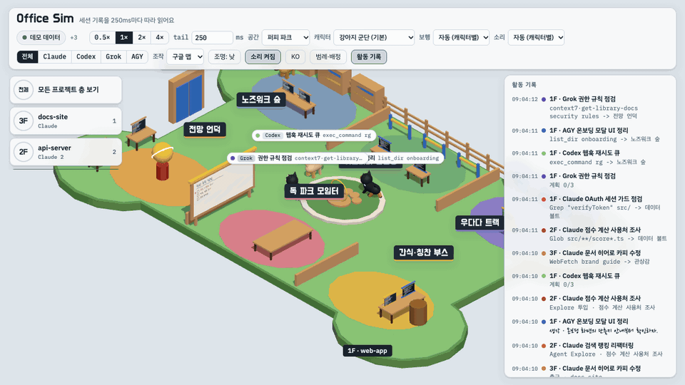
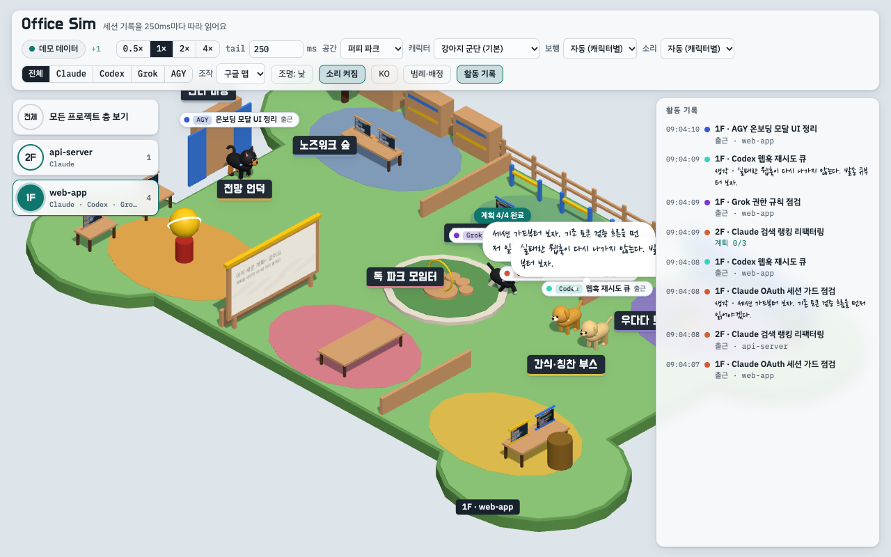
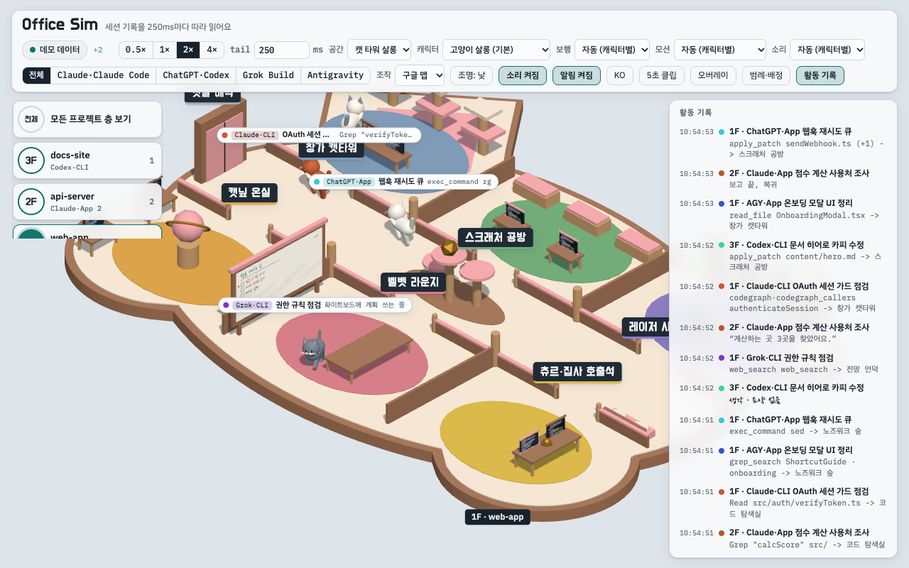
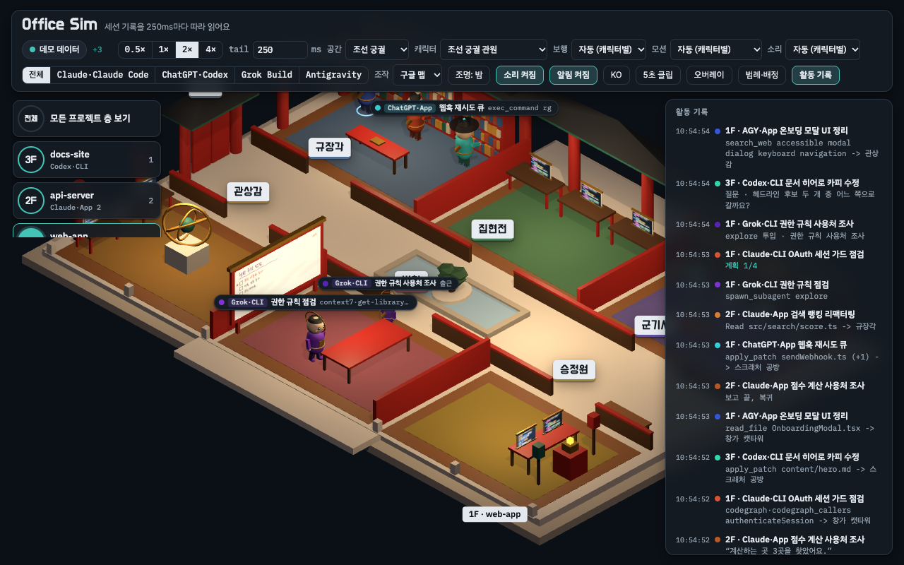
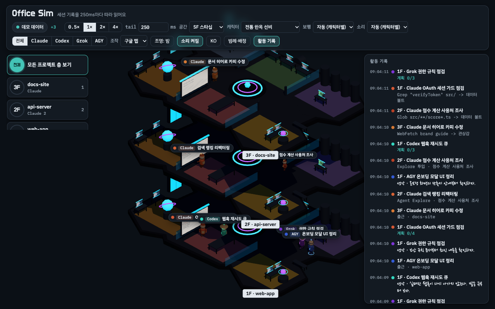
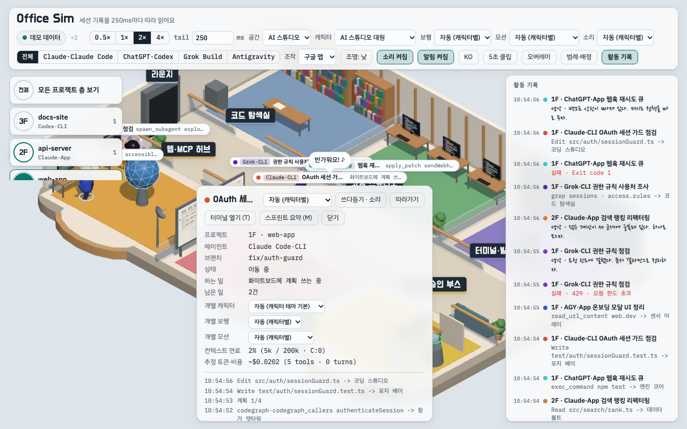
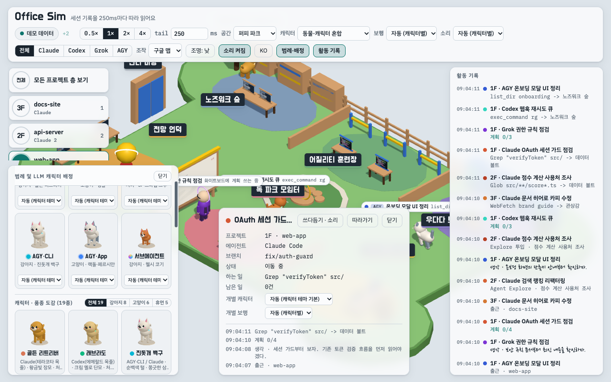

<div align="center">
<h1>Office Sim</h1>
<p><strong>Office Sim은 내 컴퓨터에서 돌아가는 AI 코딩 에이전트(Claude Code, Codex, Grok Build, Antigravity)를 3D 사무실의 캐릭터로 보여 줍니다. 브라우저 탭 하나만 보면 지금 누가 무엇을 하고 있는지 알 수 있습니다.</strong></p>

[](https://github.com/WahyzMaster/office-sim/actions/workflows/test.yml)
[](https://www.npmjs.com/package/office-sim)
[](https://nodejs.org/)
[](LICENSE)

[English](README.md) | **한국어** | [라이브 데모](https://wahyzmaster.github.io/office-sim/?lang=ko#demo) | [데모 영상 (MP4)](docs/assets/ko/demo-hero.mp4)

</div>

- Claude Code, Codex, Grok Build, Antigravity 에이전트가 한 화면에 캐릭터로 나란히 나타나고, 파일을 읽고 고치고 명령을 실행하고 검색할 때마다 그 일에 맞는 방으로 옮겨 다닙니다.
- 에이전트가 사용자에게 질문하거나 계획 승인을 기다리면 캐릭터가 리뷰 부스로 걸어갑니다. 원하면 데스크톱 알림도 받을 수 있고(직접 켜야 합니다), 캐릭터의 터미널 열기 버튼이나 `T` 키 한 번으로 그 에이전트의 터미널을 앞으로 가져옵니다(macOS, Windows).
- 내 컴퓨터 안에서만 동작합니다. 서버는 `127.0.0.1`에서만 듣고, 세션 기록은 읽기 전용으로 열며, 밖으로는 아무것도 보내지 않습니다.

<div align="center">
<a href="https://wahyzmaster.github.io/office-sim/?lang=ko#demo">
  
</a>
</div>

## 빠른 시작

```bash
npx office-sim
```

Node.js 22 이상이 필요합니다(22와 24에서 테스트합니다). 터미널에서 실행하면 `http://127.0.0.1:4747`에 로컬 서버가 뜨고 기본 브라우저가 열립니다. 브라우저를 열지 않으려면 `--no-open`을 붙입니다.

- **에이전트가 실행 중일 때**: 최근 30분 안에 움직인 세션이 몇 초 안에 캐릭터로 나타납니다.
- **실행 중인 에이전트가 없을 때**: 화면에 데모가 재생되고, 데모라는 사실을 알리는 배너가 함께 보입니다. 첫 세션이 시작되면 바로 실제 화면으로 바뀝니다. 터미널에도 같은 내용이 한 줄 출력됩니다.
- **구경만 하고 싶을 때**: `npx office-sim --demo`는 데모를 바로 엽니다. 같은 데모를 [라이브 데모](https://wahyzmaster.github.io/office-sim/?lang=ko#demo)에서도 볼 수 있습니다.

저장소를 받아서 실행하려면 `git clone https://github.com/WahyzMaster/office-sim.git` 후 `cd office-sim`, `npm start` 순서로 실행합니다.

## Claude Code 플러그인

Claude Code 안에서 입력합니다.

```text
/plugin marketplace add WahyzMaster/office-sim
/plugin install office-sim@office-sim
```

플러그인 기능을 쓰지 않으려면 셸에서 실행합니다.

```bash
npx office-sim init
```

어느 쪽이든 두 가지가 추가됩니다. 하나는 Claude Code가 권한 요청 창을 띄울 때 로컬 Office Sim 서버에 알려 주는 훅 두 개이고(세션 기록에는 그 순간이 남지 않습니다), 다른 하나는 Claude Code 안에서 서버를 켜고, 열고, 확인하고, 끄는 `/office` 스킬입니다(플러그인으로 설치하면 `/office-sim:office`). `init`은 바꿀 내용을 먼저 보여 주고, 동의한 뒤에만 파일을 씁니다. 정확히 무엇을 쓰는지는 [자주 묻는 질문](#자주-묻는-질문)에 있습니다.

## 무엇을 감지하나요

앞의 세 열에서 "예"는 캐릭터가 리뷰 부스로 걸어가고, 알림을 켜 두었다면 알림도 온다는 뜻입니다. "턴 종료"가 감지되면 캐릭터 이름표에 `완료` 배지가 켜집니다.

| 에이전트 | 사용자에게 하는 질문 | 계획 승인 | 권한 요청 | 턴 종료 |
|---|---|---|---|---|
| Claude Code | 예 (`AskUserQuestion`) | 예 (`ExitPlanMode`) | 플러그인을 설치했거나 `office-sim init`으로 훅을 넣었을 때만. 세션 기록만으로는 감지하지 못함 | 예 (마지막 답변 후 20초, 기록에 종료 표시가 있으면 즉시) |
| Codex | 예 (`request_user_input`) | 대기로는 감지하지 못함. 제안된 계획은 회의실 화이트보드에 표시 | 감지하지 못함 | 예 (`task_complete`) |
| Grok Build | 예 (`ask_user_question`) | 예 (`exit_plan_mode`) | 예. 창이 열리고 1~4초 뒤에 표시. 1초 안에 답한 요청은 보이지 않고, 답하는 쪽이 사람인지 Grok의 자동 검토인지는 기록에 없음 | 예 (`turn_completed`) |
| Antigravity | 예 (`ask_question`) | 감지하지 못함 | 감지하지 못함 | 추정. 기록에 종료 표시가 없어서, 마지막 답변 후 20초가 지나거나 그 전에 Antigravity가 대화를 대기 상태로 표시하면 턴이 끝난 것으로 봄 |
| Gemini CLI (플러그인) | 예 (`ask_user`, `ask_followup_question`) | 감지하지 못함 | 감지하지 못함 | 추정. 도구 호출이 없는 답변 후 20초 |

알려진 한계: Claude Code에는 권한 요청을 허용했다고 알려 주는 훅이 없습니다. 그래서 오래 걸리는 도구를 승인하면, 그 도구가 끝날 때까지 캐릭터가 부스에서 "대기 중"으로 남습니다.

Claude Code 훅 경로는 Claude Code 훅 문서를 보고 만든 예시 요청으로 테스트했고, 실제 Claude Code 세션으로는 아직 확인하지 못했습니다. 직접 써 보시고 잘 되는지, 안 되는지 [이슈](https://github.com/WahyzMaster/office-sim/issues)로 알려 주시면 큰 도움이 됩니다.

## 왜 만들었나요

터미널 여러 개에서 에이전트 여러 개를 돌리면 상태가 탭마다 흩어집니다. 하나는 파일을 고치고, 하나는 테스트를 돌리고, 하나는 한참 전에 질문을 던지고 멈춰 있습니다. Office Sim은 에이전트가 이미 디스크에 남기는 기록만으로 이들을 프로젝트별로 한 화면에 모읍니다. 에이전트 쪽에 연결할 것은 없습니다. Claude Code 플러그인은 선택 사항이고, 기록에 없는 신호 하나를 더해 줍니다.

## 기능

- **에이전트 네 종류와 데스크톱 앱 세 개를 한 사무실에**: Claude Code, Codex, Grok Build, Antigravity 세션을 각자의 기본 폴더에서 찾아냅니다. macOS에서는 Claude, ChatGPT, Grok 데스크톱 앱의 대화도 로봇 캐릭터로 나타납니다(이를 위해 무엇을 읽는지는 [개인정보와 보안](#개인정보와-보안)에 있습니다). Gemini CLI는 선택형 플러그인입니다(`--plugins gemini-cli`).
- **프로젝트마다 한 층**: 저장소나 작업 폴더마다 층이 하나씩 생깁니다(`1F`, `2F`, ...). 같은 저장소의 git 워크트리는 같은 층을 쓰고, 작업 폴더가 없는 세션은 `전역 · 미지정` 층에 모이며, 서브에이전트는 작은 캐릭터로 나타납니다.
- **리뷰 부스**: `desk` 방에 리뷰 부스가 있습니다. 에이전트가 질문하거나, 계획 승인을 요청하거나, 권한 요청으로 멈추면 캐릭터가 그곳으로 갑니다([감지 범위](#무엇을-감지하나요)). 답을 기다리는 캐릭터 수가 브라우저 탭 제목에 표시되고, 연결 상태 표시 옆의 칩을 누르면 기다리는 캐릭터를 차례로 보여 줍니다.
- **데스크톱 알림 (직접 켜는 기능)**: `--notify` 옵션이나 상단 바의 알림 버튼(단축키 `N`)으로 macOS와 Windows의 시스템 알림을 켭니다. 질문과 승인 대기, 턴 종료, 오류를 알려 줍니다. 시스템 알림을 쓸 수 없는 환경에서는 탭이 가려져 있을 때 브라우저 알림을 대신 씁니다. 알림이 너무 잦지 않도록 턴 종료 알림은 턴마다 한 번만, 서브에이전트의 턴에는 보내지 않고, 반복되는 API 오류는 15초 동안 하나로 묶으며, 같은 에이전트의 같은 종류 알림은 4초 이상 간격을 두고, 시작할 때 읽은 지난 기록과 리플레이에서는 알리지 않습니다.
- **터미널 앞으로 가져오기 (`T`)**: 캐릭터를 선택하고 `T`를 누르거나 상세 창의 `터미널 열기 (T)`를 누르면 그 에이전트의 창이 앞으로 나옵니다. macOS에서는 tty로 iTerm2나 Terminal.app 탭을 찾고, 못 찾으면 프로젝트 이름으로 Cursor, VS Code, Antigravity, Ghostty, WezTerm, Warp 창을 찾습니다. Windows에서는 제목에 프로젝트 이름이 들어 있는 창을 찾습니다. Linux는 지원하지 않습니다.
- **컨텍스트 링과 토큰 수치 (추정치)**: 캐릭터 발밑의 컨텍스트 링은 추정치이며, 초록(60% 미만), 호박색(60~79%), 빨강(80% 이상)으로 바뀌고 세션의 컨텍스트가 압축되면 짧은 입자 효과가 나옵니다. 모델이 알려 준 값이 아닙니다. 페이지가 받는 이벤트에는 사용량 숫자가 없어서, 이벤트(프롬프트, 생각, 답변, 도구 호출)마다 어림한 토큰 수를 더하고(답변은 발췌가 길수록 더 많이 셉니다) 컨텍스트 창을 20만 토큰으로 가정해 계산합니다. 상세 창에는 같은 추정치가 `컨텍스트 연료 (추정)`과 `토큰 (추정)` 두 줄로 나옵니다. Office Sim은 비용이나 요금을 표시하지 않습니다.
- **`완료` 배지와 스프린트 요약 (`M`)**: 턴이 끝나면 캐릭터 이름표에 호박색 `완료` 배지가 켜지고, 캐릭터를 선택하면 꺼집니다. `M` 키나 상세 창의 `스프린트 요약 (M)`을 누르면 복사할 수 있는 마크다운 카드가 열립니다. 에이전트와 브랜치, 걸린 시간과 턴 수, 컨텍스트와 토큰 추정치, 도구 호출 수와 많이 쓴 도구, 건드린 파일 이름이 담깁니다.
- **리플레이**: `--replay <file.jsonl>`로 기록해 둔 Claude Code 세션을 타임라인 스크러버, 마커, 북마크 핀과 함께 다시 봅니다.
- **가구를 피해 다니는 이동**: 책상, 서버 랙, 탁자, 캣타워, 연못마다 층별 충돌 영역이 있어서 캐릭터가 가구를 돌아가고 문으로 드나듭니다.
- **범례와 캐릭터 도감**: 회전하는 3D 모형 29종을 분류 탭(`전체 29 | 강아지 8 | 고양이 8 | 로봇 8 | 휴먼 5`)으로 보고, 캐릭터 배정 카드 8개와 방 색깔, 말풍선의 뜻을 확인합니다.
- **방송용 오버레이와 클립**: `?overlay=1`(또는 `#overlay`, `O` 키)로 열면 패널이 숨고 캔버스 배경이 투명해집니다. `?chroma=green`, `?chroma=blue`, `?chroma=ff00ff`로 크로마키 배경도 쓸 수 있어 OBS 브라우저 소스로 바로 올릴 수 있습니다. `5초 클립` 버튼은 5초짜리 WebM 영상을 저장하고, `Shift`+클릭은 PNG 스크린샷을 저장합니다.
- **한국어와 영어**: 브라우저 언어가 한국어이면 한국어로, 아니면 영어로 시작하고, `KO / EN` 버튼으로 언제든 바꿉니다. 소리는 꺼진 채로 시작합니다.

## 자주 묻는 질문

**내 코드를 읽나요?**
아니요. 저장소가 아니라 에이전트가 남기는 세션 기록을 읽습니다. 다만 그 기록에는 에이전트가 한 일이 파일 내용과 명령줄까지 들어 있고, 서버가 읽는 동안 메모리를 거쳐 갑니다. 서버가 남겨서 페이지로 보내는 글은 세 종류입니다. 첫째는 이름입니다. 도구 이름, 폴더를 뗀 파일 이름, URL의 호스트 이름, 셸 명령의 프로그램 이름(`git`, `npm`, `make` 같은 흔한 도구는 하위 명령까지), 브랜치와 워크트리 이름이 여기에 듭니다. 둘째는 프롬프트, 답변, 에이전트의 생각, 질문, 계획 항목, 세션 제목, API 오류 알림, 도구 오류 첫 줄의 짧은 앞부분입니다(각각 최대 160자). 셋째는 도구 호출이 무엇에 관한 것인지 알려 주는 짧은 조각입니다(각각 최대 60자). 예를 들면 검색 패턴, 웹 검색이나 MCP 검색의 검색어, 에이전트가 명령이나 서브에이전트 작업에 붙인 한 줄 설명, 작업 제목, 질문의 머리말과 선택지가 있습니다. 세 종류 모두 경로는 파일 이름으로, URL은 호스트 이름으로 줄이고 이메일 주소는 지웁니다. 그 밖에는 걸러 내지 않습니다. 앞부분은 쓴 그대로이고 검색 패턴과 검색어도 에이전트가 쓴 그대로 전달되므로, 프롬프트 첫머리나 검색어에 비밀 값이 들어 있으면 다른 글과 똑같이 화면에 보입니다. 전체 경로로 전달되는 것은 세션의 프로젝트 폴더 하나뿐이며, [개인정보와 보안](#개인정보와-보안)에 설명이 있습니다. 전체 목록은 [`docs/CONTRACT.md`](docs/CONTRACT.md) 3.1절, 4절, 5절에 있습니다.

**밖으로 무언가를 보내나요?**
아니요. 서버는 루프백에만 열리고, 사용 통계를 수집하지 않으며, 다른 컴퓨터로 요청을 보내지 않습니다. 서버가 보내는 HTTP 요청은 루프백의 자기 포트에 Office Sim이 이미 떠 있는지 묻는 상태 확인 하나뿐입니다. 페이지는 three.js를 포함한 모든 파일을 로컬 서버에서 받고, 콘텐츠 보안 정책에는 외부 호스트가 없습니다. 예외는 직접 켜는 옵션 하나입니다. `--cdn`을 주면 실험 중인 WebGPU 렌더러를 `cdn.jsdelivr.net`에서 받을 수 있습니다.

**에이전트 설정을 바꾸나요?**
실행만으로는 바꾸지 않습니다. `npx office-sim`은 에이전트 폴더를 읽기만 하고, 그 폴더나 설정 파일에는 쓰지 않습니다. 파일을 쓰는 것은 직접 실행하는 설치 단계 두 가지뿐이고, 둘 다 Claude Code에만 해당합니다. 플러그인 설치(Claude Code가 직접 합니다)와 `office-sim init`(또는 `office-sim hooks install`)입니다. Codex, Grok, Antigravity 폴더에는 어떤 경우에도 쓰지 않습니다.

**플러그인은 무엇을 설치하나요?**
`http` 훅 두 개와 스킬 하나입니다. 훅은 `PermissionRequest`와 `Notification`(matcher `permission_prompt`)이고, `127.0.0.1:4747`의 로컬 서버로 요청을 보내며 제한 시간은 2초입니다. 스킬은 `/office-sim:office`입니다. 플러그인의 훅은 Claude Code가 플러그인 캐시에 복사해 두는 플러그인 폴더 안에 있고, 설정 파일의 훅 항목으로 들어가지 않습니다. `npx office-sim init`은 같은 훅 두 개를 `~/.claude/settings.json`에 넣고(기존 내용과 합치고, 원본은 `settings.json.office-sim.bak`으로 한 번 복사해 둡니다) 스킬을 `~/.claude/skills/office`에 복사합니다. 바꿀 내용을 보여 주고 물어본 뒤에 쓰며, `--dry-run`은 보여 주기만 하고, `office-sim hooks uninstall`은 훅을 다시 지웁니다. 훅에는 기본 포트가 적히므로 다른 `--port`를 쓴다면 `office-sim hooks install --port <n>`으로 설치합니다. 서버는 훅 요청에서 여섯 항목(세션 id, 이벤트 이름, 알림 종류, 도구 이름, 에이전트 id, 그리고 Claude 폴더와 비교만 하는 기록 파일 경로)만 읽고, 도구 입력을 비롯한 나머지는 버립니다.

## 문제 해결

- **포트가 이미 사용 중일 때**: 기본 포트는 `4747`이고 다른 포트로 자동으로 넘어가지 않습니다. 그 포트를 쓰는 것이 또 다른 Office Sim이고 옵션 없이(또는 `--open`, `--no-open`, `--demo`만 주고) 실행했다면, 그 주소를 출력하고 브라우저를 열 조건이면 연 다음 끝납니다. 그 밖의 경우에는 오류 메시지에 포트가 나옵니다. 그 프로그램을 끄거나 `--port <n>`으로 실행하세요(`--port 0`은 빈 포트를 고릅니다).
- **세션이 보이지 않을 때**: 최근 30분 안에 수정된 세션만 붙습니다(`--active <분>`으로 늘릴 수 있습니다). 시작할 때 나오는 `office-sim: agents ...` 줄에서 폴더를 찾은 에이전트를 확인하세요. 기록을 다른 곳에 두는 에이전트는 루트 옵션(`--claude-root`, `--codex-root`, `--grok-root`, `--antigravity-root`)으로 알려 줘야 합니다. 붙은 세션이 없을 때 연 페이지는 첫 세션이 나타날 때까지 배너와 함께 데모를 보여 줍니다.
- **Node 버전**: Node.js 22 이상을 지원합니다. 더 낮은 버전에서는 경고 한 줄을 출력하고 실행을 시도합니다. 그 상태에서 실패한다면 Node부터 올리세요.
- **Claude Code 권한 요청이 보이지 않을 때**: 서버가 훅에 적힌 포트(`--port`를 주고 설치하지 않았다면 `4747`)에서 떠 있어야 하고, `--auth` 없이 실행해야 합니다. 훅 요청에는 쿠키가 없기 때문입니다. `office-sim hooks status`는 설정 파일의 훅이 설치되어 있는지와 서버가 응답하는지를 보여 줍니다(플러그인의 훅은 확인하지 않습니다).

## 지원하는 에이전트

| 에이전트 | 에이전트 id | 읽는 것 |
|---|---|---|
| Claude Code (CLI와 Claude 데스크톱 앱) | `claude-code` | `~/.claude/projects/**/*.jsonl`(서브에이전트 기록 포함)과 그 옆의 작은 파일 두 가지: 서브에이전트의 `agent-<id>.meta.json`(이름, 설명, 종류, 그 서브에이전트를 시작한 호출)과 워크플로 실행의 `journal.jsonl`(단계 이름). 권한 요청은 선택 사항인 플러그인이나 훅으로 받습니다. `--replay`로 지난 세션을 다시 볼 수 있습니다 |
| Grok (xAI Grok Build) | `grok` | `~/.grok/sessions/<작업 폴더>/<세션>/updates.jsonl`과 `summary.json`, 그리고 라이브 승인 대기를 위해 `events.jsonl`의 네 항목. Grok Bot 데스크톱 앱도 봅니다 |
| OpenAI Codex (데스크톱 앱, CLI, IDE 확장, ChatGPT 데스크톱 앱) | `codex` | `~/.codex/sessions/<YYYY>/<MM>/<DD>/rollout-*.jsonl`과 `session_index.jsonl`(대화 제목) |
| Antigravity CLI (`agy`)와 예전 IDE | `antigravity` | `~/.gemini/antigravity-cli/`와 `~/.gemini/antigravity-ide/`의 `brain/<대화>/.system_generated/logs/` 단계 기록과 `task.md` 체크리스트. 제목, 작업 폴더, 브랜치, 상태를 알기 위해 작은 파일 두 가지도 읽습니다: 요약 파일(`jetbox_summaries_proto.pb` 또는 `agyhub_summaries_proto.pb`, 대화마다 네 항목)과 `annotations/<대화>.pbtxt` |
| Antigravity 데스크톱 앱 (2.x) | `antigravity` | `~/.gemini/antigravity/`에서 앱이 남긴 경우에 한해 `brain/<대화>/.system_generated/logs/` 단계 기록을 읽고, 그런 대화에 대해서는 `task.md`, `agyhub_summaries_proto.pb`, `annotations/<대화>.pbtxt`도 같은 방식으로 읽습니다. 암호화된 `conversations/*.pb`는 열지 않습니다 |
| Gemini CLI (선택형 플러그인) | `gemini-cli` | `~/.gemini/tmp/<프로젝트>/chats/session-*.json[l]`. `--plugins gemini-cli`를 줬을 때만 |

정확히 어떤 파일의 어떤 항목을 읽는지는 [`docs/CONTRACT.md`](docs/CONTRACT.md) 4절에 있습니다. Claude, ChatGPT, Grok 데스크톱 앱에서 읽는 것은 [개인정보와 보안](#개인정보와-보안)에 적었습니다.

## 개인정보와 보안

- **루프백 전용**: 서버 주소로는 `127.0.0.1`, `localhost`, `::1`만 받습니다. `Host`나 `Origin` 헤더가 다른 요청, `Sec-Fetch-Site: cross-site` 요청은 거부합니다. `--auth`를 주면 실행마다 새 토큰을 만들고 브라우저는 이를 `HttpOnly` 쿠키로 보관합니다.
- **외부에서 받는 것 없음**: 서버에는 npm 의존성이 없습니다. 페이지는 three.js 사본을 함께 싣고(`public/vendor/`) 시스템 글꼴을 쓰므로, 기본 화면은 로컬 서버하고만 통신합니다.
- **페이지로 가는 것**: 도구 이름(MCP 서버와 도구 이름 포함), 파일 이름, URL의 호스트 이름, 셸 명령의 프로그램 이름(`git`, `npm`, `make` 같은 흔한 도구는 하위 명령까지), 브랜치와 워크트리 이름, 그리고 프롬프트, 답변, 생각, 질문, 계획 항목, 세션 제목, API 오류 알림, 도구 오류의 짧은 앞부분입니다. 도구 호출에서는 무엇에 관한 호출인지 알려 주는 입력의 짧은 조각도 함께 갑니다. 검색 패턴(Grep, Glob), 웹 검색의 검색어, 에이전트가 셸 명령·서브에이전트 작업·워크플로에 붙인 한 줄 설명, 작업 제목, 스킬 이름이나 메시지를 받는 쪽의 이름, MCP 호출의 짧은 값 하나(검색어, 라이브러리, 컬렉션, 요소, 동작, 제목 가운데 하나), 질문의 머리말과 선택지가 그렇습니다. 여기 적은 것은 도구별 예시이고, 전체 목록은 [`docs/CONTRACT.md`](docs/CONTRACT.md) 3.1절, 4절, 5절에 있습니다. 파일 내용과 명령줄은 보내지 않습니다. 경로는 파일 이름으로, URL은 호스트 이름으로 줄이고 이메일 주소는 지우지만, 그 밖의 비밀 값을 찾아내 지우지는 않습니다. 인증 파일과 저장소 파일(`oauth_creds.json`, `.env`, SQLite 데이터베이스, 프롬프트 원문 기록, Antigravity의 암호화된 `conversations/*.pb` 파일)은 열지 않습니다.
- **전체 경로 하나**: 세션의 프로젝트 폴더 경로는 층을 구분하는 키로 로컬 페이지에 전달되고, 층 버튼의 툴팁으로 보입니다. `--auth` 없이 실행하면 같은 컴퓨터의 다른 사용자와 프로세스가 서버의 로컬 주소를 읽을 수 있으므로, 여럿이 쓰는 컴퓨터에서는 `--auth`를 쓰고, 상태 덤프를 공유하기 전에는 내용을 확인하세요.
- **기록은 읽기 전용**: 에이전트 파일은 읽기 전용으로 열고, 서버는 에이전트 폴더에 아무것도 쓰지 않습니다. 서버가 직접 쓰는 파일은 개발자용 패널(`?observe=1`)에서 기록 관찰을 시작했을 때 자기 패키지 폴더 안의 `.observe` 폴더에 남기는 진단 파일뿐이고, 여기에는 개수와 형태만 들어갑니다. `~/.claude`에 쓰는 것은 직접 실행하는 설치 명령뿐입니다. `office-sim init`과 `office-sim hooks install`([자주 묻는 질문](#자주-묻는-질문) 참고), 그리고 받아 둔 저장소에서 실행하는 `npm run skill:install`입니다.
- **데스크톱 앱 (에이전트 폴더 밖의 파일)**: Claude·ChatGPT·Grok 데스크톱 앱의 대화도 캐릭터로 보이도록, 서버는 macOS에서 이 앱들의 파일 몇 개를 추가로 살펴봅니다. 세 가지 확인 모두 기본으로 켜져 있고 따로 끄는 옵션은 없습니다. 각 확인은 해당 에이전트의 루트가 기본값일 때만 실행되므로, `--claude-root`·`--codex-root`·`--grok-root`를 다른 폴더로 지정하거나 `--agents`에서 그 에이전트를 빼면 꺼지고, `--replay`에서는 하나도 실행되지 않습니다. 모든 경로와 필드는 [`docs/CONTRACT.md`](docs/CONTRACT.md) 5.1절에 있습니다.
  - **Claude 데스크톱 앱**: `~/Library/Application Support/Claude/IndexedDB/` 아래 `https_claude.ai_0.indexeddb.leveldb`와 `https_claude.ai_0.indexeddb.blob` 폴더의 목록을 보고, 그 안 파일들의 크기와 수정 시각만 읽습니다. IndexedDB 파일은 어떤 것도 열지 않습니다. `~/Library/Logs/Claude/`에서는 `main.log`와 `mcp.log`의 크기와 수정 시각을 읽고, Claude 데스크톱 캐릭터가 사무실에 있는 동안에는 앱이 `mcp.log`에 덧붙이는 줄을 읽습니다(한 번에 최대 128 KiB). `<시각> [info] [<서버>] Message from client: ...` 형식의 줄에서 시각, MCP 서버 이름, 요청 id, 메서드가 정확히 `tools/call`인 요청의 도구 이름(`params.name`), 그리고 서버의 답이 결과인지 오류인지만 남깁니다. 요청은 JSON으로 해석해 이 항목만 읽고, `params.arguments`는 읽지 않습니다. 이 줄에는 도구 인자와 결과도 들어 있는데, 방금 말한 항목을 빼고는 메모리를 거쳐 버려질 뿐 저장·기록·전송되지 않습니다. 서버 이름과 도구 이름은 `[A-Za-z0-9_.:-]{1,64}` 형식일 때만 페이지로 가고, 그 밖의 이름(공백, 경로, 이메일 주소, 64자 초과)은 일반 이름 `mcp` 또는 `call`로 바뀝니다. 페이지에는 `Claude Desktop Chat`이라는 제목의 캐릭터 하나, `mcp__<서버>__<도구>` 이름의 도구 이벤트, `Completed <서버>` 한 줄이 전달됩니다.
  - **ChatGPT 데스크톱 앱**: 최근 `~/Library/Logs/com.openai.codex/<YYYY>/<MM>/<DD>/codex-desktop-*.log` 파일의 마지막 512 KiB를 읽어 대화 id(UUID), 줄의 시각, 시작·중지·완료 표시만 남깁니다. `~/Library/Application Support/com.openai.chat/conversations-v3-*/`의 목록을 보고 `<uuid>.data` 파일의 이름·크기·수정 시각만 쓰며, 파일은 열지 않습니다. 페이지에는 대화마다 id가 `codex-<uuid>`이고 제목이 고정된 캐릭터 하나가 전달됩니다.
  - **Grok Bot**: `~/.grokbot/`과 `~/Library/Application Support/Grok Bot/`의 상태 파일들의 수정 시각을 읽습니다(`Cookies`, `Preferences`, `settings.json`도 여기에 들어가며, 이 파일들은 열지 않습니다). `~/.grokbot/local-exec-daemon.log`의 끝부분은 데몬이 종료 중인지 보려고만 읽고, 작은 JSON 파일 `sand-client-persistence/*.blob`에서는 봇마다 id, 이름 또는 제목, 활동 시각, 답을 기다리는 중인지만 남깁니다. 페이지에는 `Grok Bot · <이름 또는 제목>`이라는 제목의 캐릭터가 전달됩니다. `~/.grok` 안에서는 세션 id와 시각을 보려고 `logs/unified.jsonl`의 끝부분도 읽습니다.

## CLI 옵션

```bash
office-sim [옵션]
```

| 옵션 | 기본값 | 설명 |
|---|---|---|
| `--port <n>` | `4747` | HTTP 포트(`0`이면 빈 포트 자동 할당) |
| `--host <addr>` | `127.0.0.1` | 루프백 주소만 허용 (`127.0.0.1`, `localhost`, `::1`) |
| `--interval <ms>` | `250` | 기록에 새 줄이 생겼는지 확인하는 간격(ms, 50~5000) |
| `--active <min>` | `30` | 최근 N분 안에 수정된 세션만 따라감 |
| `--rescan <ms>` | `3000` | 새 세션 파일을 찾는 간격(ms) |
| `--agents <list>` | 기록 폴더가 있는 에이전트 모두 | 켤 에이전트 id 를 쉼표로 선택 (`claude-code,codex,grok,antigravity`) |
| `--claude-root <dir>` | `~/.claude/projects` | Claude Code 세션 기록 위치 (`--root` 별칭 지원) |
| `--codex-root <dir>` | `~/.codex` | Codex 기록 위치 |
| `--grok-root <dir>` | `~/.grok` | Grok 기록 위치 |
| `--antigravity-root <dir>` | `~/.gemini` | Antigravity 데스크톱 앱·CLI·IDE 기록 위치 |
| `--plugins <list>` | 꺼짐 | 선택형 플러그인 어댑터 켜기 (`gemini-cli`) |
| `--gemini-cli-root <dir>` | `~/.gemini/tmp` | Gemini CLI 채팅 기록 위치 (`--plugins gemini-cli` 사용 시) |
| `--notify [cats]` | 꺼짐 | macOS/Windows 시스템 알림 켜기 (기본 `ask,error,done`; `tool_error`, `all`, `off` 지원) |
| `--replay <file.jsonl>` | 없음 | 지난 Claude Code 세션을 타임라인 스크러버·마커·북마크 핀과 함께 재생 |
| `--speed <n>` | `1` | 재생 배속 (`0.1`~`1000`) |
| `--loop` | 꺼짐 | 재생이 끝나면 처음부터 반복 |
| `--auth` | 꺼짐 | 일회용 토큰(`http://127.0.0.1:<port>/?t=<token>`)으로 쿠키 인증 강제 |
| `--cdn` | 꺼짐 | 페이지가 `https://cdn.jsdelivr.net` 에서 스크립트를 받도록 허용 (`?renderer=webgpu` 에만 필요, 기본은 모든 파일을 로컬 서버에서 받음) |
| `--open` | 터미널에서는 켜짐 | 서버 시작 시 기본 브라우저로 화면 열기. `--open` 도 `--no-open` 도 없으면 표준 출력이 터미널이고 `CI` 가 설정되지 않았으며 여는 프로그램이 있을 때만 엽니다 (Linux 의 `--auth` 에서는 기본으로 열지 않음) |
| `--no-open` | 꺼짐 | 브라우저를 열지 않음 |
| `--demo` | 꺼짐 | 브라우저를 열 때 데모 모드로 열기 (주소 뒤에 `#demo`). 열지 않을 때는 그 주소를 한 줄 더 출력 (`office-sim: demo <url>#demo`) |

Claude Code용 설치 명령입니다. 서버를 띄우지 않으며, 자세한 내용은 `office-sim init --help`에 있습니다.

| 명령 | 하는 일 |
|---|---|
| `office-sim init` | 권한 요청 훅 두 개를 설치하고 `/office` 스킬을 복사 |
| `office-sim hooks install` | 훅만 설치 |
| `office-sim hooks uninstall` | 훅 제거 |
| `office-sim hooks status` | 훅이 설치되어 있는지, 그 포트에서 서버가 응답하는지 확인 |

네 명령 모두 `--settings <path>`, `--home <dir>`, `--port <n>`, `--dry-run`, `--yes`를 받습니다.

## `/office` 스킬

`/office` 스킬은 Claude Code 안에서 `office-sim`을 켜고, 확인하고, 끕니다. `/office`, `/office demo`, `/office auth`, `/office status`, `/office stop`을 쓸 수 있습니다. 설치 방법은 세 가지입니다.

- [Claude Code 플러그인](#claude-code-플러그인). 이때 명령은 `/office-sim:office`입니다.
- `npx office-sim init`. 스킬을 `~/.claude/skills/office`에 복사합니다.
- 받아 둔 저장소에서 링크로 연결:

```bash
npm run skill:install                  # ~/.claude/skills/office -> <저장소>/skills/office
npm run skill:install -- --skills-dir ~/.agents/skills
npm run skill:uninstall                # 이 저장소를 가리키는 링크일 때만 제거
```

링크로 설치한 스킬은 그 저장소의 서버를 실행합니다. 플러그인과 `init`으로 복사한 스킬은 뒤에 저장소가 없으므로 `npx -y office-sim@latest`로 실행하며, 패키지가 캐시에 없으면 네트워크가 필요합니다.

## 7가지 공간 테마와 방 구성

| 역할 (`key`) | AI 스튜디오 (`studio`, 기본) | 테크 오피스 (`office`) | 조선 궁궐 (`palace`) | 전통 한옥 (`hanok`) | SF 스타십 (`starship`) | 퍼피 파크 (`dogs`) | 캣 타워 살롱 (`cats`) | 주요 도구·역할 |
|---|---|---|---|---|---|---|---|---|
| `archive` | **코드 탐색실** | 라이브러리 | **규장각** | **장판각** | 데이터 볼트 | **노즈워크 숲** | **창가 캣타워** | `Read`, `Grep`, `Glob`, `codegraph` |
| `dev` | **코딩 스튜디오** | 개발존 | **집현전** | **글방** | 포지 베이 | **어질리티 훈련장** | **스크래처 공방** | `Edit`, `Write`, `NotebookEdit`, `apply_patch` |
| `server` | **터미널·빌드실** | 서버룸 | **군기시** | **대장간** | 엔진 코어 | **우다다 트랙** | **레이저 사냥터** | `Bash`, `git`, `gh`, 테스트·빌드 |
| `research` | **웹·MCP 허브** | 리서치랩 | **관상감** | **누각** | 센서 어레이 | **전망 언덕** | **캣닢 온실** | `WebSearch`, `WebFetch`, 외부 MCP |
| `meeting` | **기획·작전실** | 보드룸 | **빈청** | **대청마루** | 택티컬 브리지 | **독 파크 모임터** | **벨벳 라운지** | 계획 수립 · 할 일 화이트보드 기록 |
| `desk` | **리뷰·승인 부스** | 핫라인 부스 | **승정원** | **사랑채** | 홀로그램 통신실 | **간식·칭찬 부스** | **츄르·집사 호출석** | 사용자 질문(`AskUserQuestion`) · 권한/계획 승인 |
| `lounge` | **라운지** | 라운지 | **후원** | **안마당** | 크루 라운지 | **잔디 마당** | **햇살 해먹** | 대기 · 출퇴근 엘리베이터 |

- 프로젝트(작업 폴더)마다 한 층을 씁니다. 같은 저장소의 워크트리 세션은 같은 층에 모이고, 작업 폴더가 정해지지 않은 세션은 `전역 · 미지정`(`Global · Unassigned`) 층에 모이며, 직원이 모두 퇴근한 빈 층은 자동으로 정리됩니다(마지막 한 층은 남습니다).
- 사람 캐릭터는 에이전트 브랜드 색상과 전용 3D 소품을 갖춥니다. 현대풍 캐릭터 프리셋에서는 Claude Code가 베레모와 별, Codex가 바이저와 크리스털, Grok이 선글라스와 궤도 링, Antigravity가 발밑의 부유 링과 머리 위 프리즘을 쓰고(CLI는 캡, 앱은 헤드셋), 궁궐과 한옥 프리셋에서는 머리 장식이 전통 관모로 바뀝니다. 서브에이전트는 더 작은 캐릭터로 나타나고, 사람 캐릭터라면 프로펠러 모자를 씁니다.

## 테마 및 화면 갤러리

| 퍼피 파크 (`dogs`) | 캣 타워 살롱 (`cats`) |
| :---: | :---: |
|  |  |
| **뼈다귀 모양 잔디 마당, 발바닥 분수대, 어질리티 링과 8종 3D 강아지 품종** (골든·래브라도 리트리버, 진돗개 백구·흑구·반달곰, 보더 콜리, 웰시 코기, 시바견) | **고양이 귀 썬룸, 3단 캣타워, 벨벳 라운지와 8종 3D 고양이 품종** (사바나·아세라, 메인쿤, 친칠라 페르시안, 벵갈, 브리티시·러시안 블루, 샤미즈, 랙돌, 스코티시 폴드) |
| **조선 궁궐 (`palace` - 밤 조명 모드)** | **다층 프로젝트 오버뷰 (`starship` & `hanok`)** |
|  |  |
| **장대석 흰 돌 기단, 경회루 연못 회랑과 은은한 청사초롱 야간 조명** (`밤` 조명 모드) | **프로젝트별 다층 구조** (2층 SF 스타십 팔각 선체·워프 코어, 1층 전통 한옥 ㄱ·ㄷ자 마당, **8종 로봇 군단**) |
| **AI 스튜디오 (`studio`)** | **29종 3D 캐릭터 도감 및 에이전트 상세 창** |
|  |  |
| **실시간 도구 말풍선, 3D 컨텍스트 연료 링, 화이트보드 체크리스트, 에이전트 상세 창**(`터미널 열기 (T)` & `스프린트 요약 (M)`)이 갖춰진 모던 AI 스튜디오 | **전체 29종 3D 캐릭터 모형**(전체 29, 강아지 8, 고양이 8, 로봇 8, 휴먼 5)과 **8종 LLM 캐릭터 배정 카드** |

## 카메라 조작 프리셋

상단 바의 **조작(Controls)** 선택기(`구글 맵`, `피그마`, `3D 오빗`, `블렌더`)에서 손에 익은 마우스·트랙패드 조작 방식을 고를 수 있으며, 브라우저(`localStorage`)에 자동 저장됩니다.

| 프리셋 | 좌클릭 드래그 | 우클릭 / 보조 드래그 | 휠 / 트랙패드 스크롤 |
|---|---|---|---|
| **구글 맵** (기본) | 바닥 수평 이동 (패닝) | 우클릭 또는 `Ctrl`+좌클릭: 시점 회전·기울기 | 줌 인 / 줌 아웃 (`Shift`+방향키: 회전·기울기) |
| **피그마** | 시점 회전 | `Space`+드래그 또는 휠클릭: 이동 | 상하좌우 패닝 (`Ctrl`/`Cmd`+휠: 줌, `Shift+0/1/2`: 시점·포커스) |
| **3D 오빗** | 시점 회전 (오빗) | 우클릭 또는 `Shift`/`Space`+드래그: 이동 | 줌 인 / 줌 아웃 (`Q`/`E`: 회전) |
| **블렌더** | 바닥 수평 이동 | 휠클릭 또는 `Alt`+드래그: 회전 | 줌 인 / 줌 아웃 (`.`/`F`: 선택 포커스, `Home`/`R`: 초기화) |

공통 단축키: `WASD`/방향키(수평 이동), `Q`/`E`(회전), `+`/`-`(줌), `1`~`9`(층 선택), `0`(전체 층 보기), `F` 또는 캐릭터 더블클릭(따라가기), `T`(에이전트 터미널·IDE 탭으로 전환), `M`(작업 요약 마크다운 카드 열기), `N`(시스템 알림 토글), `O`(스트리머 투명 오버레이 토글), `R` 또는 `Home`(카메라 초기화), `Esc`(선택 해제).

## 8축 독립 커스터마이징

상단 컨트롤 바에서 **공간·캐릭터·LLM별 캐릭터 배정·모션·보행·소리·조명·카메라 조작**을 서로 독립적으로 조합할 수 있으며, 모든 설정은 브라우저(`localStorage`)에 자동 저장됩니다.

- **공간 (`7`가지 3D 건축 테마)**: `AI 스튜디오`, `테크 오피스`, `조선 궁궐`, `전통 한옥`, `SF 스타십`, `퍼피 파크`, `캣 타워 살롱` 중 원하는 3D 건물 구조와 방 가구를 즉시 전환합니다.
- **캐릭터 (`9`가지 프리셋 + `29`종 개별 모형)**: 건물 공간과 캐릭터 외형을 분리하여 `AI 스튜디오 대원`, `테크 오피스 사원`, `조선 궁궐 관원`, `전통 한옥 선비`, `SF 스타십 크루`, `강아지 군단`, `고양이 살롱`, `로봇 군단`, `동물·캐릭터 혼합` 또는 29종 개별 모형 중 자유롭게 조합할 수 있습니다.
- **LLM별 캐릭터 개별 매핑 (`29`종 3D 모형 · `8`개 슬롯)**: **Claude/Claude Code·App**, **Claude Code·CLI**, **ChatGPT/Codex·App**, **Codex·CLI**, **Grok Build·CLI**, **Antigravity·CLI**, **Antigravity·App**, **서브에이전트** 8개 슬롯 각각에 29종(강아지 8종 + 고양이 8종 + 3D 로봇 8종: 클로드 듀엣 봇·클로드 코드 봇·챗GPT 도트 봇·코덱스 드로이드·그록 봇·AGY 프로브 봇·AGY 아스트랄 봇·미니 드론 봇 + 치비 휴먼 5종) 중 원하는 캐릭터를 개별 배정할 수 있습니다.
- **모션 (`자동` + `6`가지 곡예 모션)**: 상단 모션 선택기, 에이전트 상세 창, 또는 3D 캐릭터 클릭으로 `점프`, `구르기`, `캣 플립`, `회전 스핀`, `프로펠러 비행`, `차원 도약` 모션을 즉시 실행할 수 있습니다.
- **보행 (`자동` / `앉기` / `서기` / `2족 보행` / `4족 보행`)**: 책상 앞 자동 착석, 서기·앉기 고정, 또는 2족·4족 보행 자세를 선택할 수 있습니다.
- **소리 (`끄기` / `자동` / `동물` / `사람` / `로봇`)**: Web Audio 합성 사운드로 사람 음성 차임벨, 강아지 짖는 소리, 고양이 울음소리, 드로이드 전자음(`BotVoice`)을 재생합니다. 직접 켜기 전에는 소리가 나지 않습니다.
- **조명 (`낮` / `밤` / `자동`)**: 밝은 주간 조명, 아늑한 야간 무드 조명, 또는 현재 시각 연동 자동 모드를 지원합니다.
- **카메라 조작 (`4`가지 프리셋)과 한·영 전환 (`KO / EN`)**: 화면 문구를 한국어와 영어 사이에서 바로 바꿉니다.

## 문서

- [`CHANGELOG.md`](CHANGELOG.md): 릴리스별 변경 내용(영어).
- [`docs/CONTRACT.md`](docs/CONTRACT.md): 명세(이벤트 형식, 어댑터 규칙, 개인정보 계약, 서버 동작).
- [`docs/ADAPTERS.md`](docs/ADAPTERS.md): 멀티 에이전트 어댑터 설계와 대응표.
- [`docs/SOFTWARE_DEVELOPMENT_REPORT.md`](docs/SOFTWARE_DEVELOPMENT_REPORT.md): 요구사항 추적, 아키텍처, 검증 보고, 릴리스 이력.
- [`docs/HISTORY.md`](docs/HISTORY.md): 구현 이력과 기술 메모.
- 어댑터 개발용 실시간 기록 관찰 패널은 `http://127.0.0.1:4747/?observe=1`(또는 `#observe`)로 열었을 때만 상단 바에 나타납니다.

## 기여하기

버그 제보, 새 에이전트 어댑터 요청, 테마나 캐릭터 아이디어를 환영합니다. 이슈 양식에 필요한 항목이 정리되어 있습니다. 테스트 하나만 돌리는 방법, 테마와 어댑터가 있는 위치, 모든 변경이 지키는 규칙(서버 의존성 없음, 개인정보 보호 기본, 파일당 500줄 이하)은 [CONTRIBUTING.md](CONTRIBUTING.md)에 있습니다.

## 후원

Office Sim이 일할 때 도움이 되거나 즐거움을 줬다면 [커피 한 잔](https://www.buymeacoffee.com/wahyzdad)으로 응원할 수 있습니다.

## 라이선스

[MIT](LICENSE)
