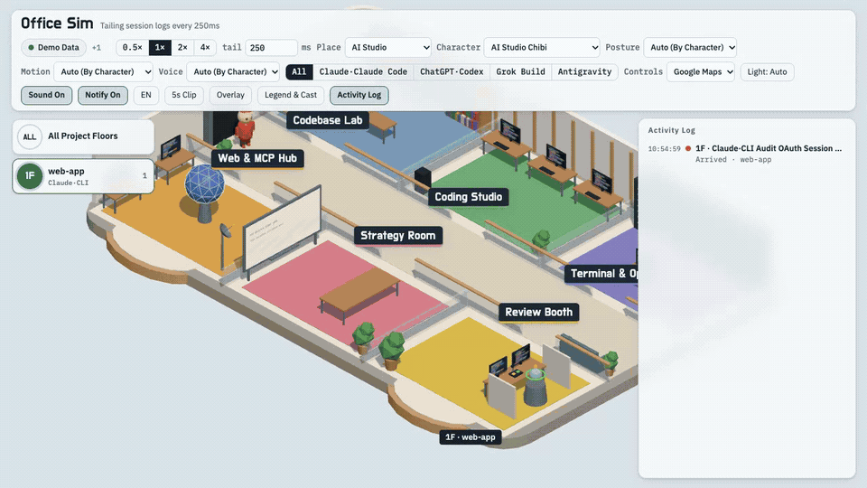
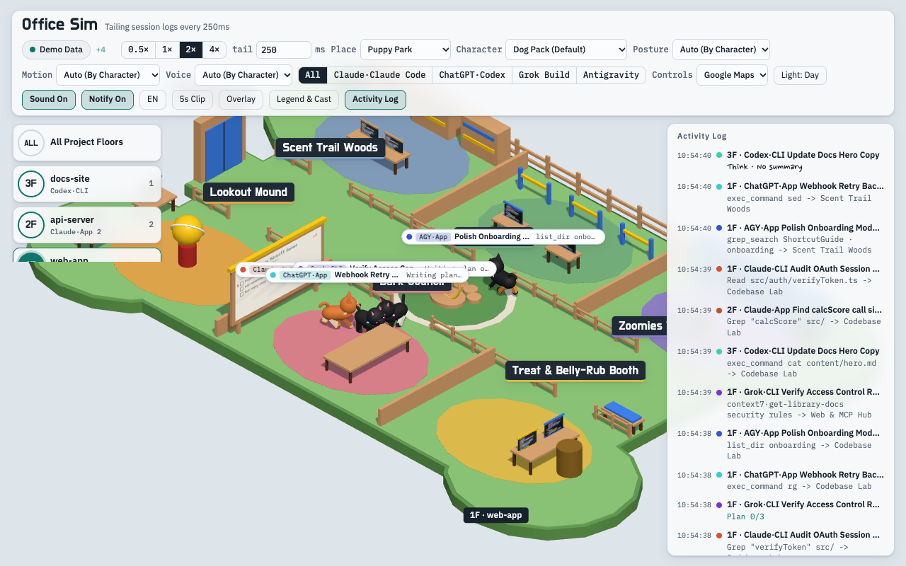
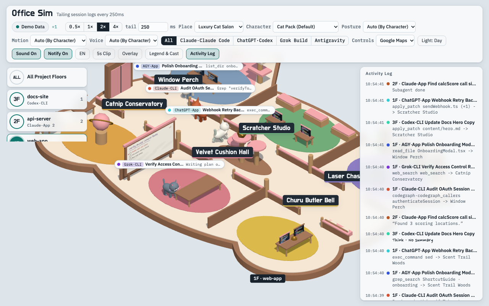
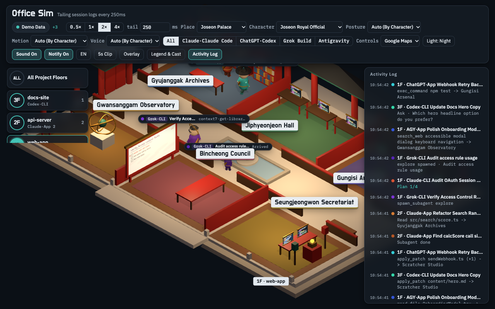
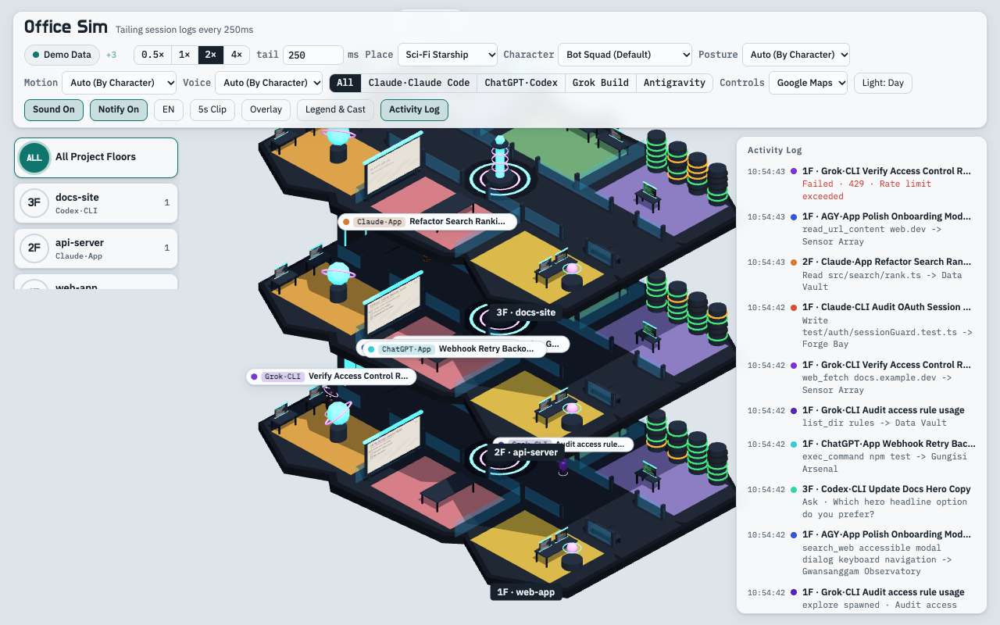
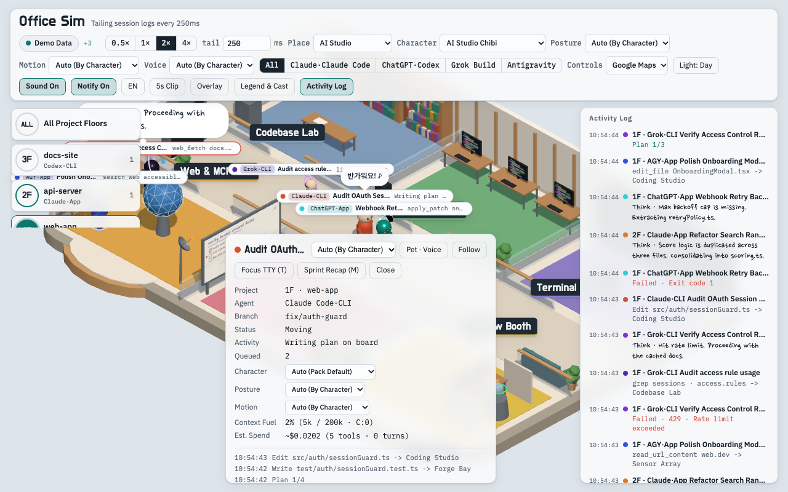
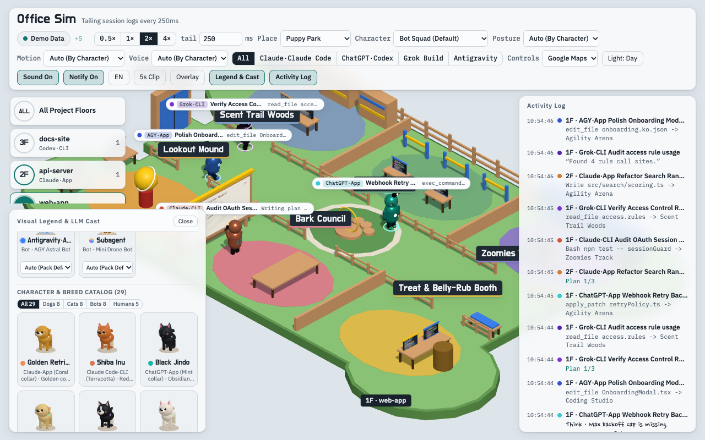

<div align="center">
<h1>Office Sim</h1>
<p><strong>Real-time 3D multi-agent office visualizer for Claude Code, OpenAI Codex, xAI Grok, and Google Antigravity</strong></p>

[](https://github.com/WahyzMaster/office-sim/actions/workflows/test.yml)
[](https://www.npmjs.com/package/office-sim)
[](https://wahyzmaster.github.io/office-sim/?lang=en#demo)
[](https://nodejs.org/)
[](#quick-start)
[](LICENSE)
[](https://www.buymeacoffee.com/wahyzdad)

**English** | [한국어 문서 (Korean README)](README.ko.md) | [Live Interactive Demo](https://wahyzmaster.github.io/office-sim/?lang=en#demo) | [HD Demo Video (MP4)](docs/assets/demo-hero.mp4)

<a href="https://wahyzmaster.github.io/office-sim/?lang=en#demo">
  
</a>

*Click the preview above to launch the [Live Interactive 3D Demo](https://wahyzmaster.github.io/office-sim/?lang=en#demo) in your browser, or view the [720p H.264 Demo Video (`docs/assets/demo-hero.mp4`)](docs/assets/demo-hero.mp4).*

</div>

---

**Office Sim** is a zero-dependency local 3D office visualizer that tails your AI coding agent session logs every 250ms (plus sub-10ms Claude Code HTTP hooks) and renders **Claude Code** (CLI & Claude Desktop), **OpenAI Codex** (CLI & ChatGPT Desktop), **Grok (xAI Grok Build)** (CLI & Desktop Bot), and **Google Antigravity** (`agy` CLI & Desktop App) agents collaborating across project floors in real time.

## Quick Start

Requires **Node.js 22+** and has **zero runtime dependencies**.

```bash
# Run directly with npx
npx office-sim --open

# Enable native macOS / Windows system notifications for agent prompts & completions
npx office-sim --open --notify

# Or clone and start locally
git clone https://github.com/WahyzMaster/office-sim.git
cd office-sim
npm start
```

- **Live Local Sessions**: Open `http://127.0.0.1:4317` in your browser to watch your active local agent sessions.
- **Self-Contained Demo Mode**: Open `http://127.0.0.1:4317/?lang=en#demo` (or try the hosted [GitHub Pages Demo](https://wahyzmaster.github.io/office-sim/?lang=en#demo)) to watch a multi-agent simulation across multiple floors with zero setup.

## Visual Showcase

| Puppy Park (`dogs`) | Luxury Cat Salon (`cats`) |
| :---: | :---: |
|  |  |
| **Bone-shaped lawn, paw fountain, agility hoops & 8 3D dog breeds** (Golden/Labrador Retriever, White/Black/Bear Jindo, Border Collie, Welsh Corgi, Shiba Inu) | **Cat-ear velvet sunroom, 3-tier cat tower & 8 luxury 3D cat breeds** (Savannah/Ashera, Maine Coon, Chinchilla Persian, Bengal, British/Russian Blue, Siamese, Ragdoll, Scottish Fold) |
| **Joseon Palace (`palace` - Night Lighting)** | **Multi-Floor Overview (`starship` & `hanok`)** |
|  |  |
| **Stepped white stone base (`Jangdaeseok`), Gyeonghoeru lotus pond & warm lantern glow** under Night lighting mode | **Stacked project floors** with octagonal Sci-Fi Starship warp core (`2F`), L/U-shaped Traditional Hanok courtyard (`1F`), and **Bot Squad** |
| **AI Studio (`studio`)** | **29-Character Catalog & Agent Inspector** |
|  |  |
| **Modern glass AI studio** with real-time tool speech bubbles, **3D Context Fuel Rings**, whiteboard checklist, and Agent Inspector (`Focus TTY (T)` & `Sprint Recap (M)`) | **Scrollable 29-Character Visual Legend** (`All 29 | Dogs 8 | Cats 8 | Bots 8 | Humans 5`) alongside **8 per-LLM Cast assignment cards** |

## Features

- **Multi-Agent CLI & Desktop Cloud Chat Support**:
  - Automatically discovers and tails local CLI/IDE session logs from **Claude Code** (`~/.claude/projects`), **OpenAI Codex** (`~/.codex`), **Grok** (`~/.grok`), and **Google Antigravity** (`~/.gemini/{antigravity,antigravity-cli,antigravity-ide}`).
  - Also detects active **Claude Desktop** (`claude-code:app`), **ChatGPT Desktop / Dot** (`codex:app`), and **Grok Desktop Bot** (`grok:app`) sessions and renders them as 3D Bot characters by default.
  - Accepts real-time **Claude Code HTTP Hooks** (`POST /api/hooks/claude`) for sub-10ms event delivery alongside 250ms JSONL tailing.
- **Native macOS & Windows System Notifications (`--notify` / `N`)**:
  - Opt-in desktop alerts via `--notify [ask,error,done,tool_error]` or the top-bar **Notify Off / Notify On** (`#notify-toggle`, shortcut `N`) button, synced in real time via `GET/POST /api/notify`.
  - Uses native macOS Notification Center (`/usr/bin/osascript`) and Windows 10/11 WinRT `ToastNotificationManager` (`NotifyIcon` fallback) with zero external dependencies and 5 corpus-backed anti-noise guards (`3.5s` Ask wait-confirm, `4.0s` Turn Done settle, `4.0s` per-agent cooldown, subagent intermediate suppression, and `replay` hard-mute), plus Web `Notification` API fallback.
- **Click-to-Focus Native Terminal / IDE Tab (`T`)**:
  - Click any 3D agent character or press `T` (`Focus TTY (T)` in the Inspector) to bring the agent's native terminal tab or IDE window to the foreground on **macOS** (`iTerm2`, `Terminal.app`, `Cursor`, `VS Code`, `Antigravity`, `Ghostty`, `WezTerm`, `Warp`) and **Windows** (`Windows Terminal`, `VS Code`, `Cursor`, `PowerShell`).
- **3D Context Window Fuel Ring & Token / Cost Estimator**:
  - Each 3D character stands on a live **Context Window Fuel Ring** that shifts from Green (`<60%`) to Amber (`60-85%`) to pulsing Red (`>85%`) and triggers a compaction particle burst when context is compacted.
  - The Agent Inspector displays a live context utilization bar, token breakdown, and estimated session spend in USD.
- **Unreviewed `Done` Badge & 1-Click Sprint Recap (`M`)**:
  - Completed agent turns display an amber **`Done` badge** on the floating character tag until reviewed.
  - Press `M` or click **Sprint Recap (M)** in the Inspector to view and copy a structured Markdown summary of edited files, commands, and verification steps.
- **8-Axis Independent Customization**:
  - **Place (`7` Architectural Themes)**: Switch the 3D floor structure and room furniture between `AI Studio`, `Tech Office`, `Joseon Palace`, `Traditional Hanok`, `Sci-Fi Starship`, `Puppy Park`, and `Luxury Cat Salon`.
  - **Character (`9` Presets + Individual Breeds/Bots)**: Decouple character costumes/species from the building architecture (`AI Studio Chibi`, `Tech Office Staff`, `Joseon Royal Official`, `Traditional Hanok Scholar`, `Sci-Fi Starship Crew`, `Dog Pack`, `Cat Pack`, `Bot Squad`, `Mixed Cast`, or any of the 29 individual models).
  - **Per-LLM Character Mapping (`29` 3D Models across `8` Cast Slots)**: Assign any of the **29 3D models** (`8` Dog breeds + `8` Cat breeds + `8` 3D Bots: `Claude Duet`, `Claude Bot`, `ChatGPT Dot`, `Codex Droid`, `Grok Bot`, `AGY Probe Bot`, `AGY Astral Bot`, `Mini Drone Bot` + `5` Human Chibi themes) individually across **8 LLM cast slots** (`Claude/Claude Code·App`, `Claude Code·CLI`, `ChatGPT/Codex·App`, `Codex·CLI`, `Grok Build·CLI`, `Antigravity·CLI`, `Antigravity·App`, and `Subagent`).
  - **Motion (`Auto` + `6` Acrobatic Stunts)**: Trigger `Jump`, `Roll`, `Cat Flip`, `Spin`, `Propeller Fly`, or `Phase` stunts globally, per agent in the Inspector, or by clicking any 3D character in the scene.
  - **Posture (`Auto` / `Sit` / `Stand` / `Bipod` / `Tetrapod`)**: Let characters sit at desks automatically, force standing/sitting poses, or switch between 2-legged (`Bipod`) and 4-legged (`Tetrapod`) gaits.
  - **Voice (`Off` / `Auto` / `Animal` / `Human` / `Bots`)**: Synthesized Web Audio sound effects tailored to human speech chimes, dog barks, cat meows, or sci-fi droid bleeps (`BotVoice`).
  - **Lighting (`Day` / `Night` / `Auto`)**: Switch between bright daylight, warm night-time architectural lighting, or local-clock automatic cycling.
  - **Controls (`4` Camera Presets) & Bilingual UI (`KO / EN`)**: Instant toggle between Korean and English UI labels.
- **3D Obstacle & Furniture Collision Avoidance**:
  - Every room desk, server rack, conference table, cat tower, and courtyard pond registers a 2D AABB collider per floor so agents smoothly steer around furniture and doorway thresholds.
- **Scrollable Visual Legend & Interactive 3D Catalog**:
  - Inspect all **29 rotating 3D models** with category filter tabs (`All 29 | Dogs 8 | Cats 8 | Bots 8 | Humans 5`) alongside the **8 live LLM Cast cards**, room color swatches, and speech bubble signal meanings.
- **Project Floors & Review Intercom Booth**:
  - Each repository/workspace gets its own floor (`1F`, `2F`, ...); git worktrees of the same repo share a floor, and workspace-less sessions gather on the `Global · Unassigned` (`전역 · 미지정`) floor.
  - The `desk` room features a **3D Review & Approval Intercom Booth** where agents walk to ask questions or await permission approval.
- **Privacy by Default**: Loopback-only (`127.0.0.1`), strict `Host`/`Origin`/`Sec-Fetch-Site` guards, optional `--auth` cookie token, and strict scrubbing (only tool categories, file basenames, and URL hostnames are sent to the browser — never file contents, raw commands, or credentials).
- **Streamer / OBS Overlay Mode & 1-Click 5s Clip Capture**:
  - Open `?overlay=1` (or `#overlay`, or press `O`) to hide HUD panels and switch the 3D WebGL canvas to a transparent background (or chroma-key via `?chroma=green` / `?chroma=blue` / `?chroma=ff00ff`) for OBS Browser Sources and Picture-in-Picture streams.
  - Click **5s Clip** (`#capture-clip`) in the top bar to record a 5-second WebM clip (`Shift+Click` for an instant PNG snapshot).

## Room Themes & Tool Mapping

| Room Key | AI Studio (`studio`) | Tech Office (`office`) | Joseon Palace (`palace`) | Traditional Hanok (`hanok`) | Sci-Fi Starship (`starship`) | Puppy Park (`dogs`) | Luxury Cat Salon (`cats`) | Agent Activity & Tools |
|---|---|---|---|---|---|---|---|---|
| `archive` | **Codebase Lab** (`코드 탐색실`) | Library (`라이브러리`) | **Gyujanggak Archives** (`규장각`) | **Jangpangak Library** (`장판각`) | Data Vault (`데이터 볼트`) | **Scent Trail Woods** (`노즈워크 숲`) | **Window Perch** (`창가 캣타워`) | `Read`, `Grep`, `Glob`, `codegraph` |
| `dev` | **Coding Studio** (`코딩 스튜디오`) | Dev Zone (`개발존`) | **Jiphyeonjeon Hall** (`집현전`) | **Geulbang Study** (`글방`) | Forge Bay (`포지 베이`) | **Agility Arena** (`어질리티 훈련장`) | **Scratcher Studio** (`스크래처 공방`) | `Edit`, `Write`, `NotebookEdit`, `apply_patch` |
| `server` | **Terminal & Ops** (`터미널·빌드실`) | Server Room (`서버룸`) | **Gungisi Arsenal** (`군기시`) | **Daejanggan Forge** (`대장간`) | Engine Core (`엔진 코어`) | **Zoomies Track** (`우다다 트랙`) | **Laser Chase Dome** (`레이저 사냥터`) | `Bash`, `git`, `gh`, test & build runs |
| `research` | **Web & MCP Hub** (`웹·MCP 허브`) | Research Lab (`리서치랩`) | **Gwansanggam Observatory** (`관상감`) | **Nugak Pavilion** (`누각`) | Sensor Array (`센서 어레이`) | **Lookout Mound** (`전망 언덕`) | **Catnip Conservatory** (`캣닢 온실`) | `WebSearch`, `WebFetch`, external MCP tools |
| `meeting` | **Strategy Room** (`기획·작전실`) | Boardroom (`보드룸`) | **Bincheong Council** (`빈청`) | **Daecheong Main Hall** (`대청마루`) | Tactical Bridge (`택티컬 브리지`) | **Bark Council** (`독 파크 모임터`) | **Velvet Cushion Hall** (`벨벳 라운지`) | Task planning & live 3D whiteboard |
| `desk` | **Review Booth** (`리뷰·승인 부스`) | Hotline Booth (`핫라인 부스`) | **Seungjeongwon Secretariat** (`승정원`) | **Sarangchae Reception** (`사랑채`) | Holo-Comms Pod (`홀로그램 통신실`) | **Treat & Belly-Rub Booth** (`간식·칭찬 부스`) | **Churu Butler Bell** (`츄르·집사 호출석`) | `AskUserQuestion`, plan & tool approvals |
| `lounge` | **Lounge** (`라운지`) | Lounge (`라운지`) | **Huwon Garden** (`후원`) | **Anmadang Courtyard** (`안마당`) | Crew Lounge (`크루 라운지`) | **Sunny Lawn** (`잔디 마당`) | **Sunbeam Hammock** (`햇살 해먹`) | Idle standby & arrival/departure elevator |

## Supported Agents

| Agent | Agent ID | Status & Notes |
|---|---|---|
| Claude Code (CLI & Claude Desktop) | `claude-code` | Supported (`~/.claude/projects/**/*.jsonl`, HTTP hooks `POST /api/hooks/claude`, Claude Desktop App watcher, subagents, and `--replay`) |
| Grok (xAI Grok Build) | `grok` | Supported (P5c). Live permission approval wait supported (P5g, 라이브 승인 대기 표시: reads only 4 fields from `events.jsonl`), plus Grok Desktop Bot watcher |
| OpenAI Codex (App, CLI, IDE & ChatGPT Desktop) | `codex` | Supported (P5d, `~/.codex/sessions/<YYYY>/<MM>/<DD>/rollout-*.jsonl`, `session_index.jsonl`, and ChatGPT Desktop / Dot watcher) |
| Antigravity CLI (`agy`) & Legacy IDE | `antigravity` (`surface: 'cli'`) | Supported (P5e, `~/.gemini/{antigravity-cli,antigravity-ide}/brain/<id>/.system_generated/logs/`) |
| Antigravity Desktop App (2.x) | `antigravity` (`surface: 'app'`) | Supported (`~/.gemini/antigravity/brain/<id>/.system_generated/logs/`, plus `task.md` / `implementation_plan.md` checklists; never opens encrypted `conversations/*.pb`) |

## Camera Control Presets

| Preset | Left-Drag | Right / Modifier Drag | Wheel / Trackpad Scroll |
|---|---|---|---|
| **Google Maps** (Default) | Pan across floor | Right-drag or `Ctrl`+Left-drag: Orbit & tilt | Zoom in / out (`Shift`+Arrows: Orbit & tilt) |
| **Figma** | Orbit camera | `Space`+drag or Middle-drag: Pan | 2D pan (`Ctrl`/`Cmd`+Wheel: Zoom, `Shift+0/1/2`: Reset/Focus) |
| **3D Orbit** | Orbit camera | Right-drag or `Shift`/`Space`+drag: Pan | Zoom in / out (`Q`/`E`: Rotate) |
| **Blender** | Pan across floor | Middle-drag or `Alt`+Left-drag: Orbit | Zoom in / out (`.`/`F`: Focus selected, `Home`/`R`: Reset) |

Common shortcuts: `WASD` / Arrow keys (pan), `Q` / `E` (rotate), `+` / `-` (zoom), `1`-`9` (select floor), `0` (overview all floors), `F` or double-click character (follow agent), `T` (focus agent terminal / IDE tab), `M` (open Sprint Recap Markdown card), `N` (toggle system notifications), `O` (toggle streamer overlay mode), `R` or `Home` (reset camera), `Esc` (deselect).

## CLI Options

```bash
node bin/office-sim.mjs [options]
```

| Option | Default | Description |
|---|---|---|
| `--port <n>` | `4317` | HTTP port (`0` for a random free port) |
| `--host <addr>` | `127.0.0.1` | Loopback address (`127.0.0.1`, `localhost`, `::1` only) |
| `--interval <ms>` | `250` | Tail poll interval in ms (`50`..`5000`) |
| `--active <min>` | `30` | Only attach sessions modified within the last N minutes |
| `--rescan <ms>` | `3000` | Directory rescan interval for new sessions in ms |
| `--agents <list>` | all available | Comma-separated agent IDs (`claude-code,codex,grok,antigravity`) |
| `--claude-root <dir>` | `~/.claude/projects` | Claude Code sessions directory (`--root` alias supported) |
| `--codex-root <dir>` | `~/.codex` | OpenAI Codex home directory |
| `--grok-root <dir>` | `~/.grok` | xAI Grok Build home directory |
| `--antigravity-root <dir>` | `~/.gemini` | Google Antigravity home directory |
| `--notify [cats]` | off | Native OS notifications (`ask,error,done` default; accepts `tool_error`, `all`, `off`) |
| `--replay <file.jsonl>` | off | Replay a recorded Claude Code session file with original timing |
| `--speed <n>` | `1` | Replay speed multiplier (`0.1`..`1000`) |
| `--loop` | off | Loop replay continuously |
| `--auth` | off | Require a per-run token (`http://127.0.0.1:<port>/?t=<token>`) and set an `HttpOnly` cookie |
| `--open` | off | Open the URL in your default browser on startup |

## `/office` Skill Integration

Install the bundled `/office` skill (`skills/office/SKILL.md`) to start, check, or stop `office-sim` directly from Claude Code or compatible agent skill directories:

```bash
npm run skill:install                  # Symlinks ~/.claude/skills/office -> <repo>/skills/office
npm run skill:install -- --skills-dir ~/.agents/skills
npm run skill:uninstall                # Removes symlink if it points to this repo
```

Once installed, invoke `/office`, `/office demo`, `/office auth`, `/office status`, or `/office stop`.

## Privacy & Security Architecture

- **Loopback-Only & Cross-Site Guards**: Rejects non-loopback `Host` headers, foreign `Origin` headers, and `Sec-Fetch-Site: cross-site` requests.
- **Strict Scrubbing**: Only tool names, file basenames (never directory paths), URL hostnames (never query strings or paths), and short status summaries reach the browser. Credentials (`oauth_creds.json`, `.env`, SQLite DBs, raw prompt history files, encrypted `.pb` files) are never opened.
- **Architecture & Specifications**:
  - [`docs/CONTRACT.md`](docs/CONTRACT.md) — Event schema, adapter rules, privacy scrubbing contract, and `/healthz` specification.
  - [`docs/ADAPTERS.md`](docs/ADAPTERS.md) — Multi-agent adapter design and mapping tables.
  - [`docs/HISTORY.md`](docs/HISTORY.md) — Implementation history and engineering notes.
  - [Contributing Guide](CONTRIBUTING.md) — How to run tests (`npm test`) and contribute adapters or themes.

## Support & Sponsorship

If you find **Office Sim** useful or enjoyable in your daily AI coding workflow, you can support its continued development via Buy Me a Coffee:

<a href="https://www.buymeacoffee.com/wahyzdad" target="_blank" rel="noopener noreferrer">
  
</a>

- **Buy Me a Coffee**: [https://www.buymeacoffee.com/wahyzdad](https://www.buymeacoffee.com/wahyzdad)

## License

[MIT](LICENSE)
