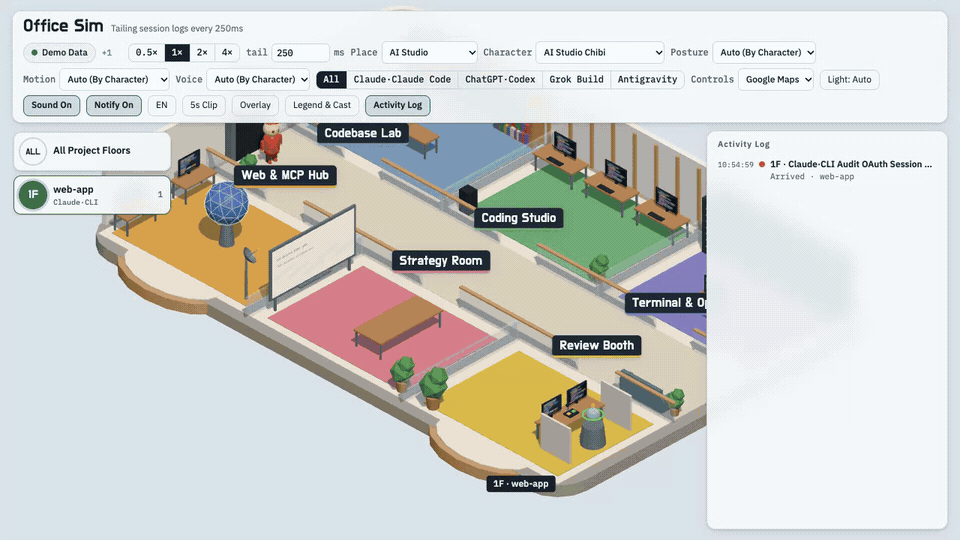
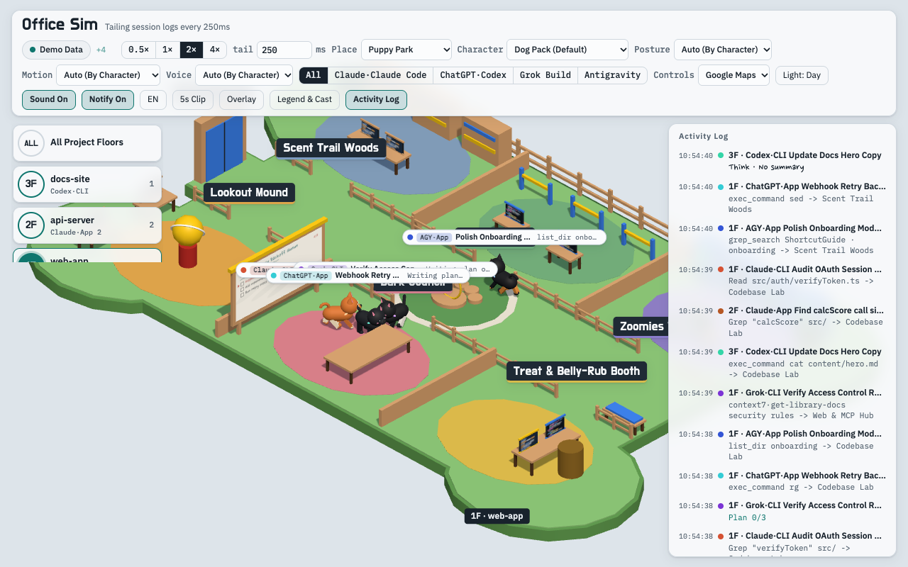
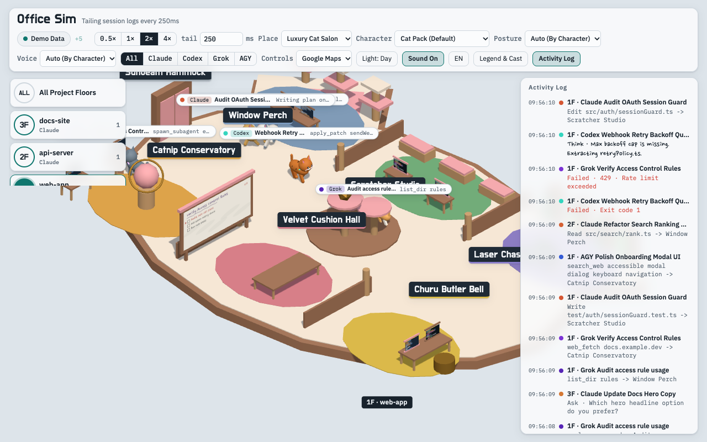
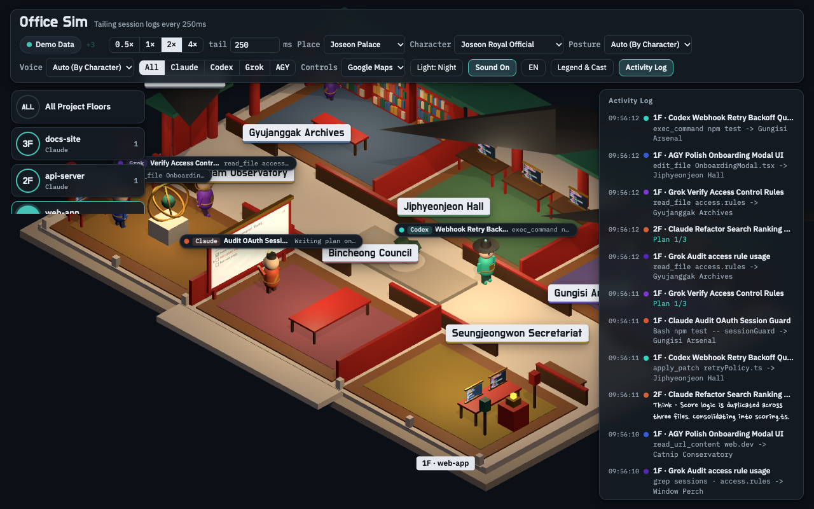
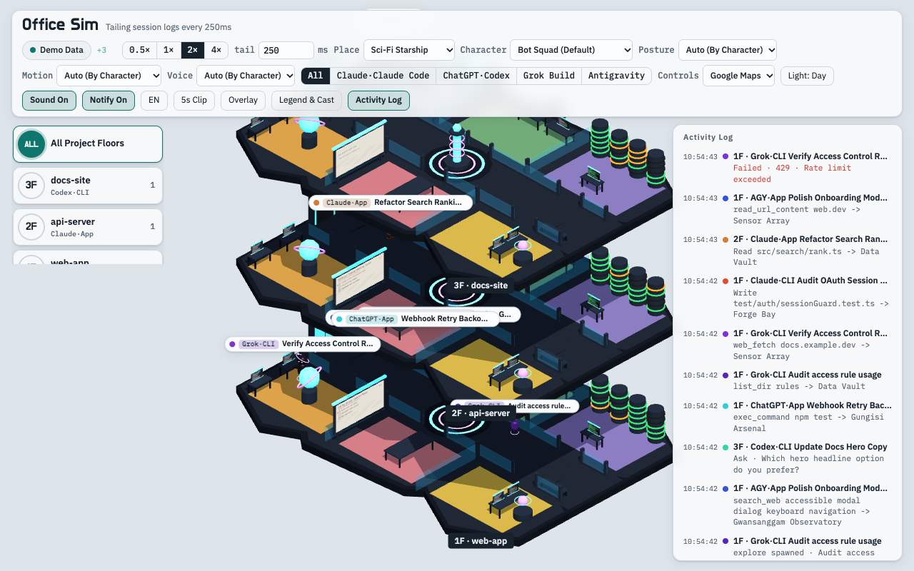
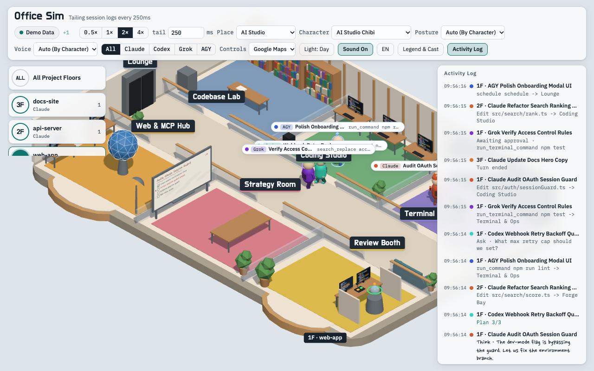
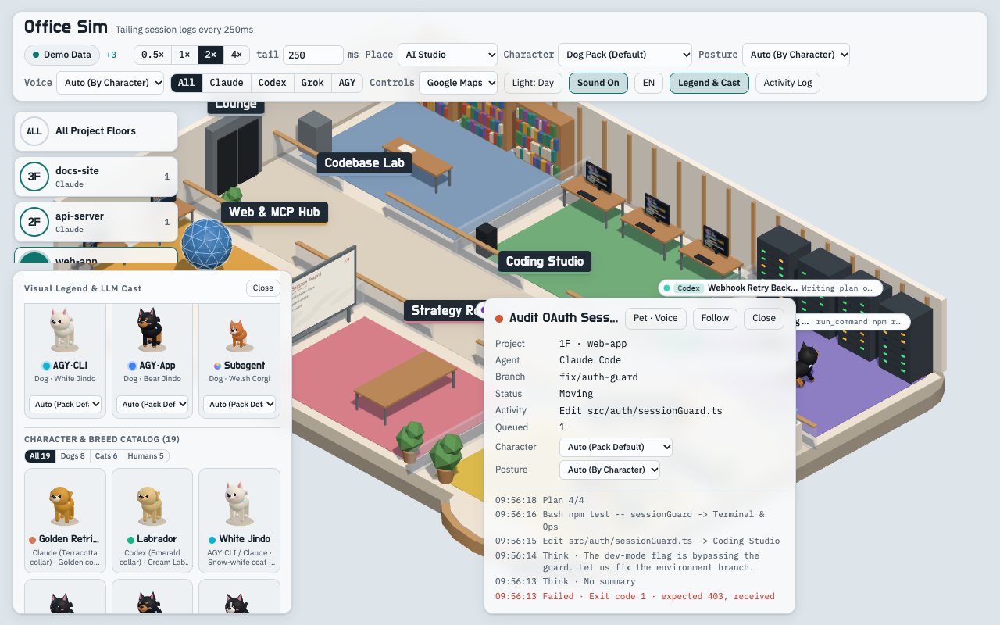

<div align="center">
<h1>Office Sim</h1>
<p><strong>Office Sim shows the AI coding agents running on your computer (Claude Code, Codex, Grok Build, Antigravity) as characters in a 3D office, so one browser tab tells you what each of them is doing right now.</strong></p>

[](https://github.com/WahyzMaster/office-sim/actions/workflows/test.yml)
[](https://www.npmjs.com/package/office-sim)
[](https://nodejs.org/)
[](LICENSE)

**English** | [한국어](README.ko.md) | [Live demo](https://wahyzmaster.github.io/office-sim/?lang=en#demo) | [Demo video (MP4)](docs/assets/demo-hero.mp4)

</div>

- Your agents from Claude Code, Codex, Grok Build and Antigravity appear side by side as characters, and each one moves between rooms as it reads, edits, runs commands and searches.
- An agent that asks you a question or waits for plan approval walks to the review booth. It can also raise a desktop notification (opt-in), and one click on its Focus button (or the `T` key) brings its terminal to the front on macOS and Windows.
- It runs on your machine only: the server listens on `127.0.0.1`, opens session logs read-only and sends nothing out.

<div align="center">
<a href="https://wahyzmaster.github.io/office-sim/?lang=en#demo">
  
</a>
</div>

## Quick start

```bash
npx office-sim
```

Needs Node.js 22 or newer (22 and 24 are tested). Run in a terminal, this starts a local server at `http://127.0.0.1:4747` and opens it in your default browser; `--no-open` turns the opening off.

- **An agent is running**: every session that was active in the last 30 minutes shows up as a character within a few seconds.
- **No agent is running**: the page plays a built-in demo under a banner that says so, and switches to your real sessions as soon as the first one starts. The terminal prints one line saying the same.
- **Just looking**: `npx office-sim --demo` opens the demo directly, and the same demo is hosted as the [live demo](https://wahyzmaster.github.io/office-sim/?lang=en#demo).

From a clone: `git clone https://github.com/WahyzMaster/office-sim.git`, then `cd office-sim` and `npm start`.

## Claude Code plugin

Inside Claude Code:

```text
/plugin marketplace add WahyzMaster/office-sim
/plugin install office-sim@office-sim
```

Or from a shell, without the plugin system:

```bash
npx office-sim init
```

Either one adds two hooks that tell the local Office Sim server when Claude Code opens a permission prompt (the session log does not record that moment), and the `/office` skill, which starts, opens, checks and stops the server from inside Claude Code (`/office-sim:office` when it comes from the plugin). `init` prints every change first and writes only after you say yes; the [FAQ](#faq) lists exactly what is written.

## What it detects

A "yes" in the first three columns means the character walks to the review booth and, with notifications on, an alert fires. "Turn finished" lights the `Done` badge on the character's name tag.

| Agent | Question to the user | Plan approval | Permission prompt | Turn finished |
|---|---|---|---|---|
| Claude Code | Yes (`AskUserQuestion`) | Yes (`ExitPlanMode`) | Only with the plugin or the hooks from `office-sim init`. Not detected from the session log alone | Yes (20 seconds after the closing reply, or at once when the log has a stop record) |
| Codex | Yes (`request_user_input`) | Not detected as a wait. The proposed plan appears on the meeting-room whiteboard | Not detected | Yes (`task_complete`) |
| Grok Build | Yes (`ask_user_question`) | Yes (`exit_plan_mode`) | Yes, 1 to 4 seconds after the prompt opens. A prompt answered within a second never shows, and the log does not say whether a person or Grok's automatic review answers | Yes (`turn_completed`) |
| Antigravity | Yes (`ask_question`) | Not detected | Not detected | Inferred. The log has no end record: a turn ends 20 seconds after the closing answer, or sooner when Antigravity reports the conversation idle |
| Gemini CLI (plug-in) | Yes (`ask_user`, `ask_followup_question`) | Not detected | Not detected | Inferred: 20 seconds after a reply that calls no tool |

Known limit: Claude Code has no hook that says a prompt was allowed, so after you approve a long-running tool its character stays at the booth as "waiting" until the tool ends.

The Claude Code hook path is tested with fixture payloads written from Claude Code's hook reference, not yet against a live Claude Code session. If you try it in your own setup, a confirmation or a failure report is welcome as an [issue](https://github.com/WahyzMaster/office-sim/issues).

## Why

Several agents in several terminals means their state is spread over tabs: one is editing, one is running tests, one stopped a while ago to ask something. Office Sim puts them in one picture, grouped by project, using only what the agents already write to disk. There is nothing to wire into the agents themselves; the Claude Code plugin is optional and adds one signal the logs lack.

## Features

- **Four agents and three desktop apps in one office**: sessions of Claude Code, Codex, Grok Build and Antigravity are found in their default folders. On macOS, chats in the Claude, ChatGPT and Grok desktop apps appear as bot characters (what is read for that is listed under [Privacy and security](#privacy-and-security)). Gemini CLI is an opt-in plug-in (`--plugins gemini-cli`).
- **One floor per project**: each repository or workspace gets its own floor (`1F`, `2F`, ...). Git worktrees of the same repository share a floor, sessions without a workspace gather on the `Global · Unassigned` floor, and subagents appear as smaller characters.
- **Review booth**: the `desk` room holds the review booth, where a character goes when its agent asks a question, proposes a plan for approval or waits on a permission prompt ([what is detected](#what-it-detects)). The browser tab title counts the characters that wait for an answer, and a chip next to the connection indicator steps through them.
- **Mini window**: the `Mini window` button in the top bar moves the office into a small window that stays on top of other applications, so you can keep an eye on it while you work elsewhere. It shows one floor, switches to the floor of a character that waits for an answer when nobody waits on the floor you see, shows how many characters wait, and moves the scene on at most 30 times a second. `Back to tab`, or closing the window, puts the office back into the tab. It needs a Chromium-based desktop browser (Chrome or Edge): Safari and Firefox lack the browser feature it uses (Document Picture-in-Picture), and the button does not appear there.
- **Desktop notifications (opt-in)**: `--notify` or the Notify button in the top bar (shortcut `N`) turns on native macOS and Windows notifications for questions and approval waits, finished turns and errors. Where native notifications are not available the browser's own are used while the tab is hidden. To keep the noise down there is one finished-turn alert per turn and none for subagents, repeated API errors are merged for 15 seconds, alerts of one kind for one agent are at least 4 seconds apart, and nothing fires for history read at startup or in replay.
- **Focus the terminal (`T`)**: select a character and press `T`, or use `Focus TTY (T)` in the inspector, to bring that agent's window to the front. On macOS this finds the iTerm2 or Terminal.app tab by its tty, or else a Cursor, VS Code, Antigravity, Ghostty, WezTerm or Warp window by project name; on Windows it finds a window whose title contains the project name. Linux is not supported.
- **Context ring and token figures (estimates)**: each character stands on a context ring that turns from green (below 60%) to amber (60-79%) to red (80% and above), and a short particle burst plays when the session's context is compacted. The ring is an estimate, not a reading from the model: the events the page receives carry no usage numbers, so it adds a rough number of tokens per event (prompt, thinking, reply, tool call; a reply counts more the longer its excerpt is) against an assumed 200,000-token window. The inspector shows the same estimates as two text rows, `Context Fuel (est.)` and `Tokens (est.)`. Office Sim shows no cost or price figure.
- **`Done` badge and Sprint Recap (`M`)**: a finished turn leaves an amber `Done` badge on the character's name tag until you select it. `M`, or `Sprint Recap (M)` in the inspector, opens a Markdown card you can copy: agent and branch, duration and turn count, the context and token estimates, tool-call counts with the most used tools, and the names of the files touched.
- **Replay**: `--replay <file.jsonl>` plays back a recorded Claude Code session with a timeline scrubber, markers and bookmark pins.
- **Furniture-aware movement**: desks, server racks, tables, cat towers and ponds register colliders per floor, so characters steer around furniture and through doorways.
- **Legend and character catalog**: all 29 rotating 3D models with category tabs (`All 29 | Dogs 8 | Cats 8 | Bots 8 | Humans 5`), the 8 cast cards, room colour swatches and the meaning of each speech bubble.
- **Streamer overlay and clips**: `?overlay=1` (or `#overlay`, or the `O` key) hides the panels and makes the canvas background transparent, or a chroma key with `?chroma=green`, `?chroma=blue` or `?chroma=ff00ff`, for OBS browser sources. The `5s Clip` button records a 5-second WebM clip (`Shift`+click saves a PNG snapshot).
- **Korean and English**: the page starts in English unless your browser language is Korean, and the `KO / EN` button switches it at any time. Sound starts off.

## FAQ

**Does it read my code?**
No. It reads the session logs your agents write, not your repository. Those logs do contain what the agents did, file contents and command lines included, and they pass through the server's memory while it reads them. The server keeps and sends to the page three kinds of text. Names: tool names, file names without their folders, URL host names, program names of shell commands (with the subcommand for common tools such as `git`, `npm` or `make`), branch and worktree names. Short excerpts (at most 160 characters each) of prompts, replies, the agent's thinking, questions, plan items, session titles, API error notices and the first line of a tool error. And short pieces of a tool call that say what the call is about (at most 60 characters each), for example a search pattern, a web or MCP search query, the one-line description the agent gives a command or a subagent task, a task subject, and the headers and option labels of a question. In all three, paths are cut to file names, URLs to host names, email addresses are removed, and a fixed list of secret shapes is replaced by `(secret)`: some keys that start with a well-known prefix (not every key a vendor issues; section 5 of [`docs/CONTRACT.md`](docs/CONTRACT.md) names the prefixes), JSON Web Tokens, `Bearer` credentials, the values of `Authorization` and `x-api-key` headers (a value that is one ordinary word, with no known scheme in front of it, is left), PEM private keys, and the value behind a name that ends with a word such as `password`, `secret`, `token` or `api_key`. That list is a net, not a detector. Everything else is shown as written: an excerpt is the start of the text, and a search pattern or a query is sent as the agent wrote it, so a secret of any other shape at the start of a prompt or inside a search query would show like any other text. The one full path sent is each session's project folder, described under [Privacy and security](#privacy-and-security); sections 3.1, 4 and 5 of [`docs/CONTRACT.md`](docs/CONTRACT.md) are the complete list.

**Does it send anything out?**
No. The server binds to loopback, has no telemetry and makes no request to another machine; the only HTTP request it ever makes is a health check to its own port on loopback, to see whether an Office Sim is already running there. The page loads everything from the local server, three.js included, and its content security policy names no outside host. The one exception is yours to turn on: `--cdn` lets the page fetch the experimental WebGPU renderer from `cdn.jsdelivr.net`.

**Does it change my agent settings?**
Not by running it: `npx office-sim` reads the agents' folders and never writes to them or to a settings file. Two explicit setup steps write, and only for Claude Code: installing the plugin (Claude Code does that itself), and `office-sim init` (or `office-sim hooks install`). Nothing is ever written to the Codex, Grok or Antigravity folders.

**What does the plugin install?**
Two `http` hooks, `PermissionRequest` and `Notification` (matcher `permission_prompt`), that post to the local server on `127.0.0.1:4747` with a 2-second timeout, and one skill, `/office-sim:office`. Plugin hooks live in the plugin folder that Claude Code copies into its plugin cache, not as hook entries in your settings file. `npx office-sim init` installs the same two hooks into `~/.claude/settings.json` (merged with what is there, with the original copied once to `settings.json.office-sim.bak`) and copies the skill to `~/.claude/skills/office`; it shows the change and asks before it writes, `--dry-run` only shows it, and `office-sim hooks uninstall` removes the hooks again. The hooks carry the default port, so with another `--port` use `office-sim hooks install --port <n>`. From a hook body the server reads six fields (session id, event name, notification type, tool name, agent id, and the transcript path, which is only compared with the Claude folder); the tool input and everything else in the body is discarded.

## Troubleshooting

- **Port in use**: the default port is `4747` and there is no automatic fallback. If the program on it is another Office Sim and you passed no option (or only `--open`, `--no-open`, `--demo`), the command prints its address, opens it when opening is on, and exits. Otherwise the error names the port: stop the other program, or start with `--port <n>` (`--port 0` picks a free one).
- **No sessions appear**: only sessions modified in the last 30 minutes are attached (`--active <min>` widens that), and the line `office-sim: agents ...` at startup lists the agents whose folders were found. An agent that keeps its logs elsewhere needs its root option (`--claude-root`, `--codex-root`, `--grok-root`, `--antigravity-root`). A page opened while no session is attached shows the demo under its banner until the first one appears.
- **Node version**: Node.js 22 or newer is supported. On an older Node the command prints one warning and still tries to run; if it then fails, upgrade Node first.
- **A Claude Code permission prompt does not show**: the server must be running on the port the hooks name (`4747` unless you installed them with `--port`), and not with `--auth`, because a hook request carries no cookie. `office-sim hooks status` shows whether the settings-file hooks are installed and whether a server answers; it does not check plugin hooks.

## Supported agents

| Agent | Agent id | What is read |
|---|---|---|
| Claude Code (CLI and the Claude desktop app) | `claude-code` | `~/.claude/projects/**/*.jsonl`, subagent logs included, plus two small files next to them: a subagent's `agent-<id>.meta.json` (its name, description and type, and the call that started it) and a workflow run's `journal.jsonl` (step labels). Permission prompts come through the optional plugin or hooks. `--replay` plays back a recorded session |
| Grok (xAI Grok Build) | `grok` | `~/.grok/sessions/<workspace>/<session>/updates.jsonl` and `summary.json`, plus four fields of `events.jsonl` for the live approval wait. Also the Grok Bot desktop app |
| OpenAI Codex (desktop app, CLI, IDE extension and the ChatGPT desktop app) | `codex` | `~/.codex/sessions/<YYYY>/<MM>/<DD>/rollout-*.jsonl` and `session_index.jsonl` (thread titles) |
| Antigravity CLI (`agy`) and the legacy IDE | `antigravity` | `~/.gemini/antigravity-cli/` and `~/.gemini/antigravity-ide/`: the step logs under `brain/<id>/.system_generated/logs/` and the `task.md` checklist, plus two small files for the title, working folder, branch and status: the summaries file (`jetbox_summaries_proto.pb` or `agyhub_summaries_proto.pb`, four fields per conversation) and `annotations/<id>.pbtxt` |
| Antigravity desktop app (2.x) | `antigravity` | `~/.gemini/antigravity/`: the step logs under `brain/<id>/.system_generated/logs/` when the app writes them, and for such a conversation the same `task.md`, `agyhub_summaries_proto.pb` and `annotations/<id>.pbtxt`. The encrypted `conversations/*.pb` files are never opened |
| Gemini CLI (opt-in plug-in) | `gemini-cli` | `~/.gemini/tmp/<project>/chats/session-*.json[l]`, only with `--plugins gemini-cli` |

The exact files, and the fields read from each, are in section 4 of [`docs/CONTRACT.md`](docs/CONTRACT.md). What is read for the Claude, ChatGPT and Grok desktop apps is listed under [Privacy and security](#privacy-and-security).

## Privacy and security

- **Loopback only**: the server accepts `127.0.0.1`, `localhost` and `::1` as its address and nothing else, and rejects requests with a foreign `Host` or `Origin` header or `Sec-Fetch-Site: cross-site`. `--auth` adds a per-run token that the browser keeps as an `HttpOnly` cookie.
- **Nothing from outside**: the server has no npm dependencies, and the page ships its own copy of three.js (vendored under `public/vendor/`) and uses system fonts, so the default page contacts the local server only.
- **What reaches the page**: tool names (MCP server and tool names included), file basenames, URL hostnames, the program names of shell commands (with the subcommand for common tools such as `git`, `npm` or `make`), branch and worktree names, and short excerpts of prompts, replies, thinking, questions, plan items, session titles, API error notices and tool errors. A tool call also sends short pieces of its input that say what it is about: a search pattern (Grep, Glob), a web search query, the one-line description the agent gives a shell command, a subagent task or a workflow, a task subject, the name of a skill or of a message's recipient, one short value of an MCP call (its query, library, collection, element, action or title), and the headers and option labels of a question. These are examples per tool; sections 3.1, 4 and 5 of [`docs/CONTRACT.md`](docs/CONTRACT.md) are the complete list. File contents and command lines are not sent. Paths are cut to file names, URLs to host names, email addresses are removed, and a fixed list of secret shapes (section 5 of [`docs/CONTRACT.md`](docs/CONTRACT.md) has the list) is replaced by `(secret)`; everything else, a secret of any other shape included, is sent as written. Credential files and stores (`oauth_creds.json`, `.env`, SQLite databases, raw prompt history files, Antigravity's encrypted `conversations/*.pb` files) are never opened.
- **The one full path**: each session's project folder is sent to the local page as the key of its floor and is shown as the tooltip of the floor button. Without `--auth`, other users and processes on the same machine can read the server's local endpoints, so use `--auth` on a shared machine, and look at a state dump before you share it.
- **Read-only logs**: agent files are opened read-only, and the server writes nothing into an agent folder. The only files it writes itself are counts-only diagnostics in a `.observe` folder inside its own package, and only after you start a log observation from the developer panel (`?observe=1`). Only setup commands you run yourself write to `~/.claude`: `office-sim init` and `office-sim hooks install` (see the [FAQ](#faq)), and `npm run skill:install` from a clone.
- **Desktop Apps (files outside the agent folders)**: so that a chat in the Claude, ChatGPT or Grok desktop app can appear as a character, the server also looks at a few of those apps' files on macOS. All three checks are on by default and have no switch of their own: each runs only while that agent's root is the default one, so pointing `--claude-root`, `--codex-root` or `--grok-root` elsewhere, or leaving the agent out of `--agents`, turns it off, and `--replay` runs none of them. Every path and field is listed in [`docs/CONTRACT.md`](docs/CONTRACT.md) section 5.1.
  - **Claude Desktop**: under `~/Library/Application Support/Claude/IndexedDB/` it lists the `https_claude.ai_0.indexeddb.leveldb` and `https_claude.ai_0.indexeddb.blob` folders and reads the size and modification time of files in them, nothing else: no IndexedDB file is ever opened. In `~/Library/Logs/Claude/` it reads the size and modification time of `main.log` and `mcp.log`, and while the Claude Desktop character is in the office it reads the lines the app appends to `mcp.log` (at most 128 KiB per read). From a line of the form `<time> [info] [<server>] Message from client: ...` it keeps the time, the MCP server name, the request id, the tool name (`params.name`) of a request whose method is exactly `tools/call`, and whether the server answered with a result or an error. The request is parsed as JSON and only those fields are read; `params.arguments` is never read. Those lines also hold tool arguments and results: they pass through memory and, apart from the items just listed, are dropped, never stored, logged or sent. A server or tool name reaches the page only when it matches `[A-Za-z0-9_.:-]{1,64}`; a name of any other shape (a space, a path, an email address, more than 64 characters) is replaced by the generic label `mcp` or `call`. The page gets one character titled `Claude Desktop Chat`, tool events named `mcp__<server>__<tool>`, and the line `Completed <server>`.
  - **ChatGPT desktop**: it reads the last 512 KiB of recent `~/Library/Logs/com.openai.codex/<YYYY>/<MM>/<DD>/codex-desktop-*.log` files and keeps conversation ids (UUIDs), line times and start, stop and done markers; it lists `~/Library/Application Support/com.openai.chat/conversations-v3-*/` and uses the name, size and modification time of the `<uuid>.data` files without opening them. The page gets one character per conversation, with the id `codex-<uuid>` and a fixed title.
  - **Grok Bot**: it reads the modification time of state files in `~/.grokbot/` and `~/Library/Application Support/Grok Bot/` (`Cookies`, `Preferences` and `settings.json` are among them and are never opened), the end of `~/.grokbot/local-exec-daemon.log` (only to see whether the daemon is shutting down), and the small JSON files `sand-client-persistence/*.blob`, from which it keeps each bot's id, name or title, activity times and whether it is waiting for a reply. The page gets a character titled `Grok Bot · <name or title>`. Inside `~/.grok` it also reads the end of `logs/unified.jsonl` for session ids and times.

## CLI options

```bash
office-sim [options]
```

| Option | Default | Description |
|---|---|---|
| `--port <n>` | `4747` | HTTP port (`0` for a random free port) |
| `--host <addr>` | `127.0.0.1` | Loopback address (`127.0.0.1`, `localhost`, `::1` only) |
| `--interval <ms>` | `250` | How often the logs are checked for new lines, in ms (`50`..`5000`) |
| `--active <min>` | `30` | Only attach sessions modified within the last N minutes |
| `--rescan <ms>` | `3000` | How often the folders are searched for new sessions, in ms |
| `--agents <list>` | all available | Comma-separated agent ids (`claude-code,codex,grok,antigravity`) |
| `--claude-root <dir>` | `~/.claude/projects` | Claude Code sessions directory (`--root` is an alias) |
| `--codex-root <dir>` | `~/.codex` | OpenAI Codex home directory |
| `--grok-root <dir>` | `~/.grok` | xAI Grok Build home directory |
| `--antigravity-root <dir>` | `~/.gemini` | Google Antigravity home directory |
| `--plugins <list>` | off | Opt-in plug-in adapter ids (`gemini-cli`) |
| `--gemini-cli-root <dir>` | `~/.gemini/tmp` | Gemini CLI chats directory (when `--plugins gemini-cli` is enabled) |
| `--notify [cats]` | off | Native OS notifications (`ask,error,done` default; accepts `tool_error`, `all`, `off`) |
| `--replay <file.jsonl>` | off | Replay a recorded Claude Code session with interactive timeline scrubber, markers, and bookmark pins |
| `--speed <n>` | `1` | Replay speed multiplier (`0.1`..`1000`) |
| `--loop` | off | Loop replay continuously |
| `--auth` | off | Require a per-run token (`http://127.0.0.1:<port>/?t=<token>`) and set an `HttpOnly` cookie |
| `--cdn` | off | Let the page load scripts from `https://cdn.jsdelivr.net`; only `?renderer=webgpu` needs it (by default the page loads everything from the local server) |
| `--open` | on in a terminal | Open the URL in your default browser on startup. Without `--open` or `--no-open` it opens only when stdout is a terminal, `CI` is not set and an opener exists (never by default with `--auth` on Linux) |
| `--no-open` | off | Never open the browser |
| `--demo` | off | When the browser is opened, open the page in demo mode (the URL plus `#demo`); when it is not, print that URL in one more line (`office-sim: demo <url>#demo`) |

Setup commands for Claude Code (they start no server; `office-sim init --help` has the details):

| Command | What it does |
|---|---|
| `office-sim init` | Installs the two permission-prompt hooks and copies the `/office` skill |
| `office-sim hooks install` | Installs the hooks alone |
| `office-sim hooks uninstall` | Removes the hooks |
| `office-sim hooks status` | Says whether the hooks are installed and whether a server answers on the port |

They share `--settings <path>`, `--home <dir>`, `--port <n>`, `--dry-run` and `--yes`.

## `/office` skill

The `/office` skill starts, checks or stops `office-sim` from inside Claude Code: `/office`, `/office demo`, `/office auth`, `/office status`, `/office stop`. There are three ways to get it:

- the [Claude Code plugin](#claude-code-plugin), where the command is `/office-sim:office`;
- `npx office-sim init`, which copies it to `~/.claude/skills/office`;
- from a clone, as a link to the checkout:

```bash
npm run skill:install                  # Symlinks ~/.claude/skills/office -> <repo>/skills/office
npm run skill:install -- --skills-dir ~/.agents/skills
npm run skill:uninstall                # Removes symlink if it points to this repo
```

The linked skill runs the server from the checkout. The plugin and `init` copies have no checkout behind them and run it with `npx -y office-sim@latest`, which needs the network when the package is not cached yet.

## Rooms and tool mapping

| Room key | AI Studio (`studio`) | Tech Office (`office`) | Joseon Palace (`palace`) | Traditional Hanok (`hanok`) | Sci-Fi Starship (`starship`) | Puppy Park (`dogs`) | Luxury Cat Salon (`cats`) | Agent activity and tools |
|---|---|---|---|---|---|---|---|---|
| `archive` | **Codebase Lab** | Library | **Gyujanggak Archives** | **Jangpangak Library** | Data Vault | **Scent Trail Woods** | **Window Perch** | `Read`, `Grep`, `Glob`, `codegraph` |
| `dev` | **Coding Studio** | Dev Zone | **Jiphyeonjeon Hall** | **Geulbang Study** | Forge Bay | **Agility Arena** | **Scratcher Studio** | `Edit`, `Write`, `NotebookEdit`, `apply_patch` |
| `server` | **Terminal & Ops** | Server Room | **Gungisi Arsenal** | **Daejanggan Forge** | Engine Core | **Zoomies Track** | **Laser Chase Dome** | `Bash`, `git`, `gh`, test & build runs |
| `research` | **Web & MCP Hub** | Research Lab | **Gwansanggam Observatory** | **Nugak Pavilion** | Sensor Array | **Lookout Mound** | **Catnip Conservatory** | `WebSearch`, `WebFetch`, external MCP tools |
| `meeting` | **Strategy Room** | Boardroom | **Bincheong Council** | **Daecheong Main Hall** | Tactical Bridge | **Bark Council** | **Velvet Cushion Hall** | Task planning & live 3D whiteboard |
| `desk` | **Review Booth** | Hotline Booth | **Seungjeongwon Secretariat** | **Sarangchae Reception** | Holo-Comms Pod | **Treat & Belly-Rub Booth** | **Churu Butler Bell** | `AskUserQuestion`, plan & tool approvals |
| `lounge` | **Lounge** | Lounge | **Huwon Garden** | **Anmadang Courtyard** | Crew Lounge | **Sunny Lawn** | **Sunbeam Hammock** | Idle standby & arrival/departure elevator |

- Each project (working folder) uses one floor. Worktree sessions of one repository gather on the same floor, sessions without a working folder gather on the `Global · Unassigned` floor, and a floor whose characters have all left is removed (the last floor stays).
- Human characters wear their agent's brand colour and its own 3D props. With the modern character presets these are a beret and a star for Claude Code, a visor and a crystal for Codex, dark shades and an orbit ring for Grok, and for Antigravity a floating ring and a prism, with a cap for its CLI and a headset for its app; the palace and hanok presets swap the headwear for traditional hats. A subagent is a smaller character, and a human one wears a propeller cap.

## Theme gallery

| Puppy Park (`dogs`) | Luxury Cat Salon (`cats`) |
| :---: | :---: |
|  |  |
| **Bone-shaped lawn, paw fountain, agility hoops & 8 3D dog breeds** (Golden/Labrador Retriever, White/Black/Bear Jindo, Border Collie, Welsh Corgi, Shiba Inu) | **Cat-ear velvet sunroom, 3-tier cat tower & 8 luxury 3D cat breeds** (Savannah/Ashera, Maine Coon, Chinchilla Persian, Bengal, British/Russian Blue, Siamese, Ragdoll, Scottish Fold) |
| **Joseon Palace (`palace` - Night Lighting)** | **Multi-Floor Overview (`starship` & `hanok`)** |
|  |  |
| **Stepped white stone base (`Jangdaeseok`), Gyeonghoeru lotus pond & warm lantern glow** under Night lighting mode | **Stacked project floors** with octagonal Sci-Fi Starship warp core (`2F`), L/U-shaped Traditional Hanok courtyard (`1F`), and **Bot Squad** |
| **AI Studio (`studio`)** | **29-Character Catalog & Agent Inspector** |
|  |  |
| **Modern glass AI studio** with real-time tool speech bubbles, **3D Context Fuel Rings**, whiteboard checklist, and Agent Inspector (`Focus TTY (T)` & `Sprint Recap (M)`) | **Scrollable 29-Character Visual Legend** (All 29, Dogs 8, Cats 8, Bots 8, Humans 5) alongside **8 per-LLM Cast assignment cards** |

## Camera control presets

The **Controls** selector in the top bar (`Google Maps`, `Figma`, `3D Orbit`, `Blender`) switches to the mouse and trackpad scheme you are used to, and the choice is saved in the browser (`localStorage`).

| Preset | Left-Drag | Right / Modifier Drag | Wheel / Trackpad Scroll |
|---|---|---|---|
| **Google Maps** (Default) | Pan across floor | Right-drag or `Ctrl`+Left-drag: Orbit & tilt | Zoom in / out (`Shift`+Arrows: Orbit & tilt) |
| **Figma** | Orbit camera | `Space`+drag or Middle-drag: Pan | 2D pan (`Ctrl`/`Cmd`+Wheel: Zoom, `Shift+0/1/2`: Reset/Focus) |
| **3D Orbit** | Orbit camera | Right-drag or `Shift`/`Space`+drag: Pan | Zoom in / out (`Q`/`E`: Rotate) |
| **Blender** | Pan across floor | Middle-drag or `Alt`+Left-drag: Orbit | Zoom in / out (`.`/`F`: Focus selected, `Home`/`R`: Reset) |

Common shortcuts: `WASD` / Arrow keys (pan), `Q` / `E` (rotate), `+` / `-` (zoom), `1`-`9` (select floor), `0` (overview all floors), `F` or double-click character (follow agent), `T` (focus agent terminal / IDE tab), `M` (open Sprint Recap Markdown card), `N` (toggle system notifications), `O` (toggle streamer overlay mode), `R` or `Home` (reset camera), `Esc` (deselect).

## Customization

Eight settings in the top bar (place, character, per-LLM character mapping, motion, posture, voice, lighting and camera controls) combine freely, and each is saved in the browser (`localStorage`):

- **Place (`7` Architectural Themes)**: Switch the 3D floor structure and room furniture between `AI Studio`, `Tech Office`, `Joseon Palace`, `Traditional Hanok`, `Sci-Fi Starship`, `Puppy Park`, and `Luxury Cat Salon`.
- **Character (`9` Presets + Individual Breeds/Bots)**: Decouple character costumes/species from the building architecture (`AI Studio Chibi`, `Tech Office Staff`, `Joseon Royal Official`, `Traditional Hanok Scholar`, `Sci-Fi Starship Crew`, `Dog Pack`, `Cat Pack`, `Bot Squad`, `Mixed Cast`, or any of the 29 individual models).
- **Per-LLM Character Mapping (`29` 3D Models across `8` Cast Slots)**: Assign any of the **29 3D models** (`8` Dog breeds + `8` Cat breeds + `8` 3D Bots: `Claude Duet`, `Claude Bot`, `ChatGPT Dot`, `Codex Droid`, `Grok Bot`, `AGY Probe Bot`, `AGY Astral Bot`, `Mini Drone Bot` + `5` Human Chibi themes) individually across **8 LLM cast slots** (`Claude/Claude Code·App`, `Claude Code·CLI`, `ChatGPT/Codex·App`, `Codex·CLI`, `Grok Build·CLI`, `Antigravity·CLI`, `Antigravity·App`, and `Subagent`).
- **Motion (`Auto` + `6` Acrobatic Stunts)**: Trigger `Jump`, `Roll`, `Cat Flip`, `Spin`, `Propeller Fly`, or `Phase` stunts globally, per agent in the Inspector, or by clicking any 3D character in the scene.
- **Posture (`Auto` / `Sit` / `Stand` / `Bipod` / `Tetrapod`)**: Let characters sit at desks automatically, force standing/sitting poses, or switch between 2-legged (`Bipod`) and 4-legged (`Tetrapod`) gaits.
- **Voice (`Off` / `Auto` / `Animal` / `Human` / `Bots`)**: Synthesized Web Audio sound effects tailored to human speech chimes, dog barks, cat meows, or sci-fi droid bleeps (`BotVoice`). Sound is off until you turn it on.
- **Lighting (`Day` / `Night` / `Auto`)**: Switch between bright daylight, warm night-time architectural lighting, or local-clock automatic cycling.
- **Controls (`4` Camera Presets) & Bilingual UI (`KO / EN`)**: Instant toggle between Korean and English UI labels.

## Documentation

- [`CHANGELOG.md`](CHANGELOG.md): what changed in each release.
- [`docs/CONTRACT.md`](docs/CONTRACT.md): the specification (event schema, adapter rules, privacy contract, server behaviour).
- [`docs/ADAPTERS.md`](docs/ADAPTERS.md): multi-agent adapter design and mapping tables.
- [`docs/SOFTWARE_DEVELOPMENT_REPORT.md`](docs/SOFTWARE_DEVELOPMENT_REPORT.md): requirements traceability, architecture, verification report and release history.
- [`docs/HISTORY.md`](docs/HISTORY.md): implementation history and engineering notes.
- For adapter development, a live log observation panel appears in the top bar only when the page is opened as `http://127.0.0.1:4747/?observe=1` (or with `#observe`).

## Contributing

Bug reports, new agent adapters and theme or character ideas are welcome; the issue forms ask for what is needed. [CONTRIBUTING.md](CONTRIBUTING.md) explains how to run one test, where themes and adapters live, and the rules every change follows (no server dependencies, privacy by default, files of 500 lines or fewer).

## Support

If Office Sim is useful or fun in your daily work, you can [buy me a coffee](https://www.buymeacoffee.com/wahyzdad).

## License

[MIT](LICENSE)
