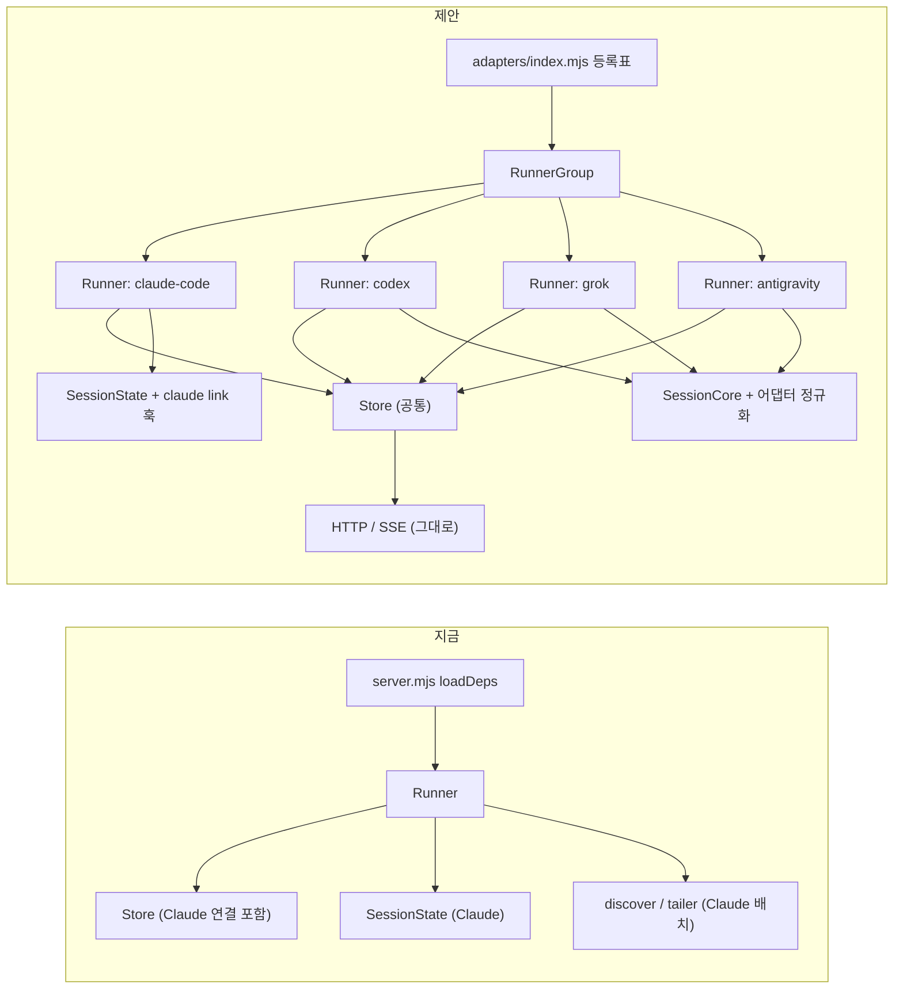

# 멀티 에이전트 어댑터 설계안 (P5)

- 상태: 승인됨(2026-10-20). 11절의 결정 D1~D12 를 모두 추천안대로 승인했다. 구현은 9절 순서로 한다. P5a(공통 분리),
  P5b(`SessionCore`, `tool-summary`), P5c(Grok 어댑터, `SidecarWatcher`), P5d(Codex 어댑터)는 끝나 master 에 병합됐고,
  P5e(Antigravity CLI 어댑터)와 P5f(문서)도 끝났다. 승인된 결정과 P5a 범위는 `docs/CONTRACT.md` 4.0.1절에, P5b 의 정규화
  항목과 의미는 4.0.2절에, Grok 어댑터의 탐색, id, 매핑은 4.6절에, Codex 어댑터는 4.7절에, Antigravity 어댑터는 4.8절에
  옮겼다. 이로써 P5 의 필수 단계는 모두 끝났고, 남은 것은 선택 단계 P5g(Grok 라이브 승인 대기)와 9절에 적은 실제 세션
  확인이다.
- 작성일: 2026-10-20
- 기준 문서: `docs/CONTRACT.md` 2절(이벤트 스키마), 4.0절(어댑터 범위), 5절(개인정보)
- 조사 근거: `docs/research/codex-format.json`, `docs/research/grok-format.json`, `docs/research/antigravity-format.json`
  (이 Mac의 기록을 읽기 전용으로 구조와 개수만 센 결과. 실제 내용, 경로, 프롬프트는 없다)

## 0. 요약

- 세 도구 모두 이 Mac 에 기록이 있고, 세 도구 모두 실시간으로 따라 읽을 수 있는 "덧붙여 쓰는 JSONL" 기록을 남긴다.
  예외는 Antigravity 데스크톱 앱 하나다(대화 파일이 암호화된 것으로 보여 도구 이벤트를 읽을 수 없다).

  | 도구 | 따라 읽을 기록 | 규모 (이 Mac) | 판정 |
  |---|---|---|---|
  | Codex (CLI, 데스크톱 앱, IDE 확장 모두) | `~/.codex/sessions/<YYYY>/<MM>/<DD>/rollout-*.jsonl` | 5,233 파일, 407만 줄 | 가능. code-mode `exec` 와 자동 승인 검토 스레드 처리가 핵심 |
  | Grok (xAI Grok Build) | `~/.grok/sessions/<cwd>/<id>/updates.jsonl` | 105 파일, 12.8만 줄 | 가능. 이벤트와 거의 1:1 로 맞는다 |
  | Antigravity CLI `agy` (+ 예전 IDE) | `~/.gemini/antigravity-cli/brain/<id>/.system_generated/logs/transcript_full.jsonl` | 34(+2) 파일, 1.7만 줄 | 가능. 도구 id 가 없어 위치로 짝짓는다 |
  | Antigravity 데스크톱 앱 | `~/.gemini/antigravity/conversations/*.pb` | 64 파일 | 불가(암호화로 보임). 제목/상태/계획 파일만 읽힌다 |

- 그래서 읽기 장치는 지금 `Tailer` 하나로 충분하다. 따로 필요한 것은 통째로 다시 쓰이는 작은 메타 파일(제목, branch,
  상태)을 바뀔 때 다시 읽는 장치뿐이다(3.3절).
- 구조: 어댑터마다 Runner 하나, Store 와 HTTP 는 하나(3.5절). Claude 는 지금 상태 기계를 그대로 쓰고, 새 어댑터
  셋은 "도구별 정규화 함수 + 공통 `SessionCore`" 로 만든다(3.2절).
- 먼저 할 일: Store 에 섞인 Claude 서브에이전트 연결을 빼내는 리팩터(P5a). `store.mjs` 가 500줄 상한까지 4줄 남아
  있어서, 이것 없이는 어떤 어댑터도 붙일 수 없다.
- 결정: 11절 D1~D12 는 2026-10-20 에 모두 추천안대로 승인됐다. 가장 큰 것은 같은 폴더면 도구가 달라도 같은 층인지(D1),
  Antigravity 범위(D6), Codex 의 자동 승인 검토 스레드와 code-mode 처리(D10), 구현 순서(D11)다.

## 1. 범위와 전제

- 새 이벤트 type 을 만들지 않는다. 모든 어댑터는 CONTRACT 2절의 `session`, `session_end`, `prompt`, `tool_start`,
  `tool_end`, `thinking`, `say`, `plan`, `turn_end`, `system` 만 보낸다.
- 모든 `session` 이벤트에 그 어댑터의 `agent` id(`claude-code`, `codex`, `grok`, `antigravity`)를 붙인다.
  서브에이전트도 부모와 같은 id 다.
- 모든 자유 텍스트는 공용 `cleanText`(`src/summarize.mjs`)를 거친다. 5절의 "보내지 않는 것" 목록은 도구가 달라도
  같은 뜻으로 적용한다(명령 원문, 파일 내용, 수정 내용, 전체 경로, 전체 URL, 이메일, 결과 본문).
- Store, SSE 형식, `/state`, 화면은 같이 쓴다. 화면 쪽 변경은 없거나 아주 작게(에이전트 라벨은 이미 있다,
  `public/js/hud.js` 의 `AGENT_LABEL`).
- 서버는 여전히 의존성 0개(Node 20 내장 모듈만)다. 이 전제 때문에 SQLite(Codex, Antigravity CLI 의 db),
  zstd(Codex 의 7일 지난 기록), 암호화된 protobuf(Antigravity 앱)는 읽지 않는다.
- 범위 밖: Gemini CLI(`~/.gemini/tmp`, `~/.gemini/history`)는 Antigravity 와 다른 도구다. 필요하면 나중에 어댑터를 더한다.

## 2. 지금 구조: Claude 전용과 공통의 경계

이 절의 줄 수와 분류는 P5a 전(master `7624a25`) 기준이다.

이미 이음매가 하나 있다. `src/server.mjs` 의 `loadDeps()` 가 `{ SessionState, Tailer, scan, readSubMeta,
readJournalLabels }` 를 `Runner` 에 주입한다. 어댑터 하나는 사실상 "이 deps 묶음 + agent id + 기록 루트"다.
문제는 공통처럼 보이는 Store 와 Runner 안에도 Claude 의 파일 배치와 서브에이전트 연결 규칙이 들어 있다는 점이다.

| 파일 | 줄 수 | 분류 | 어댑터를 붙일 때 |
|---|---|---|---|
| `summarize.mjs` | 413 | 섞임 | `cleanText`, `truncate`, `hostOf`, `looksLikeUuid` 는 공통. `summarize()` 의 `summaryFor`, `IGNORE`, `FIXED_ROOMS` 는 Claude 도구 이름 기준이다. 다른 어댑터는 자기 요약 함수를 두고 조각만 이 공통 함수로 거른다 |
| `summarize-shell.mjs` | 263 | 공통 | `programOf(command)` 는 셸 문자열이면 어디서나 쓴다. 명령이 argv 배열인 도구는 첫 원소(경로면 basename)를 쓰고, `bash -lc "<문자열>"` 꼴이면 그 문자열을 `programOf` 에 넘긴다 |
| `plan.mjs` | 323 | 섞임 | `applyUpdatePlan`, `planFromMarkdown`, `tasksToItems` 는 재사용. 입력 모양(`{items}`, `{advance}`)은 Claude 앱의 `update_plan` 이다 |
| `records.mjs` | 238 | Claude 전용 | Claude 레코드 분류 |
| `session.mjs` | 487 | Claude 전용 | R6~R36 상태 기계. 500줄 상한에 거의 닿아 있다 |
| `session-util.mjs` | 199 | 섞임 | `projectKey`, `basename`, `iso`, `firstSentence`, `firstLine` 은 공통. `resultStatus`(거절 문구), `toolStart`, `askFields`, `publicToolName` 은 Claude 전용 |
| `session-identity.mjs` | 80 | 섞임 | `buildSessionEvent` 가 `agent: CLAUDE_CODE_AGENT` 를 고정으로 넣는다. `cleanLabel`, `publicSessionId` 는 공통 |
| `session-plan.mjs` | 121 | Claude 전용 | `PlanBoard`(update_plan, Task 도구, ExitPlanMode) |
| `discover.mjs` | 280 | Claude 전용 | `~/.claude/projects` 배치, `.meta.json`, workflow journal |
| `tailer.mjs` | 241 | 공통 | 줄 단위 꼬리 읽기. JSONL 을 덧붙여 쓰는 도구에 그대로 쓴다 |
| `store.mjs` | 496 | 섞임 | 등록, 링 버퍼, snapshot, announce 는 공통. `observe`, `onResult`, `onNotification`, `parentFor`, `setMeta`, `pendingMeta`, `pendingLabels`, `taskDeltas` 는 Claude 서브에이전트 연결이다. `patch()` 가 `agent ?? CLAUDE_CODE_AGENT` 를 넣는다. 500줄 상한까지 4줄 남았다 |
| `store-link.mjs` | 246 | Claude 전용 | `refIdentity(ref)` 가 `subagents/` 경로 구조로 kind/sid/charId 를 정한다. `linkFacts` 는 Claude 레코드에서 연결 사실을 뽑는다 |
| `server-runner.mjs` | 398 | 거의 공통 | 루프, attach, 이동, backoff 는 공통. `prepare()` 가 서브 meta 와 journal label 을 읽고, `publishOrder` 가 `main/sub/wf` 순서를 쓰고, `onLine` 이 줄마다 `JSON.parse` 한다(줄 단위 형식 전제) |
| `server.mjs` | 134 | 공통 | `DEFAULTS.root` 가 Claude 루트 하나뿐이다 |
| `replay.mjs`, `replay-timeline.mjs` | 187, 109 | Claude 전용 | `sessionRefs` 와 Claude 승인 판정. P5 에서는 Claude 만 재생한다 |
| `server-http.mjs`, `server-guard.mjs` | 263, 84 | 공통 | 바꿀 것 없음 |
| `cli-args.mjs` | 79 | 공통 | 루트 옵션과 켜고 끄는 옵션이 늘어난다 |

## 3. 어댑터 인터페이스

### 3.1 어댑터 설명자

```js
// src/adapters/<id>.mjs 가 내보내는 모양 (제안)
export const adapter = {
  id: 'codex',                          // session.agent. 'claude-code' | 'codex' | 'grok' | 'antigravity'
  defaultRoot: '~/.codex',              // --<id>-root 기본값
  scan(root, { activeMs, nowMs }),      // -> FileRef[]. 각 ref 에 agent, kind, sid, charId, parentId? 를 직접 채운다
  identity(ref),                        // -> { kind, sid, charId, runId, runDir }. 없으면 ref 필드를 그대로 쓴다
  createSession(ref, ctx),              // -> SessionLike (3.2). ctx = { parentId, meta, label, now }
  sidecars(ref),                        // 선택: 이 세션의 메타 파일 목록 [{ path, parse }] (3.3)
  readMeta: null,                       // 선택: 서브에이전트 meta 를 늦게 읽는 함수 (Claude 만)
  link: null,                           // 선택: 여러 파일을 가로지르는 서브에이전트 연결 훅 (Claude 만, 3.4)
  replayRefs: null,                     // 선택: --replay 입력 (Claude 만)
};
```

- 탐색은 정해진 파일 이름 패턴만 받는다(7절 1번). 도구별 패턴: Codex `sessions/<YYYY>/<MM>/<DD>/rollout-<ts>-<uuid>.jsonl`
  (`_<uuid2>` 이어쓰기 조각 포함, `.zst` 제외), Grok `sessions/<cwd>/<uuid>/updates.jsonl`, Antigravity
  `brain/<uuid>/.system_generated/logs/transcript_full.jsonl`(없거나 더 짧으면 `transcript.jsonl`).
- 기본 루트: Codex `~/.codex`, Grok `~/.grok`, Antigravity `~/.gemini`(그 아래 `antigravity-cli/` 와 `antigravity-ide/`
  두 곳을 본다. `antigravity/` 는 결정 D6 에 따른다).

- `FileRef` 는 지금 모양(`{ path, kind, stem, sessionId, agentId, mtimeMs, size, ino, ... }`)에 `agent` 와 `charId` 를
  더한다. Store 의 `identity()` 는 ref 에 `agent` 가 있고 Claude 가 아니면 경로를 해석하지 않고 ref 값을 믿는다.
- `charId`(브라우저의 직원 id, `sessionId` 필드)는 `publicSessionId` 규칙 `[A-Za-z0-9][A-Za-z0-9_-]{0,63}` 을 지켜야
  한다. `:` 는 쓸 수 없으므로 접두사는 `codex-`, `grok-`, `antigravity-` 처럼 하이픈으로 붙인다(결정 D2).
- `kind` 는 `main` 과 `sub` 만 쓴다. `wf` 는 Claude Workflow 전용이다.

### 3.2 세션 상태 (SessionLike)

Runner 와 Store 가 부르는 것은 지금 `SessionState` 의 공개 API 뿐이다. 새 어댑터의 세션 객체도 이것만 맞추면 된다.

```js
apply(rec, { replay })   // 레코드 하나 -> events[] (replay 이면 상태만 만들고 [] )
idle(nowMs)              // 시간 규칙 -> events[] (멈춘 도구, 턴 끝 추정, 무활동 종료)
setInfo(info)            // 늦게 온 제목 / 부모 프로젝트 -> events[]
sessionEvent()           // 지금의 session 이벤트 (agent 포함)
snapshotEvents()         // session, plan, 열린 tool_start, 열린 질문
title, firstCwd, lastActivityMs, ended   // getter
takeTaskDeltas?(), applyExternalTask?()  // 선택 (Claude 서브의 작업 목록 전달)
```

새 어댑터 세 개가 같은 로직을 다시 쓰지 않도록 공통 부품을 `src/core/` 에 둔다(새 파일, 기존 파일은 그대로).

| 공통 부품 (제안) | 하는 일 |
|---|---|
| `core/session-core.mjs` `SessionCore` | 어댑터가 정규화한 항목(아래)을 받아 이벤트를 낸다. dedupe 키, 열린 도구 표(id -> tool_start), 턴 열림/닫힘, 계획판, 제목/cwd/branch, 마지막 활동 시각, snapshot |
| `core/session-event.mjs` | `buildSessionEvent({ agent, ... })`: 지금 `session-identity.mjs` 의 함수를 agent 를 받게 바꾼 것. Claude 는 `'claude-code'` 를 넘긴다 |
| `core/tool-summary.mjs` | 종류별 요약 조각: 파일(basename), 셸(`programOf`, argv), URL(host), 검색어(<= 60), MCP(`<server>__<tool>`) 와 방 힌트. 각 어댑터의 이름 표가 이 함수들을 부른다 |

정규화 항목(어댑터 -> `SessionCore`)은 이벤트와 거의 같은 모양이지만 아직 거르지 않은 원재료다.

```js
{ k: 'meta', cwd?, branch?, title?, model?, parentId? }
{ k: 'prompt', text }
{ k: 'tool_start', id, tool, kind: 'read'|'edit'|'shell'|'web'|'search'|'plan'|'ask'|'agent'|'other', input, background? }
{ k: 'tool_end', id, status: 'ok'|'failed'|'denied'|'interrupted', errorLine?, background? }
{ k: 'thinking', text|null, durationMs? }
{ k: 'say', text }
{ k: 'plan', items: [{ content, status }] }
{ k: 'turn_start', id? }  { k: 'turn_end', reason }  { k: 'system', kind, text }
{ k: 'sub_end', childId }   // 부모 파일에 적힌 자식의 끝 (Codex SubAgentActivity, Grok subagent_finished, 3.4절)
```

`SessionCore` 가 하는 일: `cleanText` 와 길이 상한을 한곳에서 적용, 도구 요약과 방 힌트는 `core/tool-summary.mjs`
로, `kind: 'plan'` 도구는 tool_start 없이 `plan` 이벤트로(R35 와 같은 처리), `kind: 'ask'` 는 질문 필드로,
새 턴이 시작될 때 결과 없는 도구는 `abandoned`(R27 과 같은 뜻), 결과 없이 `turn_end` 가 오면 그 턴의 도구도
`abandoned`.

Claude 어댑터는 지금의 `SessionState` 를 그대로 쓴다(P3 기준 테스트 394개가 지키는 상태 기계를 옮기지 않는다).
`SessionCore` 는 새 어댑터용이고, Claude 를 여기로 옮길지는 P5 이후에 따로 정한다(결정 D9).

P5b 에서 만든 `SessionCore` 와 `tool-summary` 의 정확한 모양(정규화 항목, 도구 설명자, 의미)은 `docs/CONTRACT.md`
4.0.2절이 기준이다. 위의 표와 항목 목록은 그 전의 제안이고, 달라진 점은 이렇다.

- `tool_start` 항목은 원래 도구 입력(`input`)을 받지 않는다. 어댑터가 허용된 조각만 꺼내 만든 설명자 `desc`
  (`{ tool, kind, path?, paths?, command?, argv?, url?, query?, mcpServer?, mcpTool?, patch?, description?, background? }`)
  를 넘기고, 질문 도구는 `question?`, `options?` 를 함께 넘긴다. 명령 원문, 파일 내용, patch 본문 같은 원재료가 공통
  코어까지 오지 않게 하려는 것이다(7절 2번). patch 는 헤더의 파일 이름만 쓰고 본문은 버린다.
- `say` 에 `final?`(턴 끝 추정 `end_turn` 을 켠다), `plan` 에 `source?` 와 `markdown?`, `system` 의 `kind`
  값(`api_error`, `compact`, `refusal`), 모든 항목에 선택 dedupe 키 `key` 가 더해졌다. `sub_end` 는
  `{ hint: 'end', charId: childId }` 항목이 된다(CONTRACT 4.0.1 의 공통 종료 힌트).
- `core/session-event.mjs` 는 따로 만들지 않았다. P5a 에서 `session-identity.mjs` 의 `buildSessionEvent` 가 `s.agent` 를
  받게 됐고, `SessionCore` 는 그 함수를 그대로 쓴다.
- `core/tool-summary.mjs` 는 설명자 하나를 받아 `tool_start` 필드 `{ tool, summary, room?, background? }` 를 돌려준다.
  MCP 호출은 `mcp__<server>__<tool>` 로 맞추고, uuid 모양 서버 이름은 지금의 ZERO_UUID 규칙으로 가린다. 셸은 Claude
  Bash 보다 엄격하다: 값을 받을 수 있는 옵션 뒤의 하위 명령은 버리고(`kubectl -n ns get` -> `kubectl`), 프로그램이 아닌
  `argv[0]`(빈 값, `VAR=val`, 셸 키워드, 공백)이면 프로그램 없이 도구 이름을 쓴다.
- 리뷰에서 정한 어댑터 쪽 규칙(CONTRACT 4.0.2): 한 턴의 `turn_start` 를 그 턴의 `prompt` 보다 먼저 보낸다(Antigravity
  `USER_INPUT`, Grok 의 새 `prompt_id` 처럼 한 기록에 둘이 있어도). `plan` 의 `source` 는 모양으로 정해진다: `markdown`
  은 늘 `exit_plan`, `items` 는 `tasks` 라고 할 때만 `tasks`, 아니면 `update_plan`. 그래서 Antigravity `task.md`
  체크리스트는 어댑터가 `[ ]`, `[/]`, `[x]` 를 상태로 읽어 `items` 로 보낸다. `kind: 'plan'` 도구에 실은 계획은 ok 로
  끝날 때만 판을 바꾼다. 질문을 기다리는 동안 보일 계획 제안(`exit_plan_mode`)은 질문 `tool_start` 앞에 `markdown`
  `plan` 항목으로 보낸다. 도구 `id` 는 그대로 `toolUseId` 로 나가므로 에이전트의 호출 id 를 쓴다.

### 3.3 읽기 방식: 기록은 Tailer, 메타 파일은 다시 읽기

- 기록: 세 도구의 기록이 모두 덧붙여 쓰는 JSONL 이다(Codex 는 소스 코드에 "절대 잘라 쓰거나 제자리에서 다시 쓰지
  않는다"고 적혀 있고 줄마다 flush, Grok 은 문서에 "세션 중 append-only", Antigravity CLI 는 33/33 관찰). 지금의
  `Tailer` 와 `Runner.onLine` 을 그대로 쓴다. 한 줄 최대 크기는 Codex 10 MB 로 지금 상한(8 MB, 넘으면 세고 건너뜀)보다
  크다. 그런 줄은 거의 큰 도구 출력이라 건너뛰어도 되지만, 건너뛴 줄이 도구 결과면 그 도구는 `abandoned` 로 닫힌다.
- 메타 파일: 통째로 다시 쓰이는 작은 파일(Grok `summary.json`, Antigravity `*_summaries_proto.pb`, `annotations/<id>.pbtxt`,
  `brain/<id>/task.md`)과 작은 색인(Codex `session_index.jsonl`)은 `SidecarWatcher` 가 rescan 때마다 stat 하고,
  mtime/크기/inode 가 바뀌면 크기 상한(예: 1 MB) 안에서 다시 읽어 `setInfo()` 로 넘긴다. 처음 읽을 때 한 번,
  그 뒤로는 바뀔 때만 읽는다. 이 장치는 새 파일 하나(`src/core/sidecar.mjs`, 100줄 안쪽)다. P5c 에서 만들었고, 어댑터
  설명자의 선택 훅 `sidecars(ref)` 가 있는 어댑터에만 Runner 가 돌린다(지금은 Grok 의 `summary.json` 하나, Claude 는 훅이
  없어 그대로). 정확한 규칙은 `docs/CONTRACT.md` 4.6절. Antigravity(P5e)는 요약 proto 가 대화 모두가 같이 쓰는 파일이라
  이 훅 대신 자기 감시자 `AntigravityMeta`(`SidecarWatcher` 둘 위에 선다)를 Codex 제목 읽기와 같은 자리
  `deps.sidecarWatcher` 로 넘긴다(CONTRACT 4.8절). Codex 의 `session_index.jsonl` 은 P5d 에서 이 장치로 읽지 않기로
  했다. 모든 스레드가 같이 쓰는 덧붙이기 색인이라 커질 수 있으므로, 기억해 둔 위치 뒤에 덧붙은 부분만 상한 안에서 읽는
  따로 된 읽기를 쓴다(CONTRACT 4.7절, 9절).
- 파일 안의 기록 자체를 통째로 다시 쓰는 도구가 생기면 그때 `document` 읽기 방식을 더한다. 지금은 필요 없다.

### 3.4 서브에이전트 연결

Claude 의 연결 규칙(R28/R29, 4.5절: Agent tool_use id, 결과 꼬리표, task notification, meta.json)은
`Store.observe` 와 그 아래 메서드에 들어 있다. 이것을 `adapter.link` 훅으로 옮기고, Store 는 entry 의 agent 가 그
훅을 가진 경우에만 부른다. 다른 어댑터는 부모를 자기 방법으로 안다.

- Codex: 자식 파일의 첫 줄(`session_meta.source.subagent.thread_spawn.parent_thread_id`)에 부모가 있다(1,948/1,948).
  탐색(scan)이 각 rollout 파일의 첫 줄을 크기 상한 안에서 읽어 `ref.kind`, `ref.parentId`(바로 위 부모),
  `ref.sid`(부모를 거슬러 올라간 최상위 메인)를 채운다. Store 는 비Claude 부모를 FileRef 에서만 받으므로
  (CONTRACT 4.0.2) 세션 객체가 첫 줄을 읽는 것으로는 부족하다. 같은 읽기로 D10(a) 자동 승인 검토 스레드도 가린다. 부모 파일의 `SubAgentActivity`(`completed`/`interrupted`)가
  자식의 끝이다. 이 끝 신호는 부모 파일에 있으므로 Store 의 공통 규칙 하나가 필요하다: "어댑터가 낸 `ends: <charId>`
  힌트를 받으면 그 직원에게 `session_end` 를 낸다".
- Grok: 자식 파일에는 부모가 없고(61/62), 부모 폴더의 `subagents/<자식 id>/` 디렉터리 이름이 자식 id 다. 탐색이 이
  디렉터리 이름만 보고(파일은 열지 않는다) `ref.parentId` 를 채운다. 끝은 부모 파일의 `subagent_finished`.
- Antigravity: 이 Mac 의 기록에서는 서브에이전트 연결을 찾지 못했다. 서브에이전트 없이 시작하고, `browser_subagent`
  같은 호출은 부모 직원의 도구 호출(`room: 'here'`)로 보인다. P5e 에서 이대로 구현했다: 모든 대화가 메인이다
  (CONTRACT 4.8).

Store 의 공통 규칙으로 남는 것은 둘이다. 서브에이전트의 층은 부모의 층을 따른다(지금 4.4절의 "Subagents inherit the
parent's project" 를 모든 어댑터로). 부모가 아직 알려지지 않은 자식은 부모가 알려질 때까지 기다렸다 알린다
(지금 `publishOrder` 와 같은 생각).

### 3.5 Runner: 어댑터마다 하나, Store 하나

가장 적게 바꾸는 방법은 Runner 를 어댑터마다 하나씩 만들고(각자 자기 deps 와 루트), Store 와 HTTP 층은 하나를
같이 쓰는 것이다. `server.mjs` 에는 작은 묶음(`RunnerGroup`: `startLoops`, `rescan`, `setInterval`, `close`,
`files.size` 합계, `badLines` 합계)을 둔다. 경로는 도구마다 다르므로 Store 의 `byPath` 키가 겹치지 않고,
`charId` 는 접두사로 겹치지 않는다.

## 4. src 를 나누는 방법과 영향받는 파일



파일은 크게 옮기지 않는다. 지금 이 브랜치에서 다른 작업이 함께 돌 수 있고, 테스트 30여 개가 지금 경로를
가져다 쓰기 때문이다. Claude 모듈은 제자리에 두고 `src/adapters/claude-code.mjs` 설명자가 그것을 가리킨다(결정 D8).

| 단계 | 파일 | 바꾸는 것 |
|---|---|---|
| 선행 | `store.mjs` (496줄) | Claude 연결 메서드(`observe`, `onResult`, `onNotification`, `subByToolUse`, `endAgent` 일부, `taskDeltas`, `applyBufferedTasks`, `setMeta`, `setLabel`, `pendingMeta`, `pendingLabels`)를 `src/store-claude.mjs` 로 빼서 500줄 상한 여유를 만든다. 동작은 그대로(기존 테스트로 확인) |
| 선행 | `session-identity.mjs` | `buildSessionEvent` 가 `s.agent ?? CLAUDE_CODE_AGENT` 를 쓰게 한다. `store.mjs patch()` 도 entry 의 agent 를 쓴다 |
| 선행 | `store-link.mjs` `refIdentity` | ref 에 `agent` 가 있고 `claude-code` 가 아니면 ref 의 kind/sid/charId 를 그대로 쓴다 |
| 선행 | `server-runner.mjs` | `prepare()` 의 meta/label 읽기를 `deps.readMeta` 가 있을 때만, `onLine` 은 그대로, rescan 끝에 `SidecarWatcher` 확인(3.3절, P5c 로 옮김, 9절), 어댑터가 낸 서브 종료 힌트를 Store 로 넘김(3.4절) |
| 선행 | `server.mjs`, `cli-args.mjs` | 어댑터 등록표, `RunnerGroup`, `--codex-root`, `--grok-root`, `--antigravity-root`, `--agents <id,...>`. `--root`/`--claude-root` 는 그대로 |
| 새 파일 | `src/adapters/index.mjs`, `src/adapters/claude-code.mjs` | 등록표와 Claude 설명자 |
| 새 파일 | `src/core/session-core.mjs`, `src/core/tool-summary.mjs`, `src/core/sidecar.mjs` | 3.2, 3.3절. 앞의 둘은 P5b 에서 만들었다(CONTRACT 4.0.2절). `sidecar.mjs` 는 P5c 에서 만들었다(CONTRACT 4.6절) |
| 새 파일 | `src/adapters/grok/` (P5c 에서 만듦), `src/adapters/codex/` (P5d 에서 만듦) 등 | 도구마다 탐색 + 정규화 (각 파일 500줄 이하) |
| 문서 | `docs/CONTRACT.md` | 1절 배치, 4.0절 아래에 어댑터별 절(4.6 Codex ...), 6절 CLI. `README.md` 지원 표 |
| 화면 | `public/js/*` | 원칙적으로 없음. 방은 서버가 `room` 힌트로 보낸다(결정 D4) |

## 5. 도구별 조사 결과

### 5.1 Codex (`docs/research/codex-format.json`)

- 대상: OpenAI Codex 의 모든 클라이언트. 데스크톱 앱(`originator` `Codex Desktop` 3,848 파일), CLI(`codex_cli_rs`,
  `codex-tui`, `codex_exec`), VS Code 확장이 같은 폴더에 같은 형식으로 쓴다. `agent: 'codex'` 하나로 묶는다.
  설치된 CLI 는 0.157 이지만 기록은 데스크톱 앱이 쓴 0.163-alpha 까지 있으므로, 동작은 파일마다
  `session_meta.cli_version` 기준으로 판단한다.
- 위치: `~/.codex/sessions/<YYYY>/<MM>/<DD>/rollout-<로컬 시각>-<uuid>.jsonl`(폴더 날짜와 파일 이름의 시각은 로컬 시간,
  레코드 시각은 UTC). 7일이 지나면 같은 자리에서 `.jsonl.zst` 로 압축되고 원본은 지워진다. 오래된 스레드를 이어
  쓰면 다시 `.jsonl` 로 풀린다. 되돌리기(rollback) 뒤에는 `_<uuid2>` 가 붙은 이어쓰기 조각이 생긴다(6개).
  `archived_sessions/` 는 `.zst` 만 있다. 활동 창(기본 30분) 안의 파일은 언제나 `.jsonl` 이라 라이브에는 지장이 없다.
  이어쓰기 조각은 같은 스레드라 같은 직원이다. 새 조각이 생기면 옛 파일을 떼고 새 조각을 붙인다(지금 Runner 는 같은
  직원의 두 번째 경로를 무시하므로, Codex 는 조각 번호가 큰 쪽을 고르는 규칙이 필요하다).
- 덧붙이기: 소스 코드상 append 로 열고 줄마다 flush 한다. 448개 평문 파일 모두 mtime 이 마지막 레코드 시각 뒤 6 ms 안.
  새 스레드의 파일은 첫 입력 뒤에야 생길 수 있다. 조사 때는 쓰이는 중인 파일이 없어(가장 새 파일 약 20시간 전)
  실제 증가는 보지 못했다.
- 줄 모양: `{timestamp, ordinal, type, payload, metadata?}`. `ordinal` 은 0부터의 줄 번호라 dedupe 키로 쓴다(R9 의 uuid 역할).
  29가지 `type/payload.type`. 저장 정책상 승인 요청, 오류, 경고, 계획 갱신 이벤트, 도구 시작 이벤트는 기록에 남지
  않는다. 그래서 Codex 도 라이브 승인 대기를 볼 수 없다(Claude 와 같다).
- 도구: `function_call`/`custom_tool_call` 과 그 `*_output` 을 `call_id` 로 짝짓는다. 호출 줄은 실행 전에 쓰인다.
  0.142.5 부터는 거의 모든 일이 code-mode `exec` 도구 하나로 간다(입력이 `tools.<이름>(...)` 를 부르는 스크립트,
  10.8만 호출). 안쪽 명령은 따로 호출 줄이 없고, 끝났을 때 `item_completed` 항목(`CommandExecution`, `FileChange`,
  `McpToolCall`, `WebSearch` 등)으로만 나타난다. 그 전 버전은 `exec_command`, `shell`, `shell_command`, `apply_patch`,
  `update_plan`, `mcp__<server>__<tool>` 이 각각 호출 줄로 온다.
- 셸 명령: `exec_command.cmd`, `shell_command.command` 는 문자열, `shell.command` 는 argv 배열이다. `CommandExecution` 의
  argv 는 언제나 `[zsh|bash, -lc, <스크립트>]` 라 프로그램 이름은 `parsed_cmd` 첫 원소나 스크립트 첫 단어에서 꺼낸다.
- 결과: 텍스트 안의 `Exit code: <n>` / `Process exited with code <n>` 이나 JSON `metadata.exit_code` 로 실패를 가린다.
  `rejected by user`, `sandbox denied` 같은 앞부분은 거절, `aborted by user` 는 중단, `Process running with session ID` 는
  백그라운드 실행이다. `write_stdin`/`wait` 는 이미 돌고 있는 명령을 들여다보는 호출이라 새 일로 보지 않는다.
- 생각과 말: 추론 원문은 암호화되어 있고 요약(`summary[].text`)만 읽힌다(51.6만 개 중 19만 개가 비어 있지 않음).
  최근 파일은 생각과 말이 `response_item` 과 `item_completed` 에 두 번 적히므로 한쪽만 읽는다.
- 프롬프트: `item_completed` 의 `UserMessage` 가 사람 입력이다(`<` 로 시작하면 건너뜀). `role:user` 메시지는 지침 파일과
  환경 정보가 섞여 있어 쓰지 않는다. 서브에이전트의 과제는 `agent_message` 로 온다.
- 턴: `task_started`(turn_id) / `task_complete`(오류가 있으면 `error`) / `turn_aborted`(모두 `interrupted`). 끝 없이 다음
  시작이 오는 경우가 787번 있으므로 그때는 `next_turn`.
- 계획: `update_plan {plan:[{step, status}], explanation?}` 는 상태 값이 CONTRACT 와 같다. 다만 0.146 이후로는 code-mode
  스크립트 안에서만 불려 구조화된 기록이 없다. 계획 모드의 제안은 `Plan` 항목(마크다운)이다.
- 질문: `request_user_input {questions:[{id, header, question, options[{label, description}]}]}` 는 AskUserQuestion 과 같은 모양.
- 서브에이전트: 따로 된 파일이고, 첫 줄에 부모 id 가 있다. 깊이 3까지. `subagent_history_start_ordinal` 앞의 줄은
  부모 문맥을 복사한 것이라 건너뛴다(예전에 옮겨 쓴 파일은 이 값이 파일 길이와 같으므로, 건너뛰면 아무것도 남지 않을 때는
  첫 줄 뒤를 모두 읽는다. 구현은 0.154 보다 오래된 파일에만 이 대체 규칙을 쓴다, 9절).
- 자동 승인 검토(guardian) 스레드: `source.subagent.other == 'guardian'` 인 파일이 2,171개로 전체의 41% 다. 사람이 시킨
  일이 아니라 승인 검토기이므로 숨기는 것을 제안한다(결정 D10). `/review` 스레드는 77개.
- 제목: `~/.codex/session_index.jsonl` 의 `thread_name`(같은 id 는 마지막 줄이 이김). 없으면 첫 사람 입력(<= 40).
  SQLite 의 `threads.name` 도 같은 값이지만 Node 20 에서 못 읽으므로 쓰지 않는다. cwd 는 `session_meta.cwd`(스레드 안에서
  바뀐 적 0/5,233), branch 는 `session_meta.git.branch`.
- 워크트리: cwd 가 `~/.codex/worktrees/<id>/<name>` 인 세션이 152개다. 경로에 원래 저장소 위치가 없어 지금 `projectKey`
  규칙으로는 원래 층에 묶이지 않는다(결정 D1).
- 개인정보: `session_meta` 에 계정 id 가 있다. 읽어도 이벤트에 넣지 않는다. `~/.codex/history.jsonl` 은 원문 프롬프트라
  열지 않는다.
- 미확인: 백그라운드 명령이 턴 끝까지 살아 있을 때의 끝 표시, guardian 거절이 부모에 남는 모양, writer lock 파일이
  "지금 열림" 신호인지, 예전 파일을 새 형식으로 옮겨 쓴 일이 꼬리 읽는 중에도 일어날 수 있는지, 새 스레드 파일이 첫
  레코드보다 얼마나 늦게 생기는지.
- P5d 구현 뒤 상태(2026-10-20, 기준은 `docs/CONTRACT.md` 4.7절). 위 목록과 8.2절의 Codex 항목, 조사 파일의
  `unverified` 목록은 조사 때 그대로 두고 항목마다 상태만 적는다. 실행 중인 Codex 세션을 아직 보지 못했으므로 확인으로
  풀린 항목은 없다. 항목마다 어댑터가 무엇을 가정하는지를 정했다.

  | 미확인 항목 | 상태 | P5d 의 가정과 처리 |
  |---|---|---|
  | 백그라운드 명령이 턴 끝까지 살아 있을 때의 끝 표시 | 미확인 그대로 | `Process running with session ID` 출력은 ok + `background` 로 닫는다(R28). 그 명령의 끝을 알리는 나중의 `write_stdin` 출력은 배관이라 보지 않으므로, 턴이 끝난 뒤에도 살아 있는 명령은 따로 보이지 않는다 |
  | guardian 거절이 부모에 남는 모양 | 미확인 그대로 | guardian 스레드는 숨긴다(D10a). 부모 쪽 거절은 도구 출력 앞부분의 고정 문구(`rejected by user`, `sandbox denied`, `approval required by policy`)로만 가린다. 다른 모양으로 남는 거절은 종료 코드에 따라 실패나 ok 로 보인다 |
  | writer lock 파일이 "지금 열림" 신호인지 | 미확인 그대로, 동작 영향 없음 | `thread-writer-locks/` 는 열지 않는다(허용 목록 밖). 메인은 활동 창을 벗어나면, 서브는 부모의 `SubAgentActivity` 나 무활동으로 끝난다 |
  | 예전 파일을 새 형식으로 옮겨 쓴 일이 꼬리 읽는 중에도 일어나는지 | 미확인 그대로 | 옮겨 쓰면 inode 가 바뀌거나 파일이 짧아진다고 보고, 지금의 잘림/inode 변경 처리(다시 붙여 처음부터 읽기)와 `ordinal` dedupe 로 흡수한다. 첫 줄 사실도 새 inode 나 짧아진 파일이면 다시 읽는다 |
  | 새 스레드 파일이 첫 레코드보다 얼마나 늦게 생기는지 | 미확인 그대로, 동작 영향 작음 | 파일이 생기면 다음 rescan 에 붙고 처음부터 읽으므로 놓치는 레코드는 없다. 화면이 그만큼 늦을 뿐이다 |
  | `~/.codex/worktrees` 세션의 가장 좋은 층 키(8.2절) | 미확인 그대로 | D1 어림 규칙: 이름(`<name>`)과 라벨이 같은 살아 있는 층이 있으면 그 층, 없으면 자기 층(워크트리 배지). 저장소 URL 이나 SQLite 는 쓰지 않는다 |
  | `codex_work_desktop` originator 의 뜻 | 미확인 그대로, 동작 영향 없음 | originator 는 읽지 않는다. 모든 클라이언트가 `codex` 하나다 |
  | `forked_from_ordinal_exclusive`, `history_base` | 미확인 그대로, 동작 영향 없음 | 읽지 않는다. 물려받은 문맥은 `subagent_history_start_ordinal` 로만 가린다 |
  | `TurnAbortReason` 의 `replaced`, `review_ended`, `budget_limited` 와 `thread_rolled_back` 레코드 | 미확인 그대로 | `turn_aborted` 는 이유와 상관없이 `interrupt` 다. 모르는 레코드 종류는 무시하고, 되돌리기는 이어쓰기 조각으로 따라간다 |
  | 새 스레드가 기록되기 전에 `pending_items` 로 얼마나 머무는지 | 미확인 그대로, 동작 영향 작음 | 위의 "새 스레드 파일" 항목과 같다 |
  | 두 `state_5.sqlite` 중 어느 쪽이 기준인지 | 미확인 그대로, 동작 영향 없음 | SQLite 는 열지 않는다(Node 20 에서 읽지 못하기도 한다). 제목은 `session_index.jsonl` 에서만 온다 |

  P5d 에서 새로 생긴 미확인: `/review` 스레드가 부모를 `payload.parent_thread_id` 로 적는지(조사는 이 값을 thread_spawn
  과 guardian 파일에서만 셌다. 없으면 그 스레드는 메인으로 보인다), code-mode 스크립트 안에서 MCP 도구를 부르는
  `tools.<이름>` 의 실제 모양(조사는 개수만 셌다. 바깥 `exec` 의 요약은 첫 식별자 이름만 쓴다), 이어 받아 옛 날짜
  폴더에 다시 풀린 `.jsonl` 이 느린 전체 탐색 주기 안에 붙는 동안 화면이 늦는 정도, 실행 중인 Codex 세션의 덧붙이는
  단위(8.1절 11번).

### 5.2 Grok (`docs/research/grok-format.json`)

- 제품: xAI 공식 Grok Build(`grok --help` 첫 줄 "Grok Build TUI", Rust, github.com/xai-org/grok-build). 커뮤니티
  `grok-cli` 가 아니다. 설치 버전 1.0.62, 로그에 1.0.46~1.0.62. 세션 파일에는 CLI 버전이 없다.
- 기록 형식은 Agent Client Protocol(ACP)의 `session/update` 스트림에 xAI 확장(`_x.ai/session/update`)을 더한 JSONL 이다.
  덧붙여 쓰는 파일이라 지금 `Tailer` 를 그대로 쓴다.
- 위치: `~/.grok/sessions/<URL 인코딩한 cwd>/<UUIDv7>/updates.jsonl`. 메인 45개, 서브에이전트 62개 세션 폴더,
  `updates.jsonl` 105개(12.8만 줄, 497 MB, 한 줄 최대 0.75 MB). 파일 mtime 과 마지막 레코드 시각이 105/105 같다.
  폴더 이름 = `summary.json info.id` = 모든 줄의 `params.sessionId`.
- 탐색은 모든 cwd 그룹을 훑어야 한다. 서브에이전트 62개 중 15개가 부모와 다른 그룹(워크트리 cwd)에 있다.
- 같은 폴더의 다른 파일: `events.jsonl`(런타임 이벤트, 권한 요청과 승인 대기는 여기에만 있다), `chat_history.jsonl`
  (모델에 보내는 목록, 압축 때 잘려서 일부만 있다. 읽지 않는다), `summary.json`(제목, cwd, branch, 모델, 세션 종류.
  제자리에서 다시 쓴다), `plan.json`/`plan.md`(같은 내용이 기록에 있다), `prompt_history.jsonl`(원문 프롬프트, 열지 않는다).
- 레코드: `{method, params:{sessionId, update:{sessionUpdate, ...}, _meta}, timestamp}`. `timestamp` 는 초 단위.
  `sessionUpdate` 종류 25개를 봤고, 바이너리에는 그보다 많은 이름이 있으므로 모르는 종류는 무시한다.
  `_meta.agentTimestampMs` 가 1,075번 거꾸로 가므로 파일 순서를 믿는다(R12 와 같다).
- 도구: `tool_call` 과 `tool_call_update` 를 `toolCallId` 로 짝짓는다(중복 0). 이름은 `_meta['x.ai/tool'].name` 이고
  `title` 은 쓰지 않는다(경로나 명령이 들어간 표시 문자열). 셸 명령은 argv 가 아니라 문자열이다. MCP 는 `use_tool`
  하나로 오고 `tool_name` 이 `<server>__<tool>` 이다. 끝 상태는 `completed`/`failed` 뿐이고, 종료 코드가 0 이 아닌 셸 명령도
  `completed` 로 적힌다(602건, 실패로 바꿔야 한다). 거절은 `rawOutput` 없는 `failed` 에 고정 문구 다섯 가지(80건).
- 생각: `agent_thought_chunk` 는 추론 요약 문장이고 빈 경우가 없다(원래 추론은 암호화되어 `chat_history` 에만).
  Claude 와 달리 "생각 중…" 폴백이 거의 필요 없다.
- 턴: `turn_completed`(`prompt_id` 별, `stop_reason` `end_turn` | `cancelled` | `error`)가 명시적으로 온다. 사람 프롬프트는
  `_meta` 에 `hideFromScrollback`/`syntheticPrompt` 가 없는 `user_message_chunk` 다. 숨은 주입 메시지도 턴은 연다.
- 계획: `plan` 레코드가 항상 전체 목록이고 상태 값이 CONTRACT 와 같다(`pending | in_progress | completed`).
  `todo_write` 도구 자체는 숨긴다(R35 의 update_plan 과 같은 처리). `exit_plan_mode` 는 계획 승인 질문,
  `ask_user_question` 은 AskUserQuestion 과 같은 모양이다.
- 서브에이전트: 부모 파일의 `subagent_spawned{child_session_id, parent_session_id, subagent_type, description}` 와
  `subagent_finished{child_session_id, status}` 로만 연결된다(62/62 일치). 자식 파일에는 부모를 가리키는 값이 없다
  (61/62). 그래서 자식은 부모 레코드가 이름을 부를 때까지 기다렸다 알린다. `spawn_subagent` 도구는 바로 끝나므로
  Claude 의 비동기 실행(R28)처럼 다룬다. 부모의 `subagents/<child>/meta.json` 은 부모 파일을 아직 못 읽었을 때의 대안이다.
- 살아 있는 세션: `~/.grok/active_sessions.json`(TUI 에서 열린 세션 목록, 조사 때는 빈 목록) + 파일 증가. `.lock` 파일은
  세션이 끝나도 남으므로 신호가 아니다.
- 승인 대기: `events.jsonl` 의 `permission_requested` 뒤에 `permission_resolved` 가 아직 없으면 사람의 답을 기다리는 중이다.
  Claude 라이브 모드에는 없는 확실한 신호다(CONTRACT 7절). 다만 이 레코드에는 도구 호출 id 가 없어 순서로 짝지어야 하고
  (105개 중 102개 세션에서 순서가 맞았다), `events.jsonl` 은 `updates.jsonl` 보다 줄이 약 8배 많다. 결정 D7.
- 미확인(조사 때 실행 중인 세션이 없었다): 실행 중 덧붙이는 단위, `active_sessions.json` 행 모양, 수동 `/compact` 의
  표현, headless(`grok -p`)와 ACP 세션의 파일 차이, 바이너리에만 있는 레코드 종류의 키, 255바이트를 넘는 cwd 그룹 이름
  (slug + hash + `.cwd` 파일), 세션 중 cwd 변경과 `/fork` 의 표현.
- P5c 구현 뒤 상태(2026-10-20, 기준은 `docs/CONTRACT.md` 4.6절). 위 목록은 조사 때 그대로 두고 항목마다 상태만 적는다.
  실행 중인 Grok 세션을 아직 보지 못했으므로 확인으로 풀린 항목은 없다. 항목마다 어댑터가 무엇을 가정하는지를 정했다.

  | 미확인 항목 | 상태 | P5c 의 가정과 처리 |
  |---|---|---|
  | 실행 중 덧붙이는 단위 | 미확인 그대로 | 줄 단위 `Tailer` 가 잘린 마지막 줄을 다음 회차로 넘기므로 한 레코드가 여러 번에 나뉘어 써져도 흡수한다. 실제 세션으로 보는 확인은 9절 P5c 끝 조건에 남아 있다(8.1절 11번) |
  | `active_sessions.json` 행 모양 | 미확인 그대로 | 이 파일은 열지 않는다(허용 목록 밖). 메인은 활동 창을 벗어나면, 서브는 부모의 `subagent_finished` 나 무활동으로 끝난다 |
  | 수동 `/compact` 의 표현 | 미확인 그대로 | `auto_compact_started` 만 `system compact` 로 낸다. 다른 표현이 생기면 모르는 종류로 무시된다 |
  | headless(`grok -p`), ACP 세션의 파일 차이 | 미확인 그대로 | 같은 배치(`sessions/<그룹>/<세션>/updates.jsonl`)라고 가정한다. 다르면 탐색이 찾지 못할 뿐 다른 파일을 열지는 않는다 |
  | 바이너리에만 있는 레코드 종류의 키 | 미확인 그대로, 동작 영향 없음 | 모르는 `sessionUpdate` 는 모두 무시한다(`session_ended` 가 써져도 지금은 쓰지 않는다) |
  | 255바이트를 넘는 cwd 그룹 이름(slug + hash + `.cwd`) | 미확인 그대로, 동작 영향 없음 | 그룹 이름을 해석하지 않고 `.cwd` 파일도 열지 않는다. cwd 는 `summary.json` 의 `info.cwd` 에서만 오므로 긴 이름의 그룹도 똑같이 훑는다 |
  | 세션 중 cwd 변경과 `/fork` | 미확인 그대로 | 층은 처음 cwd 에 머문다(CONTRACT 4.4). `/fork` 로 생긴 세션은 다른 세션의 `subagents/` 에 없으면 메인으로 보인다 |
  | `ask_user_question` 거절(8.2절) | 미확인 그대로 | `rawOutput` 없는 `failed` 에 고정 거절 문구가 있으면 `denied`, 그 밖의 `failed` 는 `failed` |

  P5c 에서 새로 생긴 미확인: 자식의 세션 폴더와 부모의 `subagents/<자식>/` 폴더 중 어느 쪽이 먼저 생기는지(어댑터는
  첫 탐색 뒤에 새로 보인 폴더를 부모가 부를 때까지 1초 기다린다. 그보다 늦으면 자식이 메인으로 보인다), Grok 이 직접
  만드는 워크트리(`~/.grok/worktrees/<repo>/<name>`, 이 Mac 에는 없음)의 실제 cwd 모양.

### 5.3 Antigravity (`docs/research/antigravity-format.json`)

데이터 루트가 셋이고, 답이 각각 다르다.

| 루트 | 무엇 | 읽을 수 있나 |
|---|---|---|
| `~/.gemini/antigravity-cli/` | CLI `agy`(1.4.2) | 예. `brain/<uuid>/.system_generated/logs/transcript_full.jsonl`(값이 잘리지 않음, 인자가 원래 JSON 타입) 34개, 없거나 더 짧으면 `transcript.jsonl`(긴 값이 잘리고 인자가 JSON 문자열). 약 1.7만 줄 |
| `~/.gemini/antigravity-ide/` | 예전 IDE | 예. 같은 `transcript.jsonl` 형식 2개 |
| `~/.gemini/antigravity/` | 데스크톱 앱(2.23.1) | 아니오. `conversations/*.pb` 64개가 암호화된 것으로 보인다(파일마다 첫 바이트가 다르고 엔트로피 8.0, protobuf 로 풀리지 않음, 통째로 다시 씀). `brain/` 64개에 `logs/` 가 하나도 없다. 이 폴더의 대화는 모두 2025-11~2026-04 것이라, 2.x 앱이 `brain/<uuid>/.system_generated/logs/` 를 쓰는지는 이 Mac 에서 확인하지 못했다(외부 글은 쓴다고 한다) |

- 읽기 방식: transcript 파일은 덧붙이기만 한다(33/33 확인). 마지막 줄이 잘려 있을 수 있다. 지금 `Tailer` 로 읽는다.
  다만 한 단계(step)의 줄은 그 단계가 끝날 때 쓰인다. 모델 응답 줄은 시작 6~35초 뒤, 도구 결과 줄은 호출 줄 0~2초 뒤에
  나타난다. 모델이 생각하는 동안에는 아무것도 쓰이지 않으므로, 화면의 반응이 Claude 보다 한 박자 늦다.
- 레코드: `{step_index, type, source, status, created_at, content?, thinking?, tool_calls?, error?, exit_code?, ...}`
  한 줄이 한 단계다. 메시지 id, 턴 id, 도구 호출 id, cwd 가 레코드에 없다. `step_index` 는 겹치고(43번) 거꾸로도
  가므로 줄은 바이트 위치로 구분한다. `type` 은 앞으로 늘어날 수 있으니 모르는 값은 무시한다.
- 도구 짝짓기는 위치로 한다. `tool_calls` 가 N개인 `PLANNER_RESPONSE` 줄 뒤의 N개 결과 줄이 차례로 그 결과다.
  id 는 `<대화 id>:<바이트 위치>:<i>` 로 만든다. 순서가 어긋난 경우가 약 8,990번 중 최소 51번 있었으므로, 다음
  `PLANNER_RESPONSE`/`USER_INPUT`/`ERROR_MESSAGE` 가 오면 남은 호출은 `abandoned` 로 닫는다. 조사는 `CHECKPOINT` 도
  닫는 줄로 적었지만, 압축 표시 뒤에도 결과 줄이 올 수 있어 P5e 리뷰(1)에서 닫는 줄에서 뺐다(그 결과 줄은 제 결과를 낸다).
- 결과가 `RUNNING` 인 줄(백그라운드 명령)은 다시 쓰이지 않는다. 완료는 나중에 `messages/<uuid>.json` 에 온다.
  Claude 의 비동기 실행(R28)처럼 `tool_end` ok 로 닫는다.
- 도구 이름이 버전마다 바뀐다(예전 `view_file`/`write_to_file`, 1.4.x `read_file`/`write_file`). 이름 표는 둘 다 받는다.
  1.4.x 는 `edit_file`(`Path`, `Target`, `Replacement`)도 쓴다. 조사 파일에는 없고 통합 단계의 실제 데이터 개수 확인에서
  찾았다(호출 71번). 경로(`Path`)만 읽고 바꾸기 전후의 글(`Target`, `Replacement`)은 읽지 않는다.
  `toolAction`/`toolSummary` 인자는 모델이 쓴 짧은 설명인데 명령 원문이 들어갈 수 있어 쓰지 않는다.
- 프롬프트: `USER_INPUT` 의 `content` 는 201/201 이 `<USER_REQUEST>...</USER_REQUEST><ADDITIONAL_METADATA>...` 꼴이다.
  안쪽 `USER_REQUEST` 만 쓰고 나머지 블록(환경 정보, 설정 변경, 계획)은 버린다. Claude 의 "`<` 로 시작하면 건너뜀" 규칙을
  그대로 쓰면 모든 프롬프트가 사라진다. 맨 바깥 블록만 본다: 다른 블록 안에 적힌 `<USER_REQUEST>`(환경 정보 속의 선택 영역이나
  파일 발췌)는 프롬프트도 제목도 되지 않는다(P5e 리뷰 3).
- 생각과 말: `PLANNER_RESPONSE.thinking`(3,416줄), `content`(660줄). 생각 시간 필드는 없다.
- 턴 끝: 명시적인 표시가 없다. 도구 호출 없이 `content` 만 있는 `PLANNER_RESPONSE` 뒤에 조용한 시간이 지나면 `end_turn`,
  다음 `USER_INPUT` 이 오면 `next_turn`. 요약 파일의 상태(idle/running)로 확인할 수 있다. `CHECKPOINT` 는 압축.
- 계획: CLI 에는 할 일 목록 도구가 없다(`manage_task` 는 백그라운드 작업 제어다). 예전 IDE/데스크톱은
  `brain/<uuid>/task.md` 체크리스트(`[ ]`, `[/]` 진행 중, `[x]`)가 있다. 파일이 바뀌면 다시 읽어 `plan` 으로 낼 수 있다.
- 제목, 작업 폴더, branch, 상태: CLI 는 `jetbox_summaries_proto.pb`, IDE 는 `agyhub_summaries_proto.pb`. 스키마 없는
  일반 protobuf 라 작은 varint 해석기로 읽을 수 있지만, 필드 번호는 교차 확인으로 추정한 것이다(branch 가 실제 저장소와
  70건 중 61건 일치). 통째로 바뀌는 파일이라 mtime/크기/inode 가 바뀌면 다시 읽는다. 제목은 `annotations/<uuid>.pbtxt`,
  작업 폴더는 `history.jsonl`(원문 입력도 들어 있어 `conversationId` 와 `workspace` 키만 본다)도 대안이다.
- 서브에이전트, 사용자 거절, 사용자 중단: 이 Mac 의 기록에서 구조적인 표시를 찾지 못했다(미확인).
- 다른 경로: CLI 는 대화마다 SQLite db(`conversations/<uuid>.db`)에 실제 도구 호출 id 가 있는 같은 단계를 저장하지만,
  Node 20 에는 내장 SQLite 가 없다(`node:sqlite` 는 22.5 이상). `agy` 프로세스마다 localhost 의 임의 포트에 언어 서버가
  뜨지만 문서화되지 않은 API 라 쓰지 않는다(조사에서도 부르지 않았다).
- P5e 구현 뒤 상태(2026-10-20, 기준은 `docs/CONTRACT.md` 4.8절). 위 목록과 8.2절의 Antigravity 항목, 조사 파일의
  `unverified` 목록은 조사 때 그대로 두고 항목마다 상태만 적는다. 조사는 쓰이는 중인 CLI 대화 둘의 덧붙임을 직접
  보았지만(8.2절), 아래 항목 중 확인으로 풀린 것은 없다. 항목마다 어댑터가 무엇을 가정하는지를 정했다.

  | 미확인 항목 | 상태 | P5e 의 가정과 처리 |
  |---|---|---|
  | 2.x 데스크톱 앱이 `~/.gemini/antigravity/brain/<id>/.system_generated/logs/` 를 쓰는지 | 미확인 그대로 | D6 대로 `antigravity/` 는 목록도 보지 않는다(조사의 mappingHints 는 혹시 모를 기록을 위해 이 폴더도 훑자고 했지만 따르지 않았다). 앱이 그곳에 기록을 쓰더라도 그 대화는 보이지 않는다 |
  | `.pb` 암호화 방식, 키, 스키마 | 미확인 그대로, 동작 영향 없음 | `.pb` 는 열지 않는다 |
  | SQLite 단계 상태 5, 6 과 `step_type` 28 의 뜻 | 미확인 그대로, 동작 영향 없음 | SQLite 는 열지 않는다(Node 20 에서 읽지 못하기도 한다) |
  | 요약 proto 필드 번호(추정) | 미확인 그대로 | 남기는 경로는 `1.1`, `1.2.1`, `1.2.5`, `1.2.9.1`, `1.2.9.4` 뿐이고 문서에 추정이라고 적었다. 해석기는 한계 안에서만 읽고 예외를 던지지 않으며, 바이트 덩어리를 메시지로 짐작해 풀지 않고 정해진 경로로만 내려간다. 번호가 틀리면 제목, 작업 폴더, branch 가 틀릴 수 있으므로 제목은 `annotations` 가 이기고, 작업 폴더는 `file://` URI 를 풀어 절대 경로일 때만 쓰며, 없으면 첫 `run_command` 의 `Cwd` 로 대신한다. 상태(`1.2.5`)가 idle 이면 도구 없는 마지막 답 뒤의 열린 턴을 조용한 시간을 기다리지 않고 바로 끝낸다(틀린 값이면 그 턴이 조금 일찍 끝날 뿐이다). 닫는 답 없이 멈춘 턴(중단, 오류 뒤 포기)은 받은 idle 이 60초 동안 그대로이고 새 줄이 없으면 결과를 기다리던 호출을 `abandoned` 로 닫고 끝낸다(후속 작업, 2026-10-20). 틀린 값이면 아직 도는 호출이 `abandoned` 로 보이고 턴이 일찍 끝나지만, 다음 계획 줄이 턴을 다시 연다 |
  | 사용자 거절과 사용자 중단의 표현 | 미확인 그대로 | `denied` 와 `interrupted` 는 내지 않는다. 그런 호출은 결과 줄의 `status`, `error`, `exit_code` 에 따라 실패나 ok 로, 결과 줄이 없으면 다음 계획 줄, 입력, 오류 단계에서 `abandoned` 로 보인다(압축 표시는 닫지 않는다) |
  | 서브에이전트 레코드(`INVOKE_SUBAGENT`)와 부모 연결 | 미확인 그대로 | 모든 대화가 메인이다. 그런 단계가 생기면 모르는 종류라, 기다리는 호출이 있을 때는 결과 줄로, 없을 때는 무시된다. 자식 대화가 자기 `brain/<id>/` 를 가지면 따로 된 메인으로 보인다 |
  | 다른 버전의 CLI 할 일 목록 도구 | 미확인 그대로 | 계획판으로 바꾸는 도구는 없다(`manage_task` 는 백그라운드 작업 제어라 서버실). CLI 대화에도 `task.md` 가 생기면 같은 규칙으로 읽는다 |
  | 언어 서버 API 의 인증과 주소 | 미확인 그대로, 동작 영향 없음 | 부르지 않는다 |
  | `transcript_full.jsonl` 이 늦게 생긴 것 말고 다른 이유로 짧을 때 | 미확인 그대로 | 이유와 상관없이 줄 수로 고른다: 처음에는 `transcript_full.jsonl` 의 줄 수가 같거나 많으면 그것, 적으면 `transcript.jsonl`. 한 번 `transcript_full.jsonl` 을 고른 대화는 `transcript.jsonl` 이 16줄(`FULL_SLACK_LINES`)을 넘게 앞설 때만 바꾸고, 다른 쪽에 있다가도 `transcript_full.jsonl` 이 따라잡으면 돌아간다. 고른 파일이 바뀌면 직원을 그 파일로 옮겨 처음부터 다시 읽는다(상태는 새 파일로만 다시 만든다) |

  P5e 에서 새로 생긴 미확인: 두 파일이 덧붙는 순서 때문에 줄 수가 잠깐 얼마나 어긋나는지(16줄 여유는 어림이다. 실제 "짧은
  full" 은 74줄 차이였다. 여유를 넘게 어긋나면 고른 파일이 잠깐 바뀌고, 다시 붙여 처음부터 읽을 뿐 이벤트는 잃지 않지만
  읽기 비용이 든다), 예전 IDE 의 요약 파일 위치(작업 지시는 `antigravity-ide/agyhub_summaries_proto.pb` 를 읽으라고 했지만
  조사는 이 파일을 데스크톱 앱 루트 `antigravity/` 에서만 보았다. 있으면 읽고, 없으면 예전 IDE 대화의 제목은 첫
  `USER_REQUEST`, 작업 폴더는 첫 `run_command` 의 `Cwd` 다), `ERROR_MESSAGE` 의 `error`/`content` 첫 줄이 어떤
  글인지(조사는 템플릿을 사전 단어로만 보았다. 공통 코어가 줄이고 거른다), `transcript.jsonl` 에서 `tool_calls` 가 잘려
  호출 수를 모르는 줄이 얼마나 되는지(조사: `truncated_fields` 의 `tool_calls` 622번. 그 줄의 호출은 보이지 않고 다음 닫는
  줄까지의 결과 줄은 건너뛴다. `transcript_full.jsonl` 이 있으면 생기지 않는다).

## 6. 도구별 매핑 표

### 6.1 신호 -> 이벤트

Claude Code 칸은 지금 동작(CONTRACT 4절)이고, Grok 칸은 P5c 에서, Codex 칸은 P5d 에서, Antigravity CLI 칸은 P5e 에서
구현했다(기준은 CONTRACT 4.6절, 4.7절, 4.8절, 이 표와 달라진 점은 9절). "없음" 은 기록에 그 신호가 없다는 뜻이다.
Antigravity 칸의 "세션 끝"에 적은 요약 proto 의 상태는 P5e 에서 세션 끝에 쓰지 않는다(메인은 활동 창을 벗어나면 끝난다).
대신 상태가 idle 이 되면 도구 없는 마지막 답 뒤의 열린 턴을 바로 `end_turn` 으로 끝낸다(조사의 "idle 로 확인" 제안).
닫는 답 없이 멈춘 턴(중단, 오류 뒤 포기)은 받은 idle 이 60초 동안 그대로이고 새 줄이 없을 때 열린 도구를 `abandoned` 로
닫고 `end_turn` 으로 끝낸다(P5e 뒤 후속 작업. 실제 기록을 읽기 전용으로 개수만 세어 보니 36개 중 6개가 열린 채 남았고, 이 규칙으로
4개가 닫힌다. 남은 2개는 idle 을 받지 못한다: 요약 상태가 running 인 것 1개, 요약 항목이 없는 것 1개).

| 신호 | Claude Code (지금) | Codex | Grok | Antigravity CLI |
|---|---|---|---|---|
| 직원 id | 파일 uuid / `agentId` | `codex-<session_meta.id>` | `grok-<세션 폴더 uuid>` | `antigravity-<brain 폴더 uuid>` |
| 서브에이전트 | `meta.json` + Agent tool_use id | 자식 첫 줄의 `parent_thread_id`. 끝: 부모의 `SubAgentActivity completed/interrupted` | 부모 폴더 `subagents/<자식 id>/`. 끝: 부모의 `subagent_finished` | 없음 |
| 층(project) | 첫 `cwd` + 워크트리 규칙 | `session_meta.cwd` (+ D1 워크트리 규칙) | `summary.json info.cwd` | 요약 proto 의 작업 폴더 URI, 없으면 `run_command` 의 `Cwd` |
| 제목 | `custom-title` 등 4.3절 | `session_index.jsonl thread_name` -> 첫 사람 입력 | `summary.json generated_title` -> 첫 사람 입력 | `annotations/<id>.pbtxt` -> 요약 proto -> 첫 `USER_REQUEST` |
| branch | `gitBranch` | `session_meta.git.branch` | `summary.json head_branch` | 요약 proto (추정 필드) |
| `prompt` | 사람 user 레코드 (R17~R19) | `UserMessage` 항목 (`<` 시작 제외) | `user_message_chunk` 중 숨김/합성 아님 | `USER_INPUT` 안의 `<USER_REQUEST>` 만 |
| `tool_start` | `tool_use` | `function_call`/`custom_tool_call` (code-mode 는 6.3절) | `tool_call` (`_meta['x.ai/tool'].name`) | `PLANNER_RESPONSE.tool_calls[i]`, id 는 `<대화>:<바이트 위치>:<i>` |
| 도구 짝 | `tool_use_id` | `call_id` | `toolCallId` | 위치(다음 N개 결과 줄) |
| `tool_end` 실패 | `is_error` | 종료 코드 != 0, `Script failed`, `<tool> failed:` | `failed`, 또는 `completed` 인데 셸 종료 코드 != 0 | `status: ERROR`, `error`, `exit_code` != 0 |
| 거절 (`denied`) | 거절 문구, `toolDenialKind` | `rejected by user`, `sandbox denied`, `approval required by policy` 등 | `rawOutput` 없는 `failed` + 고정 문구 5종 | 없음 (미확인) |
| 중단 (`interrupted`) | interrupt 표시 | `aborted by user`, `turn_aborted` 때 열린 도구 | `turn_completed cancelled` 때 열린 도구 | 없음 (미확인) |
| `abandoned` | 다른 msgId (R27) | 결과 없이 턴 끝 | 결과 없이 다음 턴 | 결과 줄 없이 다음 계획 줄, 입력, 오류 단계 |
| 백그라운드 | `run_in_background` | `Process running with session ID` -> ok + `background` | `rawInput.background`, `BackgroundTaskStarted` | 결과 `RUNNING` -> ok + `background` |
| `thinking` | `thinking` 블록 (80% 비어 있음) | `reasoning.summary[]` 첫 문장 (원문 암호화) | `agent_thought_chunk` (요약, 늘 있음) | `PLANNER_RESPONSE.thinking` |
| `say` | `text` 블록 | `message role=assistant output_text` (중복 한쪽만) | `agent_message_chunk` | `PLANNER_RESPONSE.content` |
| `plan` | update_plan, Task 도구, ExitPlanMode | `update_plan.plan[{step,status}]` (0.146 까지), `Plan` 항목 -> `planFromMarkdown` | `plan` 레코드 (전체 목록), `exit_plan_mode` 계획 -> `planFromMarkdown` | 없음 (IDE 는 `task.md` 체크리스트) |
| 질문 (`question`) | AskUserQuestion, ExitPlanMode | `request_user_input` | `ask_user_question`, `exit_plan_mode` | `ask_question` |
| 턴 시작 | 새 `promptId` | `task_started` | `prompt_id` 가 바뀜 | `USER_INPUT` |
| `turn_end` | stop hook, end_turn + 20 s 등 | `task_complete` (`end_turn`), `error` 면 `api_error`, `turn_aborted` (`interrupt`) | `turn_completed`: `end_turn` / `cancelled` -> `interrupt` / `error` -> `api_error` | 도구 없는 `PLANNER_RESPONSE` + 조용한 시간 (`end_turn`), 다음 입력 (`next_turn`), 닫는 답 없이 요약 상태 idle + 60초 (`end_turn`) |
| `system compact` | `compact_boundary` | `compacted` 레코드 | `auto_compact_started` | `CHECKPOINT` |
| `system api_error` | `api_error` | `task_complete.error` | `retry_state` | `ERROR_MESSAGE` (턴은 안 끝남) |
| 승인 대기 | 재생 모드만 (7절) | 없음 (저장 안 됨) | `events.jsonl` 의 `permission_requested` (D7) | 없음 |
| 세션 끝 | 무활동, 부모 결과 | 무활동, 부모의 `SubAgentActivity` | 무활동, 부모의 `subagent_finished`, `active_sessions.json` 에서 빠짐 | 무활동, 요약 proto 의 상태 |

### 6.2 도구 -> 방

방은 서버가 `room` 힌트로 보낸다(결정 D4). MCP 호출은 세 도구 모두 `tool` 을 `mcp__<server>__<tool>` 로 맞춰 보내서,
화면의 지금 규칙(codegraph -> 자료실, github -> 서버실, 그 밖 -> 정보검색실)과 uuid 가리기를 그대로 쓴다.
셸 명령은 지금처럼 프로그램 이름으로 방을 고른다(`grep`/`cat` -> 자료실, `curl` -> 정보검색실, 그 밖 -> 서버실).

| 방 | Codex | Grok | Antigravity CLI |
|---|---|---|---|
| 자료실 | `view_image`, `ImageView` | `read_file`, `grep`, `list_dir` | `view_file`, `read_file`, `grep_search`, `find_by_name`, `list_dir` |
| 개발실 | `apply_patch`, `FileChange` 항목 | `search_replace`, `write` | `write_to_file`, `write_file`, `edit_file`, `replace_file_content`, `multi_replace_file_content` |
| 서버실 | `exec_command`, `shell`, `shell_command`, `CommandExecution` 항목 (프로그램 이름 규칙) | `run_terminal_command`, `monitor` (프로그램 이름 규칙), `get_command_or_subagent_output`, `kill_command_or_subagent` | `run_command` (프로그램 이름 규칙), `command_status`, `manage_task` |
| 정보검색실 | `web.run`, `WebSearch` 항목, MCP | `web_fetch`, 서버 측 웹 검색, `use_tool` (MCP) | `search_web`, `read_url_content`, `call_mcp_tool` (MCP) |
| 회의실 | `update_plan` (`plan` 이벤트만, `tool_start` 없음) | `todo_write` (숨기고 `plan` 레코드로 보드 갱신), `enter_plan_mode` | (IDE `task.md` 는 `plan` 이벤트만) |
| 내 자리 | `request_user_input` | `ask_user_question`, `exit_plan_mode` | `ask_question` |
| 제자리 | `spawn_agent`, `collaboration.*`, `wait_agent`, `close_agent`, `send_input` | `spawn_subagent` | `manage_subagents`, `browser_subagent`, `generate_image` |
| 라운지 | `clock.sleep` | (해당 없음) | `schedule` |
| 무시 (배관) | `write_stdin`, `wait` (돌고 있는 명령 들여다보기), `search_tool_bm25`, `list_mcp_resources`, `get_goal` | `search_tool` (도구 검색으로 보임, 미확인) | `list_permissions` |

모르는 도구 이름은 지금처럼 `tool` 은 그대로, 방은 `here`(제자리)다. 이름이 버전마다 바뀌는 것(Antigravity
`view_file` -> `read_file`)은 표에 옛 이름과 새 이름을 함께 둔다.

Grok 칸은 P5c 에서 이대로 구현했다(CONTRACT 4.6절). 다만 `enter_plan_mode` 는 화면을 바꾸지 않고는(D4) 회의실 힌트를
줄 수 없어 `todo_write` 처럼 숨기고, `search_tool` 은 배관으로 숨긴다(도구 검색으로 보이는 것은 여전히 미확인).

Codex 칸은 P5d 에서 이대로 구현했다(CONTRACT 4.7절). `clock.sleep` 은 종류로 정하는 방 힌트에 라운지가 없어서
`CodexSession` 이 그 `tool_start` 에 라운지 힌트를 직접 붙인다(화면은 그대로, D4). `request_user_input_async` 도 내 자리,
`collaboration.*` 의 `send_message`, `followup_task`, `list_agents`, `interrupt_agent` 도 제자리이고, 배관에는
`list_mcp_resource_templates` 를 더했다. 이름표에 없는 도구는 `other`(제자리)다.

Antigravity CLI 칸은 P5e 에서 이대로 구현했다(CONTRACT 4.8절). `schedule` 은 Codex 의 `clock.sleep` 처럼
`AntigravitySession` 이 그 `tool_start` 에 라운지 힌트를 직접 붙인다. `list_permissions` 는 배관이라 숨기지만, 위치 짝짓기에서는
자리를 차지하므로 그 결과 줄은 조용히 소비된다. `call_mcp_tool` 은 `ServerName`, `ToolName` 으로 `mcp__<server>__<tool>`
이 되고 방 힌트 없이 화면이 MCP 규칙으로 고른다. 회의실 칸의 `task.md` 는 도구가 아니라 메타 파일이라 `plan` 이벤트만
낸다(CLI 대화에는 조사 때 `task.md` 가 없었다). 개발실의 `edit_file` 은 1.4.x 이름으로, 조사가 아니라 통합 단계의 실제
데이터 개수 확인에서 찾아 더했다(5.3절). 이름표에 없는 도구는 `other`(제자리)다.

### 6.3 Codex code-mode `exec`

0.142.5 이후 Codex 는 거의 모든 일을 `exec` 하나로 한다. 이 호출 하나만 보여 주면 직원이 한 방에 서서 끝날 때까지
움직이지 않는다. 제안(결정 D10):

1. `exec` 호출 줄 -> `tool_start`(tool `exec`). 요약과 방은 스크립트 안에서 처음 부르는 `tools.<이름>` 의 이름만 보고
   정한다(식별자만 읽고 인자는 읽지 않는다). 예: `tools.apply_patch` -> 개발실.
2. 그 호출이 열려 있는 동안 오는 `item_completed` 안쪽 항목마다 짧은 `tool_start` + `tool_end` 한 쌍을 낸다
   (id 는 항목 id). 직원이 그 방에 잠깐 들른다. 화면의 따라잡기 규칙(같은 방은 "외 N건")이 몰림을 흡수한다.
3. `exec` 출력 줄 -> 바깥 `tool_end`.
4. 스크립트 안의 `tools.update_plan(...)` 은 처음에는 보여 주지 않는다. 인자를 꺼내려면 모델이 쓴 JS 객체 글자를
   해석해야 해서, 첫 판에서는 빼고 나중에 따로 정한다.

P5d 에서 이 제안대로 구현했다(CONTRACT 4.7절 Code mode). 더 정한 것: 안쪽 항목은 `exec` 호출이 열려 있을 때만 짧은
방문이 되고, 열린 `exec` 가 없을 때의 같은 항목(code-mode 전 버전에서 `exec_command`, `apply_patch`, MCP 호출 줄과 함께
쓰인 것)은 무시한다(같은 일이 두 번 보이지 않게). 방문의 끝은 항목 상태로 정한다(`completed` ok, `failed` 실패,
`declined` 거절. 명령 실행은 0 이 아닌 종료 코드도 실패). 바깥 `exec` 의 요약은 첫 `tools.<이름>` 의 이름이고(문자열과
주석 밖의 식별자만 읽고, `update_plan` 과 배관 이름은 건너뛴다), 방은 그 이름의 종류로 정한다(MCP 이름은 정보검색실).

## 7. 개인정보

CONTRACT 5절을 도구가 달라도 같은 뜻으로 적용한다. 새로 생기는 위험은 세 가지다.

1. 기록 폴더 옆에 비밀 파일이 있다. `~/.codex`, `~/.grok`, `~/.gemini` 에는 인증 파일, MCP 자격 증명, 사용자 지침,
   입력 기록(`history.jsonl` 같은 파일)이 세션 기록과 같은 폴더 트리에 있다. 탐색(scan)은 지금 Claude 탐색처럼
   "정해진 파일 이름 패턴만 받아들이는" 허용 목록 방식으로 만들고, 그 밖의 파일은 열지 않는다. 테스트로 고정한다
   (픽스처 루트에 인증 파일 모양의 미끼를 두고, 열린 파일 목록에 없음을 확인).
2. 새 형식에는 새 원문 필드가 있다. 셸 명령이 문자열이 아니라 argv 배열이거나, 파일 수정이 patch 본문 하나로
   오거나, 결과가 `stdout`/`stderr` 로 나뉘어 오는 식이다. 어댑터의 도구 요약은 허용된 조각만 꺼낸다:
   파일은 basename, 셸은 프로그램 이름(+ 허용된 하위 명령), URL 은 host, 검색어는 60자, MCP 는 도구 이름(uuid 모양
   서버 이름은 0 uuid). patch 는 헤더에서 파일 이름만 꺼내고 본문은 버린다. 결과 본문은 `error` 첫 줄만 쓴다.
3. 주입된 문맥을 사람 프롬프트로 착각하면 안 된다. 일부 도구는 지침 파일 내용이나 환경 정보(작업 폴더, 셸)를
   사용자 역할 메시지로 기록에 넣는다. 어댑터는 이것을 `prompt` 로 내지 않는다(Claude 의 R17~R19 와 같은 역할).

`session.project` 는 지금처럼 첫 작업 폴더 전체 경로다(PLAN 9절 1번의 해시 여부 결정을 그대로 따른다).
모든 어댑터의 이벤트는 같은 `cleanText` 를 지나고, 같은 개인정보 회귀 테스트(10절)를 통과해야 한다.

## 8. 위험과 미확인

### 8.1 위험

| # | 위험 | 도구 | 영향 | 대응 |
|---|---|---|---|---|
| 1 | 데스크톱 앱 대화(`.pb`)가 암호화로 보인다 | Antigravity | 앱에서 한 일은 도구 이벤트가 없다 | D6. 복호화나 언어 서버 API 는 시도하지 않는다 |
| 2 | code-mode `exec` 안쪽 명령은 끝난 뒤에만 기록된다 | Codex | 직원이 일이 끝난 뒤에 방을 옮긴다 | 6.3절의 짧은 방문 |
| 3 | 0.146 이후 계획이 스크립트 안에만 있다 | Codex | 최근 Codex 세션은 화이트보드가 비어 있다 | D10(c) |
| 4 | 자동 승인 검토 스레드가 전체 파일의 41% | Codex | 숨기지 않으면 검토기 직원이 넘친다 | D10(a) |
| 5 | 생각과 말이 두 번 기록된다 | Codex | 말풍선이 두 번 뜬다 | 한쪽만 읽는다(5.1절) |
| 6 | `subagent_history_start_ordinal` 이 두 가지 뜻 | Codex | 부모 문맥을 다시 보여 주거나 자식 일을 다 버린다 | 5.1절의 대체 규칙 + 회귀 테스트 |
| 7 | 7일 뒤 `.zst` 압축, 이어 쓰면 다시 풀림, 예전 파일을 옮겨 쓴 이력 | Codex | 파일이 사라졌다 다시 생긴다 | 지금의 사라짐/잘림/inode 변경 처리와 `ordinal` dedupe 로 흡수. `.zst` 는 읽지 않는다 |
| 8 | 워크트리 cwd 에 원래 저장소 위치가 없다 | Codex, Grok | 같은 저장소가 다른 층으로 갈라진다 | D1 |
| 9 | 셸 종료 코드가 0 이 아니어도 `completed` | Grok | 실패가 성공으로 보인다 | 종료 코드를 따로 본다(602건 회귀 테스트) |
| 10 | 자식 파일에 부모가 없고, 자식이 다른 cwd 그룹에 있다 | Grok | 서브에이전트가 메인으로 보인다 | 모든 그룹 탐색 + `subagents/` 디렉터리 이름으로 연결 |
| 11 | 실행 중인 세션을 보지 못했다 | Grok, Codex | 덧붙이는 단위가 문서와 다를 수 있다 | P5 각 단계의 끝 조건에 "실제 세션 하나를 띄워 라이브로 확인"을 넣는다 |
| 12 | 도구 id 가 없어 위치로 짝짓는다, `step_index` 가 겹친다 | Antigravity | 51번 이상 짝이 어긋났다 | 다음 계획 줄에서 남은 호출을 `abandoned` 로 닫는다. 바이트 위치를 키로 |
| 13 | 한 단계가 끝나야 줄이 쓰인다 | Antigravity | 모델이 생각하는 6~35초 동안 화면이 멈춰 보인다 | 결과 줄 뒤 다음 계획 줄 전까지 "생각 중" 으로 둔다(선택) |
| 14 | 도구 이름이 버전마다 바뀌고 `transcript_full.jsonl` 이 더 짧은 경우가 있다 | Antigravity | 방 분류가 틀리거나 앞부분을 놓친다 | 이름 표에 옛 이름과 새 이름. 줄 수를 비교해 짧으면 `transcript.jsonl` |
| 15 | 요약 proto 의 필드 번호가 추정이다 | Antigravity | 제목, 폴더, branch 가 틀릴 수 있다 | 제목은 annotations, 폴더는 `run_command` 의 `Cwd` 로 대체. 틀리면 비워 둔다 |
| 16 | 기록 폴더 옆에 인증 파일, 원문 프롬프트 파일이 있다 | 모두 | 잘못 열면 비밀이 화면으로 간다 | 허용 목록 탐색 + 미끼 테스트(10절) |
| 17 | 탐색할 루트가 셋 늘어난다 | 모두 | rescan(3초)마다 Codex 날짜 폴더 수백 개를 훑는다 | Codex 는 오늘과 어제 폴더만 3초마다, 나머지(이어 쓰기로 다시 풀린 파일)는 30초마다. P5d 구현: 활동 창이 닿는 날짜 폴더와 최근 이틀은 rescan 마다, 모든 날짜 폴더는 첫 탐색과 30초마다(창 안의 옛 폴더 파일은 매번 lstat, CONTRACT 4.7절) |
| 18 | 조사 중 SQLite 를 읽기 전용으로 열었더니 `-wal`/`-shm` 보조 파일이 생기거나 갱신됐다 | Codex, Grok, Antigravity | 데이터 변화는 없지만 "읽기 전용" 조사의 흔적이 남았다 | 어댑터는 SQLite 를 열지 않는다(Node 20 에서 못 읽기도 한다). 앞으로 조사할 때는 `?mode=ro&immutable=1` |

### 8.2 미확인 (근거가 없는 것)

각 조사 파일의 `unverified` 목록이 원본이다. 설계에 영향이 큰 것만 옮긴다.

- 공통: 세 도구 모두 조사 동안 기록이 늘어나는 것을 직접 본 것은 Antigravity CLI 뿐이다. Codex(가장 새 파일 약
  20시간 전)와 Grok(약 66시간 전)은 파일 시각과 문서, 소스 코드로 추정했다.
- Codex: 백그라운드 명령이 턴 끝까지 살아 있을 때의 끝 표시, guardian 거절의 모양, writer lock 의 뜻, 기록 형식
  옮겨 쓰기가 꼬리 읽기 중에 일어나는지, `~/.codex/worktrees` 세션의 가장 좋은 층 키. P5d 뒤의 상태는 5.1절 끝의 표에 있다.
- Grok: 실행 중 덧붙이는 단위, `active_sessions.json` 행 모양, 수동 `/compact`, headless/ACP 세션, 바이너리에만 있는
  레코드 종류, 긴 cwd 그룹 이름, `/fork`, `ask_user_question` 거절. P5c 뒤의 상태는 5.2절 끝의 표에 있다.
- Antigravity: 2.x 데스크톱 앱이 `brain/<id>/.system_generated/logs/` 를 쓰는지, `.pb` 암호화 방식, 요약 proto 필드
  번호 일부, 거절과 중단의 표현, 서브에이전트 레코드, CLI 할 일 목록 도구. P5e 뒤의 상태는 5.3절 끝의 표에 있다.

## 9. 단계별 구현 순서

각 단계는 따로 PR 로 낸다. 앞 단계가 끝나야 다음 단계를 시작한다.

| 단계 | 내용 | 끝 조건 (검증) |
|---|---|---|
| P5a 공통 분리 (완료) | 4절 "선행" 줄 전부(`SidecarWatcher` 는 빼고 P5c 로). `store.mjs` 에서 Claude 연결을 빼고, agent id 를 ref -> entry -> session 이벤트로 흐르게 하고, `RunnerGroup` 과 어댑터 등록표를 넣되 등록된 어댑터는 `claude-code` 하나. CLI 옵션은 받기만 한다 | 기존 `npm test` 전부 그대로 통과(테스트 수정 0개가 목표, 경로 import 가 바뀌는 곳만 예외). 새 테스트: agent id 흐름, 등록표, 루트가 없는 어댑터는 조용히 꺼짐. 실제 서버를 띄워 화면이 이전과 같은지 앱 브라우저로 확인 |
| P5b `SessionCore` (완료) | `src/core/session-core.mjs`, `src/core/tool-summary.mjs` 와 그 단위 테스트(정규화 항목 -> 이벤트, `test/core-session.test.mjs`, `test/core-tool-summary.test.mjs`, 리뷰 회귀 테스트 `test/core-session-fixes.test.mjs`), 10절의 공통 적합성 하네스(`test/fixtures/conformance.mjs`)와 그것을 시험용 `core-fixture` 어댑터로 돌리는 `test/adapter-conformance.test.mjs`. 아직 어떤 어댑터도 쓰지 않는다. 정확한 모양은 CONTRACT 4.0.2절 | 정규화 항목만으로 만든 합성 입력에서 스키마, dedupe, 도구 짝, 턴, 계획, 개인정보 테스트 통과 |
| P5c Grok (완료) | 5.2절. 탐색(모든 cwd 그룹, `subagents/` 연결) + 정규화 + `summary.json` 메타 + 설명자 등록. `SidecarWatcher`(`src/core/sidecar.mjs`, 3.3절)도 이 단계에서 만든다. 정확한 모양은 CONTRACT 4.6절 | 10절의 공통 적합성 테스트 + Grok 전용 테스트. 지어낸 픽스처를 시간차로 덧붙이는 스크립트로 라이브 화면 확인(Claude 와 Grok 직원이 같은 층에 섞여 보임). 실제 Grok 세션 하나를 띄워 덧붙이는 단위 확인(8.1절 11번) |
| P5d Codex (완료) | 5.1절, 6.3절. guardian 숨김, code-mode, 서브에이전트 문맥 건너뛰기, `session_index.jsonl` 제목 | P5c 와 같음. 추가로 0.142 이전(`exec_command`, `update_plan`)과 이후(code-mode) 픽스처 둘 다 |
| P5e Antigravity CLI (완료) | 5.3절. 위치 짝짓기, `USER_REQUEST` 꺼내기, 요약 proto varint 해석(결정 D6 범위 안에서). 정확한 모양은 CONTRACT 4.8절 | P5c 와 같음. 옛 도구 이름과 새 도구 이름 픽스처 둘 다 |
| P5f 문서 (완료) | `CONTRACT.md` 에 어댑터별 절, `README.md` 지원 표와 옵션, `PLAN.md` 진행 기록 | 문서와 `--help` 출력이 맞음 |
| (선택) P5g Grok 승인 대기 | `events.jsonl` 을 함께 읽어 라이브 승인 대기(결정 D7) | CONTRACT 7절 갱신 + 순서 짝짓기 회귀 테스트 |

- `SidecarWatcher`(3.3절)는 P5a 에서 P5c 로 옮겼다(2026-10-20). 처음 쓰는 곳이 Grok 의 `summary.json` 이고, P5a 에는
  등록된 어댑터가 `claude-code` 하나뿐이라 다시 읽을 메타 파일이 없다.
- P5a 의 정확한 범위(등록표, 설명자, agent id 흐름, `Store.endCharacter`, `{ hint: 'end', charId }` 항목, CLI 옵션과
  출력)는 `docs/CONTRACT.md` 4.0.1절과 6절이 기준이다. 3.1절의 설명자 모양과 3.4절의 종료 힌트 모양은 그 전의 제안이다.
- P5b 완료(2026-10-20): `SessionCore` 와 `tool-summary` 를 만들었다. 정규화 항목, 도구 설명자, 의미는
  `docs/CONTRACT.md` 4.0.2절이 기준이고, 3.2절의 항목 목록은 그 전의 제안이다. 시험용 `core-fixture` 어댑터
  (`test/fixtures/core-adapter.mjs`)는 테스트에서만 등록표 훅으로 붙이고 `src/adapters/` 에는 넣지 않았다. 등록된
  어댑터는 여전히 `claude-code` 하나라 Claude 동작은 바뀌지 않는다. 다음은 P5c Grok 이다.
- P5c 완료(2026-10-20): Grok 어댑터(`src/adapters/grok/`, 설명자 `src/adapters/grok/index.mjs`, 등록표에 `grok`)와
  `SidecarWatcher`(`src/core/sidecar.mjs`)를 만들었다. 기준은 `docs/CONTRACT.md` 4.6절이다(허용 목록 탐색, `grok-<세션
  폴더 uuid>` id, 서브에이전트 연결, `summary.json` 사이드카, 레코드 -> 항목 표, 거절과 종료 코드 규칙, D1 워크트리 층).
  5.2절의 연결 방식과 6.1, 6.2절의 Grok 칸은 그 전의 제안이고, 달라진 점은 이렇다.
  - 서브에이전트 연결은 부모 세션 폴더의 `subagents/<자식>/` 디렉터리 이름만 본다(3.4절). `meta.json` 은 열지 않는다.
    `subagent_spawned` 는 연결에 쓰지 않고, 그 턴에서 열려 있는 `spawn_subagent` 호출을 ok 로 닫는 데만 쓴다(비동기 실행,
    R28. 호출 자신의 완료가 먼저 오면 그것으로 닫힌다).
  - 턴은 `promptId` 로 나눈다. `user_message_chunk` 에는 `promptId` 가 없다. 실제 기록은 대개 `user_prompt_submit` 훅이
    새 id 를 들고 메시지보다 먼저 오고(1,214/1,238 턴, 서브에이전트 파일은 모두 이 훅으로 시작), 그 훅이 턴을 연다
    (`turn_start { id }`). 메시지가 먼저 오면 그 자리에서 id 없는 `turn_start` 를 보내고(CONTRACT 4.0.2 의 순서 규칙: 턴
    시작이 프롬프트보다 먼저) 뒤따르는 첫 새 `promptId` 를 그 턴의 id 로 삼는다. 아직 일(생각, 말, 도구)이 없는 턴의
    메시지, 턴 중간에 친 입력(`interjection`, `promptIndex` 없는 사람 입력), id 를 알기 전의 두 번째 메시지, 숨은 주입
    메시지는 열린 턴에 그대로 둔다. 이미 끝난 턴의 늦은 레코드는 버린다. 다만 앞 턴이 끝나지 않은 채 메시지가 새 턴을
    열었는데 앞 턴 id 의 레코드가 이어지면, 열린 턴이 그 id 를 다시 받아 일을 버리지 않는다(CONTRACT 4.6 표).
  - chunk 하나가 항목 하나다. 조사대로 한 줄이 한 덩어리(생각은 추론 요약 한 단락)라 앞 줄에 이어 붙이지 않고, 줄마다
    따로 지운다(5절 규칙). `say` 는 `final` 을 켜지 않는다: Grok 은 턴마다 `turn_completed` 를 쓰므로(1,234/1,234) 20초
    무활동 추정은 일하는 턴을 일찍 끝낼 뿐이다.
  - `exit_plan_mode` 의 계획 글은 조사에서 답을 받은 뒤의 완료 갱신에만 있었다(`rawInput` 은 `{}`, `plan.md` 는 허용 목록
    밖). 호출에 계획이 실려 오면 R34 순서(계획 먼저, 질문 나중)대로 보내고, 아니면 질문이 먼저 뜨고 승인되면 계획판이
    채워진다. 수정 요청이나 포기는 `denied` 다.
  - 거절의 오류 문구는 고정 문구로만 만든다(훅이나 분류기가 적은 이유는 버린다). `spawn_subagent` 의 요약은 모델이 쓴
    `description` 이 아니라 `subagent_type` 이고, 셸 명령의 `description` 도 읽지 않는다(요약은 프로그램 이름).
  - `enter_plan_mode` 와 `search_tool` 은 숨긴다(6.2절). 이름표에 없는 도구는 `x.ai/tool.kind` 로 방을 고른다.
  - 서브의 `agentType` 은 자식 자신의 `summary.json` 에서 `session_kind` 가 `subagent`/`subagent_resume` 일 때의
    `agent_name` 이다(조사에서 subagent_type 과 62/62 같다). `subagent_spawned` 와 `meta.json` 은 읽지 않는다.
  - 자식 폴더가 부모의 `subagents/<자식>/` 보다 먼저 보일 수 있어서, 첫 탐색 뒤에 새로 생긴 폴더 중 아무 부모도 부르지
    않는 것은 1초(`LINK_GRACE_MS`) 기다린 뒤에 메인으로 낸다. 한 번 메인으로 붙은 세션은 서브로 바뀌지 않는다. 그보다
    늦게 불린 자식은 메인으로 남지만, 자기 `summary.json` 의 `session_kind` 가 `subagent` 이면 `SessionCore` 가 그
    세션의 사람 입력(부모가 넘긴 과제)을 프롬프트로도 제목으로도 쓰지 않는다(이미 잡힌 제목 대안도 지운다).
  - `subagents` 가 심볼릭 링크면 따라가지 않는다(lstat 으로 진짜 디렉터리일 때만 연다). `SidecarWatcher` 는
    `O_NOFOLLOW` 로 열고, 연 파일이 lstat 한 그 일반 파일(inode, 장치)일 때만 읽는다.
  - 탐색 상한(`SCAN_LIMITS`: 그룹 10,000, 세션 폴더 50,000, 부모당 자식 5,000)을 넘을 탐색은 이름 순으로 자르지 않고
    `SCAN_CAPPED` 로 실패한다. Runner 는 코드만 한 번 남기고, 붙은 세션은 그대로 둔 채 그 rescan 을 건너뛴다(자르면
    가장 새 UUIDv7 폴더가 빠지고, 부모가 잘린 자식은 영영 메인이 된다).
  - D1 층은 시작 순서에 기대지 않는다. 그룹의 첫 rescan 에서 층 규칙이 있는 Runner(Grok)는 다른 Runner(Claude)의 첫
    붙이기가 끝난 뒤에 탐색한다(`RunnerGroup.rescan`). 그래서 이미 있던 Grok 전용 워크트리 세션도 저장소 이름이 같은
    Claude 층을 찾는다.
  - 5.2절 미확인 항목의 상태는 5.2절 끝의 표에 적었다. 끝 조건 중 실행 중인 실제 Grok 세션으로 덧붙이는 단위를 보는
    확인(8.1절 11번)과 실제 기록으로 개수만 세는 확인의 결과는 통합 단계가 `PLAN.md` 8.2절에 적는다. 다음은 P5d Codex 다.
- P5d 완료(2026-10-20): Codex 어댑터(`src/adapters/codex/`, 설명자 `src/adapters/codex/index.mjs`, 등록표에 `codex`)를
  만들었다. 데스크톱 앱, CLI, IDE 확장이 같은 폴더에 같은 형식으로 쓰므로 모두 `codex` 하나다. 기준은
  `docs/CONTRACT.md` 4.7절이다(허용 목록 탐색과 날짜 폴더 훑기, 첫 줄 사실과 캐시, 이어쓰기 조각, guardian 숨김, `/review`,
  `session_index.jsonl` 제목, 레코드 -> 항목 표, code-mode `exec` 방문, 실패/거절/중단/백그라운드 규칙, D1 워크트리 층).
  5.1절과 6.1~6.3절의 Codex 칸은 그 전의 제안이고, 달라진 점과 더 정한 점은 이렇다.
  - 탐색(8.1절 17번): rescan 마다 보는 날짜 폴더는 활동 창 안에 만든 파일이 있을 수 있는 날짜(앞뒤로 하루 여유)와 최근
    이틀뿐이다. 모든 날짜 폴더는 첫 탐색과 그 뒤 30초(`FULL_WALK_MS`)마다 이름만 훑고, 필요한 부모가 지난 전체 탐색에
    없을 때 한 번 일찍 훑는다. 그 밖의 폴더 파일은 지난 lstat 을 쓰되 활동 창 안의 파일은 매번 다시 lstat 한다. 그래서
    전날 시작해 아직 쓰이는 스레드는 계속 붙어 있고, 이어 받아 옛 날짜 폴더에 다시 풀린 `.jsonl` 은 30초 안에 붙는다.
    탐색 상한(날짜 폴더 20,000, 한 번의 탐색에서 받는 이름 200,000)을 넘으면 Grok 처럼 `SCAN_CAPPED` 로 그 rescan 을
    건너뛴다. `.zst`, `archived_sessions/`, `history.jsonl`, 인증과 설정 파일, SQLite, 로그, `worktrees/` 안은 열지 않고,
    심볼릭 링크는 따라가지 않는다: 전체 탐색은 항목 종류로, 매번 보는 최근 폴더와 창 안의 옛 폴더는 경로의 모든 폴더
    (`sessions/`, 연, 월, 일)가 실제 폴더인지 lstat 으로 확인한 뒤에만 읽는다. 링크인 `sessions/` 는 없는 것과 같다.
    돌려주는 순서는 깊이(메인 먼저) 다음에 Codex 워크트리(`<root>/worktrees/` 안)에서 일하는 스레드를 뒤로, 그다음
    uuid 다. 그래서 같은 rescan 의 워크트리 메인은 보통 메인이 붙은 뒤에 붙어 그 층을 찾는다(uuid 순서와 무관).
  - 파일마다 첫 줄(`session_meta`)만 256 KB 안에서 읽고(`O_NOFOLLOW`, lstat 한 그 파일일 때만) 경로로 캐시한다. inode 가
    같고 파일이 첫 줄보다 짧아지지 않으면 다시 읽지 않는다. 남기는 사실은 스레드 id, guardian 표시, `/review` 표시, 바로
    위 부모, cwd, `git.branch`, `cli_version`, `subagent_history_start_ordinal`, 서브의 역할(`agent_role`), 첫 줄의
    ordinal 이다. 세션은 서브 제목의 대안으로 `agent_nickname` 과 `agent_path` 의 끝 조각을 더 읽는다. 계정 id 와 그 밖의
    신원 필드는 버린다.
  - 부모 연결은 3.4절대로 자식 첫 줄의 `thread_spawn.parent_thread_id`(없으면 `payload.parent_thread_id`)다. 최상위
    메인(`sid`)은 부모 사슬을 첫 줄로 거슬러 올라가 찾고, 활동 창 밖의 조상은 파일 이름의 uuid 로만 찾는다(다른 파일은
    열지 않는다). 평문 기록이 없는(`.zst` 만 남은) 조상에서 사슬이 멈추면 거기까지 간 조상이 최상위 메인이고, 바로 위
    부모에 닿지 못하는 스레드는 메인이다. 그런 메인도 첫 줄이 부모의 과제를 맡았다고 하면(`thread_spawn`, `/review`) 사람
    입력을 프롬프트와 제목으로 쓰지 않는다. 서브의 조상은 창 밖이어도 함께 돌려준다(Grok 과 같다). guardian 의 자손도
    숨긴다. `/review` 스레드(D10d)는 첫 줄이 가리키는 부모의 서브이고 `agentType` 은 `review` 다.
  - 이어쓰기 조각은 같은 직원이다. 탐색은 스레드마다 한 조각만 돌려준다: 가장 새 mtime, 그다음 첫 줄 ordinal 이 큰
    것, 이어쓰기 조각, 이름 순(첫 줄이 아직 덜 쓰인 조각은 쓸 수 있는 옛 조각에 양보한다). Runner 는 그 직원을 새
    조각으로 옮긴다(다른 inode 로 옮긴 파일처럼 새 조각을 처음부터 다시 읽는다). 5.1절의 "조각 번호가 큰 쪽" 대신 이
    순서로 고른다.
  - 제목 색인 `session_index.jsonl` 은 `SidecarWatcher`(세션마다 파일 전체를 1 MB 안에서 다시 읽음)로 읽지 않는다(3.3절
    제안과 다르다). 모든 스레드가 같이 쓰는 덧붙이기 파일이라 `CodexTitles` 가 기억한 위치 뒤에 덧붙은 부분만 한 번에
    1 MB 까지 읽는다. 설명자가 이것을 `deps.sidecarWatcher` 로 넘기고, Runner 는 `SidecarWatcher` 자리에서 같은 때(붙일
    때와 rescan 마다) 부른다. `id` 와 `thread_name` 만 쓰고, 같은 id 는 마지막 줄이 이긴다. 없으면 메인은 첫 사람 입력
    (40자), 서브는 `agent_nickname`, 그다음 `agent_path` 의 끝 조각, 마지막으로 id 앞 8자다.
  - 서브의 `agentType` 은 `agent_role`(`explorer`, `worker`, `default`, 사용자가 정한 역할)이다.
  - 생각과 말은 두 곳에 적히므로 파일의 `cli_version` 으로 한쪽만 고른다: 0.142.5 부터(code-mode 시대)는 `item_completed`
    의 `AgentMessage` / `Reasoning`(시작과 끝 시각이 있어 생각 시간이 나온다), 그 전이나 버전을 모르면 `response_item`.
    요약이 빈 추론은 `thinking` 의 글이 `null` 이다(화면은 "생각 중…"). `phase` 가 `final_answer` 인 말은 `final` 이라,
    `task_complete` 가 오지 않은 턴은 20초 뒤 `end_turn` 으로 닫힌다.
  - 사람 프롬프트는 `UserMessage` 항목만이다. `role: user` / `developer` 메시지는 주입된 문맥이고, 서브의 과제
    (`agent_message`)도 프롬프트가 아니다. 데스크톱과 IDE 클라이언트는 요청 앞에 문맥 묶음(`# Context from my IDE
    setup:`, `# Files mentioned by the user:` ...)을 붙이고 요청에 `## My request:`(예전과 TUI 는 `## My request for
    Codex:`) 표시를 단다. 이 표시가 있으면 마지막 표시 뒤의 글만 프롬프트와 제목 대안으로 쓰고, 그 뒤가 비면 프롬프트가
    아니다(7절 3번: 주입 문맥은 프롬프트가 아니다).
  - 서브 파일의 물려받은 문맥(`subagent_history_start_ordinal` 앞)은 붙일 때의 replay 동안 임시로 적용해 두었다가, 그
    값 이상의 기록이 오면 버리고 처음부터 다시 만든다. replay 가 끝날 때까지 그런 기록이 없으면, 0.154 보다 오래된
    파일(버전을 모르는 파일 포함, 예전에 옮겨 쓴 파일)만 임시 상태를 그 파일의 것으로 쓴다(5.1절의 대체 규칙). 0.154
    부터의 파일은 임시 상태를 버리고 자기 기록을 기다린다: 갈라져 나온 자식은 태어날 때 첫 줄과 물려받은 묶음을 한꺼번에
    쓰므로, 그 사이에 붙으면 부모의 진행 중인 호출이 자식의 열린 도구로 보이기 때문이다(조사: 그 값 뒤에 기록이 없는
    spawn 파일은 모두 0.154 전).
  - 부모 파일의 `SubAgentActivity` 는 붙일 때의 replay 동안 자식마다 마지막 종류(`started`, `interacted`, `completed`,
    `interrupted`)만 기억하고, replay 가 끝날 때 마지막이 `completed` / `interrupted` 인 자식에게만 끝 힌트를 준다(알리기
    전이라 끝난 자식은 끝난 채로 시작한다, F4). v2 다중 에이전트는 끝난 자식에게 일을 다시 맡기며 `started` 없이
    `interacted` 만 쓰기도 하므로, 그런 자식은 끝내지 않는다. replay 뒤에는 `completed` / `interrupted` 가 오면 바로 끝낸다.
  - 기록의 `ordinal` dedupe 는 적어도 마지막 65,536 개를 기억하고, 131,072 개를 넘으면 한 번에 다시 만든다(한 줄에
    O(1), 아주 긴 기록도 replay 가 느려지지 않는다).
  - 도구 끝은 출력의 종료 코드와 첫 줄의 고정 문구로만 정하고, 오류 줄도 그것으로만 만든다(출력 본문은 버린다). 종료
    코드(`metadata.exit_code`, `Exit code: <n>`, `Process exited with code <n>`)를 먼저 보고, `Process running with
    session ID` 는 ok + 백그라운드다. 그 밖에는 첫 줄의 문구로: `aborted by user` 중단, `rejected by user` /
    `exec command rejected` / `patch rejected` / `approval required by policy` / `sandbox denied` / `failed in sandbox`
    거절, `command timed out` / `Script failed` / `Script error` / `<이름> failed` 실패(오류 줄의 이름은 그 호출 자신의
    이름). `turn_aborted` 때 열린 도구는 중단, `task_complete` 나 다음 `task_started` 때 열린 도구는 `abandoned` 다.
  - `request_user_input_async` 도 질문으로 보이고 `{ accepted }` 출력에서 끝난다. `spawn_agent` 의 요약은 에이전트 종류
    (`agent_type`)다. 0.142.5 전의 `web_search_call` 은 출력 줄이 없어 짧은 방문(시작과 끝을 한 번에)으로 보인다.
    `turn_context` 의 cwd 는 `session_meta` 에 cwd 가 없을 때만 쓴다.
  - code-mode(6.3절): 바깥 `exec` 의 요약은 스크립트에서 처음 부르는 `tools.<이름>`(문자열, 템플릿 글, 정규식, 주석 밖의
    식별자만이고 템플릿의 `${...}` 안은 코드다. 끝나지 않은 문자열, 정규식, 템플릿, 주석으로 끝나거나 문자열이나 정규식
    안에서 줄이 바뀌는 스크립트는 이름 없이 그냥 `exec` 다. `update_plan`, `write_stdin`, `wait` 같은 배관 이름은
    건너뜀)이고, 방은 그 이름의 종류로 정한다(MCP 이름은 정보검색실). 안쪽 항목은 `exec` 가 열려 있을 때만 짧은 방문이 되고, 열린 `exec` 가 없을 때의 같은 항목은
    무시한다(code-mode 전 버전에서 호출 줄과 함께 쓰인 것이라 두 번 보이지 않게). 방문의 끝은 항목 상태로 정한다.
    스크립트 안의 `tools.update_plan` 은 보이지 않는다(D10c).
  - `clock.sleep` 은 6.2절대로 라운지다. 종류로 정하는 방 힌트에는 라운지가 없어서 `CodexSession` 이 그 `tool_start` 에
    라운지 힌트를 직접 붙인다(화면은 그대로, D4).
  - D1 층은 Grok 과 같은 장치(설명자의 `worktreeFloor`, `store.setFloorRule`)로 정한다. `~/.codex/worktrees/<id>/<name>`
    세션은 라벨이 `<name>` 인 살아 있는 층이 있으면 그 층, 없으면 자기 층(워크트리 배지)이다. 첫 rescan 에서 Codex
    Runner 도 층 규칙이 없는 Runner(Claude)의 첫 붙이기를 기다린다. Grok 과 Codex 는 서로 기다리지 않는다.
  - 5.1절 미확인 항목의 상태는 5.1절 끝의 표에 적었다. 끝 조건 중 실행 중인 실제 Codex 세션으로 덧붙이는 단위를 보는
    확인(8.1절 11번)과 실제 기록으로 개수만 세는 확인의 결과는 통합 단계가 `PLAN.md` 8.2절에 적는다. 다음은 P5e
    Antigravity CLI 다.
- P5e 완료(2026-10-20): Antigravity 어댑터(`src/adapters/antigravity/`, 설명자 `src/adapters/antigravity/index.mjs`,
  등록표에 `antigravity`)를 만들었다. 범위는 D6 대로 CLI(`agy`)와 예전 IDE 의 transcript 뿐이고, 데스크톱 앱은 범위 밖이다.
  기준은 `docs/CONTRACT.md` 4.8절이다(허용 목록 탐색과 파일 고르기, `antigravity-<대화 uuid>` id, 메타 파일 셋, 추정한 proto
  필드, 레코드 -> 항목 표, 위치 짝짓기와 `abandoned` 닫기, `USER_REQUEST` 프롬프트, 조용한 시간의 턴 끝, `task.md` 계획판,
  D1 층). 5.3절과 6.1, 6.2절의 Antigravity 칸은 그 전의 제안이고, 달라진 점과 더 정한 점은 이렇다.
  - 탐색은 루트(`~/.gemini`) 아래 `antigravity-cli/` 와 `antigravity-ide/` 두 폴더에만 들어간다. `~/.gemini` 는 Gemini CLI 와
    같이 쓰는 폴더라 인증 파일(`oauth_creds.json`, `google_accounts.json`), 설정, `history`, `tmp/` 같은 것이 함께 있다.
    조사의 mappingHints 는 혹시 모를 기록을 위해 데스크톱 앱 루트 `antigravity/` 도 훑자고 했지만, D6 대로 그 폴더는 목록도
    보지 않는다(그 아래의 `task.md` 와 `agyhub_summaries_proto.pb` 도 읽지 않는다).
  - 파일 고르기: 대화마다 `transcript_full.jsonl` 을 쓰고, 없거나 줄 수가 더 적으면 `transcript.jsonl` 을 쓴다(바이트가
    아니라 줄 수, 8.1절 14번). 줄 수는 경로마다 덧붙은 부분만 세어 기억한다(rescan 한 번에 최대 64 MB). 두 파일은 차례로
    덧붙으므로, 한 번 `transcript_full.jsonl` 을 고른 대화는 `transcript.jsonl` 이 16줄을 넘게 앞설 때만 바꾼다. 고른
    파일은 대화 중에 바뀔 수 있어서, Runner 는 Codex 의 이어쓰기 조각(9절 P5d)과 같은 장치로 직원을 새 파일로 옮겨 처음부터
    다시 읽는다. 직원 id 는 그대로다. 같은 uuid 가 두 앱 폴더에 있으면 더 새 mtime, 더 큰 크기, 그다음 `antigravity-cli` 다.
  - 줄은 위치로 구분한다. 세션이 받은 줄의 바이트를 세고(붙일 때마다 0 부터), 그 위치가 도구 id `<대화 uuid>:<위치>:<i>`
    의 가운데 조각이다. Runner 는 해석한 레코드만 넘기므로 지금의 위치는 레코드를 다시 직렬화한 길이 + 1 로 센 의사 위치다
    (같은 줄이면 replay 와 라이브에서 같다. 파일의 실제 바이트 위치는 아니다). 실제 위치를 넘기는 호출은 `{ offset }` 을 주고,
    그때는 이미 지난 위치의 줄을 반복으로 건너뛴다. `step_index` 는 쓰지 않는다.
  - 위치 짝짓기에서 결과 줄이 아닌 것을 정했다: `PLANNER_RESPONSE`, `USER_INPUT`, `ERROR_MESSAGE` 는 남은 호출을
    `abandoned` 로 닫고, `CHECKPOINT` 는 `system compact` 만 낸다(닫지 않는다: 압축 표시 뒤에도 결과 줄이 온다, 리뷰 1).
    `SYSTEM_MESSAGE` 와 `CONVERSATION_HISTORY` 는 결과도 닫는 줄도 아니다(조사에서 도구 없는 마지막 계획 줄 뒤에
    `SYSTEM_MESSAGE` 가 324번 왔다). 그 밖의 종류(모르는 종류 포함)는 기다리는 호출이 있으면 결과 줄이다.
  - 결과가 `RUNNING` 인 호출은 그 줄에서 ok + 백그라운드로 끝난다. 나중의 완료 알림(`messages/<uuid>.json`)은 열지 않는다
    (조사의 mappingHints 는 그것으로 백그라운드 작업을 닫자고 했다). 실패는 `status: ERROR`, `error`, 0 이 아닌 `exit_code`
    이고 오류 줄은 `Exit code <n>` 이나 `error` 의 첫 줄(공통 코어가 줄이고 거름)이다. `INVALID` 와 모르는 상태는 오류 줄
    없는 실패다. 거절과 중단은 표시가 없어 내지 않는다. `transcript.jsonl` 에서 `tool_calls` 가 잘려 읽을 수 없는 계획
    줄은 호출을 보이지 않고, 다음 닫는 줄까지의 결과 줄을 건너뛴다(어긋난 짝을 만들지 않게).
  - 프롬프트는 `USER_INPUT` 안의 맨 바깥 `<USER_REQUEST>` 블록 안쪽 글뿐이다. 블록을 먼저 꺼내므로 공통 코어의 "`<` 로
    시작하면 건너뜀" 규칙에 걸리지 않는다. `ADDITIONAL_METADATA`, `USER_SETTINGS_CHANGE`, `PLAN` 블록은 통째로 건너뛰므로
    그 안에 적힌 `<USER_REQUEST>` 는 읽지 않는다(리뷰 3).
  - 턴 끝: 도구 없이 글만 있는 `PLANNER_RESPONSE` 의 `say` 가 `final` 이라, 그 뒤 20초 동안 조용하면 `end_turn`, 그 전에
    다음 `USER_INPUT` 이 오면 `next_turn` 이다. 요약 proto 의 상태(`1.2.5`)가 idle 로 오면, 열린 턴의 마지막 일이 그 답이고
    기다리는 호출이 없을 때 조용한 시간을 기다리지 않고 바로 `end_turn` 이다. 요약 파일(rescan)과 기록(poll)은 따로 읽으므로
    idle 이 그 답보다 먼저 올 수 있다. 그때는 기억해 두었다가 답이 오면 바로 닫고, 그 사이에 `USER_INPUT`, 도구 호출이 있는
    계획 줄, `running` 이 오면 잊는다(리뷰 7). 상태는 세션 끝에는 쓰지 않는다(6.1절의 제안과 다르다). `ERROR_MESSAGE` 는
    `system api_error` 이고 턴을 끝내지 않는다.
  - 8.1절 13번의 "결과 줄 뒤 다음 계획 줄 전까지 생각 중으로 두기"(선택)는 하지 않았다. 생각은 계획 줄의 `thinking` 이
    도착할 때만 보인다.
  - 작업 폴더의 대안은 첫 `run_command` 의 `Cwd` 하나다. 5.3절이 대안으로 적은 `history.jsonl` 은 원문 입력이 들어 있어
    읽지 않는다. 붙일 때의 replay 동안에는 그 `Cwd` 를 기억만 하고, replay 가 끝날 때(Runner 의 첫 메타 확인 뒤) 요약에
    작업 폴더가 없을 때만 쓴다. 그래서 요약 항목이 있는 대화는 작업 폴더가 첫 cwd 다. 첫 cwd 가 층을 정하므로(CONTRACT
    4.4), 요약 항목이 `run_command` 보다 늦게 생긴 새 대화는 그 `Cwd` 의 층(하위 폴더일 수 있다)에 머문다.
  - 메타 파일 셋: 요약 proto(CLI `jetbox_summaries_proto.pb`, 예전 IDE `agyhub_summaries_proto.pb`, 대화마다 자기 항목만),
    `annotations/<uuid>.pbtxt`(`title` 키만), `brain/<uuid>/task.md`(체크리스트를 `tasks` 계획판으로. `SessionCore.setInfo`
    는 계획을 받지 않으므로 `AntigravitySession.setInfo` 가 `plan` 항목으로 바꾼다). 3.3절의 `sidecars(ref)` 훅이 아니라
    `AntigravityMeta`(`meta.mjs`)를 `deps.sidecarWatcher` 로 넘긴다: 요약 파일은 대화 모두가 같이 쓰므로 대화마다가 아니라
    파일마다 한 번 보고 바뀔 때 한 번 푼다(최대 8 MB), annotations 와 `task.md` 는 대화마다(최대 256 KB). 둘 다
    `SidecarWatcher` 위에 서므로 링크를 따라가지 않고 바뀔 때만 읽는다. 파일의 lstat 은 마지막 이름만 보므로 확인할 때마다
    폴더(`<app>`, `annotations/`, `brain/`, `brain/<uuid>/`)도 lstat 하고, 링크인 폴더는 없는 것으로 친다(리뷰 4). 바뀐 값만
    넘기고, 파일이 사라져도 넘긴 값은 비우지 않는다. proto 는 새 파일 `proto.mjs` 의 작은 일반 해석기로 읽는다(깊이, 필드 수, 크기에 한계가 있고 예외를 던지지
    않으며, 정해진 경로로만 내려간다). 필드 번호는 추정이라 문서에 그렇게 적었다.
  - 도구 이름표는 6.2절 Antigravity 칸 그대로다(옛 이름과 새 이름 둘 다). 설명자에는 경로, `run_command` 의 명령 문자열
    (프로그램 이름만 보임), URL(host), 검색어, MCP 서버와 도구 이름만 넣는다. `toolAction`/`toolSummary` 와 그 밖의 자유
    글 인자는 읽지 않는다. `transcript.jsonl` 의 인자는 JSON 문자열이라(세션은 탐색이 ref 에 적은 `facts.full` 로 파일
    형식을 안다) 허용된 필드만 하나씩 풀고, 잘려서 풀리지 않는 값은 버린다.
  - D1 층은 공통 `projectKey` 만 쓴다. 조사에 Antigravity 전용 워크트리가 없어 층 규칙(`worktreeFloor`)이 없고, 그래서
    Antigravity Runner 는 첫 rescan 에서 Grok, Codex Runner 가 기다리는 "층 규칙 없는 Runner" 쪽이다.
  - P5e 리뷰 수정(7건, CONTRACT 4.8절과 6절에 반영): (1) `CHECKPOINT` 는 닫는 줄이 아니다. (2) 1.4.x `edit_file` 을 문서의
    이름표에 적었다(코드는 이미 받았다). (3) 맨 바깥 `<USER_REQUEST>` 만 프롬프트다. (4) 메타 파일의 폴더도 lstat 해서 링크인
    `annotations/`, `brain/<uuid>/`, 앱 폴더를 따라가지 않는다. (5) Antigravity 의 Tailer 는 `noFollow` 다: 붙일 때
    `O_NOFOLLOW` 로 열고 탐색이 lstat 한 그 파일(`ino`)일 때만 읽는다(공유 Tailer 의 기본값은 그대로라 다른 어댑터는 바뀌지
    않는다). (6) 파일을 바꿔 다시 알린 직원은, 옮기기 전에 열린 페이지에 열려 있던 도구 중 새 스냅숏에 없는 것을 Store 가
    `abandoned` 로 닫는다(위치가 든 도구 id 가 두 파일에서 다르기 때문이다. id 가 그대로이고 아직 열린 도구에는 보낼 것이
    없고, 옮기는 사이에 끝난 도구는 페이지에 남지 않고 `abandoned` 로 닫힌다).
    (7) 닫는 답보다 먼저 읽힌 요약 상태 idle 도 그 답에서 턴을 닫는다.
  - 등록표의 모든 id 가 구현됐으므로 `--agents` 로 고른 id 가 "아직 구현되지 않음" 으로 알려지는 경우는 이제 없다(규칙은
    앞으로의 id 를 위해 남는다). 이 때문에 `antigravity` 를 그 예로 쓰던 기존 테스트는 고칠 수밖에 없다(고친 곳은 통합
    단계가 `PLAN.md` 8.2절에 하나씩 적는다).
  - 5.3절 미확인 항목의 상태는 5.3절 끝의 표에 적었다. 실제 기록으로 개수만 세는 확인의 결과는 통합 단계가 `PLAN.md`
    8.2절에 적는다. 조사가 쓰이는 중인 CLI 대화 둘의 덧붙임(줄이 끝나야 쓰임, 덧붙이기만 함)을 이미 보았으므로, 실제
    세션으로 덧붙이는 단위를 보는 확인(8.1절 11번)은 Grok, Codex 와 달리 조사 결과가 근거다.
- P5f 완료(2026-10-20, P5e 와 함께): `docs/CONTRACT.md` 에 어댑터마다 절이 있다(Claude Code 4.1~4.5, Grok 4.6, Codex
  4.7, Antigravity 4.8). `README.md` 의 지원 표, 옵션 표, 에이전트마다 보이는 모습, `PLAN.md` 의 진행 기록을 맞췄다.
  끝 조건의 `--help`: `src/cli-args.mjs` 의 USAGE 가 구현된 어댑터에 `antigravity` 를 넣고, `--antigravity-root` 를
  "다음 어댑터용" 이 아니라 CLI 와 예전 IDE 의 루트(`antigravity-cli/`, `antigravity-ide/` 만 읽고 데스크톱 앱의
  `antigravity/` 는 읽지 않음)로 적는다. README 옵션 표와 CONTRACT 6절이 같은 내용이다.

## 10. 테스트 전략

- 기본 규칙 확장: CONTRACT 0절의 "테스트는 실제 `~/.claude` 를 읽지 않는다"를 모든 어댑터 루트(`~/.codex`,
  `~/.grok`, `~/.gemini`)로 넓힌다. 테스트는 언제나 임시 폴더 루트를 명시해서 넘기고, 픽스처 내용은 지어낸다.
  기본 루트를 쓰는 `start()` 호출이 테스트에 없음을 확인하는 검사를 하나 둔다.
- 공통 적합성 테스트(`test/adapter-conformance.test.mjs`): `(adapter, fixtureRoot)` 쌍마다 같은 검사를 돈다.
  P5b 에서 하네스(`test/fixtures/conformance.mjs`)를 만들어 시험용 `core-fixture` 어댑터로 돌린다(CONTRACT 4.0.2절).
  아래 탐색 허용 목록 검사는 이 하네스에 아직 없다. Grok 은 P5c 의 Grok 전용 테스트가, Codex 는 P5d 의 Codex 전용
  테스트가, Antigravity 는 P5e 의 Antigravity 전용 테스트가 확인한다(CONTRACT 4.6절, 4.7절, 4.8절).
  - 스키마: 이벤트 type 이 CONTRACT 2절 표 안에 있고, type 마다 허용된 필드만 있고, 길이 상한(80/100/120/160)을 지킨다.
  - `session.agent` 가 그 어댑터 id 이고, `sessionId` 와 `parentSessionId` 가 `publicSessionId` 규칙을 지킨다.
  - 도구 짝: 모든 `tool_end` 의 `toolUseId` 는 앞선 `tool_start` 가 있고, 끝나지 않은 도구는 `snapshot()` 에 남는다.
  - 개인정보: 픽스처에 미끼(가짜 홈 경로, 가짜 이메일, 쿼리가 붙은 URL, `rm -rf` 같은 명령, patch 본문, 결과 본문,
    주입 지침 문장, uuid 모양 MCP 서버 이름)를 심고, 이벤트 전체를 JSON 으로 이어 붙인 문자열에 미끼가 0건임을 확인.
  - 탐색 허용 목록: 픽스처 루트의 인증 파일 모양 미끼가 열리지 않음(가짜 `fs` 로 연 파일을 기록).
- 어댑터 단위 테스트: 레코드 종류마다 정규화 결과, 실패/거절/중단 구분, 계획 상태 변환, 제목/cwd/branch 우선순위,
  잘린 줄과 덧붙임, 메타 파일이 바뀌었을 때만 다시 읽기(제목, branch 갱신).
- 통합 테스트: 임시 루트 두 개(Claude + 새 어댑터)로 `start()` 를 띄워 `/state` 에 두 agent 가 함께 있고, 같은 cwd 면
  같은 `project` 로 묶이는지 확인. 한 어댑터 루트가 없거나 읽을 수 없어도 다른 어댑터가 계속 도는지 확인.
- 실제 기록으로 하는 구조 확인(수동, 결과는 개수만): P1 때처럼 이 Mac의 실제 기록을 어댑터로 다시 읽어 이벤트 수,
  짝 안 맞는 도구 수, 적용 오류 수, 개인정보 노출 수를 센다. 노출 0건이 끝 조건이다. 내용은 출력하지 않는다.
- 화면 확인: 지어낸 픽스처를 시간차로 임시 파일에 덧붙이는 작은 스크립트(테스트 도우미)로 라이브 모드를 흉내 내고,
  앱 브라우저에서 HUD 의 `에이전트` 칸과 방 이동을 본다.

## 11. 결정 목록 (승인됨)

2026-10-20 에 모든 결정을 추천안대로 승인했다. 승인된 결정은 `docs/CONTRACT.md` 4.0.1절에 옮겼고 P5a 를 시작했다.
대안 칸은 채택하지 않은 안을 기록으로 남긴 것이다.

| # | 결정 | 승인된 결정 (추천안) | 대안 (채택 안 함) |
|---|---|---|---|
| D1 | 같은 작업 폴더면 도구가 달라도 같은 층인가. 도구 전용 워크트리(`~/.codex/worktrees/<id>/<name>`, Grok 문서의 `~/.grok/worktrees/<repo>/<name>`)는 어느 층인가 | 같은 층. `projectKey` 를 모든 어댑터가 같이 쓴다. 도구 전용 워크트리는 이름(`<name>`, `<repo>`)과 basename 이 같은 층이 이미 있으면 그 층, 없으면 자기 층(어림 규칙이라 HUD 에 워크트리 배지) | 도구마다 층을 따로(같은 저장소가 여러 층) |
| D2 | 직원 id 가 도구끼리 겹치지 않게 하는 방법 | Claude 는 그대로, 나머지는 `codex-`, `grok-`, `antigravity-` 접두사(`:` 는 id 규칙에 안 맞는다) | 모든 도구에 접두사(Claude 도 바뀌어 예전 링크와 테스트가 깨진다) |
| D3 | 어댑터를 언제 켜는가 | 구현된 어댑터 중 기록 폴더가 있는 것은 모두 켠다. `--agents claude-code,codex` 로 좁히고, 시작할 때 켜진 어댑터 이름을 출력한다 | 기본은 Claude 만, `--agents` 로 켤 때만(더 보수적) |
| D4 | 다른 도구의 도구 이름을 방으로 나누는 곳 | 서버가 모든 새 어댑터 `tool_start` 에 `room` 힌트를 붙이고, MCP 는 `tool` 을 `mcp__<server>__<tool>` 로 맞춘다. 화면은 그대로 | `public/js/rooms.js` 의 `ROOM_RULES` 에 도구별 이름을 더한다 |
| D5 | `plan.source` 값 | 새 값을 만들지 않는다. 전체 목록(Codex `update_plan`, Grok `plan`)은 `update_plan`, 마크다운 계획 제안은 `exit_plan`, Antigravity `task.md` 는 `tasks`. 화면은 이 값을 쓰지 않는다(확인함) | `codex_plan` 같은 새 값을 더한다(CONTRACT 2절 변경) |
| D6 | Antigravity 범위 | CLI(`agy`)와 예전 IDE 의 transcript 만. 데스크톱 앱은 이번 범위에서 뺀다 | (b) 앱 대화를 요약 proto 의 상태(일하는 중/쉬는 중)와 `task.md` 계획판만 있는 거친 직원으로 보여 준다. (c) Antigravity 전체를 보류한다 |
| D7 | Grok 의 승인 대기를 라이브로 보여 줄 것인가 (`events.jsonl` 을 함께 읽음) | 기본 Grok 어댑터 다음의 별도 단계로 한다. 그때 CONTRACT 변경을 정한다(지금 `awaitsApproval` 은 `tool_start` 에만 붙고 재생 전용이다. 라이브는 시작 뒤에 오는 신호라, 같은 `toolUseId` 의 갱신을 허용하거나 새 필드가 필요하다) | 하지 않는다 / 첫 판에 넣는다 |
| D8 | `src/` 파일을 어댑터별 폴더로 옮길 것인가 | 옮기지 않는다. Claude 모듈은 제자리, 새 것만 `src/adapters/`, `src/core/` | 모두 옮긴다(테스트 import 30여 곳 수정, 다른 작업과 충돌) |
| D9 | Claude 의 `SessionState` 도 `SessionCore` 로 옮길 것인가 | P5 에서는 옮기지 않는다. 새 어댑터 셋이 안정된 뒤 따로 정한다 | P5a 에서 함께 옮긴다(위험 큼) |
| D10 | Codex 특수 처리: (a) 자동 승인 검토(guardian) 스레드, (b) code-mode `exec`, (c) 스크립트 안의 `update_plan`, (d) `/review` 스레드 | (a) 숨긴다. (b) 6.3절의 짧은 방문. (c) 첫 판에서는 보여 주지 않는다. (d) 보통 서브에이전트로 보여 준다 | (a) 작은 직원으로 보여 준다. (b) `exec` 하나만 보여 준다 |
| D11 | 구현 순서 | Grok -> Codex -> Antigravity CLI. Grok 은 기록이 이벤트와 거의 1:1 이라 `SessionCore` 설계를 가장 싸게 검증하고, Codex 는 그 위에 어려운 부분(code-mode, guardian)을 얹는다 | Codex 먼저(이 Mac 에서 가장 많이 쓰는 도구라 가치가 가장 빨리 난다) |
| D12 | 재생 모드(`--replay`) | P5 에서는 Claude 만. 다른 도구는 나중에 | P5 에 함께 넣는다 |
