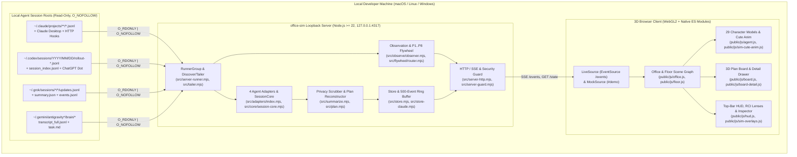
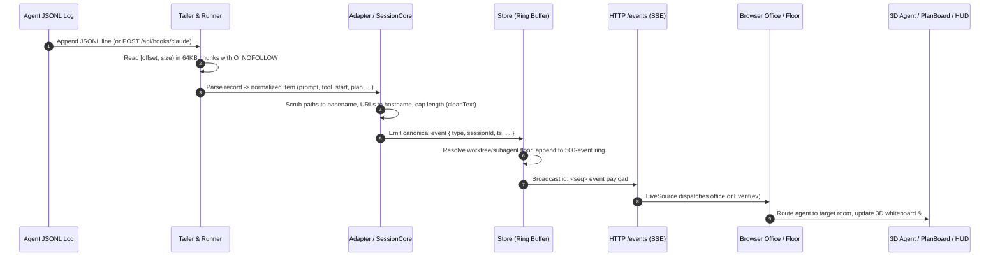

# Software Development Report — Office Sim (`v0.10.1`)

## 1. Document Control, Identification & Executive Summary

> **Standard Alignment**: **ISO/IEC/IEEE 12207:2017** (Systems and software engineering — Software life cycle processes, Technical Management & Measurement Process).

### 1.1 Document Control & Product Identification

| Attribute | Value |
|---|---|
| **Document ID** | `SDR-OFFICE-SIM-2026-01` |
| **Product Name** | `office-sim` (Real-Time 3D Multi-Agent Office Visualizer) |
| **Baseline Version** | `v0.10.1` (Git tag `v0.10.1`, published to npm as `office-sim@0.10.1`) |
| **Repository** | `https://github.com/WahyzMaster/office-sim` |
| **License** | MIT (`LICENSE`) |
| **Runtime Environment** | Server: `Node.js >= 22` (`node:*` built-in ESM only); Client: Browser ES Modules + WebGL2 (`Three.js` via `importmap`) |
| **Runtime Dependencies** | `0` (`package.json` `dependencies` field absent by invariant) |
| **Governing Specifications** | `CLAUDE.md`, `AGENTS.md`, `GEMINI.md`, `docs/CONTRACT.md`, `docs/ADAPTERS.md`, `docs/HISTORY.md` |

### 1.2 Executive Summary

`office-sim` is a zero-dependency local 3D multi-agent office visualizer that discovers and tails local AI coding agent session transcripts every `250ms` (alongside sub-`10ms` Claude Code HTTP hooks via `POST /api/hooks/claude` in `src/hooks-receiver.mjs`) and renders **Claude Code** (CLI & Claude Desktop), **OpenAI Codex** (CLI, IDE & ChatGPT Desktop), **xAI Grok Build** (CLI & Desktop Bot), and **Google Antigravity** (`agy` CLI & Desktop App) collaborating across project floors in real time.

Built under a strict **Zero-Dependency** and **Privacy-by-Default** engineering charter, the server uses exclusively Node.js built-in modules (`node:http`, `node:fs`, `node:path`, `node:crypto`, `node:child_process`) bound to loopback (`127.0.0.1`), opens transcript files with `O_RDONLY | O_NOFOLLOW | O_NONBLOCK`, and scrubs all sensitive payloads so that only tool categories, file basenames, URL hostnames, and short status summaries cross the Server-Sent Events (`/events`) wire boundary.

### 1.3 Quantitative Engineering Baseline (`v0.10.1`)

| Metric Category | Metric | Verified Value | Primary Evidence |
|---|---|---|---|
| **Release Velocity** | Semantic Releases & Commits | `18` releases (`v0.2.0` -> `v0.10.1`), `132+` commits | Git tags, `.github/workflows/publish.yml` |
| **Dependency Footprint** | Production `npm` Dependencies | `0` runtime dependencies | `package.json`, `scripts/verify-dom-invariants.mjs` |
| **Modularity** | Source File Line Cap | `<= 500 lines` per file across `bin/`, `src/`, `public/js/`, `scripts/` | `scripts/verify-dom-invariants.mjs` |
| **Codebase Volume** | Production & Test Source | `~25.2K` lines production (`src/`, `bin/`, `public/`, `scripts/`) + `28.2K` lines tests (`test/`) | `268+` repository `.mjs`/`.js`/`.html` files |
| **Multi-Agent Coverage** | Supported Agent Families | `4` families (`claude-code`, `codex`, `grok`, `antigravity`) across CLI, IDE & Desktop surfaces | `src/adapters/index.mjs`, `docs/ADAPTERS.md` |
| **3D Visual Matrix** | Rooms × Themes × Characters | `7` rooms × `7` architectural themes × `29` 3D character models (`8` LLM cast slots) | `public/js/rooms.js`, `public/js/theme-kit.js`, `public/js/legend-data.js` |
| **Verification Suite** | Automated Test Execution | `1,380` passing tests across `40` suites (`122` test files, `0` failures) | `npm test` (`node --test`) |

---

## 2. System Requirements & Bidirectional Traceability Matrix

> **Standard Alignment**: **ISO/IEC/IEEE 29148:2018** (Systems and software engineering — Life cycle processes — Requirements engineering).

### 2.1 Functional Requirements Traceability (`FR-01` .. `FR-10`)

| Req ID | Requirement Summary | Primary Implementation Modules | Verification Test Suites | Status |
|---|---|---|---|---|
| **FR-01** | **Multi-Agent Log Discovery & Incremental Tailing**: Discover active sessions and tail byte offsets (`250ms` default) plus sub-`10ms` Claude HTTP hooks (`POST /api/hooks/claude`). | `src/discover.mjs`, `src/tailer.mjs`, `src/hooks-receiver.mjs`, `src/adapters/index.mjs`, `src/adapters/claude-code.mjs`, `src/adapters/codex/index.mjs`, `src/adapters/grok/index.mjs`, `src/adapters/antigravity/index.mjs` | `test/tailer.test.mjs`, `test/discover.test.mjs`, `test/p1-p4-roadmap.test.mjs`, `test/adapter-conformance.test.mjs` | Verified |
| **FR-02** | **Subagent Hierarchy & Worktree Floor Routing**: Link parent/child subagents and group git worktrees onto their parent repository floor (`1F`, `2F`, ...). | `src/store.mjs`, `src/store-claude.mjs`, `src/store-link.mjs`, `src/session-identity.mjs` | `test/store.test.mjs`, `test/codex-floor.test.mjs`, `test/grok-floor.test.mjs` | Verified |
| **FR-03** | **Real-Time SSE Streaming & Snapshot Recovery**: Maintain a 500-event ring buffer, stream `/events` with `Last-Event-ID` resume, and serve `/state` snapshots and `/healthz` diagnostics. | `src/server.mjs`, `src/server-runner.mjs`, `src/server-http.mjs`, `src/server-health.mjs`, `public/js/sources.js` | `test/server.test.mjs`, `test/healthz.test.mjs`, `test/e2e.test.mjs` | Verified |
| **FR-04** | **3D Architectural Diorama & Collision Navigation**: Render 7 functional rooms across 7 architectural themes and 29 3D characters with 2D AABB obstacle avoidance and acrobatic stunts. | `public/js/office.js`, `public/js/floor.js`, `public/js/agent.js`, `public/js/rooms.js`, `public/js/theme-kit.js`, `public/js/placement.js` | `test/theme-build.test.mjs`, `test/theme-geometry.test.mjs`, `test/theme-layout-invariants.test.mjs`, `test/agent-flow.test.mjs` | Verified |
| **FR-05** | **SimCity RCI Demand Meter & 5-Mode 3D Lenses**: Compute real-time `R/C/I` demand (`Research / Coding / Infra`) and switch 3D spatial heatmaps (`normal`, `context`, `latency`, `error`, `traffic`) from `#sim-hud-pill`. | `public/js/sim-overlays.js`, `public/js/sim-advisor.js`, `public/js/hud.js`, `public/office.html` | `test/sim-studio-flywheel.test.mjs` | Verified |
| **FR-06** | **Sims-Style Agent Motives, Moodlets & Autonomy**: Derive 4 agent motives (`Context Freshness`, `Tool Momentum`, `Approval Freedom`, `Error Resilience`), moodlets, and autonomous lounge interactions. | `public/js/sim-motives.js`, `public/js/hud.js` | `test/sim-studio-flywheel.test.mjs` | Verified |
| **FR-07** | **Location-Contextual Cute Animations & 3D Micro-Props**: Drive room-specific keyframe profiles, 3D handheld props (`magnifyingGlass`, `keycapWand`, `wrench`), volume-preserving Squash & Stretch, joy-burst hops, and species-specific tetrapod behaviors. | `public/js/sim-cute-anim.js`, `public/js/agent.js`, `public/js/agent-extras.js`, `public/js/pet-mesh.js`, `public/js/bot-mesh.js` | `test/sim-cute-anim.test.mjs` | Verified |
| **FR-08** | **Interactive 3D Plan Board & Detail Drawer**: Raycast clicks on the 3D `meeting` whiteboard, `.sign[data-room="meeting"]`, `li[data-kind="plan"]`, `#inspector` `Plan (B)`, and shortcut `B` to open `#board-detail` with full unclipped checklist items and `P:done/total` floor/sign badges. | `public/js/board-detail.js`, `public/js/board.js`, `public/js/main.js`, `public/js/office.js`, `public/js/sources.js` | `test/board-detail.test.mjs`, `test/plan.test.mjs` | Verified |
| **FR-09** | **Native OS System Notifications & Terminal Focus**: Deliver opt-in macOS/Windows desktop alerts (`--notify`, shortcut `N`) with 5 anti-noise guards and focus the active terminal/IDE tab (`POST /api/focus`, shortcut `T`). | `src/system-notify.mjs`, `public/js/system-notify.js`, `src/terminal-focus.mjs`, `src/session-recap.mjs` | `test/system-notify.test.mjs`, `test/p1-p4-roadmap.test.mjs` | Verified |
| **FR-10** | **Observation Sidecar & Autonomous Improvement Flywheel**: Collect non-invasive shape telemetry (`src/observe/`) and 8-source (`P1..P8`) runtime anomalies (`src/flywheel/`), deduplicate via 24-hex SHA-256 fingerprints, and route Tier A/B/C actions into `Harness²` loop contracts. | `src/observe/observer.mjs`, `src/flywheel/collectors.mjs`, `src/flywheel/router.mjs`, `src/flywheel/control.mjs`, `public/js/flywheel-panel.js`, `public/js/sim-flywheel-viz.js` | `test/observe-core.test.mjs`, `test/flywheel-router.test.mjs`, `test/flywheel-control-http.test.mjs`, `test/flywheel-panel.test.mjs` | Verified |

### 2.2 Non-Functional Requirements Traceability (`NFR-01` .. `NFR-06`)

| Req ID | Quality Attribute | Specification & Threshold | Enforcement Mechanism | Status |
|---|---|---|---|---|
| **NFR-01** | **Zero Runtime Dependencies** | `0` external npm packages in production runtime (`node:*` built-ins only). | `scripts/verify-dom-invariants.mjs` (`package.json` `dependencies` check) | Verified |
| **NFR-02** | **Network & Cross-Site Boundary** | Loopback-only binding (`127.0.0.1`, `localhost`, `::1`), strict `Host`/`Origin`/`Sec-Fetch-Site`/CSP headers, optional `--auth` cookie. | `src/server-guard.mjs`, `test/http-hardening.test.mjs`, `test/http-auth.test.mjs` | Verified |
| **NFR-03** | **Filesystem & Payload Privacy** | `O_RDONLY \| O_NOFOLLOW \| O_NONBLOCK` + `lstat` inode check; strict filename allowlists; basename/hostname scrubbing; zero credential/content leaks. | `docs/CONTRACT.md` §5, `test/privacy.test.mjs`, `test/ref-guard.test.mjs`, `test/adapter-conformance.test.mjs` | Verified |
| **NFR-04** | **Source Modularity & Hygiene** | Every `.mjs`/`.js`/`.html` file `<= 500 lines`; zero `console.log` in `src/`; zero emoticons in markdown governance/report docs. | `scripts/verify-dom-invariants.mjs`, `test/software-development-report.test.mjs` | Verified |
| **NFR-05** | **Bilingual (`ko`/`en`) Parity** | Complete Korean and English localization across all 7 rooms, 7 themes, HUD controls, inspector, and `#demo` scenarios without reload. | `public/js/rooms.js`, `test/browser-names.test.mjs`, `test/board-detail.test.mjs` | Verified |
| **NFR-06** | **Rendering & Tailing Performance** | Hidden-floor culling (`0.6ms` CPU p50 focused floor), shared geometry/material ratchets, and chunked `64 KB` non-starving tailer (`20 MB` in `~316ms`). | `public/js/detail.js`, `test/detail.test.mjs`, `test/theme-geometry.test.mjs`, `test/tailer.test.mjs` | Verified |

---

## 3. Software Architecture & Detailed Design

> **Standard Alignment**: **ISO/IEC/IEEE 42010:2022** (Architecture description), **arc42**, and **IEEE 1016** (Software Design Descriptions).

### 3.1 System Context & Container Architecture (C4 View)

### 3.2 End-to-End Event Pipeline Sequence

### 3.3 Subsystem Decomposition

| Subsystem | Key Modules | Architectural Responsibility |
|---|---|---|
| **CLI & Lifecycle** | `bin/office-sim.mjs`, `src/cli-args.mjs`, `src/open-url.mjs` | Pure CLI flag parsing (`--port`, `--host`, `--agents`, `--notify`, `--replay`, `--auth`, `--open`), process lifecycle, and platform browser launcher. |
| **Discovery & Tailing** | `src/discover.mjs`, `src/tailer.mjs`, `src/core/sidecar.mjs`, `src/desktop-claude.mjs` | Allowlist-only directory scanning, inode/truncation-aware byte-offset tailing, desktop cloud-chat detection, and mtime/size-guarded sidecar metadata watching (`<= 1 MB`). |
| **Canonical Core & Store** | `src/session.mjs`, `src/core/session-core.mjs`, `src/core/tool-summary.mjs`, `src/store.mjs`, `src/store-claude.mjs`, `src/store-link.mjs` | Stateful turn/tool pairing (`R6..R36`), `cleanText` privacy scrubbing, subagent parent linking, git worktree floor coalescing, and snapshot synthesis. |
| **Multi-Agent Adapters** | `src/adapters/index.mjs`, `src/adapters/claude-code.mjs`, `src/adapters/codex/index.mjs`, `src/adapters/grok/index.mjs`, `src/adapters/antigravity/index.mjs` | Translates provider-specific transcript records into canonical `docs/CONTRACT.md` §2 events without leaking raw payloads. |
| **HTTP, Replay & OS Bridge** | `src/server-http.mjs`, `src/server-guard.mjs`, `src/server-health.mjs`, `src/replay.mjs`, `src/system-notify.mjs`, `src/terminal-focus.mjs`, `src/hooks-receiver.mjs` | Serves static assets, `/events` SSE, `/state`, `/healthz`, `/api/notify`, `/api/focus`, `/api/hooks/claude`, and deterministic `--replay` playback. |
| **Observation & Flywheel** | `src/observe/observer.mjs`, `src/observe/control.mjs`, `src/flywheel/collectors.mjs`, `src/flywheel/router.mjs`, `scripts/flywheel/seed-loop-contract.mjs` | Captures categorical telemetry (`P1..P8`), deduplicates anomalies via 24-hex SHA-256 keys, and seeds `Harness²` `L3 -> L1 -> L2` improvement contracts. |
| **3D Scene & Simulation HUD** | `public/js/main.js`, `public/js/office.js`, `public/js/floor.js`, `public/js/agent.js`, `public/js/board.js`, `public/js/board-detail.js`, `public/js/sim-cute-anim.js`, `public/js/sim-overlays.js`, `public/js/sim-motives.js`, `public/js/sim-advisor.js` | Renders multi-floor Three.js scenes, 29 character rigs, 3D handheld micro-props, clickable Plan Board Detail Drawer (`#board-detail`), SimCity RCI lenses, and Sims motives. |

---

## 4. Quality Attributes, Security & Privacy Engineering

> **Standard Alignment**: **ISO/IEC 25010:2023** (Systems and software Quality Requirements and Evaluation — SQuaRE Product Quality Model).

### 4.1 Security & Privacy by Default (`docs/CONTRACT.md` §5)

1. **Network Isolation (`src/server-guard.mjs`)**:
   - The server refuses to bind to any non-loopback interface (`--host` accepts only `127.0.0.1`, `localhost`, or `::1`).
   - Every HTTP request is validated against loopback `Host` allowlists, same-origin `Origin` headers, and `Sec-Fetch-Site` guards (`cross-site` requests are rejected with `403 Forbidden`).
   - Strict Content Security Policy (`CSP`) headers restrict script, style, font, and connection origins. Optional `--auth` mode enforces a per-run random token exchanged for an `HttpOnly; SameSite=Strict` session cookie.
2. **Symlink & Descriptor Safety (`O_NOFOLLOW`)**:
   - All session log readers (`src/tailer.mjs`), metadata watchers (`src/core/sidecar.mjs`, `src/adapters/antigravity/meta.mjs`), desktop watchers (`src/desktop-claude.mjs`, `src/adapters/codex/desktop-cloud.mjs`, `src/adapters/grok/desktop-bot.mjs`), and observation sidecars (`src/observe/observer.mjs`) open files with `O_RDONLY | O_NOFOLLOW | O_NONBLOCK` and verify `st.isFile()` and matching device/inode numbers via `fs.lstatSync` / `fs.fstatSync`.
   - Symlinked directories or files inside `~/.claude`, `~/.codex`, `~/.grok`, or `~/.gemini` are rejected before any byte is read.
3. **Allowlist-Only Discovery & Bait Rejection**:
   - Each adapter scans only explicit filename patterns (`*.jsonl`, `summary.json`, `events.jsonl`, `session_index.jsonl`, `task.md`, `implementation_plan.md`).
   - Non-allowlisted files (`oauth_creds.json`, `.env`, `config.toml`, SQLite databases, `.jsonl.zst` archives, `history.jsonl`, and encrypted `conversations/*.pb` files) are never opened.
4. **Payload Scrubbing (`src/summarize.mjs`, `src/core/tool-summary.mjs`)**:
   - File paths are reduced to `basename(path)`; URLs are reduced to `new URL(u).host`; shell commands are reduced to allowlisted program names via `src/summarize-shell.mjs`.
   - `cleanText` strips embedded absolute paths, `file://` URIs, query strings, bearer tokens, UUID connector segments (`ZERO_UUID`), and email addresses, and truncates strings to strict code-point caps (`80..120` code points).

### 4.2 Performance Efficiency & Resource Management

- **3D Scene Culling & Shared GPU Resources (`public/js/detail.js`, `public/js/theme-kit.js`)**:
  - Unfocused floors disable shadow casting; hidden upper floors skip matrix world updates, character skeletal animations, and CSS2D label projection (`CPU p50` reduced from `1.0ms` to `0.6ms` on focused floor at 10 floors / 60 agents).
  - Geometries and materials are pooled and verified by automated ratchets (`test/theme-geometry.test.mjs`) with zero per-frame allocations inside `tick()` loops.
- **Bounded Memory & Non-Starving I/O (`src/tailer.mjs`, `src/store.mjs`)**:
  - `Tailer` reads growing files in `64 KB` chunks (`readChunkBytes: 65536`) so a `20 MB` burst completes in `~316ms` without blocking the Node.js event loop.
  - `Store` caps the SSE replay ring buffer at `500` events and open-tool tracking maps at `1,000` entries.

### 4.3 Usability, Accessibility & Internationalization

- **Bilingual (`ko`/`en`) Live Switching**: Toggling `#lang-toggle` (`KO` / `EN`) re-renders all HUD labels, 3D room signs, elevator floor badges (`P:done/total`), `#board-detail` checklist drawers, and `#demo` scenarios (`public/js/sources.js`, `public/js/board.js`) in place without page reload.
- **Progressive Disclosure & Keyboard Navigation**: Top bar consolidates primary simulation controls (`#sim-hud-pill` RCI meter + `<select id="sim-lens-select">`) and secondary utilities behind `#sim-more-toggle`, with full keyboard shortcuts (`1-9`, `0`, `B`, `F`, `T`, `M`, `N`, `O`, `R`, `Esc`) and `prefers-reduced-motion` support.

---

## 5. Verification, Validation & Test Report

> **Standard Alignment**: **ISO/IEC/IEEE 29119** (Software Testing) and **IEEE 829** (Software and System Test Documentation).

### 5.1 Verification Architecture & Test Pyramid (`1,380` Tests / `122` Files)

| Verification Layer | Representative Test Files | Coverage Scope |
|---|---|---|
| **Core Parsing, State & Privacy** | `test/records.test.mjs`, `test/session.test.mjs`, `test/summarize.test.mjs`, `test/privacy.test.mjs`, `test/http-hardening.test.mjs` | `R6..R36` state machine transitions, `cleanText` scrubbing, CSP/Origin/Auth guards, and symlink rejection. |
| **Multi-Agent Conformance & Bait Guards** | `test/adapter-conformance.test.mjs`, `test/adapter-grok-conformance.test.mjs`, `test/adapter-codex-conformance.test.mjs`, `test/adapter-antigravity-conformance.test.mjs` | Shared conformance harness (`test/fixtures/conformance.mjs`) verifying schema compliance, deduplication, and zero bait-file reads across all 4 adapters. |
| **3D Geometry, Collision & Animation** | `test/theme-build.test.mjs`, `test/theme-geometry.test.mjs`, `test/theme-layout-invariants.test.mjs`, `test/sim-cute-anim.test.mjs`, `test/agent-flow.test.mjs` | Headless Three.js scene graph instantiation across all 7 themes and 29 character models, 12 geometric invariants, AABB pathfinding, and cute animation profiles. |
| **Interactive HUD & Plan Board Drawer** | `test/board-detail.test.mjs`, `test/sim-studio-flywheel.test.mjs`, `test/browser-names.test.mjs`, `test/share-overlay.test.mjs` | 3D Plan Board raycast, `#board-detail` drawer lifecycle, bilingual live re-localization, RCI/lens HUD persistence, and room sign cues. |
| **Observation, Flywheel & Governance** | `test/observe-core.test.mjs`, `test/flywheel-router.test.mjs`, `test/flywheel-control-http.test.mjs`, `test/flywheel-loop-cli.test.mjs`, `test/software-development-report.test.mjs` | `P1..P8` anomaly collection, SHA-256 deduplication, `L3 -> L1 -> L2` promotion, and living-documentation verification. |

### 5.2 Synthetic Root Isolation & 12 3D Geometric Invariants

- **Synthetic Root Guard (`scripts/fake-root-guard.mjs`)**: Every test (`test/fake-root-guards.test.mjs`) and synthetic stream generator (`scripts/fake-codex-append.mjs`, `scripts/fake-grok-append.mjs`, `scripts/fake-antigravity-append.mjs`) validates that target directories reside strictly inside `os.tmpdir()`, preventing accidental reads or writes to real `~/.claude`, `~/.codex`, `~/.grok`, or `~/.gemini`.
- **12 Automated 3D Spatial Invariants (`test/theme-geometry.test.mjs`)**: Verifies every architectural theme and character rig against `shear` (no non-uniform rotation shearing), `hidden` (no buried meshes), `support` (furniture grounded), `floorTop` (no z-fighting with floor slabs), `ringClear` (context rings unobstructed), `coverage` (all 7 rooms populated), `globe`, `routeClear` (doorways passable), `screenBack`, `coplanar`, `alloc` (zero per-tick leaks), and `random` (seeded determinism).

### 5.3 Continuous Integration & Governance Gates

1. **GitHub Actions CI (`.github/workflows/test.yml`, `.github/workflows/publish.yml`, `.github/workflows/pages.yml`)**: Runs syntax checks (`node --check`), full test suite (`npm test`), package dry-runs across **Node.js 22 and Node.js 24**, OIDC npm publishing, and GitHub Pages deployment.
2. **Domain & Harness² Surface Verifiers (`scripts/verify-dom-invariants.mjs`)**: Enforces 0 dependencies, `<= 500 lines` per file, `O_NOFOLLOW` presence on watchers, and `c1..c8` `Harness²` surface budgets.

---

## 6. Release History, SDLC Governance & Future Roadmap

> **Standard Alignment**: **IEEE 1061** (Software Quality Metrics Methodology) and **Harness² (`INV` / `DOM`)** Autonomous Agentic Engineering Governance.

### 6.1 Chronological Release Ledger (`v0.2.0` -> `v0.10.1`)

| Version | Date | Milestone Summary |
|---|---|---|
| `v0.2.0` | `2026-10-23` | Multi-agent core (`claude-code`, `codex`, `grok`, `antigravity`), 7 architectural themes, 21 characters, `--replay`, `?overlay=1` streamer mode, and automated npm publishing. |
| `v0.3.0` - `v0.3.5` | `2026-10-23..24` | 3D Bot character family (`29` total models), `BotVoice` Web Audio synthesizer, desktop cloud-chat watchers, `Harness²` `DOM` (`c1..c8`) onboarding, and `O_NOFOLLOW` desktop security audit fixes. |
| `v0.4.0` | `2026-10-25` | Customer roadmap `P1..P4`: real-time Claude Code HTTP hooks (`POST /api/hooks/claude`), click-to-focus native TTY/IDE (`T`), 3D Context Fuel Rings, and 1-click Sprint Recap (`M`). |
| `v0.5.0` - `v0.6.0` | `2026-10-25..28` | Native macOS (`osascript`) and Windows (`WinRT Toast`) system notifications (`--notify` / `N`) with 5 anti-noise guards, bilingual EN/KO demo videos, and isometric 3D office favicons. |
| `v0.7.0` | `2026-10-29` | Autonomous `L3 -> Dedup -> L1 -> L2` Improvement Flywheel (`src/flywheel/`, `scripts/flywheel/`) and 4-zone HUD layout. |
| `v0.8.0` - `v0.8.2` | `2026-10-30` | Sims agent motives/moodlets (`public/js/sim-motives.js`), SimCity `R/C/I` demand meter & 5-mode 3D lenses (`public/js/sim-overlays.js`), inline `#sim-hud-pill` top-bar integration (`GLO-1160`), and Dark Mode / progressive disclosure polish (`GLO-1161`). |
| `v0.9.0` | `2026-10-30` | Location-contextual cute animations, 3D handheld micro-props, volume-preserving Squash & Stretch, joy-burst hops, and tetrapod species behaviors (`public/js/sim-cute-anim.js`, `GLO-1162`). |
| `v0.10.0` | `2026-10-30` | Clickable 3D Plan Board raycast, Plan Board Detail Drawer (`#board-detail`), and interactive `.bubble`, `.floortag`, and `.sign` targets (`public/js/board-detail.js`, `GLO-1163`). |
| `v0.10.1` | `2026-10-31` | 3-Loop Plan Board & HUD polish: bilingual live 3D whiteboard/drawer re-localization (`Board.syncOwnerTitle`), 7-step OAuth `#demo` checklist, `P:done/total` floor/sign badges, and room sign occupancy/approval cues (`GLO-1164`). |

### 6.2 SDLC Governance (`Harness²` & 6-Phase Standard Workflow)

Development is governed by the `Harness²` cost hierarchy (`skill -> script -> subagent -> hook -> gate -> memory -> always-on`), separating task-invariant rules (`INV`) from repository-specific domain contracts (`DOM` in `CLAUDE.md`, `AGENTS.md`, `GEMINI.md`). Every change executes the 6-phase `/standard-workflow`:
- **P0 Intake & P1 Worktree Isolation**: Linear issue tracking (`GLO-*`) and isolated Git worktree creation (`.worktrees/<slug>` from `origin/master`).
- **P2 Architecture Fit & P3 4-Pillar Build**: Simultaneous delivery of production code + unit/conformance tests, usage documentation, visual cues, and invariant gates.
- **P4 Independent Multi-Agent Verification & P5 Ship & Land**: Read-only subagent code review verifying zero `HIGH`/`MEDIUM` findings prior to PR squash-merge and automated npm/GitHub release publishing (`.github/workflows/publish.yml`).

### 6.3 Future Engineering Roadmap (Post-`v0.10.1`)

1. **WebGPU Optional Renderer Path**: Progressive enhancement alongside WebGL2 using `Three.js` WebGPU backend and instanced skeletal batching for `100+` concurrent subagents across `20+` floors.
2. **Multi-Session Replay Timeline Scrubber**: Interactive seek/scrub bar in `--replay` mode with bookmarkable turn/error markers and synchronized `#board-detail` state snapshots.
3. **Extended Adapter Ecosystem**: Optional plug-in descriptors for additional local CLI coding agents using the shared `SessionCore` (`src/core/session-core.mjs`) and `test/fixtures/conformance.mjs` verification harness.
